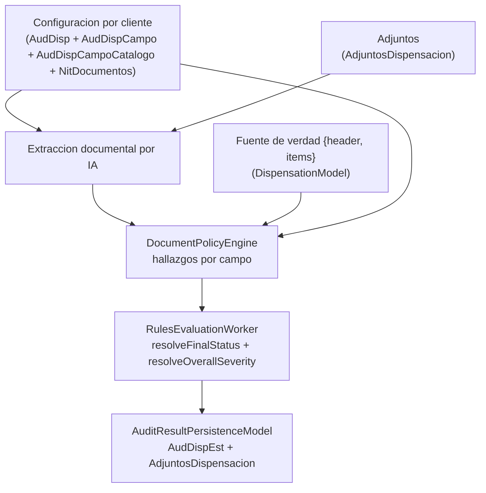
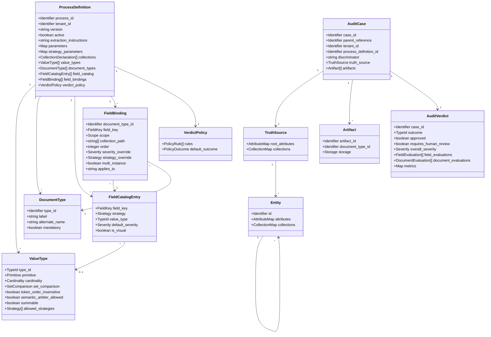
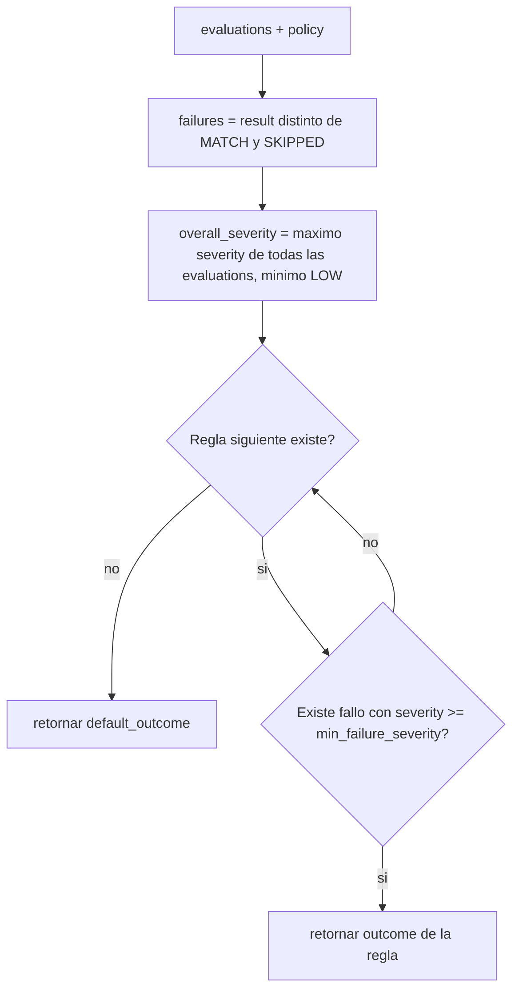

# DOC-01: Especificación del Meta-Modelo de Dominio Agnóstico

## 1. Metadatos y Control de Estado

```yaml
document_id: "DOC-01"
document_name: "SPEC-DOMAIN-METAMODEL"
version: "v0.3.0-review"
status: "REVIEW"
completeness_level: "C"
last_updated: "2026-10-06"
authors:
  - "Agente de IA (skill ddf-agnostic-spec) - borrador sin revision humana"
reviewers: []
assumptions_count:
  S1: 2
  S2: 2
  S3: 0
  S4: 0
unknowns_critical: 3
unknowns_non_critical: 6
```

> [!IMPORTANT]
> Este documento **no está aprobado**. Pasa a `VALIDATED` solo cuando un revisor humano ratifique las decisiones `DEC-01` a `DEC-07` (sección 4.1) y los supuestos `A-01` a `A-07` (sección 6.3). Un revisor asignado reemplaza `reviewers: []`.

> [!IMPORTANT]
> [CONFIRMADO] AudFact no implementa la segmentación por tenants requerida para el SaaS futuro. `NitSec` y `FacNitSec` identifican clientes de negocio, no tenants. Fuente: aclaración del usuario del 2026-10-06 y `ClientsModel::getAllClients()` en `app/Models/ClientsModel.php`, líneas observadas 47-79. Las decisiones canónicas `DEC-P-001` a `DEC-P-003` viven en [SPEC-SAAS-MASTER](SPEC-SAAS-MASTER.md), secciones 4.2 y 4.3: empresa contratante por tenant, con varios clientes/procesos; usuarios con membresías en varios tenants y permisos independientes; y restricciones internas por cliente y proceso además del rol. La configuración actual por cliente no acredita aislamiento multitenant. Las reglas de combinación de alcances se definen en el maestro; los contratos formales de seguridad siguen pendientes de GAP-05.

### 1.1 Control de cambios respecto a v0.1.0

Actualización v0.3.0-review (2026-10-06): contratos únicos de operadores/resultados/Finding de DOC-02, severidad única en Common, parámetros cerrados, SV-07 y publicación directa DEC-P-011. Seguridad, persistencia histórica y extracción SaaS siguen pendientes; completitud C. La verificación actual sustituye el resultado histórico cuyo ejecutable no estaba disponible.


Resolución de los hallazgos de la auditoría [audit_doc01_metamodel.md](file:///C:/Users/USER/.gemini/antigravity-ide/brain/1010cf98-4907-4859-8ab6-8ad5bb8fb778/audit_doc01_metamodel.md).

| Hallazgo | Resolución en v0.2.0 | Dónde |
|---|---|---|
| B1 estados inventados | Se documentan los estados reales (`EstAud` es `BIT`; estados en `EstadoDetallado`). El ciclo de vida se separa del veredicto. | §3.3 R-14, R-16; §4.1 DEC-02 |
| B2 semántica de veredicto divergente | El veredicto es una política declarativa (`verdict_policy`) que reproduce `resolveFinalStatus()`. Casos de paridad ejecutables. | §4.4, §4.6 ALG-02, §7 |
| B3 línea base sobre tablas sin uso | El catálogo operativo es `AudDispCampoCatalogo`. Las tablas de las migraciones 001-003 pasan a `[DESCONOCIDO]`. | §3.4 |
| B4 Nivel A y APPROVED sin respaldo | Estado `REVIEW`, Nivel B, sin autores ni revisores ficticios, sin estadísticas inventadas. | §1, §6.3 |
| B5 contradicción de jerarquía | Decisión explícita `DEC-01` y textos alineados. | §4.1 |
| M1 filtrado léxico | Verificación automática de léxico de dominio y lenguaje ambiguo. | §8 |
| M2 invariantes no ejecutables | Reglas `if/then` en schema, reglas semánticas SV-01 a SV-06 y fixtures negativos. | §4.4, §4.5, §7 |
| M3 inconsistencias schema/texto | `case_id` como identificador de negocio, decimales como cadena, severidades de 3 niveles, `additionalProperties: false`. | §4.4 |
| M4 paridad sobrestimada | Tabla de paridad con estados ✅ / ⚠️ / ❌ y documento responsable. | §5.1 |
| M5 gate del Paso 3 | Algoritmos, diagrama de flujo, contratos de acceso con pre/post-condiciones, sin tipos de runtime. | §4.6, §4.7 |
| M6 trazabilidad rota | Cada caso de prueba tiene fixture ejecutable y matriz bidireccional. | §6.1, §7 |
| m1 a m5 | Citas corregidas; `mime_type` sin enumeración cerrada; `$id` en dominio reservado `.invalid`; sin afirmaciones absolutas. | §3, §4.4 |

---

## 2. Resumen Ejecutivo y Alcance

### 2.1 Problema que Resuelve

El modelo de datos de AudFact está acoplado a un dominio sectorial: columnas de una vista legada, un catálogo de campos con códigos de una letra y un conjunto de tipos de dato con nombres propios del sector. Reescribir la plataforma sin ese acoplamiento exige un contrato de datos único que describa cualquier proceso de auditoría documental por configuración declarativa.

Este documento define ese contrato: el caso a auditar, su fuente de verdad, los artefactos documentales, la definición declarativa del proceso (tipos de documento, catálogo de campos, enlaces campo-documento, tipos de valor y política de veredicto) y el veredicto resultante. Cada elemento se verifica con esquemas JSON, reglas semánticas y fixtures ejecutables.

### 2.2 Alcance Incluido

1. Caso de auditoría (`AuditCase`) y su fuente de verdad jerárquica (`truth_source`).
2. Artefactos documentales (`artifacts`) y su modo de almacenamiento.
3. Definición de proceso (`ProcessDefinition`): tipos de documento, catálogo de campos, enlaces, registro de tipos de valor, colecciones y política de veredicto.
4. Veredicto (`AuditVerdict`): evaluaciones por campo y por documento, resultado global y métricas.
5. Vocabularios cerrados: severidad, resultado de hallazgo y estrategia de comparación.
6. Reglas semánticas de validación del proceso y algoritmos de resolución de valores efectivos y de derivación del veredicto.

### 2.3 Alcance Excluido

| Responsabilidad excluida | Documento responsable |
|---|---|
| Algoritmos de comparación por estrategia, umbrales, normalización de texto, árbitro semántico y selección de documento fallido | DOC-02 |
| Evaluación con colecciones anidadas de profundidad mayor a 1 | DOC-02 |
| Proveedor de IA, construcción del contrato de extracción y calidad de imagen | DOC-03 |
| Puertos completos de datos, almacenamiento, eventos y telemetría; reglas de emparejamiento artefacto-documento | DOC-04 |
| Ciclo de vida de ejecución (`pending`, `processing`, `failed`), eventos, reintentos y DLQ | DOC-05 |
| Biblioteca de tipos de valor con nombre propio, mapeo de nombres legados y migración de configuración de AudFact | DOC-06 |
| Dataset dorado y calibración de paridad | DOC-07 |

### 2.4 Dependencias entre Documentos

| Este documento requiere | Documento fuente | Estado requerido |
|---|---|---|
| Ninguna (documento fundacional) | N/A | N/A |

| Documentos que consumen este contrato | Elementos consumidos |
|---|---|
| DOC-02 | `ComparisonStrategy`, `FindingResult`, `Severity`, `verdict_policy`, `strategy_parameters` |
| DOC-03 | `value_types[].extraction_hint`, `extraction_instructions`, `FieldCatalogEntry` |
| DOC-04 | `AuditCase`, `AuditVerdict`, contratos de acceso (§4.7) |
| DOC-06 | Todos los esquemas como destino del mapeo |

---

## 3. Línea Base en AudFact (Evidencia del Sistema Actual)

Método: lectura directa del código citado y búsquedas por línea sobre `app`, `core`, `bin`, `scripts`, `tests`, `plans`, `database`, `.agent`, `docker` y `.github`. No se consultó la base de datos.

### 3.1 Inventario de Componentes

| Componente | Ruta | Símbolo | Líneas | Propósito | Clasificación |
|---|---|---|---|---|:---:|
| `AuditConfigModel` | [AuditConfigModel.php](file:///c:/Users/USER/Desktop/AudFact/app/Models/AuditConfigModel.php) | `getConfig()` | L28-L119 | Une catálogo, enlaces por cliente y documentos; calcula valores efectivos. | `[CONFIRMADO]` |
| `AuditConfigModel` | idem | `getHeader()` | L124-L142 | Lee `SystemPrompt`, `Activo`, `FactorConv`, `DiasVigencia` de `AudDisp`. | `[CONFIRMADO]` |
| `AuditConfigModel` | idem | `getCatalog()` | L336-L352 | Lee `AudDispCampoCatalogo`. | `[CONFIRMADO]` |
| `AuditConfigController` | [AuditConfigController.php](file:///c:/Users/USER/Desktop/AudFact/app/Controllers/AuditConfigController.php) | `save()`, `sanitizeFields()` | L82-L265 | Validación de la configuración guardada. | `[CONFIRMADO]` |
| `AuditComparisonType` | [AuditComparisonType.php](file:///c:/Users/USER/Desktop/AudFact/app/Services/Audit/AuditComparisonType.php) | enum | L13-L63 | Códigos `E/S/B/V/I/P` y umbrales. | `[CONFIRMADO]` |
| `AuditFieldValueType` | [AuditFieldValueType.php](file:///c:/Users/USER/Desktop/AudFact/app/Services/Audit/AuditFieldValueType.php) | enum | L15-L237 | 13 tipos de dato con comportamiento asociado. | `[CONFIRMADO]` |
| `AuditSeverity` | [AuditSeverity.php](file:///c:/Users/USER/Desktop/AudFact/app/Services/Audit/AuditSeverity.php) | enum | L13-L30 | Severidades `alta/media/baja`. | `[CONFIRMADO]` |
| `AuditFindingResult` | [AuditFindingResult.php](file:///c:/Users/USER/Desktop/AudFact/app/Services/Audit/AuditFindingResult.php) | enum | L12-L30 | Seis resultados de hallazgo y `isFailure()`. | `[CONFIRMADO]` |
| `DispensationModel` | [DispensationModel.php](file:///c:/Users/USER/Desktop/AudFact/app/Models/DispensationModel.php) | `HEADER_FIELDS`, `ITEM_FIELDS`, `formatDispensation()`, filtros | L19-L91, L162-L167 | Fuente de verdad `{header, items}`; filtros exigen ambas llaves. | `[CONFIRMADO]` |
| `AttachmentsModel` | [AttachmentsModel.php](file:///c:/Users/USER/Desktop/AudFact/app/Models/AttachmentsModel.php) | `getAttachmentsByDisDetNro()`, `getPhysicalAttachmentsByDisDetNro()` | L26-L66, L76 en adelante | Adjuntos y tipo de almacenamiento. | `[CONFIRMADO]` |
| `AuditResultPersistenceModel` | [AuditResultPersistenceModel.php](file:///c:/Users/USER/Desktop/AudFact/app/Models/AuditResultPersistenceModel.php) | `persist()`, `upsertAuditResult()`, `persistAttachmentDecisions()`, `executeAttachmentUpdates()` | L40-L95, L148-L188, L231-L331, L336-L418 | Persistencia transaccional del resultado. | `[CONFIRMADO]` |
| `RulesEvaluationWorker` | [RulesEvaluationWorker.php](file:///c:/Users/USER/Desktop/AudFact/app/Services/Audit/Pipeline/RulesEvaluationWorker.php) | `resolveFinalStatus()`, `resolveOverallSeverity()`, `buildAuditResultData()` | L560-L660, L672-L721, L761-L793 | Estado final, severidad global y resultado persistido. | `[CONFIRMADO]` |
| `DocumentPolicyEngine` | [DocumentPolicyEngine.php](file:///c:/Users/USER/Desktop/AudFact/app/Services/Audit/Pipeline/DocumentPolicyEngine.php) | `evaluateSingleDataField()`, `buildDataFinding()`, `evaluateField()`, `evaluateBusinessField()` | L239-L330, L487-L526, L566-L623, L983-L1030 | Construcción de hallazgos. | `[CONFIRMADO]` |
| `DocumentExtractionContractBuilder` | [DocumentExtractionContractBuilder.php](file:///c:/Users/USER/Desktop/AudFact/app/Services/Audit/Pipeline/DocumentExtractionContractBuilder.php) | `groupFields()`, `isItemField()` | L187-L246 | Alcance cabecera/ítem y exclusión de campos internos. | `[CONFIRMADO]` |
| `DocumentAuditOrchestrator` | [DocumentAuditOrchestrator.php](file:///c:/Users/USER/Desktop/AudFact/app/Services/Audit/Pipeline/DocumentAuditOrchestrator.php) | `isServiceApplicable()`, `resolveServiceType()` | L584-L605 | Aplicabilidad de campos por tipo de servicio. | `[CONFIRMADO]` |
| `DocumentMappingRejectionReason` | [DocumentMappingRejectionReason.php](file:///c:/Users/USER/Desktop/AudFact/app/Services/Audit/Pipeline/DocumentMappingRejectionReason.php) | constantes | L9-L13 | Motivos de rechazo de mapeo documental. | `[CONFIRMADO]` |
| `AuditStateStore` | [AuditStateStore.php](file:///c:/Users/USER/Desktop/AudFact/app/Services/Audit/Pipeline/AuditStateStore.php) | constantes | L18-L28 | Estados `pending`, `processing`, `completed`, `manual_review`, `error`, `failed`. | `[CONFIRMADO]` |

### 3.2 Flujo de Datos Actual



### 3.3 Reglas de la Línea Base

| ID | Regla observada | Evidencia | Clasificación |
|---|---|---|:---:|
| R-01 | La unidad auditada es una dispensa identificada por `DisDetNro`; `DisId` es la llave padre. Las consultas de fuente de verdad exigen ambos filtros. La PK operativa de `AudDispEst` es `FacNro` y `FacSec` conserva `DisId`. | [DispensationModel.php:162-167](file:///c:/Users/USER/Desktop/AudFact/app/Models/DispensationModel.php#L162-L167); [AGENTS.md:151-152](file:///c:/Users/USER/Desktop/AudFact/AGENTS.md#L151-L152) | `[CONFIRMADO]` |
| R-02 | La fuente de verdad se parte en `header` (campos de `HEADER_FIELDS`) e `items` (campos de `ITEM_FIELDS`). | [DispensationModel.php:19-69, 78-90](file:///c:/Users/USER/Desktop/AudFact/app/Models/DispensationModel.php#L19-L90) | `[CONFIRMADO]` |
| R-03 | El catálogo operativo de campos es `AudDispCampoCatalogo` con columnas `CampoNombre`, `CodigoCampo`, `TipoCampo`, `TipoDato`, `Descripcion`, `Severidad`, `EsVisual`. | [AuditConfigModel.php:336-341](file:///c:/Users/USER/Desktop/AudFact/app/Models/AuditConfigModel.php#L336-L341) | `[CONFIRMADO]` |
| R-04 | El enlace campo-documento-cliente (`AudDispCampo`) aporta `Orden`, `DescripcionOverride`, `SeveridadOverride`, `TipoCampoOverride`, `AplicaServicio`, `EsMultiItem`. Estrategia efectiva: `COALESCE(TipoCampoOverride, TipoCampo)`. Descripción efectiva: `DescripcionOverride ?? Descripcion ?? ''`. Severidad efectiva: `SeveridadOverride ?? Severidad ??` `'media'` para campos y `'alta'` para controles visuales. | [AuditConfigModel.php:35-50, 82, 92, 103](file:///c:/Users/USER/Desktop/AudFact/app/Models/AuditConfigModel.php#L35-L103) | `[CONFIRMADO]` |
| R-05 | Solo se exportan documentos no opcionales (`NitMedDocOpc = 'N'`). | [AuditConfigModel.php:49](file:///c:/Users/USER/Desktop/AudFact/app/Models/AuditConfigModel.php#L49) | `[CONFIRMADO]` |
| R-06 | Los códigos `E/S/B/V/I/P` se mapean a `exact/semantic/business/visual/internal/presence`; un código desconocido produce `exact`. Umbral textual: `0.82` para `S`, `0.90` en los demás. Coincidencia por contención: solo `S`. | [AuditComparisonType.php:25-62](file:///c:/Users/USER/Desktop/AudFact/app/Services/Audit/AuditComparisonType.php#L25-L62) | `[CONFIRMADO]` |
| R-07 | Existen 13 tipos de dato con rasgos: multivalor documental (`code`, `trace_token`, `article_name`), comparación por subconjunto (`code`), por conjunto igual (`trace_token`), por cobertura (`article_name`), orden de tokens indiferente (`person_name`), árbitro semántico (`article_name`, `person_name`), sumable (`quantity`). | [AuditFieldValueType.php:15-166](file:///c:/Users/USER/Desktop/AudFact/app/Services/Audit/AuditFieldValueType.php#L15-L166) | `[CONFIRMADO]` |
| R-08 | Tipos permitidos por código de estrategia: `B` solo `quantity`; `S` solo `text`, `person_name`, `institution_name`, `article_name`; `E` y `P` todos; los demás ninguno. | [AuditFieldValueType.php:224-237](file:///c:/Users/USER/Desktop/AudFact/app/Services/Audit/AuditFieldValueType.php#L224-L237) | `[CONFIRMADO]` |
| R-09 | Los campos `V` e `I` no se evalúan; los `I` se excluyen del contrato de extracción. Un `TipoDato` vacío en un campo evaluable produce excepción. | [DocumentPolicyEngine.php:250-253, 311-314, 555-558](file:///c:/Users/USER/Desktop/AudFact/app/Services/Audit/Pipeline/DocumentPolicyEngine.php#L250-L314); [DocumentExtractionContractBuilder.php:195-198](file:///c:/Users/USER/Desktop/AudFact/app/Services/Audit/Pipeline/DocumentExtractionContractBuilder.php#L195-L198) | `[CONFIRMADO]` |
| R-10 | Un campo pertenece a ítems si `EsMultiItem`, o su estrategia es `business`, o su tipo de dato es `article_name` o `trace_token`. | [DocumentExtractionContractBuilder.php:228-246](file:///c:/Users/USER/Desktop/AudFact/app/Services/Audit/Pipeline/DocumentExtractionContractBuilder.php#L228-L246) | `[CONFIRMADO]` |
| R-11 | Un campo aplica si `aplica == 'TODOS'`, o el tipo de servicio del caso es `'TODOS'`, o ambos coinciden. El tipo de servicio es el primer `Tipo` no vacío de los ítems, o `'TODOS'`. | [DocumentAuditOrchestrator.php:584-605](file:///c:/Users/USER/Desktop/AudFact/app/Services/Audit/Pipeline/DocumentAuditOrchestrator.php#L584-L605) | `[CONFIRMADO]` |
| R-12 | Un hallazgo de campo contiene `campo`, `valorFuenteVerdad`, `valorDocumento`, `resultado`, `severidad`, `documento`, `detalle`, `tipo_auditoria`, `valueType`, `codigoCampo` y, según el caso, `valoresFuenteVerdad`, `valoresDocumento`, `extraction_meta`. | [DocumentPolicyEngine.php:500-523](file:///c:/Users/USER/Desktop/AudFact/app/Services/Audit/Pipeline/DocumentPolicyEngine.php#L500-L523) | `[CONFIRMADO]` |
| R-13 | Resultados de hallazgo: `COINCIDE`, `VALOR_DISTINTO`, `NO_ENCONTRADO`, `OMITIDO`, `NO_CONCLUYENTE`, `RECHAZADO`. Son fallo todos salvo `COINCIDE` y `OMITIDO`. | [AuditFindingResult.php:14-30](file:///c:/Users/USER/Desktop/AudFact/app/Services/Audit/AuditFindingResult.php#L14-L30) | `[CONFIRMADO]` |
| R-14 | Estado final: algún fallo con severidad `alta` produce `manual_review`; si no, cualquier otro fallo produce `error`; sin fallos produce `completed`. | [RulesEvaluationWorker.php:672-702](file:///c:/Users/USER/Desktop/AudFact/app/Services/Audit/Pipeline/RulesEvaluationWorker.php#L672-L702) | `[CONFIRMADO]` |
| R-15 | Severidad global: máximo entre **todos** los hallazgos (no solo fallos), con valor inicial `baja`. | [RulesEvaluationWorker.php:707-721](file:///c:/Users/USER/Desktop/AudFact/app/Services/Audit/Pipeline/RulesEvaluationWorker.php#L707-L721) | `[CONFIRMADO]` |
| R-16 | `EstAud` es `BIT`: `1` solo si el estado final es `completed`. `RequiereRevisionHumana` es `1` si el estado es `manual_review` o `failed`. | [AuditResultPersistenceModel.php:148](file:///c:/Users/USER/Desktop/AudFact/app/Models/AuditResultPersistenceModel.php#L148); [RulesEvaluationWorker.php:589-595, 621-623](file:///c:/Users/USER/Desktop/AudFact/app/Services/Audit/Pipeline/RulesEvaluationWorker.php#L589-L623) | `[CONFIRMADO]` |
| R-17 | El resultado persistido contiene `EstadoDetallado`, `Severidad`, `Hallazgos` (JSON), `DetalleError` (mensaje resumen), `DocumentosProcesados`, `DocumentoFallido`, `DuracionProcesamientoMs`, `FacNitSec`. | [AuditResultPersistenceModel.php:148-157](file:///c:/Users/USER/Desktop/AudFact/app/Models/AuditResultPersistenceModel.php#L148-L157); [RulesEvaluationWorker.php:618-638](file:///c:/Users/USER/Desktop/AudFact/app/Services/Audit/Pipeline/RulesEvaluationWorker.php#L618-L638) | `[CONFIRMADO]` |
| R-18 | Una decisión documental contiene `documentName`, `approved`, `payload`, `doc_id`, `attachment_id` y, si hay rechazo, `rejection_reason`, `rejection_class`, `rejection_category`, `candidate_attachment_ids`. Motivos de mapeo: `DOCUMENT_ATTACHMENT_MISSING`, `_AMBIGUOUS`, `_NO_CONTENT`, `_REUSED`. | [RulesEvaluationWorker.php:560-583](file:///c:/Users/USER/Desktop/AudFact/app/Services/Audit/Pipeline/RulesEvaluationWorker.php#L560-L583); [DocumentMappingRejectionReason.php:9-13](file:///c:/Users/USER/Desktop/AudFact/app/Services/Audit/Pipeline/DocumentMappingRejectionReason.php#L9-L13) | `[CONFIRMADO]` |
| R-19 | Persistir exige al menos un adjunto. La decisión se empareja primero por `attachment_id` y luego por nombre. Una decisión huérfana rechazada se asigna al adjunto `DISPENSA`, o al primero si no existe. | [AuditResultPersistenceModel.php:237-240, 256-307, 321-331](file:///c:/Users/USER/Desktop/AudFact/app/Models/AuditResultPersistenceModel.php#L237-L331) | `[CONFIRMADO]` |
| R-20 | Tipos de almacenamiento de un adjunto: `BLOB`, `URL`, `SIN_DOCUMENTOS`. | [AttachmentsModel.php:37-41](file:///c:/Users/USER/Desktop/AudFact/app/Models/AttachmentsModel.php#L37-L41) | `[CONFIRMADO]` |
| R-21 | Validación al guardar configuración: severidades `ALTA/MEDIA/BAJA` con valor por defecto `ALTA`; `diasVigencia` entero entre 1 y 365; `campoNombre` debe existir en el catálogo y cumplir `^[A-Za-z0-9_.\-]{1,100}$`; `aplicaServicio` cumple `^[A-Za-z0-9_\-]{1,20}$` con valor por defecto `TODOS`. | [AuditConfigController.php:19, 119-132, 214-265](file:///c:/Users/USER/Desktop/AudFact/app/Controllers/AuditConfigController.php#L19-L265) | `[CONFIRMADO]` |
| R-22 | Las métricas leídas sin valor por defecto son `discrepancias` y `total_campos`; `no_concluyentes` se lee con valor por defecto `0`. | [RulesEvaluationWorker.php:767, 771, 781, 791](file:///c:/Users/USER/Desktop/AudFact/app/Services/Audit/Pipeline/RulesEvaluationWorker.php#L761-L793) | `[CONFIRMADO]` |

### 3.4 Hechos No Verificados

| ID | Hecho | Motivo | Clasificación |
|---|---|---|:---:|
| ~~U-01~~ | Las tablas `AudCatalogoCampo`, `AudCatalogoAlias` y `AudDocTipoCanonicoMap` **no existen en la base de datos** (`Discolnet`). Consulta `INFORMATION_SCHEMA.TABLES` el 2026-10-05 retornó 0 filas. | Cerrado. Las migraciones 001-003 nunca se ejecutaron. Esta especificación no depende de ellas. | `[CONFIRMADO]` |
| ~~U-02~~ | Clave primaria registrada de `AudDispCampo`: `PK_AudDispCampo (FacNitSec, NitMedDocId, CampoNombre)` — (cliente de negocio, documento, campo). Esta unicidad no demuestra aislamiento de tenants. | Consulta `INFORMATION_SCHEMA.KEY_COLUMN_USAGE` del 2026-10-05 registrada en la revisión anterior; no reejecutada en esta sesión. Semántica de cliente: aclaración del usuario del 2026-10-06 y `ClientsModel::getAllClients()`, líneas observadas 47-79. | `[CONFIRMADO]` |
| ~~U-03~~ | Relación entre `EsVisual` y el código `V`: **correlación perfecta**. `TipoCampo='V'` siempre con `EsVisual=true` (3 campos); todos los demás códigos (`E`, `S`, `B`, `I`) con `EsVisual=false`. | Consulta `GROUP BY TipoCampo, EsVisual` sobre `AudDispCampoCatalogo` el 2026-10-05. | `[CONFIRMADO]` |
| U-04 | Valores de calidad de documento distintos de `legible`. | Solo se observa la comparación con `legible` ([DocumentPolicyEngine.php:578](file:///c:/Users/USER/Desktop/AudFact/app/Services/Audit/Pipeline/DocumentPolicyEngine.php#L578)). | `[DESCONOCIDO]` |
| U-05 | Conjunto completo de claves de `metrics`. | Solo se leyeron las de R-22. | `[DESCONOCIDO]` |
| U-06 | Estructura de `timings`. | Producida por `AuditTimingSummarizer`, no leída. | `[DESCONOCIDO]` |
| U-07 | Cómo se calcula `approved` en `mergeCalculatedFindingsIntoDecisions()`. | Función no leída (L800 en adelante). | `[DESCONOCIDO]` |
| U-08 | Prioridad de selección del documento fallido (`AuditFindingRules::findingPriority`). | Función no leída. | `[DESCONOCIDO]` |
| U-09 | Longitud máxima de `SystemPrompt`. | DDL no disponible. | `[DESCONOCIDO]` |

### 3.5 Particularidades Observadas

| ID | Particularidad | Evidencia | Clasificación |
|---|---|---|:---:|
| Q-01 | La consulta de fuente de verdad contiene ramas por cliente (`NitSec IN (...)`, `NitSec = '2426'`) que alteran el origen de columnas. | [DispensationModel.php:205, 240, 246](file:///c:/Users/USER/Desktop/AudFact/app/Models/DispensationModel.php#L205) | `[CONFIRMADO]` |
| Q-02 | Los hallazgos se guardan dos veces en el JSON de resultado (`items` y `field_decisions`). | [RulesEvaluationWorker.php:626-627](file:///c:/Users/USER/Desktop/AudFact/app/Services/Audit/Pipeline/RulesEvaluationWorker.php#L626-L627) | `[CONFIRMADO]` |
| Q-03 | La severidad global cuenta hallazgos que no son fallo (R-15). | [RulesEvaluationWorker.php:710-720](file:///c:/Users/USER/Desktop/AudFact/app/Services/Audit/Pipeline/RulesEvaluationWorker.php#L710-L720) | `[CONFIRMADO]` |
| Q-04 | El tipo de servicio del caso es el primer ítem con `Tipo` no vacío (R-11). | [DocumentAuditOrchestrator.php:590-605](file:///c:/Users/USER/Desktop/AudFact/app/Services/Audit/Pipeline/DocumentAuditOrchestrator.php#L590-L605) | `[CONFIRMADO]` |
| Q-05 | El estado `error` se usa también para discrepancias no altas con auditoría completada. | [RulesEvaluationWorker.php:765-768](file:///c:/Users/USER/Desktop/AudFact/app/Services/Audit/Pipeline/RulesEvaluationWorker.php#L765-L768) | `[CONFIRMADO]` |

---

## 4. Diseño del Contrato Agnóstico (Especificación Técnica)

### 4.1 Decisiones de Diseño

| ID | Decisión | Justificación | Estado |
|---|---|---|---|
| DEC-01 | El modelo de datos admite colecciones anidadas (la entidad contiene colecciones de entidades). `collection_path` es una lista de nombres. La conformidad CL-1 limita la profundidad a 1, igual que la línea base. | El costo en el esquema es una referencia recursiva. La profundidad efectiva la gobierna SV-03. La semántica de evaluación para profundidad mayor a 1 no está definida (DOC-02). | Pendiente de ratificación (A-01) |
| DEC-02 | El veredicto es el resultado de aplicar una política declarativa a los hallazgos. Los estados de ejecución (`pending`, `processing`, `failed`) pertenecen a DOC-05. | R-14 y R-16 muestran que el resultado de reglas y el estado de ejecución son conceptos distintos que comparten una columna. | Decidido |
| DEC-03 | Los tipos de valor son un registro declarativo con rasgos. Esta especificación define el mecanismo; la biblioteca con nombres propios se publica en DOC-06. | R-07 y R-08 muestran que el comportamiento depende de rasgos, no de nombres. | Decidido |
| DEC-04 | `case_id` es la clave de negocio aportada por la fuente. `parent_reference` agrupa casos. No se genera un identificador sintético. | R-01: la unidad auditada ya tiene identificador operativo único y una llave padre. | Pendiente de ratificación (A-02) |
| DEC-05 | Se conservan las seis estrategias de la línea base con nombres neutros. No se incluyen estrategias sin evidencia en el código actual. | R-06. Las extensiones se proponen en DOC-02 con evidencia. | Decidido |
| DEC-06 | La severidad tiene tres niveles: `HIGH`, `MEDIUM`, `LOW`. | R-13 y `AuditSeverity`. | Decidido |
| DEC-07 | Los valores decimales se codifican como cadena. El esquema no admite números no enteros. | Evita errores de representación en comparaciones de cantidad y dinero. | Decidido |

### 4.2 Modelo Conceptual



### 4.3 Vocabularios

| Vocabulario | Valores | Origen en la línea base |
|---|---|---|
| `Severity` | `HIGH`, `MEDIUM`, `LOW`. Orden: `HIGH` > `MEDIUM` > `LOW`. | R-13, `AuditSeverity` |
| `FindingResult` | `MATCH`, `MISMATCH`, `NOT_FOUND`, `SKIPPED`, `INCONCLUSIVE`, `REJECTED`. Son fallo: `MISMATCH`, `NOT_FOUND`, `INCONCLUSIVE`, `REJECTED`. | R-13 |
| `ComparisonStrategy` | Referencia a DOC-02: EXACT, SEMANTIC, QUANTITY_COVERAGE, TOLERANCE, VISUAL, PRESENCE, INTERNAL | BUSINESS legacy se traduce al modo explícito en DOC-06. |
| `Primitive` | `STRING`, `INTEGER`, `DECIMAL`, `DATE`, `DATETIME`, `BOOLEAN` | Esta especificación (DEC-07) |
| `Cardinality` | `SINGLE`, `MULTI` | R-07 multivalor documental |
| `SetComparison` | `NONE`, `SUBSET`, `EQUAL_SET`, `COVERAGE_SET` | R-07: subconjunto, conjunto igual, cobertura |
| `Scope` | `ROOT`, `COLLECTION` | R-02, R-10 |
| `StorageKind` | `STORED_CONTENT`, `REMOTE_URL`, `NONE` | R-20: `BLOB`, `URL`, `SIN_DOCUMENTOS` |

Las estrategias `VISUAL` e `INTERNAL` no evalúan un valor textual: su `value_type` puede ser nulo (R-09). Las demás exigen `value_type`.

### 4.4 Esquemas Formales (JSON Schema 2020-12)

Los identificadores `$id` usan el dominio reservado `.invalid`: no resuelven por diseño. Cada bloque se extrae y valida con [validate-doc-01.cjs](file:///c:/Users/USER/Desktop/AudFact/opt/tools/validate-doc-01.cjs).

#### Esquema común

```json schema
{
  "$schema": "https://json-schema.org/draft/2020-12/schema",
  "$id": "https://schemas.invalid/audit-platform/doc-01/v0.3/common.schema.json",
  "title": "Common",
  "description": "Tipos y vocabularios compartidos por los demás esquemas.",
  "$defs": {
    "Identifier": {
      "type": "string",
      "pattern": "^[A-Za-z0-9][A-Za-z0-9_.:-]{0,319}$"
    },
    "NullableIdentifier": {
      "oneOf": [
        {
          "$ref": "#/$defs/Identifier"
        },
        {
          "type": "null"
        }
      ]
    },
    "FieldKey": {
      "type": "string",
      "pattern": "^[A-Za-z0-9_.-]{1,100}$"
    },
    "TypeId": {
      "type": "string",
      "pattern": "^[A-Z][A-Z0-9_]{0,63}$"
    },
    "NullableTypeId": {
      "oneOf": [
        {
          "$ref": "#/$defs/TypeId"
        },
        {
          "type": "null"
        }
      ]
    },
    "CollectionName": {
      "type": "string",
      "pattern": "^[a-z][a-z0-9_]{0,63}$"
    },
    "Token20": {
      "type": "string",
      "pattern": "^[A-Za-z0-9_-]{1,20}$"
    },
    "NullableToken20": {
      "oneOf": [
        {
          "$ref": "#/$defs/Token20"
        },
        {
          "type": "null"
        }
      ]
    },
    "NullableString": {
      "type": [
        "string",
        "null"
      ]
    },
    "Severity": {
      "enum": [
        "HIGH",
        "MEDIUM",
        "LOW"
      ]
    },
    "NullableSeverity": {
      "oneOf": [
        {
          "$ref": "#/$defs/Severity"
        },
        {
          "type": "null"
        }
      ]
    },
    "FindingResult": {
      "$ref": "https://schemas.invalid/audit-platform/doc-02/v0.2/finding-outcome.schema.json"
    },
    "ComparisonStrategy": {
      "$ref": "https://schemas.invalid/audit-platform/doc-02/v0.2/comparison-strategy.schema.json"
    },
    "NullableComparisonStrategy": {
      "oneOf": [
        {
          "$ref": "#/$defs/ComparisonStrategy"
        },
        {
          "type": "null"
        }
      ]
    },
    "AttributeValue": {
      "oneOf": [
        {
          "type": "string"
        },
        {
          "type": "integer"
        },
        {
          "type": "boolean"
        },
        {
          "type": "null"
        },
        {
          "type": "array",
          "items": {
            "oneOf": [
              {
                "type": "string"
              },
              {
                "type": "integer"
              }
            ]
          }
        }
      ]
    },
    "AttributeMap": {
      "type": "object",
      "propertyNames": {
        "$ref": "#/$defs/FieldKey"
      },
      "additionalProperties": {
        "$ref": "#/$defs/AttributeValue"
      }
    }
  }
}
```

#### Definición de proceso

```json schema
{
  "$schema": "https://json-schema.org/draft/2020-12/schema",
  "$id": "https://schemas.invalid/audit-platform/doc-01/v0.3/process-definition.schema.json",
  "title": "ProcessDefinition",
  "description": "Configuración declarativa de un proceso de auditoría documental.",
  "type": "object",
  "additionalProperties": false,
  "required": [
    "process_id",
    "tenant_id",
    "name",
    "version",
    "active",
    "collections",
    "value_types",
    "document_types",
    "field_catalog",
    "field_bindings",
    "verdict_policy",
    "operator_registry_version"
  ],
  "properties": {
    "process_id": {
      "$ref": "common.schema.json#/$defs/Identifier"
    },
    "tenant_id": {
      "$ref": "common.schema.json#/$defs/Identifier"
    },
    "name": {
      "type": "string",
      "minLength": 1,
      "maxLength": 200
    },
    "version": {
      "type": "string",
      "pattern": "^[0-9]+\\.[0-9]+\\.[0-9]+$"
    },
    "active": {
      "type": "boolean"
    },
    "extraction_instructions": {
      "$ref": "common.schema.json#/$defs/NullableString"
    },
    "parameters": {
      "type": "object",
      "additionalProperties": false,
      "description": "Reservado; sin parámetros ad hoc interpretados por el núcleo."
    },
    "strategy_parameters": {
      "$ref": "https://schemas.invalid/audit-platform/doc-02/v0.2/operator-parameters.schema.json"
    },
    "collections": {
      "type": "array",
      "items": {
        "$ref": "#/$defs/CollectionDeclaration"
      },
      "maxItems": 100
    },
    "value_types": {
      "type": "array",
      "items": {
        "$ref": "#/$defs/ValueType"
      },
      "maxItems": 100
    },
    "document_types": {
      "type": "array",
      "minItems": 1,
      "items": {
        "$ref": "#/$defs/DocumentType"
      },
      "maxItems": 100
    },
    "field_catalog": {
      "type": "array",
      "items": {
        "$ref": "#/$defs/FieldCatalogEntry"
      },
      "maxItems": 1000
    },
    "field_bindings": {
      "type": "array",
      "minItems": 1,
      "items": {
        "$ref": "#/$defs/FieldBinding"
      },
      "maxItems": 2000
    },
    "verdict_policy": {
      "$ref": "#/$defs/VerdictPolicy"
    },
    "operator_registry_version": {
      "const": "1.0.0"
    }
  },
  "$defs": {
    "CollectionDeclaration": {
      "type": "object",
      "additionalProperties": false,
      "required": [
        "path"
      ],
      "properties": {
        "path": {
          "type": "array",
          "minItems": 1,
          "items": {
            "$ref": "common.schema.json#/$defs/CollectionName"
          }
        },
        "label": {
          "type": "string"
        }
      }
    },
    "ValueType": {
      "type": "object",
      "additionalProperties": false,
      "required": [
        "type_id",
        "primitive",
        "cardinality",
        "set_comparison",
        "token_order_insensitive",
        "semantic_arbiter_allowed",
        "summable",
        "allowed_strategies"
      ],
      "properties": {
        "type_id": {
          "$ref": "common.schema.json#/$defs/TypeId"
        },
        "primitive": {
          "enum": [
            "STRING",
            "INTEGER",
            "DECIMAL",
            "DATE",
            "DATETIME",
            "BOOLEAN"
          ]
        },
        "cardinality": {
          "enum": [
            "SINGLE",
            "MULTI"
          ]
        },
        "set_comparison": {
          "enum": [
            "NONE",
            "SUBSET",
            "EQUAL_SET",
            "COVERAGE_SET"
          ]
        },
        "token_order_insensitive": {
          "type": "boolean"
        },
        "semantic_arbiter_allowed": {
          "type": "boolean"
        },
        "summable": {
          "type": "boolean"
        },
        "allowed_strategies": {
          "type": "array",
          "uniqueItems": true,
          "items": {
            "allOf": [
              {
                "$ref": "common.schema.json#/$defs/ComparisonStrategy"
              },
              {
                "not": {
                  "enum": [
                    "VISUAL",
                    "INTERNAL"
                  ]
                }
              }
            ]
          }
        },
        "extraction_hint": {
          "$ref": "common.schema.json#/$defs/NullableString"
        },
        "subset_direction": {
          "enum": [
            "REFERENCE_SUBSET_DOCUMENT",
            "DOCUMENT_SUBSET_REFERENCE"
          ]
        },
        "proper_subset_result": {
          "enum": [
            "MATCH",
            "INCONCLUSIVE"
          ]
        }
      },
      "allOf": [
        {
          "if": {
            "required": [
              "set_comparison"
            ],
            "properties": {
              "set_comparison": {
                "enum": [
                  "SUBSET",
                  "EQUAL_SET",
                  "COVERAGE_SET"
                ]
              }
            }
          },
          "then": {
            "properties": {
              "cardinality": {
                "const": "MULTI"
              }
            }
          }
        },
        {
          "if": {
            "required": [
              "summable"
            ],
            "properties": {
              "summable": {
                "const": true
              }
            }
          },
          "then": {
            "properties": {
              "primitive": {
                "enum": [
                  "INTEGER",
                  "DECIMAL"
                ]
              }
            }
          }
        },
        {
          "if": {
            "required": [
              "allowed_strategies"
            ],
            "properties": {
              "allowed_strategies": {
                "contains": {
                  "enum": [
                    "QUANTITY_COVERAGE",
                    "TOLERANCE"
                  ]
                }
              }
            }
          },
          "then": {
            "properties": {
              "summable": {
                "const": true
              }
            }
          }
        },
        {
          "if": {
            "required": [
              "set_comparison"
            ],
            "properties": {
              "set_comparison": {
                "const": "SUBSET"
              }
            }
          },
          "then": {
            "required": [
              "subset_direction",
              "proper_subset_result"
            ]
          }
        }
      ]
    },
    "DocumentType": {
      "type": "object",
      "additionalProperties": false,
      "required": [
        "type_id",
        "label",
        "mandatory"
      ],
      "properties": {
        "type_id": {
          "$ref": "common.schema.json#/$defs/Identifier"
        },
        "label": {
          "type": "string",
          "minLength": 1,
          "maxLength": 200
        },
        "alternate_name": {
          "$ref": "common.schema.json#/$defs/NullableString"
        },
        "mandatory": {
          "type": "boolean"
        }
      }
    },
    "FieldCatalogEntry": {
      "type": "object",
      "additionalProperties": false,
      "required": [
        "field_key",
        "strategy",
        "value_type",
        "default_severity",
        "is_visual"
      ],
      "properties": {
        "field_key": {
          "$ref": "common.schema.json#/$defs/FieldKey"
        },
        "code": {
          "$ref": "common.schema.json#/$defs/NullableString"
        },
        "strategy": {
          "$ref": "common.schema.json#/$defs/ComparisonStrategy"
        },
        "value_type": {
          "$ref": "common.schema.json#/$defs/NullableTypeId"
        },
        "description": {
          "$ref": "common.schema.json#/$defs/NullableString"
        },
        "default_severity": {
          "$ref": "common.schema.json#/$defs/Severity"
        },
        "is_visual": {
          "type": "boolean"
        }
      },
      "allOf": [
        {
          "if": {
            "required": [
              "strategy"
            ],
            "properties": {
              "strategy": {
                "enum": [
                  "EXACT",
                  "SEMANTIC",
                  "QUANTITY_COVERAGE",
                  "PRESENCE",
                  "TOLERANCE"
                ]
              }
            }
          },
          "then": {
            "properties": {
              "value_type": {
                "type": "string"
              }
            }
          }
        }
      ]
    },
    "FieldBinding": {
      "type": "object",
      "additionalProperties": false,
      "required": [
        "document_type_id",
        "field_key",
        "scope",
        "order",
        "multi_instance",
        "applies_to"
      ],
      "properties": {
        "document_type_id": {
          "$ref": "common.schema.json#/$defs/Identifier"
        },
        "field_key": {
          "$ref": "common.schema.json#/$defs/FieldKey"
        },
        "scope": {
          "enum": [
            "ROOT",
            "COLLECTION"
          ]
        },
        "collection_path": {
          "type": "array",
          "minItems": 1,
          "items": {
            "$ref": "common.schema.json#/$defs/CollectionName"
          }
        },
        "order": {
          "type": "integer",
          "minimum": 0
        },
        "description_override": {
          "$ref": "common.schema.json#/$defs/NullableString"
        },
        "severity_override": {
          "$ref": "common.schema.json#/$defs/NullableSeverity"
        },
        "strategy_override": {
          "$ref": "common.schema.json#/$defs/NullableComparisonStrategy"
        },
        "multi_instance": {
          "type": "boolean"
        },
        "applies_to": {
          "$ref": "common.schema.json#/$defs/Token20"
        },
        "strategy_parameters_override": {
          "$ref": "https://schemas.invalid/audit-platform/doc-02/v0.2/operator-parameters.schema.json"
        }
      },
      "allOf": [
        {
          "if": {
            "required": [
              "scope"
            ],
            "properties": {
              "scope": {
                "const": "COLLECTION"
              }
            }
          },
          "then": {
            "required": [
              "collection_path"
            ]
          }
        },
        {
          "if": {
            "required": [
              "scope"
            ],
            "properties": {
              "scope": {
                "const": "ROOT"
              }
            }
          },
          "then": {
            "not": {
              "required": [
                "collection_path"
              ]
            }
          }
        }
      ]
    },
    "PolicyOutcome": {
      "type": "object",
      "additionalProperties": false,
      "required": [
        "outcome",
        "approved",
        "requires_human_review"
      ],
      "properties": {
        "outcome": {
          "$ref": "common.schema.json#/$defs/TypeId"
        },
        "approved": {
          "type": "boolean"
        },
        "requires_human_review": {
          "type": "boolean"
        }
      }
    },
    "PolicyRule": {
      "type": "object",
      "additionalProperties": false,
      "required": [
        "min_failure_severity",
        "outcome",
        "approved",
        "requires_human_review"
      ],
      "properties": {
        "min_failure_severity": {
          "$ref": "common.schema.json#/$defs/Severity"
        },
        "outcome": {
          "$ref": "common.schema.json#/$defs/TypeId"
        },
        "approved": {
          "type": "boolean"
        },
        "requires_human_review": {
          "type": "boolean"
        }
      }
    },
    "VerdictPolicy": {
      "type": "object",
      "additionalProperties": false,
      "required": [
        "rules",
        "default_outcome"
      ],
      "properties": {
        "rules": {
          "type": "array",
          "items": {
            "$ref": "#/$defs/PolicyRule"
          }
        },
        "default_outcome": {
          "$ref": "#/$defs/PolicyOutcome"
        }
      }
    }
  }
}
```

#### Caso de auditoría

```json schema
{
  "$schema": "https://json-schema.org/draft/2020-12/schema",
  "$id": "https://schemas.invalid/audit-platform/doc-01/v0.3/audit-case.schema.json",
  "title": "AuditCase",
  "description": "Caso a auditar: fuente de verdad jerárquica y artefactos documentales.",
  "type": "object",
  "additionalProperties": false,
  "required": [
    "case_id",
    "tenant_id",
    "process_definition_id",
    "truth_source",
    "artifacts"
  ],
  "properties": {
    "case_id": {
      "$ref": "common.schema.json#/$defs/Identifier"
    },
    "parent_reference": {
      "$ref": "common.schema.json#/$defs/NullableIdentifier"
    },
    "tenant_id": {
      "$ref": "common.schema.json#/$defs/Identifier"
    },
    "process_definition_id": {
      "$ref": "common.schema.json#/$defs/Identifier"
    },
    "discriminator": {
      "$ref": "common.schema.json#/$defs/NullableToken20"
    },
    "truth_source": {
      "type": "object",
      "additionalProperties": false,
      "required": [
        "root_attributes"
      ],
      "properties": {
        "root_attributes": {
          "$ref": "common.schema.json#/$defs/AttributeMap"
        },
        "collections": {
          "$ref": "#/$defs/CollectionMap"
        }
      }
    },
    "artifacts": {
      "type": "array",
      "minItems": 1,
      "items": {
        "$ref": "#/$defs/Artifact"
      }
    }
  },
  "$defs": {
    "CollectionMap": {
      "type": "object",
      "propertyNames": {
        "$ref": "common.schema.json#/$defs/CollectionName"
      },
      "additionalProperties": {
        "type": "array",
        "items": {
          "$ref": "#/$defs/Entity"
        }
      }
    },
    "Entity": {
      "type": "object",
      "additionalProperties": false,
      "required": [
        "attributes"
      ],
      "properties": {
        "id": {
          "$ref": "common.schema.json#/$defs/Identifier"
        },
        "attributes": {
          "$ref": "common.schema.json#/$defs/AttributeMap"
        },
        "collections": {
          "$ref": "#/$defs/CollectionMap"
        }
      }
    },
    "Artifact": {
      "type": "object",
      "additionalProperties": false,
      "required": [
        "artifact_id",
        "storage"
      ],
      "properties": {
        "artifact_id": {
          "$ref": "common.schema.json#/$defs/Identifier"
        },
        "document_type_id": {
          "$ref": "common.schema.json#/$defs/NullableIdentifier"
        },
        "declared_name": {
          "$ref": "common.schema.json#/$defs/NullableString"
        },
        "alternate_name": {
          "$ref": "common.schema.json#/$defs/NullableString"
        },
        "mime_type": {
          "type": [
            "string",
            "null"
          ],
          "pattern": "^[A-Za-z0-9][A-Za-z0-9.+-]*/[A-Za-z0-9][A-Za-z0-9.+-]*$"
        },
        "storage": {
          "type": "object",
          "additionalProperties": false,
          "required": [
            "kind"
          ],
          "properties": {
            "kind": {
              "enum": [
                "STORED_CONTENT",
                "REMOTE_URL",
                "NONE"
              ]
            },
            "uri": {
              "type": [
                "string",
                "null"
              ],
              "format": "uri"
            }
          },
          "allOf": [
            {
              "if": {
                "required": [
                  "kind"
                ],
                "properties": {
                  "kind": {
                    "const": "REMOTE_URL"
                  }
                }
              },
              "then": {
                "required": [
                  "uri"
                ],
                "properties": {
                  "uri": {
                    "type": "string"
                  }
                }
              }
            }
          ]
        }
      }
    }
  }
}
```

#### Veredicto

```json schema
{
  "$schema": "https://json-schema.org/draft/2020-12/schema",
  "$id": "https://schemas.invalid/audit-platform/doc-01/v0.3/audit-verdict.schema.json",
  "title": "AuditVerdict",
  "description": "Resultado de evaluar un caso contra su definición de proceso.",
  "type": "object",
  "additionalProperties": false,
  "required": [
    "case_id",
    "tenant_id",
    "process_definition_id",
    "process_definition_version",
    "outcome",
    "approved",
    "requires_human_review",
    "overall_severity",
    "field_evaluations",
    "document_evaluations",
    "metrics",
    "detail_message",
    "failed_document_ref",
    "documents_processed",
    "duration_ms"
  ],
  "properties": {
    "case_id": {
      "$ref": "common.schema.json#/$defs/Identifier"
    },
    "tenant_id": {
      "$ref": "common.schema.json#/$defs/Identifier"
    },
    "process_definition_id": {
      "$ref": "common.schema.json#/$defs/Identifier"
    },
    "process_definition_version": {
      "type": "string",
      "pattern": "^[0-9]+\\.[0-9]+\\.[0-9]+$"
    },
    "outcome": {
      "$ref": "common.schema.json#/$defs/TypeId"
    },
    "approved": {
      "type": "boolean"
    },
    "requires_human_review": {
      "type": "boolean"
    },
    "overall_severity": {
      "$ref": "common.schema.json#/$defs/Severity"
    },
    "field_evaluations": {
      "type": "array",
      "items": {
        "$ref": "#/$defs/FieldEvaluation"
      }
    },
    "document_evaluations": {
      "type": "array",
      "items": {
        "$ref": "#/$defs/DocumentEvaluation"
      }
    },
    "metrics": {
      "type": "object",
      "required": [
        "total_fields",
        "discrepancies"
      ],
      "properties": {
        "total_fields": {
          "type": "integer",
          "minimum": 0
        },
        "discrepancies": {
          "type": "integer",
          "minimum": 0
        },
        "inconclusive": {
          "type": "integer",
          "minimum": 0
        }
      },
      "additionalProperties": {
        "type": "integer",
        "minimum": 0
      }
    },
    "detail_message": {
      "type": "string"
    },
    "failed_document_ref": {
      "$ref": "common.schema.json#/$defs/NullableString"
    },
    "documents_processed": {
      "type": "integer",
      "minimum": 0
    },
    "duration_ms": {
      "type": "integer",
      "minimum": 0
    },
    "timings": {
      "type": [
        "object",
        "null"
      ]
    }
  },
  "$defs": {
    "FieldEvaluation": {
      "$ref": "https://schemas.invalid/audit-platform/doc-02/v0.2/finding.schema.json"
    },
    "DocumentEvaluation": {
      "type": "object",
      "additionalProperties": false,
      "required": [
        "document",
        "approved"
      ],
      "properties": {
        "document": {
          "type": "string",
          "minLength": 1
        },
        "approved": {
          "type": "boolean"
        },
        "observation": {
          "$ref": "common.schema.json#/$defs/NullableString"
        },
        "document_type_id": {
          "$ref": "common.schema.json#/$defs/NullableIdentifier"
        },
        "artifact_id": {
          "$ref": "common.schema.json#/$defs/NullableIdentifier"
        },
        "rejection": {
          "oneOf": [
            {
              "type": "null"
            },
            {
              "type": "object",
              "additionalProperties": false,
              "required": [
                "reason"
              ],
              "properties": {
                "reason": {
                  "type": "string",
                  "minLength": 1
                },
                "class": {
                  "$ref": "common.schema.json#/$defs/NullableString"
                },
                "category": {
                  "$ref": "common.schema.json#/$defs/NullableString"
                },
                "candidate_artifact_ids": {
                  "type": "array",
                  "items": {
                    "$ref": "common.schema.json#/$defs/Identifier"
                  }
                }
              }
            }
          ]
        },
        "payload": {
          "type": [
            "object",
            "null"
          ]
        }
      }
    }
  }
}
```

### 4.5 Reglas Semánticas

JSON Schema no expresa referencias cruzadas entre elementos de un arreglo. Las siguientes reglas se aplican después del esquema y las implementa [validate-doc-01.cjs](file:///c:/Users/USER/Desktop/AudFact/opt/tools/validate-doc-01.cjs). El parámetro `max_collection_depth` es el nivel de conformidad (CL-1 = 1).

| Regla | Condición exigida sobre una `ProcessDefinition` |
|---|---|
| SV-01 | Todo `field_catalog[].value_type` no nulo existe en `value_types[].type_id`. |
| SV-02 | Todo `field_bindings[].document_type_id` existe en `document_types[].type_id` y todo `field_bindings[].field_key` existe en `field_catalog[].field_key`. |
| SV-03 | Todo `collection_path` usado por un enlace está declarado en `collections`; todo prefijo de una colección declarada también está declarado; ninguna longitud supera `max_collection_depth`. |
| SV-04 | Sea `E` la estrategia efectiva (ALG-01). Si `E` no es `VISUAL` ni `INTERNAL`, el `value_type` del campo es no nulo y `E` pertenece a `allowed_strategies` de ese tipo. |
| SV-05 | Un mismo código `outcome` que aparece en varias reglas o en `default_outcome` conserva los mismos valores de `approved` y `requires_human_review`. |
| SV-07 | Cada enlace resuelve parámetros cerrados del operador efectivo, con operator_registry_version = 1.0.0. SEMANTIC/TOLERANCE requieren parámetros explícitos. factor_source referencia un campo numérico SINGLE sumable y una ubicación declarada (SV-03). Ningún operador desconocido pasa a EXACT. |
| SV-06 | Son únicos: `value_types[].type_id`, `document_types[].type_id`, `field_catalog[].field_key`, `collections[].path` y el par (`document_type_id`, `field_key`) en `field_bindings`. |

### 4.5.1 Valores canónicos vinculados al proceso

La validación de un caso exige el schema y luego SV-CASE-01: tenant y process_definition_id coinciden con el perfil resuelto por contexto autorizado; los tipos documentales conocidos pertenecen a ese perfil. No resolver perfiles globalmente por process_id.

SV-CASE-02 valida cada atributo presente vinculado, recorriendo la ubicación ROOT o COLLECTION del enlace. SINGLE admite un escalar del tipo o null; MULTI admite un arreglo de escalares del tipo o null. null y ausencia se conservan para la política de evaluación; no se convierten en cero ni cadena vacía. Un valor fuera del tipo produce CASE_VALUE_INVALID antes de comparar; ilegibilidad y fallo de extracción se clasifican mediante el contrato de extracción de GAP-08.

| Primitive | Representación canónica después de normalización |
|---|---|
| STRING | Cadena, sin coerción de booleanos/números. Las claves de códigos e identidades conservan ceros iniciales. |
| INTEGER | Número entero JSON dentro de ±9007199254740991. Fuera del rango exigir conversión explícita a DECIMAL, sin redondear. |
| DECIMAL | Cadena `^-?(0|[1-9][0-9]*)(\\.[0-9]+)?$`, hasta 128 caracteres. Sin separadores locales/exponentes. |
| DATE | Cadena YYYY-MM-DD que representa una fecha válida; 2026-02-30 falla. |
| DATETIME | RFC 3339 con zona explícita. No asumir zona local de máquina. |
| BOOLEAN | true/false JSON; rechazar las cadenas "true"/"false". |

Los formatos de documentos de origen se normalizan por un contrato versionado antes de entrar al caso canónico; DATE no elige silenciosamente entre DD/MM y MM/DD. Zona/locale/residencia específicos se cierran en GAP-10. La prueba de estos tipos no demuestra autenticación ni aislamiento de almacenamiento.

### 4.5.2 Semántica de colecciones de valores

| Rasgo | Regla canónica |
|---|---|
| NONE | SINGLE compara el escalar; MULTI sin una política de conjuntos y con valores distintos produce INCONCLUSIVE por ambigüedad. |
| SUBSET | Conjuntos iguales → MATCH. Exigir subset_direction explícita: REFERENCE_SUBSET_DOCUMENT o DOCUMENT_SUBSET_REFERENCE. Si la relación no se cumple → MISMATCH; subconjunto propio → proper_subset_result explícito (MATCH o INCONCLUSIVE). No intercambiar orientación por nombres de campos. |
| EQUAL_SET | Conjuntos normalizados iguales → MATCH; cualquier diferencia → MISMATCH. |
| COVERAGE_SET | Cada elemento de referencia debe tener una correspondencia documental según EXACT o SEMANTIC; pueden sobrar elementos documentales y reutilizarse correspondencias. Sin cobertura completa → INCONCLUSIVE. |

El orden y las repeticiones no afectan estos conjuntos; no aplicar reglas de suma a conjuntos de códigos. Los valores ausentes/ilegibles se clasifican antes de comparar. Estos rasgos forman parte del perfil, sin seleccionar reglas por nombres de tipos de un negocio. Los normalizadores y el emparejamiento semántico se calibran en GAP-08/11; sus implementaciones todavía no están verificadas.

### 4.6 Algoritmos

#### ALG-01 ResolverEnlaceEfectivo

```
ENTRADA: binding: FieldBinding, entry: FieldCatalogEntry   (entry.field_key == binding.field_key)
SALIDA:  { strategy, severity, description }

1. strategy    <- binding.strategy_override si no es nulo; si no, entry.strategy
2. severity    <- binding.severity_override si no es nulo; si no, entry.default_severity
3. description <- binding.description_override si no es nulo; si no, entry.description; si no, ""
4. retornar { strategy, severity, description }
```

#### ALG-02 DerivarVeredicto

```
ENTRADA: policy: VerdictPolicy, evaluations: FieldEvaluation[]
SALIDA:  { outcome, approved, requires_human_review, overall_severity }
ORDEN:   HIGH = 3, MEDIUM = 2, LOW = 1

1. failures <- los elementos de evaluations cuyo result no es MATCH ni SKIPPED
2. overall_severity <- LOW
3. Para cada e en evaluations:
   3.1. Si rank(e.severity) > rank(overall_severity): overall_severity <- e.severity
4. Para cada rule en policy.rules, en el orden dado:
   4.1. Si existe f en failures con rank(f.severity) >= rank(rule.min_failure_severity):
        retornar { rule.outcome, rule.approved, rule.requires_human_review, overall_severity }
5. retornar { policy.default_outcome.outcome, policy.default_outcome.approved,
              policy.default_outcome.requires_human_review, overall_severity }
```

El paso 3 considera todos los hallazgos, no solo los fallos, para reproducir R-15.



#### ALG-03 ValidarProceso

```
ENTRADA: pd: ProcessDefinition (ya valida contra su esquema), max_collection_depth: integer
SALIDA:  lista de violaciones { regla, detalle }; vacia si pd es valida

1. Aplicar SV-06 sobre pd.
2. Aplicar SV-01 y SV-02 sobre pd.
3. Para cada binding en pd.field_bindings:
   3.1. entry <- elemento de pd.field_catalog con la misma field_key
   3.2. { strategy } <- ALG-01(binding, entry)
   3.3. Aplicar SV-04 con strategy.
   3.4. Si binding.scope == COLLECTION: aplicar SV-03 sobre binding.collection_path.
4. Aplicar SV-03 sobre pd.collections.
5. Aplicar SV-05 sobre pd.verdict_policy.
6. Aplicar SV-07 a todos los enlaces efectivos.
7. retornar las violaciones acumuladas
```

### 4.7 Contratos de Acceso

Firmas mínimas que requiere este contrato de datos. La especificación completa de puertos pertenece a DOC-04.

| Operación | Precondición | Postcondición | Fallos |
|---|---|---|---|
| `obtenerCaso(tenantId, caseId) -> AuditCase` | Contexto autorizado; `tenantId` y `caseId` cumplen `Identifier`. | El resultado valida contra `AuditCase`; `case_id` y `tenant_id` coinciden con los solicitados. | `CASE_NOT_FOUND` si la fuente no tiene el caso. `SOURCE_UNAVAILABLE` si la fuente no responde. |
| `obtenerProceso(tenantId, processId, publishedVersion) -> ProcessDefinition` | `processId` cumple `Identifier`. | El resultado valida contra `ProcessDefinition`, coincide con tenant/proceso/versión y ALG-03 retorna una lista vacía. | `PROCESS_NOT_FOUND`, `PROCESS_INACTIVE` si `active` es falso, `PROCESS_INVALID` si ALG-03 retorna violaciones. |
| `abrirContenido(tenantId, caseId, artifactId) -> flujo de bytes` | El artefacto pertenece al caso y su `storage.kind` no es `NONE`. | El flujo entrega el contenido completo del artefacto. | `ARTIFACT_NO_CONTENT` si `kind` es `NONE`. `ARTIFACT_UNAVAILABLE` si el almacenamiento no responde. |
| `guardarVeredicto(tenantId, executionId, verdict) -> vacío` | Contexto autorizado; tenant de verdict coincide; resultado valida y executionId identifica la ejecución admitida. | Resultado automático inmutable por ejecución. Una repetición idéntica es idempotente; una diferente en la misma ejecución produce RESULT_CONFLICT. Reproceso crea ejecución nueva; cambiar el puntero vigente conserva el historial. | VERDICT_INVALID, RESULT_CONFLICT, STORE_UNAVAILABLE. Contrato transaccional/envelope pendientes de GAP-07. |

### 4.7.1 Publicación de configuración — diseño futuro

DEC-P-011 permite publicar directamente a un administrador con permiso de publicación para ese tenant/proceso. El permiso de edición es distinto; no exige segunda aprobación en el MVP.

`PublicarConfiguracion(contextoAutorizado, processId, expectedDraftRevision)`:

1. Resolver tenant, membresía y alcance desde credenciales verificadas; comprobar permiso de publicación. El cuerpo no constituye autoridad para tenant ni permisos.
2. Leer una revisión concreta del borrador y registro admitido. Rechazar revisión obsoleta e identidad de proceso/tenant diferente.
3. Validar schema, SV-01 a SV-07, límites CL-1 y capacidades exigidas. Compilar referencias a versiones exactas de operadores, normalizador y extracción; dependencias ausentes impiden publicar. El resultado identifica revisión y digest del contenido.
4. En una transacción comparar de nuevo expectedDraftRevision y digest; crear versión inmutable y activar el puntero para nuevas admisiones. Si cambia el borrador entre validación y commit, rechazar con REVISION_CONFLICT.
5. Registrar actor, tenant/proceso, revisión, digest, versiones resueltas y fecha. Un error conserva la versión activa anterior. Las auditorías admitidas conservan su versión fijada.

Son requisitos de implementación. Autorización ejecutable pertenece a GAP-05; transacción, eventos y referencias por ejecución a GAP-07. El comprobador de schemas no demuestra estas propiedades del runtime.

### 4.8 Invariantes

| ID | Invariante | Verificación |
|---|---|---|
| INV-01 | El par (`tenant_id`, `case_id`) identifica un único caso; existe un único veredicto vigente por caso. | Contrato de `guardarVeredicto` (§4.7) |
| INV-02 | Un enlace con `scope = COLLECTION` tiene `collection_path`; uno con `scope = ROOT` no lo tiene. | Esquema `FieldBinding` (fixtures N-01, N-02) |
| INV-03 | Un campo con estrategia distinta de `VISUAL` e `INTERNAL` tiene `value_type` no nulo. | Esquema `FieldCatalogEntry` (fixture N-03) y SV-04 |
| INV-04 | Un tipo de valor con comparación por conjuntos es multivalor; un tipo sumable es numérico; un tipo que admite `QUANTITY_COVERAGE` o `TOLERANCE` es sumable. | Esquema `ValueType` (fixtures N-04, N-05) |
| INV-05 | Ningún valor de atributo es un número no entero. | Esquema `AttributeValue` (fixture C-01) |
| INV-06 | `DerivarVeredicto` es una función pura: mismos hallazgos y política producen el mismo resultado. | Casos TC-VP (§7.3) |
| INV-07 | Un artefacto con `storage.kind = REMOTE_URL` tiene `uri` no nula. | Esquema `Artifact` (fixture C-03) |

---

## 5. Análisis de Impacto Inverso y Verificación de Abstracción

### 5.1 Tabla de Cobertura y Paridad

Leyenda: ✅ cubierto por este documento; ⚠️ cubierto parcialmente o delegado a otro documento; ❌ no cubierto.

| Línea base | Contrato agnóstico | Estado | Nota |
|---|---|:---:|---|
| R-01 unidad auditada y llave padre | `case_id` + `parent_reference` (DEC-04) | ✅ | La traducción de `DisDetNro` y `DisId` es mapeo de DOC-06. |
| R-02 fuente de verdad `{header, items}` | `truth_source.root_attributes` + `collections` | ✅ | Los nombres de columna son claves de atributo definidas por el perfil. |
| R-03 catálogo de campos | `field_catalog[]` | ✅ | `TipoCampo` pasa a `strategy`; `TipoDato` a `value_type`; `Severidad` a `default_severity`; `EsVisual` a `is_visual`. |
| R-04 enlaces, valores efectivos | `field_bindings[]` + ALG-01 | ⚠️ | Los valores por defecto de severidad (`media` campos, `alta` controles visuales) se materializan en `default_severity` durante la migración (DOC-06). |
| R-05 documentos no opcionales | `document_types[].mandatory` | ✅ | El perfil filtra por `NitMedDocOpc` al construir el proceso. |
| R-06 estrategias y códigos | `ComparisonStrategy` | ⚠️ | Vocabulario cubierto. Umbrales `0.82`/`0.90` y contención se transportan en `strategy_parameters` y los define DOC-02. |
| R-07 tipos de dato y rasgos | `value_types[]` | ✅ | Trece tipos expresables con rasgos; biblioteca en DOC-06. `institution_name` e `identity_*` no tienen rasgos propios y se expresan con rasgos vacíos. |
| R-08 tipos permitidos por estrategia | `allowed_strategies` + SV-04 | ✅ | |
| R-09 campos no evaluables | estrategias `VISUAL`/`INTERNAL` con `value_type` nulo | ✅ | |
| R-10 alcance cabecera/ítem | `scope` + `collection_path` explícitos | ⚠️ | La regla derivada (R-10) se evalúa una vez en la migración (DOC-06) para fijar `scope`. |
| R-11 aplicabilidad por tipo de servicio | `discriminator` + `applies_to` | ⚠️ | Regla de comparación de tokens definida por DOC-02. El adaptador calcula el `discriminator` (Q-04). |
| R-12 estructura del hallazgo | `FieldEvaluation` | ✅ | Los campos opcionales de R-12 quedan en `source_values`, `document_values`, `extraction_meta`. |
| R-13 resultados de hallazgo | `FindingResult` | ✅ | |
| R-14 estado final | `verdict_policy` + ALG-02 | ✅ | Casos TC-VP-03 a TC-VP-08. |
| R-15 severidad global | `overall_severity` + ALG-02 | ✅ | Reproduce Q-03; DOC-02 decide si se conserva. |
| R-16 `EstAud`, revisión humana | `approved`, `requires_human_review` | ⚠️ | `failed` produce revisión humana en AudFact; ese estado pertenece al ciclo de vida (DOC-05). |
| R-17 columnas del resultado | campos de `AuditVerdict` | ⚠️ | `DocumentosProcesados`, `DocumentoFallido`, `DuracionProcesamientoMs`, `DetalleError` cubiertos. La selección del documento fallido (U-08) la define DOC-02. |
| R-18 decisión documental y rechazos | `DocumentEvaluation.rejection` | ✅ | |
| R-19 emparejamiento y adjunto de reserva | n/a | ❌ | Fuera del meta-modelo. Responsable: DOC-04 (emparejamiento) y DOC-05 (persistencia de decisiones). |
| R-20 tipos de almacenamiento | `Artifact.storage.kind` | ✅ | |
| R-21 validaciones de configuración | patrones de `Identifier`, `FieldKey`, `Token20`; severidades | ⚠️ | El rango `diasVigencia` 1-365 es validación del perfil (DOC-06). |
| R-22 métricas | `metrics` | ⚠️ | Claves de R-22 cubiertas; el resto es U-05. |
| Q-01 ramas por cliente | fuente de verdad ya resuelta por el adaptador | ✅ | Las ramas dejan de existir en el núcleo. |
| Q-02 hallazgos duplicados | un solo arreglo `field_evaluations` | ✅ | Eliminación intencional. |
| `SystemPrompt`, `FactorConv`, `DiasVigencia` | `extraction_instructions`, `parameters` | ✅ | Semántica de `FactorConv` y vigencia: DOC-02. |

### 5.2 Prueba de Dominio Dual

Los fixtures `pd-health` y `pd-logistics` (§7.2) son dos definiciones de proceso de dominios distintos. Ambas validan contra el mismo esquema y pasan ALG-03. Los casos TC-VP-09 y TC-VP-10 aplican `ALG-02` con políticas de resultados con nombres distintos (`REQUIRES_REVIEW` frente a `HOLD_SHIPMENT`). El fixture `pd-nested` demuestra colecciones anidadas bajo `max_collection_depth = 2`.

### 5.3 Auditoría de Fugas de Abstracción

La verificación es automática: [validate-doc-01.cjs](file:///c:/Users/USER/Desktop/AudFact/opt/tools/validate-doc-01.cjs) busca los siguientes términos en la sección 4 completa, incluidos los esquemas, y falla si encuentra alguno.

| Término buscado (sin distinguir mayúsculas) |
|---|
| `paciente`, `medico`/`médico`, `medicamento`, `dispensa*`, `formula`/`fórmula`, `receta`, `prescri*`, `farmac*` |
| `EPS`, `IPS`, `ARL`, `CUM`, `Mipres`, `NIT`, `factura` |
| `Discolnet`, `AudDisp`, `Z-IA` |

---

## 6. Matriz de Trazabilidad y Riesgos

### 6.1 Trazabilidad Bidireccional

| Requisito | Elemento del contrato | Verificación |
|---|---|---|
| Configuración declarativa de proceso | `ProcessDefinition` | pd-health, pd-logistics, N-01 a N-12 |
| Reproducir estado final de AudFact (R-14) | `verdict_policy` + ALG-02 | TC-VP-01 a TC-VP-08 |
| Reproducir severidad global (R-15) | ALG-02 paso 3 | TC-VP-02, TC-VP-07 |
| Política independiente del dominio | `verdict_policy` | TC-VP-09, TC-VP-10 |
| Integridad referencial del proceso | SV-01 a SV-06 | N-06 a N-12 |
| Fuente de verdad sin números no enteros | `AttributeValue` | C-01 |
| Caso con al menos un artefacto | `AuditCase.artifacts.minItems` | C-02 |
| Almacenamiento remoto con URI | `Artifact.storage` | C-03 |
| Identificador de caso válido | `Identifier` | C-04 |
| Colecciones anidadas en el modelo de datos | `Entity`, `CollectionMap` | case-nested |
| Límite de profundidad por conformidad | SV-03 | pd-nested, N-13 |
| Veredicto sin propiedades desconocidas | `additionalProperties: false` | V-02 |
| Severidad global limitada al vocabulario | `Severity` | V-01 |

### 6.2 Riesgos

| ID | Riesgo | Probabilidad | Impacto | Mitigación |
|---|---|:---:|:---:|---|
| RISK-01 | La ratificación de DEC-01 cambia la profundidad requerida y obliga a definir evaluación anidada en DOC-02. | Media | Medio | CL-1 limita a profundidad 1; SV-03 aplica el límite. |
| RISK-02 | Los rasgos de `ValueType` no cubren un tipo de dato de otro dominio. | Media | Medio | El registro es extensible con rasgos nuevos versionados; cada rasgo nuevo exige evidencia en DOC-02. |
| RISK-03 | Reproducir R-15 propaga una particularidad (Q-03) a la plataforma nueva. | Baja | Bajo | El paso 3 de ALG-02 está aislado; DOC-02 puede reemplazarlo sin cambiar el esquema. |
| RISK-04 | La tabla de la migración 001-003 sí está en uso en la base de datos. | Baja | Bajo | La especificación no depende de ella (U-01). |

### 6.3 Supuestos y Decisiones Pendientes

| ID | Supuesto | Severidad | Ruta de validación |
|---|---|:---:|---|
| A-01 | La plataforma necesita colecciones anidadas en el modelo de datos aunque CL-1 las limite a profundidad 1 (DEC-01). | S2 | Ratificación del revisor; evaluación anidada en DOC-02. |
| ~~A-02~~ | `DisDetNro` (`FacNro`) es único: 158,775 filas con 158,775 valores distintos (100%). | ~~S2~~ Confirmado | Consulta `COUNT(*) vs COUNT(DISTINCT FacNro)` sobre `AudDispEst` el 2026-10-05. |
| A-03 | Los tipos `institution_name` e `identity_*` no tienen comportamiento propio en la línea base y se expresan con rasgos vacíos. | S2 | Lectura de `DocumentPolicyEngine` completo en DOC-02. |
| ~~A-04~~ | `EsVisual` y el código `V` coinciden al 100% en la configuración vigente (U-03 cerrado). | ~~S1~~ Confirmado | Consulta del 2026-10-05. |
| ~~A-05~~ | La unicidad `(documento, campo)` por cliente de negocio está registrada en la PK `PK_AudDispCampo (FacNitSec, NitMedDocId, CampoNombre)` (U-02 cerrado). No confirma unicidad ni aislamiento por tenant SaaS. | ~~S1~~ Confirmado para cliente legado | Consulta del 2026-10-05 registrada en la revisión anterior, no reejecutada; semántica aclarada por el usuario del 2026-10-06 y `ClientsModel::getAllClients()`, líneas observadas 47-79. |
| A-06 | `metrics` admite claves adicionales enteras (U-05). | S1 | Lectura de la construcción de métricas en DOC-02. |
| A-07 | `timings` y `extraction_meta` pueden modelarse como objetos opacos en este contrato (U-06). | S1 | Especificación de telemetría en DOC-04. |

---

### 6.5 Contratos SaaS pendientes — información faltante de impacto S3

| ID | Información faltante | Propietario / gate |
|---|---|---|
| U-SAAS-01 | Contexto autenticado, membresía, permisos y alcances ejecutables. | GAP-05; impide declarar seguro el acceso a casos/perfiles. |
| U-SAAS-02 | Envelope por ejecución, transacción de publicación, eventos e historial inmutable del resultado. | GAP-07; guardarVeredicto es contrato futuro, sin prueba de persistencia. |
| U-SAAS-03 | Schemas finales de normalizador/extracción y prueba de capacidades del proveedor. | GAP-08/10; el perfil no acredita una capacidad por solicitarla. |

Estas dependencias impiden completitud A/B de la especificación SaaS completa. Su resolución se conduce en sus gaps; no se inventan contratos implementados.

## 7. Criterios de Aceptación Verificables

### 7.1 Ejecución

```bash
npm ci --prefix website
node opt/tools/validate-ddf.cjs
```

El validador usa el lockfile de website: Ajv 8.20.0 y ajv-formats 2.1.1; falla si esas versiones cambian. Los aliases validate-doc-01.cjs y validate-doc-02.cjs ejecutan el conjunto compartido. Retorna 0 solo si todas las comprobaciones pasan. Registro offline mediante addSchema y clase Ajv2020 según [JSON Schema 2020-12](https://ajv.js.org/json-schema.html#draft-2020-12) y [gestión de schemas de Ajv](https://ajv.js.org/guide/managing-schemas.html).

### 7.2 Fixtures

Cada bloque lleva en su primera línea de información el nombre, el esquema, la expectativa y, si es una mutación, la base y las operaciones sobre ella (`add`, `replace`, `remove`, ruta JSON Pointer).

#### Definiciones de proceso

```json fixture name=pd-health schema=ProcessDefinition expect=valid
{
  "process_id": "CLIENT-A",
  "tenant_id": "tenant-a",
  "name": "Proceso de ejemplo - dominio salud",
  "version": "1.0.0",
  "active": true,
  "extraction_instructions": null,
  "parameters": {},
  "strategy_parameters": {
    "SEMANTIC": {
      "threshold": 0.82,
      "substring_match": true
    }
  },
  "collections": [
    {
      "path": [
        "items"
      ]
    }
  ],
  "value_types": [
    {
      "type_id": "TEXT",
      "primitive": "STRING",
      "cardinality": "SINGLE",
      "set_comparison": "NONE",
      "token_order_insensitive": false,
      "semantic_arbiter_allowed": false,
      "summable": false,
      "allowed_strategies": [
        "EXACT",
        "SEMANTIC",
        "PRESENCE"
      ]
    },
    {
      "type_id": "PERSON_NAME",
      "primitive": "STRING",
      "cardinality": "SINGLE",
      "set_comparison": "NONE",
      "token_order_insensitive": true,
      "semantic_arbiter_allowed": true,
      "summable": false,
      "allowed_strategies": [
        "EXACT",
        "SEMANTIC",
        "PRESENCE"
      ],
      "extraction_hint": "Solo nombres y apellidos completos; sin tipo ni numero de documento."
    },
    {
      "type_id": "QUANTITY",
      "primitive": "DECIMAL",
      "cardinality": "SINGLE",
      "set_comparison": "NONE",
      "token_order_insensitive": false,
      "semantic_arbiter_allowed": false,
      "summable": true,
      "allowed_strategies": [
        "EXACT",
        "QUANTITY_COVERAGE",
        "PRESENCE"
      ]
    },
    {
      "type_id": "CODE",
      "primitive": "STRING",
      "cardinality": "MULTI",
      "set_comparison": "SUBSET",
      "token_order_insensitive": false,
      "semantic_arbiter_allowed": false,
      "summable": false,
      "allowed_strategies": [
        "EXACT",
        "PRESENCE"
      ],
      "subset_direction": "REFERENCE_SUBSET_DOCUMENT",
      "proper_subset_result": "MATCH"
    },
    {
      "type_id": "DATE",
      "primitive": "DATE",
      "cardinality": "SINGLE",
      "set_comparison": "NONE",
      "token_order_insensitive": false,
      "semantic_arbiter_allowed": false,
      "summable": false,
      "allowed_strategies": [
        "EXACT",
        "PRESENCE"
      ]
    },
    {
      "type_id": "ARTICLE_NAME",
      "primitive": "STRING",
      "cardinality": "MULTI",
      "set_comparison": "COVERAGE_SET",
      "token_order_insensitive": false,
      "semantic_arbiter_allowed": true,
      "summable": false,
      "allowed_strategies": [
        "EXACT",
        "SEMANTIC",
        "PRESENCE"
      ]
    }
  ],
  "document_types": [
    {
      "type_id": "1",
      "label": "DISPENSA",
      "alternate_name": null,
      "mandatory": true
    },
    {
      "type_id": "3",
      "label": "FORMULA MEDICA",
      "alternate_name": null,
      "mandatory": true
    }
  ],
  "field_catalog": [
    {
      "field_key": "NombrePaciente",
      "code": null,
      "strategy": "SEMANTIC",
      "value_type": "PERSON_NAME",
      "description": "Nombre completo del paciente",
      "default_severity": "HIGH",
      "is_visual": false
    },
    {
      "field_key": "CodigoDiagnostico",
      "strategy": "EXACT",
      "value_type": "CODE",
      "default_severity": "MEDIUM",
      "is_visual": false
    },
    {
      "field_key": "NombreArticulo",
      "strategy": "SEMANTIC",
      "value_type": "ARTICLE_NAME",
      "default_severity": "HIGH",
      "is_visual": false
    },
    {
      "field_key": "CantidadEntregada",
      "strategy": "QUANTITY_COVERAGE",
      "value_type": "QUANTITY",
      "default_severity": "HIGH",
      "is_visual": false
    },
    {
      "field_key": "FechaFormula",
      "strategy": "EXACT",
      "value_type": "DATE",
      "default_severity": "MEDIUM",
      "is_visual": false
    },
    {
      "field_key": "FirmaActaEntrega",
      "strategy": "VISUAL",
      "value_type": null,
      "default_severity": "HIGH",
      "is_visual": true
    }
  ],
  "field_bindings": [
    {
      "document_type_id": "3",
      "field_key": "NombrePaciente",
      "scope": "ROOT",
      "order": 1,
      "multi_instance": false,
      "applies_to": "ALL"
    },
    {
      "document_type_id": "3",
      "field_key": "CodigoDiagnostico",
      "scope": "ROOT",
      "order": 2,
      "multi_instance": false,
      "applies_to": "ALL"
    },
    {
      "document_type_id": "3",
      "field_key": "NombreArticulo",
      "scope": "COLLECTION",
      "collection_path": [
        "items"
      ],
      "order": 3,
      "multi_instance": true,
      "applies_to": "ALL"
    },
    {
      "document_type_id": "1",
      "field_key": "CantidadEntregada",
      "scope": "COLLECTION",
      "collection_path": [
        "items"
      ],
      "order": 1,
      "multi_instance": true,
      "applies_to": "ALL"
    },
    {
      "document_type_id": "1",
      "field_key": "FirmaActaEntrega",
      "scope": "ROOT",
      "order": 2,
      "severity_override": "HIGH",
      "multi_instance": false,
      "applies_to": "ALL"
    }
  ],
  "verdict_policy": {
    "rules": [
      {
        "min_failure_severity": "HIGH",
        "outcome": "REQUIRES_REVIEW",
        "approved": false,
        "requires_human_review": true
      },
      {
        "min_failure_severity": "LOW",
        "outcome": "DISCREPANCIES_FOUND",
        "approved": false,
        "requires_human_review": true
      }
    ],
    "default_outcome": {
      "outcome": "CONFORMANT",
      "approved": true,
      "requires_human_review": false
    }
  },
  "operator_registry_version": "1.0.0"
}
```

```json fixture name=pd-logistics schema=ProcessDefinition expect=valid
{
  "process_id": "FREIGHT-STD",
  "tenant_id": "tenant-b",
  "name": "Proceso de ejemplo - transporte de carga",
  "version": "2.1.0",
  "active": true,
  "parameters": {},
  "collections": [
    {
      "path": [
        "pallets"
      ]
    }
  ],
  "value_types": [
    {
      "type_id": "TEXT",
      "primitive": "STRING",
      "cardinality": "SINGLE",
      "set_comparison": "NONE",
      "token_order_insensitive": false,
      "semantic_arbiter_allowed": false,
      "summable": false,
      "allowed_strategies": [
        "EXACT",
        "PRESENCE"
      ]
    },
    {
      "type_id": "QUANTITY",
      "primitive": "DECIMAL",
      "cardinality": "SINGLE",
      "set_comparison": "NONE",
      "token_order_insensitive": false,
      "semantic_arbiter_allowed": false,
      "summable": true,
      "allowed_strategies": [
        "EXACT",
        "QUANTITY_COVERAGE"
      ]
    }
  ],
  "document_types": [
    {
      "type_id": "BOL",
      "label": "Bill of Lading",
      "mandatory": true
    },
    {
      "type_id": "PL",
      "label": "Packing List",
      "mandatory": true
    }
  ],
  "field_catalog": [
    {
      "field_key": "carrier_plate",
      "strategy": "EXACT",
      "value_type": "TEXT",
      "default_severity": "MEDIUM",
      "is_visual": false
    },
    {
      "field_key": "pallet_barcode",
      "strategy": "EXACT",
      "value_type": "TEXT",
      "default_severity": "HIGH",
      "is_visual": false
    },
    {
      "field_key": "pallet_weight",
      "strategy": "QUANTITY_COVERAGE",
      "value_type": "QUANTITY",
      "default_severity": "HIGH",
      "is_visual": false
    }
  ],
  "field_bindings": [
    {
      "document_type_id": "BOL",
      "field_key": "carrier_plate",
      "scope": "ROOT",
      "order": 1,
      "multi_instance": false,
      "applies_to": "ALL"
    },
    {
      "document_type_id": "PL",
      "field_key": "pallet_barcode",
      "scope": "COLLECTION",
      "collection_path": [
        "pallets"
      ],
      "order": 1,
      "multi_instance": true,
      "applies_to": "ALL"
    },
    {
      "document_type_id": "PL",
      "field_key": "pallet_weight",
      "scope": "COLLECTION",
      "collection_path": [
        "pallets"
      ],
      "order": 2,
      "multi_instance": true,
      "applies_to": "ALL"
    }
  ],
  "verdict_policy": {
    "rules": [
      {
        "min_failure_severity": "HIGH",
        "outcome": "HOLD_SHIPMENT",
        "approved": false,
        "requires_human_review": true
      }
    ],
    "default_outcome": {
      "outcome": "RELEASE_SHIPMENT",
      "approved": true,
      "requires_human_review": false
    }
  },
  "operator_registry_version": "1.0.0"
}
```

```json fixture name=pd-nested kind=mutation base=pd-logistics schema=ProcessDefinition expect=valid depth=2
[
  { "op": "add", "path": "/collections/-", "value": { "path": [ "pallets", "boxes" ] } },
  { "op": "replace", "path": "/field_bindings/1/collection_path", "value": [ "pallets", "boxes" ] }
]
```

#### Mutaciones inválidas de la definición de proceso

```json fixture name=N-01 kind=mutation base=pd-health schema=ProcessDefinition expect=invalid
[ { "op": "replace", "path": "/field_bindings/0/scope", "value": "COLLECTION" } ]
```

```json fixture name=N-02 kind=mutation base=pd-health schema=ProcessDefinition expect=invalid
[ { "op": "add", "path": "/field_bindings/0/collection_path", "value": [ "items" ] } ]
```

```json fixture name=N-03 kind=mutation base=pd-health schema=ProcessDefinition expect=invalid
[ { "op": "replace", "path": "/field_catalog/0/value_type", "value": null } ]
```

```json fixture name=N-04 kind=mutation base=pd-health schema=ProcessDefinition expect=invalid
[ { "op": "replace", "path": "/value_types/3/cardinality", "value": "SINGLE" } ]
```

```json fixture name=N-05 kind=mutation base=pd-health schema=ProcessDefinition expect=invalid
[ { "op": "replace", "path": "/value_types/2/summable", "value": false } ]
```

```json fixture name=N-06 kind=mutation base=pd-health schema=ProcessDefinition expect=invalid-semantic rule=SV-01
[ { "op": "replace", "path": "/field_catalog/0/value_type", "value": "UNKNOWN_TYPE" } ]
```

```json fixture name=N-07 kind=mutation base=pd-health schema=ProcessDefinition expect=invalid-semantic rule=SV-02
[ { "op": "replace", "path": "/field_bindings/0/document_type_id", "value": "999" } ]
```

```json fixture name=N-08 kind=mutation base=pd-health schema=ProcessDefinition expect=invalid-semantic rule=SV-04
[ { "op": "add", "path": "/field_bindings/0/strategy_override", "value": "QUANTITY_COVERAGE" } ]
```

```json fixture name=N-09 kind=mutation base=pd-health schema=ProcessDefinition expect=invalid-semantic rule=SV-06
[ { "op": "add", "path": "/field_bindings/-", "value": { "document_type_id": "3", "field_key": "NombrePaciente", "scope": "ROOT", "order": 9, "multi_instance": false, "applies_to": "ALL" } } ]
```

```json fixture name=N-10 kind=mutation base=pd-health schema=ProcessDefinition expect=invalid-semantic rule=SV-03
[ { "op": "replace", "path": "/field_bindings/2/collection_path", "value": [ "ghost" ] } ]
```

```json fixture name=N-11 kind=mutation base=pd-health schema=ProcessDefinition expect=invalid-semantic rule=SV-05
[ { "op": "replace", "path": "/verdict_policy/rules/1/outcome", "value": "REQUIRES_REVIEW" }, { "op": "replace", "path": "/verdict_policy/rules/1/requires_human_review", "value": false } ]
```

```json fixture name=N-12 kind=mutation base=pd-health schema=ProcessDefinition expect=invalid-semantic rule=SV-04
[ { "op": "add", "path": "/field_bindings/4/strategy_override", "value": "EXACT" } ]
```

```json fixture name=N-13 kind=mutation base=pd-logistics schema=ProcessDefinition expect=invalid-semantic rule=SV-03
[
  { "op": "add", "path": "/collections/-", "value": { "path": [ "pallets", "boxes" ] } },
  { "op": "replace", "path": "/field_bindings/1/collection_path", "value": [ "pallets", "boxes" ] }
]
```

```json fixture name=N-14 kind=mutation base=pd-health schema=ProcessDefinition expect=invalid
[{"op":"add","path":"/field_catalog/0/strategy","value":"CUSTOM_SQL"}]
```

```json fixture name=N-15 kind=mutation base=pd-health schema=ProcessDefinition expect=invalid
[{"op":"add","path":"/strategy_parameters/SEMANTIC/threshold","value":1.01}]
```

```json fixture name=N-16 kind=mutation base=pd-health schema=ProcessDefinition expect=invalid
[{"op":"add","path":"/strategy_parameters/SEMANTIC/sql","value":"SELECT *"}]
```

```json fixture name=N-17 kind=mutation base=pd-health schema=ProcessDefinition expect=invalid-semantic rule=SV-07
[{"op":"add","path":"/strategy_parameters","value":{}}]
```

```json fixture name=N-18 kind=mutation base=pd-health schema=ProcessDefinition expect=invalid
[{"op":"add","path":"/operator_registry_version","value":"9.0.0"}]
```

```json fixture name=N-19 kind=mutation base=pd-health schema=ProcessDefinition expect=invalid
[{"op":"add","path":"/strategy_parameters/TOLERANCE","value":{"factor":"0"}}]
```

#### Casos de auditoría

```json fixture name=case-health schema=AuditCase expect=valid
{
  "case_id": "CASE-0001",
  "parent_reference": "GROUP-0001",
  "tenant_id": "tenant-a",
  "process_definition_id": "CLIENT-A",
  "discriminator": null,
  "truth_source": {
    "root_attributes": {
      "NombrePaciente": "JUAN PEREZ",
      "CodigoDiagnostico": [
        "S202"
      ],
      "FechaFormula": "2026-06-01"
    },
    "collections": {
      "items": [
        {
          "attributes": {
            "NombreArticulo": [
              "ATORVASTATINA 20 MG"
            ],
            "CantidadEntregada": "30.00"
          }
        },
        {
          "id": "2",
          "attributes": {
            "NombreArticulo": [
              "METFORMINA 850 MG"
            ],
            "CantidadEntregada": "60.00"
          }
        }
      ]
    }
  },
  "artifacts": [
    {
      "artifact_id": "2624",
      "document_type_id": "1",
      "declared_name": "DISPENSA",
      "alternate_name": null,
      "mime_type": "application/pdf",
      "storage": {
        "kind": "STORED_CONTENT",
        "uri": null
      }
    },
    {
      "artifact_id": "2625",
      "document_type_id": "3",
      "declared_name": "FORMULA MEDICA",
      "mime_type": null,
      "storage": {
        "kind": "REMOTE_URL",
        "uri": "https://storage.example/files/2625"
      }
    }
  ]
}
```

```json fixture name=case-logistics schema=AuditCase expect=valid
{
  "case_id": "BOL-9948271",
  "parent_reference": null,
  "tenant_id": "tenant-b",
  "process_definition_id": "FREIGHT-STD",
  "discriminator": "ROAD",
  "truth_source": {
    "root_attributes": { "carrier_plate": "XYZ789" },
    "collections": {
      "pallets": [ { "id": "P1", "attributes": { "pallet_barcode": "7701234567890", "pallet_weight": "1250.50" } } ]
    }
  },
  "artifacts": [
    { "artifact_id": "A-1", "document_type_id": "BOL", "storage": { "kind": "REMOTE_URL", "uri": "s3://bucket/a-1.pdf" } }
  ]
}
```

```json fixture name=case-nested kind=mutation base=case-logistics schema=AuditCase expect=valid
[ { "op": "add", "path": "/truth_source/collections/pallets/0/collections", "value": { "boxes": [ { "attributes": { "box_code": "B1" } } ] } } ]
```

```json fixture name=C-01 kind=mutation base=case-logistics schema=AuditCase expect=invalid
[ { "op": "add", "path": "/truth_source/root_attributes/declared_weight", "value": 4500.5 } ]
```

```json fixture name=C-02 kind=mutation base=case-logistics schema=AuditCase expect=invalid
[ { "op": "replace", "path": "/artifacts", "value": [] } ]
```

```json fixture name=C-03 kind=mutation base=case-logistics schema=AuditCase expect=invalid
[ { "op": "replace", "path": "/artifacts/0/storage", "value": { "kind": "REMOTE_URL", "uri": null } } ]
```

```json fixture name=C-04 kind=mutation base=case-logistics schema=AuditCase expect=invalid
[ { "op": "replace", "path": "/case_id", "value": "" } ]
```

#### Veredictos

```json fixture name=verdict-health schema=AuditVerdict expect=valid
{
  "case_id": "CASE-0001",
  "tenant_id": "tenant-a",
  "process_definition_id": "CLIENT-A",
  "process_definition_version": "1.0.0",
  "outcome": "REQUIRES_REVIEW",
  "approved": false,
  "requires_human_review": true,
  "overall_severity": "HIGH",
  "field_evaluations": [
    { "field_key": "NombrePaciente", "result": "INCONCLUSIVE", "severity": "HIGH", "document": "FORMULA MEDICA", "strategy_applied": "SEMANTIC", "value_type": "PERSON_NAME", "source_value": "JUAN PEREZ", "document_value": null, "detail": "Valor ilegible en el documento." },
    { "field_key": "CodigoDiagnostico", "field_code": null, "result": "MATCH", "severity": "MEDIUM", "document": "FORMULA MEDICA", "strategy_applied": "EXACT", "value_type": "CODE", "source_value": "S202", "document_value": "S202, S273", "source_values": [ "S202" ], "document_values": [ "S202", "S273" ], "extraction_meta": null }
  ],
  "document_evaluations": [
    { "document": "FORMULA MEDICA", "approved": false, "observation": "Revisar legibilidad.", "document_type_id": "3", "artifact_id": "2625", "rejection": null, "payload": null },
    { "document": "DISPENSA", "approved": false, "document_type_id": "1", "artifact_id": null, "rejection": { "reason": "DOCUMENT_ATTACHMENT_MISSING", "category": "DOCUMENT_MAPPING", "class": null, "candidate_artifact_ids": [] } }
  ],
  "metrics": { "total_fields": 2, "discrepancies": 1, "inconclusive": 1 },
  "detail_message": "Revision humana requerida por campos no concluyentes.",
  "failed_document_ref": "FORMULA MEDICA",
  "documents_processed": 2,
  "duration_ms": 15000,
  "timings": null
}
```

```json fixture name=V-01 kind=mutation base=verdict-health schema=AuditVerdict expect=invalid
[ { "op": "replace", "path": "/overall_severity", "value": "NONE" } ]
```

```json fixture name=V-02 kind=mutation base=verdict-health schema=AuditVerdict expect=invalid
[ { "op": "add", "path": "/unknown_property", "value": 1 } ]
```

#### Casos de la política de veredicto

```json policy-cases
{
  "default_base": "pd-health",
  "cases": [
    {
      "id": "TC-VP-01",
      "name": "sin hallazgos",
      "findings": [],
      "expected": {
        "outcome": "CONFORMANT",
        "approved": true,
        "requires_human_review": false,
        "overall_severity": "LOW"
      }
    },
    {
      "id": "TC-VP-02",
      "name": "solo coincidencias y omitidos",
      "findings": [
        {
          "result": "MATCH",
          "severity": "MEDIUM"
        },
        {
          "result": "SKIPPED",
          "severity": "LOW"
        }
      ],
      "expected": {
        "outcome": "CONFORMANT",
        "approved": true,
        "requires_human_review": false,
        "overall_severity": "MEDIUM"
      }
    },
    {
      "id": "TC-VP-03",
      "name": "fallo de severidad baja",
      "findings": [
        {
          "result": "MISMATCH",
          "severity": "LOW"
        }
      ],
      "expected": {
        "outcome": "DISCREPANCIES_FOUND",
        "approved": false,
        "requires_human_review": true,
        "overall_severity": "LOW"
      }
    },
    {
      "id": "TC-VP-04",
      "name": "no encontrado de severidad media",
      "findings": [
        {
          "result": "NOT_FOUND",
          "severity": "MEDIUM"
        }
      ],
      "expected": {
        "outcome": "DISCREPANCIES_FOUND",
        "approved": false,
        "requires_human_review": true,
        "overall_severity": "MEDIUM"
      }
    },
    {
      "id": "TC-VP-05",
      "name": "no concluyente de severidad alta",
      "findings": [
        {
          "result": "INCONCLUSIVE",
          "severity": "HIGH"
        }
      ],
      "expected": {
        "outcome": "REQUIRES_REVIEW",
        "approved": false,
        "requires_human_review": true,
        "overall_severity": "HIGH"
      }
    },
    {
      "id": "TC-VP-06",
      "name": "mezcla de severidad alta y baja",
      "findings": [
        {
          "result": "MISMATCH",
          "severity": "HIGH"
        },
        {
          "result": "MISMATCH",
          "severity": "LOW"
        }
      ],
      "expected": {
        "outcome": "REQUIRES_REVIEW",
        "approved": false,
        "requires_human_review": true,
        "overall_severity": "HIGH"
      }
    },
    {
      "id": "TC-VP-07",
      "name": "coincidencia de severidad alta no es fallo",
      "findings": [
        {
          "result": "MATCH",
          "severity": "HIGH"
        }
      ],
      "expected": {
        "outcome": "CONFORMANT",
        "approved": true,
        "requires_human_review": false,
        "overall_severity": "HIGH"
      }
    },
    {
      "id": "TC-VP-08",
      "name": "rechazado de severidad media",
      "findings": [
        {
          "result": "REJECTED",
          "severity": "MEDIUM"
        }
      ],
      "expected": {
        "outcome": "DISCREPANCIES_FOUND",
        "approved": false,
        "requires_human_review": true,
        "overall_severity": "MEDIUM"
      }
    },
    {
      "id": "TC-VP-09",
      "name": "politica de transporte: fallo alto retiene el envio",
      "base": "pd-logistics",
      "findings": [
        {
          "result": "MISMATCH",
          "severity": "HIGH"
        }
      ],
      "expected": {
        "outcome": "HOLD_SHIPMENT",
        "approved": false,
        "requires_human_review": true,
        "overall_severity": "HIGH"
      }
    },
    {
      "id": "TC-VP-10",
      "name": "politica de transporte: fallo bajo libera el envio",
      "base": "pd-logistics",
      "findings": [
        {
          "result": "MISMATCH",
          "severity": "LOW"
        }
      ],
      "expected": {
        "outcome": "RELEASE_SHIPMENT",
        "approved": true,
        "requires_human_review": false,
        "overall_severity": "LOW"
      }
    }
  ]
}
```

#### Compras B2B — contrato de comprobación técnica

Fixture sintético de DEC-T-011, sin datos reales ni aprobación de otra oferta comercial. Los ejemplos de logística anteriores se conservan como comprobaciones estructurales; salud y compras B2B son el par seleccionado para la prueba futura del mismo motor.

```json fixture name=pd-purchases schema=ProcessDefinition expect=valid
{
  "process_id": "PURCHASE-MATCH",
  "tenant_id": "tenant-c",
  "name": "Compras B2B - fixture sintetico",
  "version": "1.0.0",
  "active": true,
  "operator_registry_version": "1.0.0",
  "parameters": {},
  "strategy_parameters": {
    "TOLERANCE": {
      "factor": "0.01"
    }
  },
  "collections": [
    {
      "path": [
        "lines"
      ]
    }
  ],
  "value_types": [
    {
      "type_id": "CODE",
      "primitive": "STRING",
      "cardinality": "SINGLE",
      "set_comparison": "NONE",
      "token_order_insensitive": false,
      "semantic_arbiter_allowed": false,
      "summable": false,
      "allowed_strategies": [
        "EXACT",
        "PRESENCE"
      ]
    },
    {
      "type_id": "MONEY",
      "primitive": "DECIMAL",
      "cardinality": "SINGLE",
      "set_comparison": "NONE",
      "token_order_insensitive": false,
      "semantic_arbiter_allowed": false,
      "summable": true,
      "allowed_strategies": [
        "EXACT",
        "TOLERANCE",
        "QUANTITY_COVERAGE"
      ]
    }
  ],
  "document_types": [
    {
      "type_id": "INVOICE",
      "label": "Supplier Invoice",
      "mandatory": true
    },
    {
      "type_id": "PURCHASE_ORDER",
      "label": "Purchase Order",
      "mandatory": true
    }
  ],
  "field_catalog": [
    {
      "field_key": "supplier_code",
      "strategy": "EXACT",
      "value_type": "CODE",
      "default_severity": "HIGH",
      "is_visual": false
    },
    {
      "field_key": "line_total",
      "strategy": "TOLERANCE",
      "value_type": "MONEY",
      "default_severity": "HIGH",
      "is_visual": false
    }
  ],
  "field_bindings": [
    {
      "document_type_id": "INVOICE",
      "field_key": "supplier_code",
      "scope": "ROOT",
      "order": 1,
      "multi_instance": false,
      "applies_to": "ALL"
    },
    {
      "document_type_id": "INVOICE",
      "field_key": "line_total",
      "scope": "COLLECTION",
      "collection_path": [
        "lines"
      ],
      "order": 2,
      "multi_instance": true,
      "applies_to": "ALL"
    }
  ],
  "verdict_policy": {
    "rules": [
      {
        "min_failure_severity": "LOW",
        "outcome": "REQUIRES_REVIEW",
        "approved": false,
        "requires_human_review": true
      }
    ],
    "default_outcome": {
      "outcome": "CONFORMANT",
      "approved": true,
      "requires_human_review": false
    }
  }
}
```

```json fixture name=case-purchases schema=AuditCase expect=valid
{
  "case_id": "PURCHASE-CASE-1",
  "tenant_id": "tenant-c",
  "process_definition_id": "PURCHASE-MATCH",
  "truth_source": {
    "root_attributes": {
      "supplier_code": "SUP-001"
    },
    "collections": {
      "lines": [
        {
          "id": "L1",
          "attributes": {
            "line_total": "100.00"
          }
        }
      ]
    }
  },
  "artifacts": [
    {
      "artifact_id": "INV-1",
      "document_type_id": "INVOICE",
      "mime_type": "application/pdf",
      "storage": {
        "kind": "STORED_CONTENT",
        "uri": null
      }
    },
    {
      "artifact_id": "PO-1",
      "document_type_id": "PURCHASE_ORDER",
      "mime_type": "application/pdf",
      "storage": {
        "kind": "STORED_CONTENT",
        "uri": null
      }
    }
  ]
}
```

```json fixture name=N-20 kind=mutation base=pd-purchases schema=ProcessDefinition expect=invalid-semantic rule=SV-07
[{"op":"replace","path":"/strategy_parameters/TOLERANCE","value":{"factor_source":{"scope":"ROOT","field_key":"supplier_code","aggregation":"SCALAR","floor":"1","missing":"FLOOR"}}}]
```

```json fixture name=N-21 kind=mutation base=pd-purchases schema=ProcessDefinition expect=invalid
[{"op":"replace","path":"/strategy_parameters/TOLERANCE","value":{"factor":"1","factor_source":{"scope":"ROOT","field_key":"line_total","aggregation":"SCALAR","floor":"1","missing":"FLOOR"}}}]
```

```json fixture name=N-22 kind=mutation base=pd-health schema=ProcessDefinition expect=invalid
[{"op":"remove","path":"/value_types/3/subset_direction"}]
```

```json fixture name=N-23 kind=mutation base=pd-health schema=ProcessDefinition expect=invalid
[{"op":"replace","path":"/value_types/3/proper_subset_result","value":"SILENT_FALLBACK"}]
```

### 7.3 Casos de Prueba

| ID | Verifica | Fixture o caso |
|---|---|---|
| TC-PD-01 | Definición de proceso del dominio salud es válida (esquema y SV) | `pd-health` |
| TC-PD-02 | Definición de proceso del dominio transporte es válida | `pd-logistics` |
| TC-PD-03 | Colecciones anidadas válidas con `max_collection_depth = 2` | `pd-nested` |
| TC-PD-04 | INV-02 | N-01, N-02 |
| TC-PD-05 | INV-03 | N-03 |
| TC-PD-06 | INV-04 | N-04, N-05 |
| TC-PD-07 | SV-01 | N-06 |
| TC-PD-08 | SV-02 | N-07 |
| TC-PD-09 | SV-04 | N-08, N-12 |
| TC-PD-10 | SV-06 | N-09 |
| TC-PD-11 | SV-03 (colección no declarada) | N-10 |
| TC-PD-12 | SV-05 | N-11 |
| TC-PD-13 | SV-03 (profundidad superior a CL-1) | N-13 |
| TC-AC-01 | Casos válidos de ambos dominios y entidad anidada | `case-health`, `case-logistics`, `case-nested` |
| TC-AC-02 | INV-05 | C-01 |
| TC-AC-03 | Al menos un artefacto | C-02 |
| TC-AC-04 | INV-07 | C-03 |
| TC-AC-05 | Identificador no vacío | C-04 |
| TC-AV-01 | Veredicto válido | `verdict-health` |
| TC-AV-02 | Severidad global dentro del vocabulario | V-01 |
| TC-AV-03 | Propiedades desconocidas rechazadas | V-02 |
| TC-VP-01 a TC-VP-10 | INV-06 y paridad con R-14 y R-15 | bloque `policy-cases` |

---

## 8. Puerta de Calidad (Auto-Auditoría Adversarial)

> [!NOTE]
> Los resultados de las comprobaciones automáticas se registran en §8.1 con la salida literal de [validate-doc-01.cjs](file:///c:/Users/USER/Desktop/AudFact/opt/tools/validate-doc-01.cjs).

### 8.1 Verificación ejecutada del 2026-10-06

Comando: `node opt/tools/validate-ddf.cjs` (2026-10-06), Node v26.0.0, Ajv 8.20.0, ajv-formats 2.1.1. Resultado: 137 comprobaciones, 0 fallos; 11 schemas compilados, 38 fixtures, 10 políticas, 18 casos numéricos, 20 compatibilidades de vocabulario/hallazgo, 27 casos de tipos, 8 casos de conjuntos y 5 comprobaciones del validador. El resumen también identifica SHA-256 de entradas y lockfile.

El conjunto demuestra conformidad documental de salud, logística y compras B2B contra los mismos schemas y comprobadores de contrato. La prueba del motor SaaS con salud y compras B2B se ejecutará en GAP-11, sobre el mismo artefacto del núcleo. Persistencia, autorización, publicación atómica, normalización y proveedores todavía requieren implementación y sus pruebas.

El reporte histórico del 2026-10-05 afirmaba 43 PASS y auditorías de texto. BASE-09 comprobó que su ejecutable no estaba disponible. Se sustituye por el validador presente; sus resultados no acreditan las auditorías históricas de fugas/completitud. Se corrigieron dos mutaciones que intentaban reemplazar propiedades inexistentes y la política del fixture de salud: toda discrepancia requiere revisión, conforme a DEC-P-006. Es un cambio de diseño explícito respecto a la política legacy.

### 8.2 Auditoría de consistencia y evidencia

| Control | Estado | Evidencia / límite |
|---|---|---|
| JSON Schema y referencias cerradas | PASS | 11 schemas compilados juntos; sin resolver URLs remotas. |
| Tipos/documentos/enlaces/parámetros/políticas | PASS de contrato | Fixtures positivos/negativos y SV-01 a SV-07; tipos de caso SV-CASE-01/02. |
| Contratos compartidos | PASS | Severity de Common; operadores/resultados/Finding de DOC-02; consumidores por referencia. |
| Publicación directa | DECISIÓN ACEPTADA | DEC-P-011; algoritmo §4.7.1. Sin prueba de runtime. |
| Autoridad, seguridad e historial SaaS | PENDIENTE | U-SAAS-01/02/03; GAP-05/07/08/10. |
| Prueba dual del motor y oráculo | PENDIENTE | GAP-11. El validador es un comprobador de contratos. |
| Ratificación documental y ubicación versionada | PENDIENTE | REVIEW; RISK-06 del maestro. |

### 8.3 Clasificación vigente

```yaml
completeness_level: "C"
justification: "Contratos base conciliados y comprobados. La especificación SaaS completa depende de seguridad, ejecución/historial y extracción/normalización."
blockers:
  - "U-SAAS-01: autorización y alcances"
  - "U-SAAS-02: transacciones y envelope por ejecución"
  - "U-SAAS-03: capacidades de normalización y extracción"
  - "RISK-06: ubicación versionada y gate en CI"
next_actions:
  - "Resolver GAP-05; mantener una pregunta de producto por vez."
  - "Concretar publicación/persistencia en GAP-07 y capacidades en GAP-08/10."
  - "Ejecutar benchmark del motor en GAP-11."
```
