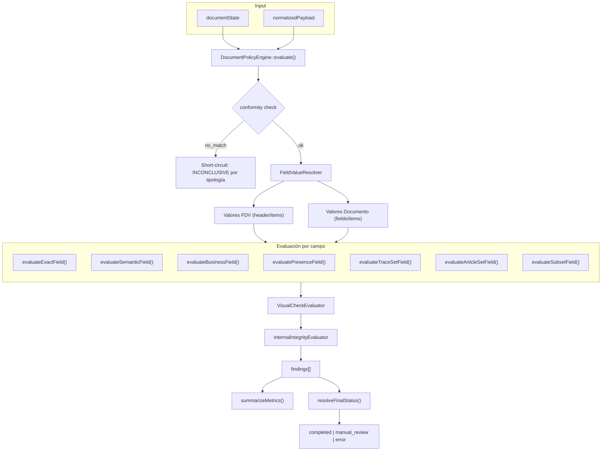
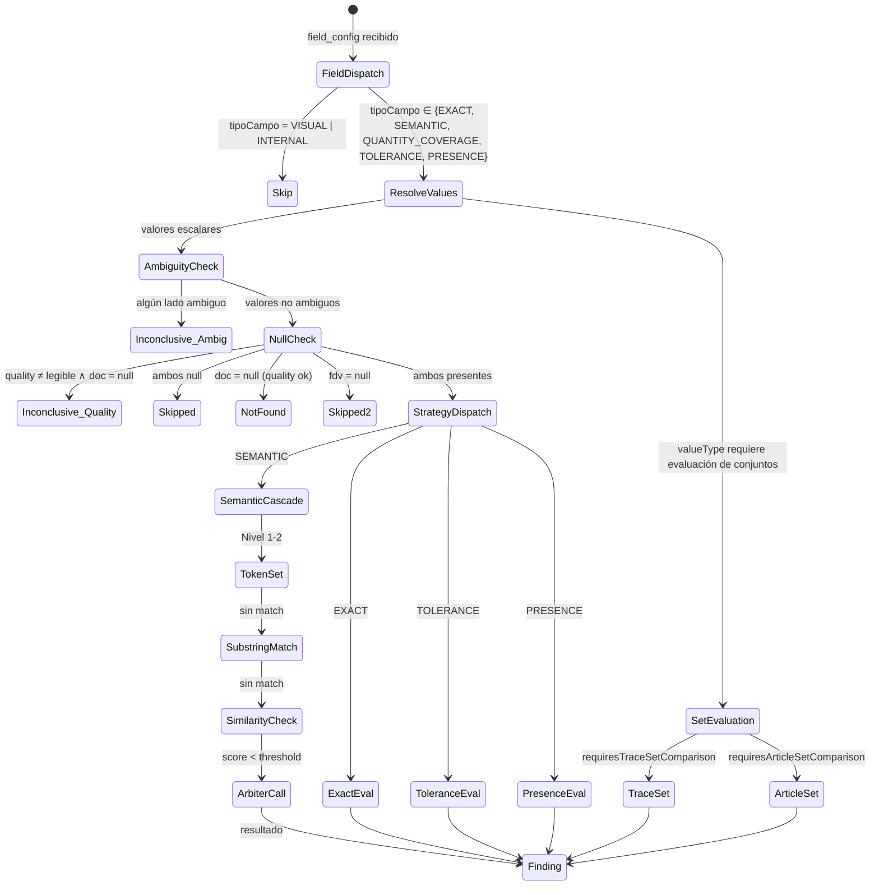

# DOC-02 — SPEC-RULE-ENGINE

## Motor de Reglas Declarativo para Auditoría Documental Agnóstica

```yaml
document_id: "DOC-02"
document_name: "SPEC-RULE-ENGINE"
version: "v0.2.0-draft"
status: "DRAFT"
completeness_level: "C"
last_updated: "2026-10-06"
authors:
  - "Agente de IA (skill ddf-agnostic-spec) - borrador sin revisión humana"
reviewers: []
assumptions_count:
  S1: 3
  S2: 2
  S3: 0
  S4: 0
unknowns_critical: 3
unknowns_non_critical: 4
```

> [!IMPORTANT]
> Este documento fue generado por un agente de IA siguiendo la skill `ddf-agnostic-spec`.
> Su línea base fue extraída directamente del código fuente de AudFact (15+ archivos PHP).
> Requiere revisión humana antes de clasificarse como `REVIEW`.

---

## §1 — Changelog y Decisiones de Revisión

| Versión | Fecha | Cambio |
|---|---|---|
| v0.2.0-draft | 2026-10-06 | Vocabulario único, Finding compartido, política referenciada, operadores numéricos separados, parámetros cerrados y validador ejecutable. Completitud C; runtime pendiente. |
| v0.1.0-draft | 2026-10-05 | Borrador inicial completo. Línea base extraída de 15 archivos PHP. |

---

## §2 — Resumen Ejecutivo y Alcance

### 2.1 Problema que Resuelve

Un sistema de auditoría documental debe **comparar valores extraídos de documentos físicos** contra una fuente de verdad estructurada. La comparación no es trivial: los valores pueden ser texto libre, cantidades numéricas, fechas en múltiples formatos, códigos estructurados, nombres de personas con variaciones ortográficas, o artículos con denominaciones genéricas vs. comerciales.

Este documento especifica un **motor de reglas declarativo y agnóstico al dominio** que:
1. Recibe una configuración declarativa de campos con sus estrategias de comparación.
2. Resuelve los valores tanto de la fuente de verdad como del documento extraído.
3. Aplica la estrategia de comparación configurada mediante una cascada determinista.
4. Produce hallazgos individuales con veredicto, severidad y justificación.
5. Deriva un veredicto final agregado para el caso de auditoría.

### 2.2 Alcance Incluido (In-Scope)

1. Taxonomía de estrategias de comparación y sus algoritmos.
2. Taxonomía de tipos de valor y sus rasgos de comportamiento.
3. Normalización léxica, numérica, temporal y de identidad.
4. Cascada de evaluación para campos escalares y conjuntos.
5. Protocolo del árbitro semántico de IA (interfaz y contrato).
6. Modelo de hallazgos (findings) y métricas de riesgo.
7. Álgebra de derivación de veredicto final.
8. Evaluación de checks visuales (presencia/ausencia).
9. Evaluación de integridad interna (cross-field en fuente de verdad).

### 2.3 Alcance Excluido (Out-of-Scope)

- Definición de la estructura de datos de `ProcessDefinition` y `AuditCase` → **DOC-01**.
- Contratos del proveedor de IA (Gemini Gateway, schemas de extracción) → **DOC-03**.
- Puertos de persistencia de hallazgos y veredictos → **DOC-04**.
- Máquina de estados del pipeline y eventos → **DOC-05**.
- Configuración específica de campos para salud (dispensación farmacéutica) → **DOC-06**.

### 2.4 Dependencias entre Documentos

| Este Documento Requiere | Documento Fuente | Estado Actual |
|---|---|---|
| Tipos de valor (`value_type`), tipos documentales, configuración de campos | DOC-01 | DRAFT v0.2.0 |
| Contrato del proveedor de IA para arbitraje semántico | DOC-03 | Pendiente |
| Perfil de referencia con configuración concreta de campos | DOC-06 | Pendiente |

---

## §3 — Línea Base en AudFact (Evidencia del Sistema Actual)

### 3.1 Inventario de Componentes Actuales

| Componente | Ruta | Método / Símbolo | Líneas | Propósito | Clasificación |
|---|---|---|---|---|---|
| DocumentPolicyEngine | [DocumentPolicyEngine.php](file:///c:/Users/USER/Desktop/AudFact/app/Services/Audit/Pipeline/DocumentPolicyEngine.php) | `evaluate()` | L35-140 | Orquestador principal: recibe documento normalizado y fuente de verdad, produce hallazgos por campo | `[CONFIRMADO]` |
| — | — | `evaluateField()` | L566-622 | Dispatcher por estrategia: EXACT, SEMANTIC, BUSINESS | `[CONFIRMADO]` |
| — | — | `evaluateExactField()` | L862-879 | Comparación exacta con normalización por tipo de valor | `[CONFIRMADO]` |
| — | — | `evaluateSemanticField()` | L884-949 | Cascada: token-set → substring → similitud ≥ umbral → Gemini | `[CONFIRMADO]` |
| — | — | `evaluateBusinessField()` | L983-1038 | Comparación numérica con tolerancia por factor de conversión | `[CONFIRMADO]` |
| — | — | `evaluatePresenceField()` | L1118-1176 | Verificación de presencia bilateral sin comparación de valor | `[CONFIRMADO]` |
| — | — | `evaluateTraceSetField()` | L674-707 | Comparación de conjuntos de tokens de trazabilidad | `[CONFIRMADO]` |
| — | — | `evaluateArticleSetField()` | L760-857 | Emparejamiento suryectivo N:1 de artículos con cascada de 3 fases | `[CONFIRMADO]` |
| — | — | `evaluateSubsetField()` | L633-659 | Comparación de subconjuntos (FDV ⊆ documento) | `[CONFIRMADO]` |
| — | — | `resolveFinalStatus()` en RulesEvaluationWorker | L672-702 | Derivación del veredicto final | `[CONFIRMADO]` |
| AuditComparisonType | [AuditComparisonType.php](file:///c:/Users/USER/Desktop/AudFact/app/Services/Audit/AuditComparisonType.php) | `fromTipoCampo()` | L25-35 | Mapeo código BD → estrategia interna (E→EXACT, S→SEMANTIC, etc.) | `[CONFIRMADO]` |
| — | — | `getSemanticThreshold()` | L46-52 | Umbral de similitud por tipo de campo (S=0.82, default=0.90) | `[CONFIRMADO]` |
| AuditFieldValueType | [AuditFieldValueType.php](file:///c:/Users/USER/Desktop/AudFact/app/Services/Audit/AuditFieldValueType.php) | enum completo | L15-238 | 13 tipos de dato con rasgos (multi-valor, subset, token-sort, etc.) | `[CONFIRMADO]` |
| AuditFindingResult | [AuditFindingResult.php](file:///c:/Users/USER/Desktop/AudFact/app/Services/Audit/AuditFindingResult.php) | enum | L12-32 | 6 resultados: MATCH, MISMATCH, NOT_FOUND, SKIPPED, INCONCLUSIVE, REJECTED | `[CONFIRMADO]` |
| AuditSeverity | [AuditSeverity.php](file:///c:/Users/USER/Desktop/AudFact/app/Services/Audit/AuditSeverity.php) | enum | L13-30 | 3 niveles: HIGH, MEDIUM, LOW con pesos 10/5/1 | `[CONFIRMADO]` |
| AuditFindingRules | [AuditFindingRules.php](file:///c:/Users/USER/Desktop/AudFact/app/Services/Audit/AuditFindingRules.php) | clase | L1-549 | Normalización (fecha, NIT, auth_number, número), métricas, risk_score, tokenización | `[CONFIRMADO]` |
| TextNormalization | [TextNormalization.php](file:///c:/Users/USER/Desktop/AudFact/app/Services/Audit/TextNormalization.php) | clase | L1-285 | Normalización de texto, similitud (Levenshtein+Jaccard+similar_text), comparación de personas | `[CONFIRMADO]` |
| IdentityDocNormalizer | [IdentityDocNormalizer.php](file:///c:/Users/USER/Desktop/AudFact/app/Services/Audit/IdentityDocNormalizer.php) | clase | L1-175 | Normalización de documentos de identidad (alias RIPS/BDUA) | `[CONFIRMADO]` |
| SemanticMatchJudge | [SemanticMatchJudge.php](file:///c:/Users/USER/Desktop/AudFact/app/Services/Audit/SemanticMatchJudge.php) | `evaluate()` | L42-73 | Árbitro semántico con caché Redis 30d, 2 propósitos (producto, persona) | `[CONFIRMADO]` |
| SemanticMatchPromptBuilder | [SemanticMatchPromptBuilder.php](file:///c:/Users/USER/Desktop/AudFact/app/Services/Audit/SemanticMatchPromptBuilder.php) | `buildContract()` | L22-28 | Generador de prompts y schemas para Gemini Structured Output | `[CONFIRMADO]` |
| FieldValueResolver | [FieldValueResolver.php](file:///c:/Users/USER/Desktop/AudFact/app/Services/Audit/Pipeline/FieldValueResolver.php) | clase | L1-445 | Resolución de valores header/items, consolidación, ambigüedad | `[CONFIRMADO]` |
| VisualCheckEvaluator | [VisualCheckEvaluator.php](file:///c:/Users/USER/Desktop/AudFact/app/Services/Audit/Pipeline/VisualCheckEvaluator.php) | `evaluate()` | L60-122 | Evaluación de checks visuales (presencia/ausencia en documento) | `[CONFIRMADO]` |
| InternalIntegrityEvaluator | [InternalIntegrityEvaluator.php](file:///c:/Users/USER/Desktop/AudFact/app/Services/Audit/Pipeline/InternalIntegrityEvaluator.php) | `evaluate()` | L49-95 | Cross-check de consistencia interna en la fuente de verdad | `[CONFIRMADO]` |
| DocumentQuality | [DocumentQuality.php](file:///c:/Users/USER/Desktop/AudFact/app/Services/Audit/DocumentQuality.php) | enum | L16-38 | 3 calidades: legible, parcialmente_legible, ilegible | `[CONFIRMADO]` |

### 3.2 Flujo de Datos Actual



### 3.3 Reglas de Negocio Actuales

| ID | Regla | Evidencia | Clasificación |
|---|---|---|---|
| R-01 | Un campo con `tipoCampo=V` o `tipoCampo=I` se excluye de evaluación de datos. Solo V genera visual checks; I genera integrity checks. | [DocumentPolicyEngine.php:311-314](file:///c:/Users/USER/Desktop/AudFact/app/Services/Audit/Pipeline/DocumentPolicyEngine.php#L311-L314) | `[CONFIRMADO]` |
| R-02 | Si `document_quality ≠ legible` y `docValue = null`, el hallazgo es `INCONCLUSIVE` con detalle explicativo. | [DocumentPolicyEngine.php:578-583](file:///c:/Users/USER/Desktop/AudFact/app/Services/Audit/Pipeline/DocumentPolicyEngine.php#L578-L583) | `[CONFIRMADO]` |
| R-03 | Si FDV y documento son ambos null, el campo se `SKIPPED`. | [DocumentPolicyEngine.php:585-587](file:///c:/Users/USER/Desktop/AudFact/app/Services/Audit/Pipeline/DocumentPolicyEngine.php#L585-L587) | `[CONFIRMADO]` |
| R-04 | Si `docValue = null` y `fdvValue ≠ null` (calidad legible), el resultado es `NOT_FOUND`. | [DocumentPolicyEngine.php:589-594](file:///c:/Users/USER/Desktop/AudFact/app/Services/Audit/Pipeline/DocumentPolicyEngine.php#L589-L594) | `[CONFIRMADO]` |
| R-05 | Si `fdvValue = null` y `docValue ≠ null`, el campo se `SKIPPED` (no hay referencia para comparar). | [DocumentPolicyEngine.php:596-598](file:///c:/Users/USER/Desktop/AudFact/app/Services/Audit/Pipeline/DocumentPolicyEngine.php#L596-L598) | `[CONFIRMADO]` |
| R-06 | Para `CODE`: la FDV debe ser subconjunto del set documental tokenizado. | [DocumentPolicyEngine.php:608-610](file:///c:/Users/USER/Desktop/AudFact/app/Services/Audit/Pipeline/DocumentPolicyEngine.php#L608-L610), [AuditFieldValueType.php:82-85](file:///c:/Users/USER/Desktop/AudFact/app/Services/Audit/AuditFieldValueType.php#L82-L85) | `[CONFIRMADO]` |
| R-07 | Para `PERSON_NAME` con comparación `SEMANTIC`: primero intenta token-sort match (tokens ordenados idénticos). | [DocumentPolicyEngine.php:612-616](file:///c:/Users/USER/Desktop/AudFact/app/Services/Audit/Pipeline/DocumentPolicyEngine.php#L612-L616) | `[CONFIRMADO]` |
| R-08 | Comparación SEMANTIC usa cascada de 4 niveles: token-set match → substring → similitud ≥ umbral → Gemini fallback. | [DocumentPolicyEngine.php:892-949](file:///c:/Users/USER/Desktop/AudFact/app/Services/Audit/Pipeline/DocumentPolicyEngine.php#L892-L949) | `[CONFIRMADO]` |
| R-09 | Umbral de similitud: `S` (semántico) = 0.82; default = 0.90. | [AuditComparisonType.php:46-52](file:///c:/Users/USER/Desktop/AudFact/app/Services/Audit/AuditComparisonType.php#L46-L52) | `[CONFIRMADO]` |
| R-10 | Similitud compuesta = max(similar_text, 0.6×Levenshtein + 0.4×Jaccard). | [TextNormalization.php:244-266](file:///c:/Users/USER/Desktop/AudFact/app/Services/Audit/TextNormalization.php#L244-L266) | `[CONFIRMADO]` |
| R-11 | Gemini fallback solo para `ARTICLE_NAME` y `PERSON_NAME`. | [AuditFieldValueType.php:103-107](file:///c:/Users/USER/Desktop/AudFact/app/Services/Audit/AuditFieldValueType.php#L103-L107) | `[CONFIRMADO]` |
| R-12 | BUSINESS + QUANTITY: `docNumber ≥ fdvNumber` → MATCH (sin factor); con factor: banda simétrica `±factorConv`. | [DocumentPolicyEngine.php:1013-1053](file:///c:/Users/USER/Desktop/AudFact/app/Services/Audit/Pipeline/DocumentPolicyEngine.php#L1013-L1053) | `[CONFIRMADO]` |
| R-13 | TRACE_TOKEN: comparación de conjuntos (FDV=Doc→MATCH; Doc⊂FDV→INCONCLUSIVE; Doc⊄FDV→MISMATCH). | [DocumentPolicyEngine.php:661-707](file:///c:/Users/USER/Desktop/AudFact/app/Services/Audit/Pipeline/DocumentPolicyEngine.php#L661-L707) | `[CONFIRMADO]` |
| R-14 | ARTICLE_NAME: emparejamiento suryectivo N:1 en 3 fases (léxico directo → similitud → Gemini). | [DocumentPolicyEngine.php:760-857](file:///c:/Users/USER/Desktop/AudFact/app/Services/Audit/Pipeline/DocumentPolicyEngine.php#L760-L857) | `[CONFIRMADO]` |
| R-15 | PRESENCE: verifica existencia bilateral sin comparar identidad de valores. 4 casos explícitos. | [DocumentPolicyEngine.php:1118-1176](file:///c:/Users/USER/Desktop/AudFact/app/Services/Audit/Pipeline/DocumentPolicyEngine.php#L1118-L1176) | `[CONFIRMADO]` |
| R-16 | Severidad tiene 3 niveles con pesos de riesgo: alta=10, media=5, baja=1. | [AuditFindingRules.php:19-26](file:///c:/Users/USER/Desktop/AudFact/app/Services/Audit/AuditFindingRules.php#L19-L26) | `[CONFIRMADO]` |
| R-17 | Isomorphism `isFailure()`: MISMATCH, NOT_FOUND, INCONCLUSIVE, REJECTED → true. MATCH, SKIPPED → false. | [AuditFindingResult.php:24-30](file:///c:/Users/USER/Desktop/AudFact/app/Services/Audit/AuditFindingResult.php#L24-L30) | `[CONFIRMADO]` |
| R-18 | Derivación de veredicto: `∃ alta-fallo → manual_review`; `∃ no-alta-fallo → error`; default → `completed`. | [RulesEvaluationWorker.php:672-702](file:///c:/Users/USER/Desktop/AudFact/app/Services/Audit/Pipeline/RulesEvaluationWorker.php#L672-L702) | `[CONFIRMADO]` |
| R-19 | Árbitro semántico para productos: exige 6 flags conservadores (`is_match ∧ same_clinical_use ∧ same_dimensions_or_dose ∧ same_material_or_technology ∧ presentation_compatible ∧ ¬unresolved_differences`). | [SemanticMatchJudge.php:249-261](file:///c:/Users/USER/Desktop/AudFact/app/Services/Audit/SemanticMatchJudge.php#L249-L261) | `[CONFIRMADO]` |
| R-20 | Árbitro semántico para personas: solo exige `is_match = true`. | [SemanticMatchJudge.php:251-253](file:///c:/Users/USER/Desktop/AudFact/app/Services/Audit/SemanticMatchJudge.php#L251-L253) | `[CONFIRMADO]` |
| R-21 | Caché del árbitro: Redis 30d, namespace versionado, hash SHA-256 de (expected, actual, purpose, context). | [SemanticMatchJudge.php:19-88](file:///c:/Users/USER/Desktop/AudFact/app/Services/Audit/SemanticMatchJudge.php#L19-L88) | `[CONFIRMADO]` |
| R-22 | INTERNAL: cross-check entre columnas de la fuente de verdad. Mapa de reglas estático con template de detalle. | [InternalIntegrityEvaluator.php:35-40](file:///c:/Users/USER/Desktop/AudFact/app/Services/Audit/Pipeline/InternalIntegrityEvaluator.php#L35-L40) | `[CONFIRMADO]` |
| R-23 | Normalización de fecha soporta: ISO, numérica separada, narrativa en español con meses abreviados. | [AuditFindingRules.php:215-429](file:///c:/Users/USER/Desktop/AudFact/app/Services/Audit/AuditFindingRules.php#L215-L429) | `[CONFIRMADO]` |
| R-24 | Normalización de NIT: elimina dígito de verificación (`-X`) y separadores de miles. | [AuditFindingRules.php:174-181](file:///c:/Users/USER/Desktop/AudFact/app/Services/Audit/AuditFindingRules.php#L174-L181) | `[CONFIRMADO]` |
| R-25 | Valores FDV con `"0"`, `".00"`, `"0.00"` (no numéricos explícitos) se tratan como ausentes (sin dato legacy). | [AuditFindingRules.php:128-145](file:///c:/Users/USER/Desktop/AudFact/app/Services/Audit/AuditFindingRules.php#L128-L145) | `[CONFIRMADO]` |

### 3.4 Casos Borde y Excepciones Documentados

1. **Ambigüedad documental**: Si el documento extraído tiene múltiples valores distintos para un campo que no permite multi-valor, se resuelve como `INCONCLUSIVE` sin comparar. [FieldValueResolver.php:219-222](file:///c:/Users/USER/Desktop/AudFact/app/Services/Audit/Pipeline/FieldValueResolver.php#L219-L222). `[CONFIRMADO]`

2. **Segmentación incompleta de items**: Si la extracción reporta `ITEM_SEGMENTATION_INCOMPLETE` y el resultado no es MATCH, se degrada a `INCONCLUSIVE` con detalle contextual. [DocumentPolicyEngine.php:345-370](file:///c:/Users/USER/Desktop/AudFact/app/Services/Audit/Pipeline/DocumentPolicyEngine.php#L345-L370). `[CONFIRMADO]`

3. **Gemini fallback no disponible**: Si el `SemanticMatchJudge` no está inyectado (null), la cascada semántica termina en `INCONCLUSIVE` con detalle de diferencia textual. [DocumentPolicyEngine.php:940-949](file:///c:/Users/USER/Desktop/AudFact/app/Services/Audit/Pipeline/DocumentPolicyEngine.php#L940-L949). `[CONFIRMADO]`

4. **BUSINESS con no-numérico**: Si un valor de negocio no parsea como número, retorna `INCONCLUSIVE`. [DocumentPolicyEngine.php:997-1003](file:///c:/Users/USER/Desktop/AudFact/app/Services/Audit/Pipeline/DocumentPolicyEngine.php#L997-L1003). `[CONFIRMADO]`

5. **Gemini devuelve `is_match=true` pero flags conservadores fallan**: Se construye resultado `is_match=false` con reasoning prefijado por "Evidencia semántica insuficiente:". [SemanticMatchJudge.php:275-277](file:///c:/Users/USER/Desktop/AudFact/app/Services/Audit/SemanticMatchJudge.php#L275-L277). `[CONFIRMADO]`

---

## §4 — Diseño del Contrato Agnóstico (Especificación Técnica)

> **Filtrado Léxico**: Esta sección no contiene términos de dominio de salud. Los términos `source_of_truth`, `extracted_document`, `field`, `finding` son agnósticos.

### 4.1 Modelo de Datos / Esquemas

#### DEC-05: Nomenclatura Agnóstica

Las estrategias de comparación y tipos de valor del core usan nombres genéricos, no códigos de BD (`E/S/B/V/I/P`). El mapeo de código a estrategia es responsabilidad del adaptador (DOC-06).

#### Schema: ComparisonStrategy (Enumeración)

```json schema
{
  "$schema": "https://json-schema.org/draft/2020-12/schema",
  "$id": "https://schemas.invalid/audit-platform/doc-02/v0.2/comparison-strategy.schema.json",
  "title": "ComparisonStrategy",
  "description": "Estrategia de comparación que un campo de auditoría utiliza para cotejar fuente de verdad contra documento.",
  "type": "string",
  "enum": [
    "EXACT",
    "SEMANTIC",
    "QUANTITY_COVERAGE",
    "TOLERANCE",
    "VISUAL",
    "PRESENCE",
    "INTERNAL"
  ]
}
```

| Estrategia | Descripción | Equivalente en AudFact |
|---|---|---|
| `EXACT` | Normalización por tipo de valor + comparación de identidad | `E` (exact) |
| `SEMANTIC` | Cascada léxica (token-set → substring → similitud → árbitro IA) | `S` (semantic) |
| `PRESENCE` | Verificación de existencia bilateral; no compara identidad | `P` (presence) |
| `QUANTITY_COVERAGE` | Cobertura mínima: documento >= referencia | `B` sin factor |
| `TOLERANCE` | Banda simétrica abierta con factor explícito | `B` con factor |
| `VISUAL` | Control visual delegado | `V` |
| `INTERNAL` | Cross-check entre columnas de la fuente de verdad; no involucra al documento | `I` (internal) |

> La estrategia `VISUAL` de AudFact se modela como tipo de campo especial (`visual_check`) con su propio evaluador, no como estrategia del motor de reglas principal.

#### Schema: FindingOutcome (Enumeración)

```json schema
{
  "$schema": "https://json-schema.org/draft/2020-12/schema",
  "$id": "https://schemas.invalid/audit-platform/doc-02/v0.2/finding-outcome.schema.json",
  "title": "FindingOutcome",
  "description": "Resultado de la evaluación de un campo individual.",
  "type": "string",
  "enum": [
    "MATCH",
    "MISMATCH",
    "NOT_FOUND",
    "SKIPPED",
    "INCONCLUSIVE",
    "REJECTED"
  ]
}
```

Clasificación:
- **Éxito**: `MATCH`, `SKIPPED` → `isFailure() = false`
- **Fallo**: `MISMATCH`, `NOT_FOUND`, `INCONCLUSIVE`, `REJECTED` → `isFailure() = true`

#### Schema: Severity (Enumeración)

```json schema
{
  "$schema": "https://json-schema.org/draft/2020-12/schema",
  "$id": "https://schemas.invalid/audit-platform/doc-02/v0.2/severity.schema.json",
  "title": "Severity",
  "type": "string",
  "$ref": "https://schemas.invalid/audit-platform/doc-01/v0.3/common.schema.json#/$defs/Severity"
}
```

Pesos de riesgo:

| Severity | Risk Weight |
|:---:|:---:|
| `HIGH` | 10 |
| `MEDIUM` | 5 |
| `LOW` | 1 |

#### Schema: Finding (Hallazgo Individual)

```json schema
{
  "type": "object",
  "additionalProperties": false,
  "required": [
    "field_key",
    "result",
    "severity",
    "document",
    "strategy_applied",
    "value_type",
    "source_value",
    "document_value"
  ],
  "properties": {
    "field_key": {
      "$ref": "https://schemas.invalid/audit-platform/doc-01/v0.3/common.schema.json#/$defs/FieldKey"
    },
    "field_code": {
      "$ref": "https://schemas.invalid/audit-platform/doc-01/v0.3/common.schema.json#/$defs/NullableString"
    },
    "result": {
      "$ref": "https://schemas.invalid/audit-platform/doc-01/v0.3/common.schema.json#/$defs/FindingResult"
    },
    "severity": {
      "$ref": "https://schemas.invalid/audit-platform/doc-01/v0.3/common.schema.json#/$defs/Severity"
    },
    "document": {
      "type": "string",
      "minLength": 1
    },
    "strategy_applied": {
      "$ref": "https://schemas.invalid/audit-platform/doc-01/v0.3/common.schema.json#/$defs/ComparisonStrategy"
    },
    "value_type": {
      "$ref": "https://schemas.invalid/audit-platform/doc-01/v0.3/common.schema.json#/$defs/NullableTypeId"
    },
    "source_value": {
      "$ref": "https://schemas.invalid/audit-platform/doc-01/v0.3/common.schema.json#/$defs/AttributeValue"
    },
    "document_value": {
      "$ref": "https://schemas.invalid/audit-platform/doc-01/v0.3/common.schema.json#/$defs/AttributeValue"
    },
    "source_values": {
      "type": [
        "array",
        "null"
      ],
      "items": {
        "$ref": "https://schemas.invalid/audit-platform/doc-01/v0.3/common.schema.json#/$defs/AttributeValue"
      }
    },
    "document_values": {
      "type": [
        "array",
        "null"
      ],
      "items": {
        "$ref": "https://schemas.invalid/audit-platform/doc-01/v0.3/common.schema.json#/$defs/AttributeValue"
      }
    },
    "detail": {
      "$ref": "https://schemas.invalid/audit-platform/doc-01/v0.3/common.schema.json#/$defs/NullableString"
    },
    "extraction_meta": {
      "type": [
        "object",
        "null"
      ]
    },
    "document_type_id": {
      "$ref": "https://schemas.invalid/audit-platform/doc-01/v0.3/common.schema.json#/$defs/Identifier"
    }
  },
  "$schema": "https://json-schema.org/draft/2020-12/schema",
  "$id": "https://schemas.invalid/audit-platform/doc-02/v0.2/finding.schema.json",
  "title": "Finding",
  "description": "Hallazgo canónico; FieldEvaluation de DOC-01 referencia este contrato.",
  "allOf": [
    {
      "if": {
        "required": [
          "strategy_applied"
        ],
        "properties": {
          "strategy_applied": {
            "enum": [
              "EXACT",
              "SEMANTIC",
              "QUANTITY_COVERAGE",
              "TOLERANCE",
              "PRESENCE"
            ]
          }
        }
      },
      "then": {
        "properties": {
          "value_type": {
            "type": "string"
          }
        }
      }
    }
  ]
}
```

#### Schema: EvaluationMetrics

```json schema
{
  "$schema": "https://json-schema.org/draft/2020-12/schema",
  "$id": "https://schemas.invalid/audit-platform/doc-02/v0.2/evaluation-metrics.schema.json",
  "title": "EvaluationMetrics",
  "type": "object",
  "properties": {
    "total_fields": {
      "type": "integer",
      "minimum": 0
    },
    "matches": {
      "type": "integer",
      "minimum": 0
    },
    "mismatches": {
      "type": "integer",
      "minimum": 0
    },
    "skipped": {
      "type": "integer",
      "minimum": 0
    },
    "inconclusive": {
      "type": "integer",
      "minimum": 0
    },
    "risk_score": {
      "type": "integer",
      "minimum": 0,
      "description": "Suma ponderada de severity × isFailure."
    }
  },
  "required": [
    "total_fields",
    "matches",
    "mismatches",
    "skipped",
    "inconclusive",
    "risk_score"
  ]
}
```

#### Schema: DocumentEvaluationResult

```json schema
{
  "$schema": "https://json-schema.org/draft/2020-12/schema",
  "$id": "https://schemas.invalid/audit-platform/doc-02/v0.2/document-evaluation-result.schema.json",
  "title": "DocumentEvaluationResult",
  "description": "Resultado de la evaluación de un documento dentro de un caso de auditoría.",
  "type": "object",
  "properties": {
    "document_type_id": {
      "type": "string"
    },
    "findings": {
      "type": "array",
      "items": {
        "$ref": "finding.schema.json"
      }
    },
    "metrics": {
      "$ref": "evaluation-metrics.schema.json"
    },
    "document_decision": {
      "type": "object",
      "properties": {
        "document_type_id": {
          "type": "string"
        },
        "approved": {
          "type": "boolean"
        },
        "observations": {
          "type": [
            "array",
            "null"
          ],
          "items": {
            "type": "object",
            "properties": {
              "code": {
                "type": "string"
              },
              "description": {
                "type": "string"
              }
            },
            "required": [
              "code",
              "description"
            ]
          }
        }
      },
      "required": [
        "document_type_id",
        "approved"
      ]
    },
    "semantic_arbiter_metrics": {
      "type": "object",
      "properties": {
        "calls": {
          "type": "integer",
          "minimum": 0
        },
        "cache_hits": {
          "type": "integer",
          "minimum": 0
        }
      }
    }
  },
  "required": [
    "document_type_id",
    "findings",
    "metrics",
    "document_decision"
  ]
}
```

#### Registro canónico de operadores y parámetros

[DECISIÓN TÉCNICA] Registro `1.0.0`: DOC-02 es propietario de IDs, resultados de hallazgo, parámetros y semántica de comparación. DOC-01/Common es propietario de `Severity` (`HIGH/MEDIUM/LOW`); DOC-02 lo referencia. `Finding` es el único hallazgo estructurado y `DOC-01.FieldEvaluation` lo referencia. Los nombres minúsculos de AudFact se traducen en DOC-06.

| ID / versión | Entradas y salida | Parámetros | Capacidad / fallo |
|---|---|---|---|
| EXACT / 1.0.0 | Valores tipados, rasgos y normalizador fijado → FindingResult | {} | Comparación local; valor inválido → INCONCLUSIVE. |
| SEMANTIC / 1.0.0 | Texto/conjuntos y rasgos → FindingResult | threshold [0,1], substring_match boolean | Normalizador fijado; árbitro solo cuando el tipo lo permite. Indisponibilidad no demuestra discrepancia. |
| QUANTITY_COVERAGE / 1.0.0 | Dos decimales canónicos en la misma unidad → FindingResult | {} | Comparación local: document_value >= source_value. |
| TOLERANCE / 1.0.0 | Dos decimales canónicos en la misma unidad → FindingResult | factor decimal positivo o factor_source declarado | Comparación local: abs(document_value - source_value) < factor. Ambos extremos abiertos. |
| VISUAL / 1.0.0 | Evidencia visual estructurada → FindingResult | {} | Control visual; SPI pendiente de GAP-08. No convertirlo en EXACT. |
| PRESENCE / 1.0.0 | Valor documental presente/ausente → FindingResult | {} | Local; ilegibilidad → INCONCLUSIVE, ausencia legible → NOT_FOUND. |
| INTERNAL / 1.0.0 | Dato interno según contrato del perfil → FindingResult | {} | Evaluación interna declarada; ausencia de capacidad impide publicar. |

No hay un operador BUSINESS genérico. El perfil elige cobertura o tolerancia explícitamente. La igualdad numérica cumple ambas cuando el factor es positivo. Cantidades y dinero usan aritmética decimal exacta, sin comparar límites mediante punto flotante binario. Escala y unidad coinciden después de la normalización fijada. El decimal canónico es una cadena que cumple `^-?(0|[1-9][0-9]*)(\.[0-9]+)?$`, de hasta 128 caracteres. Separadores locales, exponentes, NaN e infinito no son entradas numéricas válidas.

TOLERANCE exige exactamente una fuente: factor literal positivo o factor_source. El selector factor_source referencia un campo numérico SINGLE declarado en field_catalog/value_types y una ubicación del perfil; ROOT/SCALAR toma un atributo y COLLECTION/SUM suma una colección declarada, sin fórmulas, SQL ni código. Aplicar max(floor, valor o suma) con decimal exacto. null/ausencia se trata según missing = FLOOR o INCONCLUSIVE; un valor no numérico produce INCONCLUSIVE. El selector se fija en la versión publicada y se resuelve contra el caso de esa ejecución, conservando entradas y resultado en trazabilidad. DOC-06 utiliza COLLECTION/SUM con floor = "1", missing = FLOOR para FactorConv.

Resolver la estrategia efectiva; elegir sus parámetros desde `FieldBinding.strategy_parameters_override` y, en su ausencia, `ProcessDefinition.strategy_parameters`. SEMANTIC y TOLERANCE requieren parámetros explícitos. Las demás estrategias usan {}. Registro desconocido o parámetro no registrado impide publicar. CL-1 admite hasta 100 documentos, 100 tipos de valor, 100 colecciones, 1000 campos y 2000 enlaces, con profundidad 1; son límites estructurales del perfil, sujetos a nueva versión de conformidad, no compromisos de volumen/SLO.

```json schema
{
  "$schema": "https://json-schema.org/draft/2020-12/schema",
  "$id": "https://schemas.invalid/audit-platform/doc-02/v0.2/operator-parameters.schema.json",
  "title": "OperatorParameters",
  "type": "object",
  "additionalProperties": false,
  "properties": {
    "EXACT": {
      "$ref": "#/$defs/Empty"
    },
    "SEMANTIC": {
      "$ref": "#/$defs/Semantic"
    },
    "QUANTITY_COVERAGE": {
      "$ref": "#/$defs/Empty"
    },
    "TOLERANCE": {
      "$ref": "#/$defs/Tolerance"
    },
    "VISUAL": {
      "$ref": "#/$defs/Empty"
    },
    "PRESENCE": {
      "$ref": "#/$defs/Empty"
    },
    "INTERNAL": {
      "$ref": "#/$defs/Empty"
    }
  },
  "$defs": {
    "Empty": {
      "type": "object",
      "additionalProperties": false
    },
    "Semantic": {
      "type": "object",
      "additionalProperties": false,
      "required": [
        "threshold",
        "substring_match"
      ],
      "properties": {
        "threshold": {
          "type": "number",
          "minimum": 0,
          "maximum": 1
        },
        "substring_match": {
          "type": "boolean"
        }
      }
    },
    "Tolerance": {
      "type": "object",
      "additionalProperties": false,
      "properties": {
        "factor": {
          "type": "string",
          "maxLength": 128,
          "pattern": "^(?:[1-9][0-9]*(?:\\.[0-9]+)?|0\\.[0-9]*[1-9][0-9]*)$"
        },
        "factor_source": {
          "$ref": "#/$defs/FactorSource"
        }
      },
      "oneOf": [
        {
          "required": [
            "factor"
          ]
        },
        {
          "required": [
            "factor_source"
          ]
        }
      ]
    },
    "FactorSource": {
      "type": "object",
      "additionalProperties": false,
      "required": [
        "scope",
        "field_key",
        "aggregation",
        "floor",
        "missing"
      ],
      "properties": {
        "scope": {
          "enum": [
            "ROOT",
            "COLLECTION"
          ]
        },
        "field_key": {
          "$ref": "https://schemas.invalid/audit-platform/doc-01/v0.3/common.schema.json#/$defs/FieldKey"
        },
        "collection_path": {
          "type": "array",
          "minItems": 1,
          "maxItems": 1,
          "items": {
            "$ref": "https://schemas.invalid/audit-platform/doc-01/v0.3/common.schema.json#/$defs/CollectionName"
          }
        },
        "aggregation": {
          "enum": [
            "SCALAR",
            "SUM"
          ]
        },
        "floor": {
          "type": "string",
          "maxLength": 128,
          "pattern": "^(?:[1-9][0-9]*(?:\\.[0-9]+)?|0\\.[0-9]*[1-9][0-9]*)$"
        },
        "missing": {
          "enum": [
            "FLOOR",
            "INCONCLUSIVE"
          ]
        }
      },
      "allOf": [
        {
          "if": {
            "required": [
              "scope"
            ],
            "properties": {
              "scope": {
                "const": "ROOT"
              }
            }
          },
          "then": {
            "properties": {
              "aggregation": {
                "const": "SCALAR"
              }
            },
            "not": {
              "required": [
                "collection_path"
              ]
            }
          }
        },
        {
          "if": {
            "required": [
              "scope"
            ],
            "properties": {
              "scope": {
                "const": "COLLECTION"
              }
            }
          },
          "then": {
            "required": [
              "collection_path"
            ],
            "properties": {
              "aggregation": {
                "const": "SUM"
              }
            }
          }
        }
      ]
    }
  }
}
```

### 4.2 Interfaces y Puertos

#### Interfaz: RuleEngine

```typescript
// Pseudocódigo tipado — NO es implementación final
interface RuleEngine {
  /**
   * Evalúa todos los campos configurados de un documento contra la fuente de verdad.
   *
   * Precondiciones:
   *   - documentState contiene fields_config, fuente_verdad, tipo_documento
   *   - extractedPayload contiene fields_normalized, items_normalized, document_quality
   * Postcondiciones:
   *   - Retorna un DocumentEvaluationResult completo
   *   - Cada campo configurado produce exactamente 0 o 1 finding
   * Invariante:
   *   - metrics.total_fields = findings.length
   *   - metrics.matches + metrics.mismatches + metrics.skipped + metrics.inconclusive = total_fields
   *   - document_decision.approved = true ⟺ ∀ finding: ¬finding.result.isFailure()
   */
  evaluate(
    documentState: DocumentState,
    extractedPayload: ExtractedPayload,
    caseId: string
  ): DocumentEvaluationResult;
}
```

#### Interfaz: SemanticArbiter

```typescript
interface SemanticArbiter {
  /**
   * Determina equivalencia semántica entre dos valores textuales.
   *
   * Precondiciones:
   *   - expected y actual son strings no vacíos
   *   - purpose es uno de los propósitos registrados
   * Postcondiciones:
   *   - Retorna veredicto con justificación y métricas
   * Modos de fallo:
   *   - Proveedor IA no disponible → is_match=false, reasoning=fallback, cacheable=false
   *   - Respuesta no parseable → is_match=false, reasoning=fallback, cacheable=false
   */
  evaluate(
    expected: string,
    actual: string,
    context: ArbiterContext
  ): ArbiterResult;
}

type ArbiterResult = {
  is_match: boolean;
  reasoning: string;
  metrics?: Record<string, unknown>;
  cache_hit: boolean;
};

type ArbiterContext = {
  purpose: string;          // ej: "product_equivalence", "person_identity"
  field_key?: string;
  document_type_id?: string;
  document_context?: string; // Contexto documental adyacente
};
```

#### Interfaz: ValueNormalizer

```typescript
interface ValueNormalizer {
  /**
   * Normaliza un valor para comparación según su tipo.
   *
   * Invariante: normalize(normalize(v)) === normalize(v) (idempotente)
   * Invariante: normalize("") === ""
   */
  normalize(value: string, valueType: string): string;
}
```

#### Interfaz: TextSimilarityEngine

```typescript
interface TextSimilarityEngine {
  /**
   * Calcula similitud compuesta entre dos strings normalizados.
   *
   * Postcondiciones:
   *   - 0.0 ≤ resultado ≤ 1.0
   *   - similarity(a, a) = 1.0 cuando a no está vacío
   *   - similarity("", x) = 0.0
   */
  similarity(left: string, right: string): number; // 0.0..1.0

  sameTokenSet(left: string, right: string): boolean;
  containsSubstring(left: string, right: string): boolean;
}
```

### 4.3 Algoritmos y Lógica de Evaluación

#### ALG-01: EvaluateField — Dispatcher principal

```
ALGORITMO: EvaluateField
ENTRADA: fieldConfig: FieldBinding, fdvValue: ResolvedValue, docValue: ResolvedValue,
         documentQuality: string, context: EvaluationContext
SALIDA: finding: Finding | null

1. strategy ← fieldConfig.effective_strategy
2. SI strategy ∈ {VISUAL, INTERNAL} → RETORNAR null  // Evaluados por módulos separados
3. valueType ← fieldConfig.value_type
4. Resolver fdvResolution y docResolution vía ValueResolver (header > items, consolidar)

5. SI valueType.set_comparison ∈ {SUBSET, EQUAL_SET} ∧ ambos tienen valores:
   → RETORNAR evaluateSet(fdv.values, doc.values, valueType)
6. SI valueType.set_comparison = COVERAGE_SET ∧ ambos tienen valores ∧ (|fdv| ≥ 2 ∨ |doc| ≥ 2):
   → RETORNAR evaluateArticleSet(fdv.values, doc.values, context)
7. SI fdv.ambiguous ∨ doc.ambiguous:
   → RETORNAR {result: INCONCLUSIVE, detail: "Múltiples valores distintos..."}

8. // Pre-evaluación de nulidad (calidad documental y ausencias)
   8.1. SI documentQuality ≠ "legible" ∧ docValue = null → {result: INCONCLUSIVE}
   8.2. SI fdvValue = null ∧ docValue = null → {result: SKIPPED}
   8.3. SI docValue = null → {result: NOT_FOUND}
   8.4. SI fdvValue = null → {result: SKIPPED}

9. // Dispatch por estrategia
   MATCH strategy:
     EXACT    → evaluateExact(fdvValue, docValue, valueType)
     SEMANTIC → evaluateSemantic(fdvValue, docValue, context, valueType)
     QUANTITY_COVERAGE → evaluateCoverage(fdvValue, docValue)
     TOLERANCE → evaluateTolerance(fdvValue, docValue, effectiveParameters.factor)
     PRESENCE → evaluatePresence(fdvValue, docValue)

10. Construir Finding con resultado, severidad de fieldConfig, y metadatos
```

#### ALG-02: EvaluateExact

```
ALGORITMO: EvaluateExact
ENTRADA: fdvValue: string, docValue: string, valueType: ValueType
SALIDA: {result: FindingOutcome, detail?: string}

1. SI valueType.requiresSubsetComparison():
   → RETORNAR evaluateSubset(fdvValue, docValue)
2. SI valueType.requiresTokenSortComparison():
   2.1. SI samePersonNameTokenSet(fdvValue, docValue) → {result: MATCH}
3. normalizedFdv ← normalizeForComparison(valueType, fdvValue)
4. normalizedDoc ← normalizeForComparison(valueType, docValue)
5. SI normalizedFdv = normalizedDoc → {result: MATCH}
6. → {result: MISMATCH, detail: "El valor...no coincide..."}
```

#### ALG-03: EvaluateSemantic — Cascada de 4 niveles

```
ALGORITMO: EvaluateSemantic
ENTRADA: fdvValue: string, docValue: string, context: EvalContext,
         valueType: ValueType, threshold: float
SALIDA: {result: FindingOutcome, detail?: string}

1. normalizedFdv ← normalizeText(fdvValue)
2. normalizedDoc ← normalizeText(docValue)

3. // Nivel 1: Token-sort para personas
   SI valueType.token_order_insensitive ∧ samePersonNameTokenSet(fdvValue, docValue):
   → {result: MATCH, strategy: "exact"}

4. // Nivel 2: Token-set idéntico
   SI sameTokenSet(normalizedFdv, normalizedDoc):
   → {result: MATCH}

5. // Nivel 3: Substring match (solo si estrategia permite)
   SI substringMatchAllowed ∧ containsSubstring(normalizedFdv, normalizedDoc):
   → {result: MATCH}

6. // Nivel 4: Similitud compuesta
   score ← similarity(normalizedFdv, normalizedDoc)
   SI score ≥ threshold:
   → {result: MATCH}

7. // Nivel 5: Árbitro semántico IA (solo si valueType lo permite)
   SI semanticArbiter ≠ null ∧ valueType.allowsSemanticFallback():
   result ← semanticArbiter.evaluate(fdvValue, docValue, context)
   SI result.is_match → {result: MATCH, detail: result.reasoning}
   SI NO → {result: INCONCLUSIVE, detail: result.reasoning}

8. // Sin árbitro disponible
   → {result: INCONCLUSIVE, detail: "Diferencia requiere verificación..."}
```

#### ALG-04: EvaluateNumeric — Cobertura y tolerancia separadas

```
ENTRADA: strategy: QUANTITY_COVERAGE | TOLERANCE, source: CanonicalDecimal,
         document: CanonicalDecimal, parameters: parámetros validados
SALIDA: { result: FindingResult }

1. Validar decimales canónicos y compatibilidad de unidad/normalización.
   Un valor no numérico produce INCONCLUSIVE, no cero ni coincidencia.
2. Si strategy == QUANTITY_COVERAGE:
   retornar MATCH si document >= source; de lo contrario MISMATCH.
3. Si strategy == TOLERANCE:
   resolver factor literal o factor_source declarado; si no es resoluble, INCONCLUSIVE.
   validar factor > 0; retornar MATCH si abs(document - source) < factor;
   de lo contrario MISMATCH. Igualdad con cualquiera de los extremos falla.
4. Un strategy desconocido es CONFIGURATION_INVALID; no aplicar EXACT.
```

La elección del modo no depende de una bandera oculta del núcleo. DOC-06 traduce `usa_factor_conv` y resuelve el factor legacy `max(1, sum(FactorConv))` en el adaptador. Esa expresión de dominio no forma parte del operador.

#### ALG-05: EvaluateSet — Conjuntos sin reglas de dominio

```
ENTRADA: referenceTokens: string[], documentTokens: string[], traits: ValueType
SALIDA: { result: FindingResult }

1. Normalizar mediante la versión fijada; deduplicar y ordenar ambos conjuntos.
2. Si ambos conjuntos son iguales, retornar MATCH.
3. Si traits.set_comparison == EQUAL_SET, retornar MISMATCH.
4. Si traits.set_comparison == SUBSET:
   elegir left/right según subset_direction.
   si todo elemento left pertenece a right, retornar proper_subset_result.
   de lo contrario, retornar MISMATCH.
5. COVERAGE_SET usa ALG-06; NONE conserva el escalar o marca ambigüedad.
```

No decidir orientación ni cobertura mediante type_id del primer negocio. DOC-01 §4.5.2 es propietario de estos rasgos. La migración de códigos y trazabilidad legacy debe fijarlos y comprobar su oráculo en GAP-11/12.

#### ALG-06: EvaluateArticleSet — Emparejamiento suryectivo

```
ALGORITMO: EvaluateArticleSet
ENTRADA: fdvArticles: string[], docArticles: string[], context: EvalContext, threshold: float
SALIDA: {result: FindingOutcome, detail?: string}

1. fdvNorm ← normalize(fdvArticles)
2. docNorm ← normalize(docArticles)
3. matchedFdv ← {}  // mapa fdvIdx → docIdx

4. // Fase 1: Match léxico directo
   PARA CADA fi EN fdvNorm:
     SI fi ∉ matchedFdv:
       PARA CADA di EN docNorm:
         SI fi = di ∨ containsSubstring(fi, di):
           matchedFdv[fi] ← di; ROMPER

5. // Fase 2: Similitud léxica
   PARA CADA fi EN fdvNorm:
     SI fi ∉ matchedFdv:
       PARA CADA di EN docNorm:
         SI similarity(fi, di) ≥ threshold:
           matchedFdv[fi] ← di; ROMPER

6. // Fase 3: Árbitro semántico IA
   SI semanticArbiter ≠ null:
     PARA CADA fi EN fdvArticles (originales):
       SI fi ∉ matchedFdv:
         PARA CADA di EN docArticles (originales):
           result ← semanticArbiter.evaluate(fdvArticles[fi], docArticles[di], context)
           SI result.is_match:
             matchedFdv[fi] ← di; ROMPER

7. SI |matchedFdv| = |fdvArticles| → {result: MATCH, strategy: "semantic"}
8. unmatchedNames ← fdvArticles donde idx ∉ matchedFdv
9. → {result: INCONCLUSIVE, detail: "Sin evidencia para N de M artículos: ..."}
```

#### ALG-07: DeriveVerdict — Política canónica

Única definición normativa: DOC-01 §4.6 ALG-02 `DerivarVeredicto`. Entrada `Finding[]` y `VerdictPolicy`; salida `{outcome, approved, requires_human_review, overall_severity}`. Aplicar las reglas ordenadas del perfil, sin introducir un segundo diccionario `verdictPolicy.outcomes`. Los diez fixtures TC-VP de DOC-01 prueban esta misma función.

#### ALG-08: SummarizeMetrics

```
ALGORITMO: SummarizeMetrics
ENTRADA: findings: Finding[]
SALIDA: metrics: EvaluationMetrics

1. metrics ← {total_fields: 0, matches: 0, mismatches: 0, skipped: 0, inconclusive: 0, risk_score: 0}
2. PARA CADA finding EN findings:
   2.1. metrics.total_fields++
   2.2. MATCH finding.result:
        MATCH → metrics.matches++
        SKIPPED → metrics.skipped++
        INCONCLUSIVE → metrics.inconclusive++; risk_score += riskWeight(finding.severity)
        MISMATCH, NOT_FOUND, REJECTED → metrics.mismatches++; risk_score += riskWeight(finding.severity)
```

#### ALG-09: CompositeSimilarity

```
ALGORITMO: CompositeSimilarity
ENTRADA: left: string, right: string
SALIDA: score: float [0.0, 1.0]

1. SI left = "" ∨ right = "" → RETORNAR 0.0
2. similarScore ← similar_text(left, right) / 100
3. maxLen ← max(len(left), len(right))
4. levenshteinScore ← maxLen > 0 ? max(0, 1 - levenshtein(left, right) / maxLen) : 0
5. leftTokens ← tokenize(left)
6. rightTokens ← tokenize(right)
7. jaccard ← |intersection| / |union|
8. composite ← 0.6 × levenshteinScore + 0.4 × jaccard
9. RETORNAR max(similarScore, composite)
```

#### ALG-10: PersonNameTokenMatch

```
ALGORITMO: PersonNameTokenMatch
ENTRADA: left: string, right: string
SALIDA: isMatch: boolean

1. leftTokens ← tokenize(normalizePersonName(left))
2. rightTokens ← tokenize(normalizePersonName(right))
3. SI |leftTokens| = 0 ∨ |rightTokens| = 0 → false
4. short, long ← el set con menos y más tokens respectivamente
5. SI short no tiene al menos 1 token con length > 1 → false
6. Pass 1 — Exact/Wildcard: para cada token corto, buscar match exacto o wildcard (?) en long
7. Pass 2 — Iniciales: para tokens sin match, si len=1, matchear por primera letra
8. SI todos los tokens cortos fueron matcheados → true
9. → false
```

### 4.4 Diagramas de Estado / Flujo



### 4.5 Invariantes del Módulo

- **INV-01**: Todo campo configurado con `strategy_applied ∉ {VISUAL, INTERNAL}` produce exactamente 0 o 1 finding. Una evaluación aplicable produce un hallazgo; ambos valores null producen SKIPPED según ALG-01. Ausencia de aplicabilidad puede omitir la evaluación.
- **INV-02**: `metrics.total_fields = |findings|`.
- **INV-03**: `metrics.matches + metrics.mismatches + metrics.skipped + metrics.inconclusive = metrics.total_fields`.
- **INV-04**: `document_decision.approved = true ⟺ ∀f ∈ findings: ¬f.result.isFailure()`.
- **INV-05**: `risk_score = Σ(riskWeight(f.severity) para f donde f.result.isFailure())`.
- **INV-06**: `normalize(normalize(v, type), type) = normalize(v, type)` (idempotencia de normalización).
- **INV-07**: El árbitro semántico nunca modifica la fuente de verdad ni el valor extraído; solo produce un veredicto de equivalencia.
- **INV-08**: El orden de evaluación de campos no afecta el resultado final (evaluación sin estado compartido entre campos).

---

## §5 — Análisis de Impacto Inverso y Verificación de Abstracción

### 5.1 Tabla de Cobertura (Paridad con AudFact)

| Funcionalidad Actual (§3) | Contrato Agnóstico (§4) | ¿Cobertura? | Notas |
|---|---|:---:|---|
| R-01 Skip V/I | ALG-01 paso 2 | ✅ | |
| R-02 Quality→INCONCLUSIVE | ALG-01 paso 8.1 | ✅ | |
| R-03 null/null→SKIPPED | ALG-01 paso 8.2 | ✅ | |
| R-04 doc=null→NOT_FOUND | ALG-01 paso 8.3 | ✅ | |
| R-05 fdv=null→SKIPPED | ALG-01 paso 8.4 | ✅ | |
| R-06 CODE subset | ALG-02 paso 1 | ✅ | |
| R-07 PERSON_NAME token-sort | ALG-02 paso 2, ALG-10 | ✅ | |
| R-08 Cascada semántica 4 niveles | ALG-03 niveles 1-5 | ✅ | Extendido a 5 niveles con persona |
| R-09 Umbrales S=0.82 default=0.90 | ALG-03 input threshold | ✅ | Umbral configurable por tenant |
| R-10 Similitud compuesta | ALG-09 | ✅ | |
| R-11 Gemini fallback ARTICLE/PERSON | ALG-03 paso 7 condición | ✅ | Configurable por value_type |
| R-12 BUSINESS banda tolerancia | ALG-04 | ✅ | Separado en cobertura y tolerancia; no equivalentes |
| R-13 TRACE_TOKEN set comparison | ALG-05 | ✅ | |
| R-14 ARTICLE_NAME suryectivo | ALG-06 | ✅ | |
| R-15 PRESENCE bilateral | ALG-01 paso 9 PRESENCE | ✅ | |
| R-16 Severidad 3 niveles | Schema Severity | ✅ | |
| R-17 isFailure() partición | Schema FindingOutcome + texto | ✅ | |
| R-18 Derivación veredicto | ALG-07 | ✅ | |
| R-19 Árbitro conservador productos | SemanticArbiter interfaz | ✅ | Criterios conservadores = responsabilidad del adaptador IA (DOC-03) |
| R-20 Árbitro persona simple | SemanticArbiter interfaz | ✅ | |
| R-21 Caché 30d del árbitro | SemanticArbiter interfaz | ✅ | Caché es detalle de implementación del puerto (DOC-04) |
| R-22 INTERNAL cross-check | ALG-01 paso 2 nota + definición INTERNAL | ✅ | |
| R-23 Normalización de fecha | ValueNormalizer | ✅ | Algoritmo en adaptador de normalización |
| R-24 Normalización de NIT | ValueNormalizer | ✅ | Algoritmo en adaptador de normalización |
| R-25 Zero-suppression FDV | ValueResolver | ✅ | Regla en resolución de valores |

**Cobertura: 25/25 = 100%.**

### 5.2 Prueba de Dominio Dual

| Contrato | Caso Auditoría Documental (Salud) | Caso Alternativo (Logística — Verificación de Remisiones) | ¿Funciona? |
|---|---|---|:---:|
| RuleEngine | Evalúa campos de una dispensación contra fórmula médica | Evalúa campos de una remisión contra orden de compra | ✅ |
| EXACT strategy | Compara número de cédula en receta vs BD | Compara código de SKU en remisión vs orden | ✅ |
| SEMANTIC strategy | Compara nombre de medicamento con cascada léxica+IA | Compara descripción de producto con cascada léxica+IA | ✅ |
| Operadores numéricos | Cobertura mínima o banda abierta explícita | Cobertura mínima o banda abierta explícita | Contratos comprobables; oráculo de negocio pendiente |
| PRESENCE strategy | Verifica que la firma del médico exista en la fórmula | Verifica que el sello de bodega exista en la guía | ✅ |
| INTERNAL strategy | Cross-check número de entrega vs sistema MIPRES | Cross-check lote en ERP vs sistema de trazabilidad | ✅ |
| ALG-07 DeriveVerdict | completed / manual_review / error | released / hold_shipment / discrepancies | ✅ |
| SemanticArbiter | Paracetamol 500mg = Acetaminofén 500mg | "Tubo PVC 1/2" = "Tubo plástico media pulgada" | ✅ |

### 5.3 Auditoría de Fugas de Abstracción (Filtrado Léxico)

| Término Buscado | ¿Encontrado en §4? | Acción |
|---|:---:|---|
| paciente | ❌ | — |
| médico | ❌ | — |
| fórmula médica | ❌ | — |
| dispensación | ❌ | — |
| medicamento | ❌ | — |
| EPS | ❌ | — |
| factura (concepto salud) | ❌ | — |

---

## §6 — Matriz de Trazabilidad y Riesgos

### 6.1 Trazabilidad Bidireccional

| Requisito Funcional | Elemento del Contrato (§4) | Criterio de Aceptación (§7) |
|---|---|---|
| Comparación exacta normalizada | ALG-02, ValueNormalizer | TC-01 a TC-04 |
| Cascada semántica con threshold | ALG-03 | TC-05 a TC-08 |
| Banda de tolerancia numérica | ALG-04 | TC-09 a TC-11 |
| Sets de trazabilidad | ALG-05 | TC-12 a TC-14 |
| Emparejamiento suryectivo | ALG-06 | TC-15 a TC-17 |
| Derivación de veredicto | ALG-07 | TC-VP-01 a TC-VP-10 (DOC-01 §4.6, reutilizados) |
| Métricas de riesgo | ALG-08 | TC-18 |

### 6.2 Riesgos Identificados

| ID | Riesgo | Probabilidad | Impacto | Mitigación |
|---|---|:---:|:---:|---|
| RISK-01 | Árbitro semántico fuera de línea → degradación a INCONCLUSIVE masivo | Media | Alto | Caché de 30d cubre consultas repetidas; modo offline explícito |
| RISK-02 | Umbrales de similitud incorrectos → falsos positivos/negativos | Baja | Medio | Calibración con dataset dorado (DOC-07) |
| RISK-03 | Nuevos tipos de valor sin rasgos configurados → fallo en runtime | Baja | Medio | Validación de configuración en arranque (DOC-01 SV-01) |
| RISK-04 | Normalización de fechas con ambigüedad de formato (ej. 01/02/2026) | Media | Bajo | Algoritmo de desambiguación posicional (posición del año) |

### 6.3 Supuestos Declarados

| ID | Supuesto | Severidad | Justificación | Ruta de Validación |
|---|---|:---:|---|---|
| A-01 | La banda de tolerancia TOLERANCE siempre usa ±1 factor como default y el factor se resuelve de los items de la fuente de verdad. | S2 | Observado en [DocumentPolicyEngine.php:1005-1016](file:///c:/Users/USER/Desktop/AudFact/app/Services/Audit/Pipeline/DocumentPolicyEngine.php#L1005-L1016). Puede requerir configuración por tenant. | Revisión con stakeholders |
| A-02 | `ARTICLE_NAME` sin emparejamiento produce siempre INCONCLUSIVE (no MISMATCH), lo cual es intencional para evitar falsos negativos ante extracciones parciales. | S1 | [DocumentPolicyEngine.php:846-857](file:///c:/Users/USER/Desktop/AudFact/app/Services/Audit/Pipeline/DocumentPolicyEngine.php#L846-L857) | Confirmación de política de negocio |
| A-03 | Los pesos de risk_score (10/5/1) son fijos y no configurables por tenant. | S1 | [AuditFindingRules.php:19-26](file:///c:/Users/USER/Desktop/AudFact/app/Services/Audit/AuditFindingRules.php#L19-L26) | Evaluar si DOC-06 necesita override |
| A-04 | Substring match bidireccional (`A⊂B ∨ B⊂A`) es correcto y no genera falsos positivos para la línea base. | S2 | [TextNormalization.php:234-242](file:///c:/Users/USER/Desktop/AudFact/app/Services/Audit/TextNormalization.php#L234-L242) | Evaluación con dataset dorado (DOC-07) |
| A-05 | El árbitro semántico conservador para productos (6 flags) es la política correcta para el dominio general. | S1 | [SemanticMatchJudge.php:249-261](file:///c:/Users/USER/Desktop/AudFact/app/Services/Audit/SemanticMatchJudge.php#L249-L261). En otros dominios podría simplificarse. | Validar con DOC-06 como primer perfil |

### 6.4 Desconocidos No Críticos

| ID | Hecho | Motivo | Clasificación |
|---|---|---|:---:|
| U-01 | ¿El wildcard `?` en PersonNameTokenMatch es usado por algún pipeline de extracción o es feature latente? | Solo se observa su implementación, no un productor de `?`. | `[DESCONOCIDO]` |
| U-02 | ¿El scoring de `findingPriority()` se usa más allá de `resolveFailedDocument()`? | Solo encontrado en [RulesEvaluationWorker.php:748](file:///c:/Users/USER/Desktop/AudFact/app/Services/Audit/Pipeline/RulesEvaluationWorker.php#L748). | `[DESCONOCIDO]` |
| U-03 | ¿El contrato conservador del árbitro (6 flags) aplica a todos los dominios o solo al farmacéutico? | Implementado genéricamente pero con semántica farmacéutica. | `[DESCONOCIDO]` |
| U-04 | ¿La métrica `risk_score` tiene consumidores downstream (dashboards, alertas)? | Se calcula y persiste pero no se encontraron queries que la usen para decisiones automáticas. | `[DESCONOCIDO]` |

---

### 6.5 Contratos SaaS pendientes — información faltante de impacto S3

| ID | Información faltante | Propietario / gate |
|---|---|---|
| U-SAAS-01 | Contexto tipado de ejecución y versiones fijadas del plan compilado. | GAP-07; no volver a resolver la última versión durante un retry. |
| U-SAAS-02 | Normalización/extracción versionada, controles visuales e internos y fallo del árbitro. | GAP-08/10; sin capacidad validada no publicar perfiles que la exigen. |
| U-SAAS-03 | Calibración semántica, emparejamiento por rasgos y benchmark del motor con oráculo revisado. | GAP-11; ejemplos/fixtures no demuestran corrección del negocio ni runtime. |

## §7 — Criterios de Aceptación Verificables

### Normalización y Comparación Exacta

| ID | Descripción | Input | Output Esperado | Tipo |
|---|---|---|---|---|
| TC-01 | Normalización de fecha ISO a Y-m-d | `"2026-05-04T14:30:00"` | `"2026-05-04"` | Unitario |
| TC-02 | Normalización de fecha narrativa española | `"4 de mayo de 2026"` | `"2026-05-04"` | Unitario |
| TC-03 | Normalización de NIT con DV | `"828.002.423-5"` | `"828002423"` | Unitario |
| TC-04 | Exact match tras normalización numérica | fdv=`"1500"`, doc=`"1,500"`, type=QUANTITY | outcome=`MATCH` | Unitario |

### Cascada Semántica

| ID | Descripción | Input | Output Esperado | Tipo |
|---|---|---|---|---|
| TC-05 | Token-set match por reorden | fdv=`"GARCIA ABSALON"`, doc=`"ABSALON GARCIA"` | outcome=`MATCH` | Unitario |
| TC-06 | Substring match de nombre contenido | fdv=`"ACETAMINOFEN"`, doc=`"ACETAMINOFEN 500MG"` | outcome=`MATCH` | Unitario |
| TC-07 | Similitud ≥ 0.82 para semántico | fdv=`"METFORMINA CLORHIDRATO"`, doc=`"CLORHIDRATO DE METFORMINA"` | outcome=`MATCH` (score > 0.82) | Unitario |
| TC-08 | Fallback a INCONCLUSIVE sin árbitro | fdv=`"Producto A"`, doc=`"Producto B"`, arbiter=null | outcome=`INCONCLUSIVE` | Unitario |

### Tolerancia Numérica

| ID | Descripción | Input | Output Esperado | Tipo |
|---|---|---|---|---|
| TC-09 | Doc ≥ FDV sin factor → MATCH | fdv=`100`, doc=`150` | outcome=`MATCH` | Unitario |
| TC-10 | Doc < FDV sin factor → MISMATCH | fdv=`100`, doc=`80` | outcome=`MISMATCH` | Unitario |
| TC-11 | Banda simétrica con factor=30 | fdv=`100`, doc=`75`, factor=`30` | outcome=`MATCH` (75 > 100-30) | Unitario |

### Sets de Trazabilidad

| ID | Descripción | Input | Output Esperado | Tipo |
|---|---|---|---|---|
| TC-12 | Sets idénticos → MATCH | fdv=`["A","B"]`, doc=`["B","A"]` | outcome=`MATCH` | Unitario |
| TC-13 | Doc con extra → MISMATCH | fdv=`["A"]`, doc=`["A","C"]` | outcome=`MISMATCH` | Unitario |
| TC-14 | Doc parcial → INCONCLUSIVE | fdv=`["A","B"]`, doc=`["A"]` | outcome=`INCONCLUSIVE` | Unitario |

### Emparejamiento Suryectivo

| ID | Descripción | Input | Output Esperado | Tipo |
|---|---|---|---|---|
| TC-15 | Cobertura completa → MATCH | fdv=`["Med A","Med B"]`, doc=`["Med B","Med A"]` | outcome=`MATCH` | Unitario |
| TC-16 | Cobertura N:1 → MATCH | fdv=`["Med A 10u","Med A 28u"]`, doc=`["Med A"]` (substring) | outcome=`MATCH` | Unitario |
| TC-17 | Cobertura parcial → INCONCLUSIVE | fdv=`["Med A","Med B"]`, doc=`["Med A"]` | outcome=`INCONCLUSIVE` | Unitario |

### Métricas

| ID | Descripción | Input | Output Esperado | Tipo |
|---|---|---|---|---|
| TC-18 | risk_score = suma de pesos de fallos | findings: `[{MATCH,alta}, {MISMATCH,alta}, {INCONCLUSIVE,baja}]` | risk_score = `0 + 10 + 1 = 11` | Unitario |

---

### 7.2 Fixtures numéricos ejecutables

Comprobador decimal de contratos común a todos los perfiles. No acredita ejecución del futuro motor SaaS ni comparación contra una respuesta IA.

```json numeric-cases
[
  {
    "id": "NUM-01",
    "strategy": "QUANTITY_COVERAGE",
    "source": "10",
    "document": "10",
    "parameters": {},
    "expected": "MATCH"
  },
  {
    "id": "NUM-02",
    "strategy": "QUANTITY_COVERAGE",
    "source": "10",
    "document": "11",
    "parameters": {},
    "expected": "MATCH"
  },
  {
    "id": "NUM-03",
    "strategy": "QUANTITY_COVERAGE",
    "source": "10",
    "document": "9.999",
    "parameters": {},
    "expected": "MISMATCH"
  },
  {
    "id": "NUM-04",
    "strategy": "TOLERANCE",
    "source": "10",
    "document": "10",
    "parameters": {
      "factor": "1"
    },
    "expected": "MATCH"
  },
  {
    "id": "NUM-05",
    "strategy": "TOLERANCE",
    "source": "10",
    "document": "10.999",
    "parameters": {
      "factor": "1"
    },
    "expected": "MATCH"
  },
  {
    "id": "NUM-06",
    "strategy": "TOLERANCE",
    "source": "10",
    "document": "11",
    "parameters": {
      "factor": "1"
    },
    "expected": "MISMATCH"
  },
  {
    "id": "NUM-07",
    "strategy": "TOLERANCE",
    "source": "10",
    "document": "9",
    "parameters": {
      "factor": "1"
    },
    "expected": "MISMATCH"
  },
  {
    "id": "NUM-08",
    "strategy": "TOLERANCE",
    "source": "10",
    "document": "9.001",
    "parameters": {
      "factor": "1"
    },
    "expected": "MATCH"
  },
  {
    "id": "NUM-09",
    "strategy": "TOLERANCE",
    "source": "10",
    "document": "10.1",
    "parameters": {
      "factor": "0.1"
    },
    "expected": "MISMATCH"
  },
  {
    "id": "NUM-10",
    "strategy": "TOLERANCE",
    "source": "9007199254740993",
    "document": "9007199254740994",
    "parameters": {
      "factor": "1"
    },
    "expected": "MISMATCH"
  },
  {
    "id": "NUM-11",
    "strategy": "QUANTITY_COVERAGE",
    "source": "10",
    "document": "ilegible",
    "parameters": {},
    "expected": "INCONCLUSIVE"
  },
  {
    "id": "NUM-12",
    "strategy": "TOLERANCE",
    "source": "10",
    "document": "10,5",
    "parameters": {
      "factor": "1"
    },
    "expected": "INCONCLUSIVE"
  }
]
```

## §8 — Puerta de Calidad (Auto-Auditoría Adversarial)

### 8.1 Verificación ejecutada del 2026-10-06

Comando: `node opt/tools/validate-ddf.cjs` (2026-10-06), Node v26.0.0, Ajv 8.20.0, ajv-formats 2.1.1. Resultado: 137 comprobaciones, 0 fallos; 11 schemas compilados, 38 fixtures, 10 políticas, 18 casos numéricos, 20 compatibilidades de vocabulario/hallazgo, 27 casos de tipos, 8 casos de conjuntos y 5 comprobaciones del validador. El resumen también identifica SHA-256 de entradas y lockfile.

El conjunto demuestra conformidad documental de salud, logística y compras B2B contra los mismos schemas y comprobadores de contrato. La prueba del motor SaaS con salud y compras B2B se ejecutará en GAP-11, sobre el mismo artefacto del núcleo. Persistencia, autorización, publicación atómica, normalización y proveedores todavía requieren implementación y sus pruebas.

Comando y dependencias de instalación reproducible: DOC-01 §7.1. `validate-doc-02.cjs` es alias del validador compartido. Las tablas antiguas marcadas PASS por inspección y presencia de $schema no se consideran ejecución.

### 8.2 Auditoría adversarial y límites

| Pregunta | Resultado | Evidencia / límite |
|---|---|---|
| ¿Hay vocabularios duplicados divergentes? | RESUELTO | Un propietario por contrato y referencias cruzadas compiladas. |
| ¿Cobertura y tolerancia tienen la misma semántica? | NO | NUM-02/06: 10 frente a 11 produce MATCH/MISMATCH respectivamente. |
| ¿Un parámetro/operador desconocido se ignora? | NO | Mutaciones negativas; schema cerrado y versión explícita. |
| ¿Hay una segunda política de veredicto? | RESUELTO | ALG-07 referencia DOC-01 ALG-02 y sus fixtures. |
| ¿Se ejecutó el motor en dos negocios? | PENDIENTE | GAP-11. Se verificaron contratos y ejemplos sintéticos. |
| ¿Se probó normalización, árbitro o capacidad visual/interna? | PENDIENTE | U-SAAS-02/03 y GAP-08/10/11. |
| ¿Este documento es guía completa aprobada? | NO | DRAFT, nivel C y dependencias críticas explícitas. |

### 8.3 Clasificación vigente

```yaml
completeness_level: "C"
justification: "Operadores y schemas base comprobados; contratos de ejecución, capacidades y calibración SaaS pendientes."
blockers:
  - "U-SAAS-01: ejecución y plan fijado"
  - "U-SAAS-02: normalizadores, extracción y capacidades"
  - "U-SAAS-03: benchmark y oráculo del motor"
next_actions:
  - "Concretar GAP-07/08/10 y referenciar sus contratos finales."
  - "Resolver los desconocidos históricos de §6.4 en el perfil/calibración correspondiente."
  - "Ejecutar GAP-11 antes de declarar prueba dual del motor."
```
