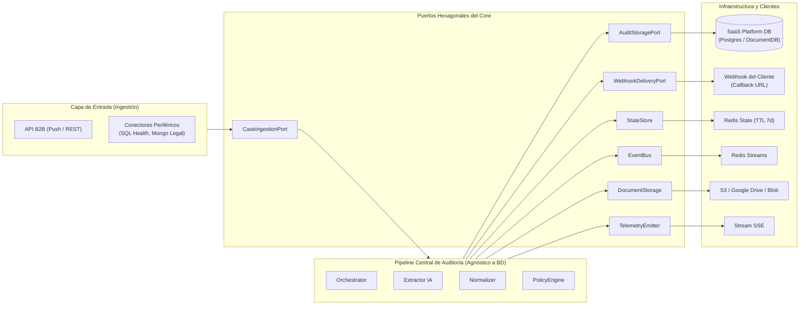
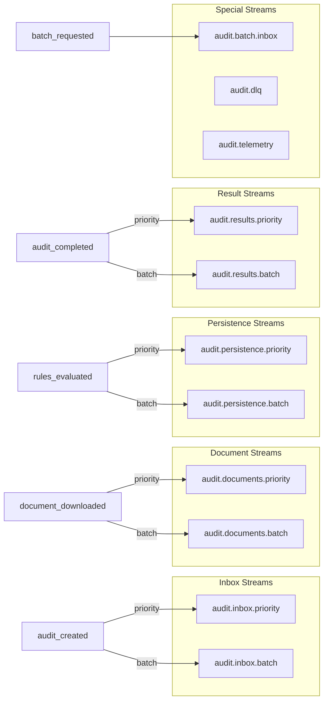

# DOC-04 — SPEC-PORTS-AND-ADAPTERS

## Arquitectura Hexagonal: Ingestión, Almacenamiento SaaS, Webhooks, Estado y Eventos

```yaml
document_id: "DOC-04"
document_name: "SPEC-PORTS-AND-ADAPTERS"
version: "v0.2.0-draft"
status: "DRAFT"
completeness_level: "B"
last_updated: "2026-10-19"
authors:
  - "Agente de IA (skill ddf-agnostic-spec) - borrador sin revisión humana"
reviewers: []
assumptions_count:
  S1: 3
  S2: 1
  S3: 0
  S4: 0
unknowns_critical: 0
unknowns_non_critical: 2
```

---

## §1 — Changelog y Decisiones de Revisión

| Versión | Fecha | Cambio |
|---|---|---|
| v0.2.2-draft | 2026-10-19 | Inmutabilidad de ejecuciones y deduplicación de consumo (DEC-T-019 / GAP-07). Contrato `AuditExecutionEnvelope` y deduplicación por `(execution_id, attempt_number)` en `AuditStoragePort`. |
| v0.2.1-draft | 2026-10-19 | Ingestión y transporte documental híbrido (DEC-T-018 / GAP-06). Métodos de `createArtifactUploadUrl` en `CaseIngestionPort` y resolución dual (`REMOTE_URL` / `STORED_CONTENT`) en `DocumentStorage`. |
| v0.2.0-draft | 2026-10-19 | Desacoplamiento total de bases de datos de clientes (DEC-T-016). Eliminación de `DataRepository` con SQL. Incorporación de `CaseIngestionPort`, `AuditStoragePort` (base interna de la plataforma SaaS) y `WebhookDeliveryPort` (retorno asíncrono al cliente). |
| v0.1.0-draft | 2026-10-05 | Borrador inicial. Línea base de 10 archivos del core y pipeline. |

---

## §2 — Resumen Ejecutivo y Alcance

### 2.1 Problema que Resuelve

Un sistema SaaS de auditoría documental multitenant **nunca debe acoplarse a los motores ni esquemas de bases de datos de sus clientes** (SQL Server, MongoDB, Oracle, APIs). Establecer conexiones directas de red hacia los entornos de los clientes viola la seguridad, imposibilita el soporte multitenant y crea fugas de abstracción (como exponer SQL en el dominio).

Este documento especifica la **arquitectura de puertos y adaptadores (hexagonal)** del SaaS documental, definiendo:
1. **Ingestión desacoplada (`CaseIngestionPort`)**: El pipeline solo consume contratos canónicos (`AuditCase`), recibidos vía API B2B (Push) o conectores periféricos.
2. **Almacenamiento interno de la plataforma (`AuditStoragePort`)**: Persistencia propia del SaaS para configuraciones de tenants, expedientes, usuarios y veredictos (`AuditVerdict`).
3. **Despacho asíncrono de resultados (`WebhookDeliveryPort`)**: Notificación firmada al cliente cuando se emite el veredicto.
4. **Infraestructura de ejecución**: Puertos para estado efímero (`StateStore`), bus de eventos (`EventBus`), telemetría (`TelemetryEmitter`) y almacenamiento de archivos (`DocumentStorage`).
5. **Políticas de resiliencia**: Criterios de fallo (fail-closed, fail-open, best-effort, retry con backoff).

### 2.2 Alcance Incluido (In-Scope)

1. Puerto de Ingestión de Casos (`CaseIngestionPort`: API B2B Push y Conectores periféricos).
2. Puerto de Almacenamiento Interno de la Plataforma (`AuditStoragePort`: persistencia del SaaS).
3. Puerto de Entrega de Veredictos (`WebhookDeliveryPort`: notificación asíncrona firmada vía webhook).
4. Puerto de estado efímero (`StateStore`: auditorías y jobs en Redis).
5. Puerto de eventos (`EventBus`: publicación y consumo de streams distribuidos).
6. Puerto de telemetría (`TelemetryEmitter`: emisión best-effort en tiempo real).
7. Puerto de almacenamiento de documentos binarios (`DocumentStorage`: S3, Google Drive, blob cache).
8. Envelope canónico de eventos (`PipelineEvent`).
9. Políticas de resiliencia formalizadas por puerto.

### 2.3 Alcance Excluido (Out-of-Scope)

- Modelo de datos del dominio y `AuditCase` → **DOC-01**.
- Motor de reglas de comparación → **DOC-02**.
- Gateway de IA (Gemini SPI) → **DOC-03**.
- Máquina de estados del pipeline → **DOC-05**.
- Adaptador legacy de SQL Server para AudFact → **DOC-06**.

### 2.4 Dependencias entre Documentos

| Este Documento Requiere | Documento Fuente | Estado Actual |
|---|---|---|
| Esquema del evento (pipeline) | DOC-05 | DRAFT v0.1.0 |
| Modelo de datos de auditoría y hallazgos (`AuditCase`, `AuditVerdict`) | DOC-01 | REVIEW v0.3.0 |
| Adaptadores de IA (SPI) | DOC-03 | DRAFT v0.1.0 |
| Directriz arquitectónica DEC-T-016 | SPEC-SAAS-MASTER | DRAFT v0.1.13 |

---

## §3 — Línea Base en AudFact (Evidencia del Sistema Actual)

### 3.1 Inventario de Componentes Actuales

| Componente | Ruta | Método / Símbolo | Líneas | Propósito | Clasificación |
|---|---|---|---|---|---|
| Database | [Database.php](file:///c:/Users/USER/Desktop/AudFact/core/Database.php) | clase estática | L10-295 | Conexión PDO a SQL Server con cache por fingerprint, dual-connection (default/db2), transacciones | `[CONFIRMADO]` |
| RedisClient | [RedisClient.php](file:///c:/Users/USER/Desktop/AudFact/core/RedisClient.php) | clase singleton | L17-870 | Conexión Predis con soporte standalone/sentinel/cluster, operaciones atómicas, Lua, streams | `[CONFIRMADO]` |
| AuditStateStore | [AuditStateStore.php](file:///c:/Users/USER/Desktop/AudFact/app/Services/Audit/Pipeline/AuditStateStore.php) | clase | L13-509 | Estado Redis de auditoría: init, get, patch, markDocument*, constantes de status, TTL 7d | `[CONFIRMADO]` |
| BatchJobStore | [BatchJobStore.php](file:///c:/Users/USER/Desktop/AudFact/app/Services/Audit/Pipeline/BatchJobStore.php) | clase | L13-670 | Estado Redis de jobs batch: init, progress, seal, complete. TTL 7d, índice ZADD. | `[CONFIRMADO]` |
| AuditEventPublisher | [AuditEventPublisher.php](file:///c:/Users/USER/Desktop/AudFact/app/Services/Audit/Pipeline/AuditEventPublisher.php) | clase | L13-170 | Publicación en Redis Streams con MAXLEN, routing por tipo+prioridad, DLQ con Lua idempotente | `[CONFIRMADO]` |
| AuditEvent | [AuditEvent.php](file:///c:/Users/USER/Desktop/AudFact/app/Services/Audit/Pipeline/AuditEvent.php) | VO inmutable | L10-247 | DTO de evento: event_id (UUID v4), event_type, audit_id, job_id, document_id, payload, versions | `[CONFIRMADO]` |
| TelemetryPublisher | [TelemetryPublisher.php](file:///c:/Users/USER/Desktop/AudFact/app/Services/Audit/Telemetry/TelemetryPublisher.php) | clase | L11-168 | Emisión best-effort a `audit.telemetry` stream con MAXLEN=1000. Métodos: started, completed, failed, rejected | `[CONFIRMADO]` |

### 3.2 Mapa de Puertos del SaaS Multi-Tenant



### 3.3 Reglas de Negocio Actuales

| ID | Regla | Evidencia | Clasificación |
|---|---|---|---|
| R-01 | Dual-connection: consultas SELECT por `db2`, escrituras INSERT/UPDATE por `default`. Excepción: `AuditStatusModel` lee por `default` para consistencia post-escritura. | AGENTS.md línea "Política de conexión en modelos" | `[CONFIRMADO]` |
| R-02 | Redis como state store: auditorías con TTL 604800s (7d), jobs batch con TTL 604800s. | [AuditStateStore.php:30](file:///c:/Users/USER/Desktop/AudFact/app/Services/Audit/Pipeline/AuditStateStore.php#L30), [BatchJobStore.php:23](file:///c:/Users/USER/Desktop/AudFact/app/Services/Audit/Pipeline/BatchJobStore.php#L23) | `[CONFIRMADO]` |
| R-03 | Event routing: 13 event types mapeados a 9 streams (4 pares priority/batch + 1 batch_inbox). | [AuditEventPublisher.php:15-24, 145-162](file:///c:/Users/USER/Desktop/AudFact/app/Services/Audit/Pipeline/AuditEventPublisher.php#L15-L24) | `[CONFIRMADO]` |
| R-04 | DLQ usa Lua script para XADD idempotente: recibo en key `event:{eventId}:dead_letter` previene duplicados. | [AuditEventPublisher.php:77-88](file:///c:/Users/USER/Desktop/AudFact/app/Services/Audit/Pipeline/AuditEventPublisher.php#L77-L88) | `[CONFIRMADO]` |
| R-05 | AuditEvent hereda routing metadata (source, is_priority) del padre vía `followUp()`. Eventos hijos nunca cambian el carril. | [AuditEvent.php:138-149](file:///c:/Users/USER/Desktop/AudFact/app/Services/Audit/Pipeline/AuditEvent.php#L138-L149) | `[CONFIRMADO]` |
| R-06 | AuditEvent incluye versiones de trazabilidad: extractor, normalizer, rules. Metadata, no participa en decisiones. | [AuditEvent.php:37-42](file:///c:/Users/USER/Desktop/AudFact/app/Services/Audit/Pipeline/AuditEvent.php#L37-L42) | `[CONFIRMADO]` |
| R-07 | Telemetría es best-effort: excepciones capturadas silenciosamente, nunca propaga al caller. | [TelemetryPublisher.php:125, 143-149](file:///c:/Users/USER/Desktop/AudFact/app/Services/Audit/Telemetry/TelemetryPublisher.php#L125) | `[CONFIRMADO]` |
| R-08 | Telemetry stream: `audit.telemetry` con MAXLEN=1000 (circular). 4 tipos: started, completed, failed, rejected. | [TelemetryPublisher.php:13-14, 26-107](file:///c:/Users/USER/Desktop/AudFact/app/Services/Audit/Telemetry/TelemetryPublisher.php#L13-L14) | `[CONFIRMADO]` |
| R-09 | State store usa Lua scripts para merge atómico (patchAudit, markDocument*). | [AuditStateStore.php:112-120](file:///c:/Users/USER/Desktop/AudFact/app/Services/Audit/Pipeline/AuditStateStore.php#L112-L120) | `[CONFIRMADO]` |
| R-10 | Database connection: cache por fingerprint SHA-256. Dos conexiones con credenciales distintas pueden coexistir. | [Database.php:263-280](file:///c:/Users/USER/Desktop/AudFact/core/Database.php#L263-L280) | `[CONFIRMADO]` |
| R-11 | Stream MAXLEN: configurable vía `AUDIT_STREAM_MAXLEN` (default 100000) para trimming automático. | [AuditEventPublisher.php:33, 41-43](file:///c:/Users/USER/Desktop/AudFact/app/Services/Audit/Pipeline/AuditEventPublisher.php#L33) | `[CONFIRMADO]` |
| R-12 | Redis soporta 3 modos: standalone, sentinel (HA), cluster. Lazy-connect en primer uso. | [RedisClient.php:50-79](file:///c:/Users/USER/Desktop/AudFact/core/RedisClient.php#L50-L79) | `[CONFIRMADO]` |
| R-13 | AuditEvent identifiers: event_id, audit_id, job_id son UUID v4 validados en constructor. document_id es nullable. | [AuditEvent.php:59-68](file:///c:/Users/USER/Desktop/AudFact/app/Services/Audit/Pipeline/AuditEvent.php#L59-L68) | `[CONFIRMADO]` |

### 3.4 Casos Borde y Excepciones Documentados

1. **Redis no disponible en arranque**: `RedisClient` usa lazy-connect; la conexión falla en la primera operación, no al instanciar. El caller recibe `RedisException`. [RedisClient.php:50-79](file:///c:/Users/USER/Desktop/AudFact/core/RedisClient.php#L50-L79). `[CONFIRMADO]`

2. **SQL Server failover en mid-query**: Si la conexión PDO falla, el modelo propaga `PDOException`. No hay retry automático a nivel de conexión. [Database.php:263-280](file:///c:/Users/USER/Desktop/AudFact/core/Database.php#L263-L280). `[CONFIRMADO]`

3. **DLQ idempotente ante duplicados**: Si un mismo evento se publica dos veces a DLQ, el Lua script verifica un recibo (`event:{eventId}:dead_letter`) y retorna sin duplicar. [AuditEventPublisher.php:77-88](file:///c:/Users/USER/Desktop/AudFact/app/Services/Audit/Pipeline/AuditEventPublisher.php#L77-L88). `[CONFIRMADO]`

4. **Telemetry stream lleno**: Si `MAXLEN=1000` se alcanza, Redis recorta automáticamente (política circular ~). Nunca bloquea al publisher. [TelemetryPublisher.php:13-14](file:///c:/Users/USER/Desktop/AudFact/app/Services/Audit/Telemetry/TelemetryPublisher.php#L13-L14). `[CONFIRMADO]`

5. **State store con TTL expirado**: Si una auditoría expira (7d), `getAudit()` retorna `null`. El worker que la recibe debe tratar esto como audit perdida y no reintentar. [AuditStateStore.php:30](file:///c:/Users/USER/Desktop/AudFact/app/Services/Audit/Pipeline/AuditStateStore.php#L30). `[CONFIRMADO]`

---

## §4 — Diseño del Contrato Agnóstico (Especificación Técnica)

### 4.1 Modelo de Datos / Esquemas

#### Schema: PipelineEvent (DTO canónico de evento)

```json
{
  "$schema": "https://json-schema.org/draft/2020-12/schema",
  "$id": "https://schemas.invalid/audit-platform/doc-04/v0.1/pipeline-event.schema.json",
  "title": "PipelineEvent",
  "description": "Envelope canónico de evento del pipeline de auditoría.",
  "type": "object",
  "properties": {
    "event_id": { "type": "string", "format": "uuid", "description": "UUID v4 único del evento." },
    "parent_event_id": { "type": ["string", "null"], "format": "uuid" },
    "event_type": { "type": "string", "description": "Tipo del evento (valor del catálogo de DOC-05)." },
    "audit_id": { "type": ["string", "null"], "format": "uuid" },
    "job_id": { "type": ["string", "null"], "format": "uuid" },
    "document_id": { "type": ["string", "null"] },
    "timestamp": { "type": "string", "format": "date-time", "description": "ISO-8601 UTC." },
    "version_extractor": { "type": "string" },
    "version_normalizer": { "type": "string" },
    "version_rules": { "type": "string" },
    "payload": { "type": "object", "additionalProperties": true }
  },
  "required": ["event_id", "event_type", "timestamp", "payload"]
}
```

#### Schema: AuditState (Estado efímero de una auditoría)

```json
{
  "$schema": "https://json-schema.org/draft/2020-12/schema",
  "$id": "https://schemas.invalid/audit-platform/doc-04/v0.1/audit-state.schema.json",
  "title": "AuditState",
  "type": "object",
  "properties": {
    "audit_id": { "type": "string", "format": "uuid" },
    "status": {
      "type": "string",
      "enum": ["pending", "processing", "completed", "requires_review", "discrepancies_found", "failed"]
    },
    "case_reference": { "type": "string", "description": "Identificador del caso de auditoría." },
    "job_id": { "type": ["string", "null"], "format": "uuid" },
    "tenant_id": { "type": ["string", "null"] },
    "docs_total": { "type": "integer", "minimum": 0 },
    "docs_done": { "type": "integer", "minimum": 0 },
    "docs_extracted": { "type": "integer", "minimum": 0 },
    "docs_evaluated": { "type": "integer", "minimum": 0 },
    "docs_rejected": { "type": "integer", "minimum": 0 },
    "documents": { "type": "object", "additionalProperties": true },
    "created_at": { "type": "string", "format": "date-time" },
    "updated_at": { "type": "string", "format": "date-time" }
  },
  "required": ["audit_id", "status", "case_reference", "docs_total", "docs_done", "created_at", "updated_at"]
}
```

#### Schema: TelemetryEvent

```json
{
  "$schema": "https://json-schema.org/draft/2020-12/schema",
  "$id": "https://schemas.invalid/audit-platform/doc-04/v0.1/telemetry-event.schema.json",
  "title": "TelemetryEvent",
  "type": "object",
  "properties": {
    "audit_id": { "type": "string" },
    "job_id": { "type": ["string", "null"] },
    "case_reference": { "type": ["string", "null"] },
    "document_id": { "type": ["string", "null"] },
    "node_id": { "type": "string", "description": "Identificador del nodo del pipeline que emite." },
    "event_type": { "type": "string", "enum": ["started", "completed", "failed", "rejected"] },
    "status": { "type": ["string", "null"] },
    "timestamp": { "type": "string", "format": "date-time" },
    "meta": { "type": ["object", "null"], "additionalProperties": true }
  },
  "required": ["audit_id", "node_id", "event_type", "timestamp"]
}
```

### 4.2 Interfaces y Puertos

#### Puerto 1: CaseIngestionPort (Ingestión de Casos)

```typescript
/**
 * Puerto de entrada primario para admitir expedientes a auditar.
 * El núcleo solo interactúa con contratos canónicos (AuditCase), ya sea
 * recibidos por la API REST B2B (Push) o mapeados por Conectores Periféricos.
 */
interface CaseIngestionPort {
  /**
   * Admite un caso de auditoría individual.
   * Valida estructura, tenant_id, y publica el evento audit_created.
   */
  submitCase(caseData: AuditCase, options?: IngestionOptions): Promise<SubmissionReceipt>;

  /**
   * Admite un lote de casos de auditoría asíncrono con clave de idempotencia.
   * Restricción (DEC-P-014): batchData.cases.length <= 100 por solicitud HTTP.
   */
  submitBatch(batchData: AuditBatchRequest, options?: BatchOptions): Promise<BatchSubmissionReceipt>;

  /**
   * Emite una URL prefirmada PUT para carga directa de binarios a almacenamiento SaaS (DEC-T-018).
   */
  createArtifactUploadUrl(tenantId: string, caseId: string, artifactId: string): Promise<UploadUrlReceipt>;
}

type IngestionOptions = {
  is_priority?: boolean;
  callback_url?: string;
  client_correlation_id?: string;
};

type SubmissionReceipt = {
  audit_id: string;
  status: "pending";
  admitted_at: string;
};

type BatchSubmissionReceipt = {
  job_id: string;
  total_cases: number;
  status: "pending";
  admitted_at: string;
};

type UploadUrlReceipt = {
  upload_url: string;
  method: "PUT";
  headers: Record<string, string>;
  expires_in_seconds: number;
};
```

#### Puerto 2: AuditStoragePort (Almacenamiento de Plataforma SaaS)

```typescript
/**
 * Puerto para la base de datos interna de la plataforma SaaS.
 * Almacena datos del SaaS (tenants, usuarios, configuraciones, veredictos).
 * Es agnóstico a las bases de datos de los clientes.
 */
interface AuditStoragePort {
  /**
   * Persiste el veredicto final inmutable de una auditoría.
   * Política de resiliencia: FAIL-CLOSED
   */
  saveVerdict(verdict: AuditVerdict): Promise<void>;

  /**
   * Recupera el veredicto de una auditoría garantizando contexto de tenant.
   */
  getVerdict(auditId: string, tenantId: string): Promise<AuditVerdict | null>;

  /**
   * Persiste snapshot inmutable del expediente admitido para trazabilidad.
   */
  saveCaseSnapshot(auditId: string, caseData: AuditCase): Promise<void>;

  /**
   * Persiste el envelope inmutable de ejecución (DEC-T-019).
   */
  saveExecutionEnvelope(envelope: AuditExecutionEnvelope): Promise<void>;
  getExecutionEnvelope(executionId: string, tenantId: string): Promise<AuditExecutionEnvelope | null>;

  /**
   * Registra el consumo técnico de la auditoría para facturación externa.
   * Clave de deduplicación: (execution_id, attempt_number).
   */
  recordConsumption(consumption: TenantConsumptionRecord): Promise<void>;
}

type AuditExecutionEnvelope = {
  execution_id: string;
  audit_id: string;
  tenant_id: string;
  case_id: string;
  case_snapshot: AuditCase;
  policy_version: string;
  policy_snapshot: Record<string, unknown>;
  artifacts_manifest: Array<{ artifact_id: string; sha256: string; size_bytes: number }>;
  model_manifest: { model: string; temperature: number; prompt_hash: string };
  created_at: string;
};

type TenantConsumptionRecord = {
  event_id: string;
  tenant_id: string;
  audit_id: string;
  execution_id: string;
  attempt_number: number;
  tokens_prompt: number;
  tokens_completion: number;
  tokens_thought?: number;
  duration_ms: number;
  timestamp: string;
};
```

#### Puerto 3: WebhookDeliveryPort (Entrega Asíncrona de Resultados)

```typescript
/**
 * Puerto para despachar el veredicto hacia los endpoints de callback del cliente.
 * El cliente recibe el veredicto en su infraestructura sin que el SaaS
 * tenga que conectarse a su base de datos.
 */
interface WebhookDeliveryPort {
  /**
   * Despacha el resultado con firma HMAC en la cabecera (X-Audit-Signature).
   * Política de resiliencia: RETRY_WITH_BACKOFF (Reintentos con retroceso y DLQ).
   */
  dispatchVerdict(
    tenantId: string,
    callbackUrl: string,
    verdict: AuditVerdict,
    secret: string
  ): Promise<WebhookDeliveryResult>;
}

type WebhookDeliveryResult = {
  success: boolean;
  status_code: number;
  attempts: number;
  delivered_at?: string;
  error?: string;
};
```

#### Puerto 4: StateStore (Estado Efímero)

```typescript
interface StateStore {
  /**
   * Inicializa el estado de una auditoría con SETNX (no sobrescribe).
   *
   * Precondiciones: auditId es UUID v4 válido
   * Postcondiciones: retorna true si se creó, false si ya existía
   * Política de resiliencia: FAIL-CLOSED
   */
  initAudit(auditId: string, caseRef: string, options?: InitOptions): boolean;

  /**
   * Lee el estado actual de una auditoría.
   * Retorna null si no existe o TTL expirado.
   */
  getAudit(auditId: string): AuditState | null;

  /**
   * Merge atómico de un patch sobre el estado existente.
   * Invariante: patchAudit es atómico (Lua script o equivalente)
   */
  patchAudit(auditId: string, patch: Partial<AuditState>): boolean;

  deleteAudit(auditId: string): boolean;
}

interface BatchStore {
  initJob(jobId: string, tenantId: string, params: JobParams): boolean;
  getJob(jobId: string): JobState | null;
  markAuditCompletedInJob(jobId: string, auditId: string, durationMs: number, status: string): boolean;
  sealJob(jobId: string, total: number): boolean;
}

type InitOptions = {
  job_id?: string;
  tenant_id?: string;
  source_id?: string;
};
```

#### Puerto 5: EventBus (Publicación y Consumo de Eventos)

```typescript
interface EventPublisher {
  /**
   * Publica un evento en el stream correspondiente a su tipo y prioridad.
   *
   * Precondiciones: event es un PipelineEvent válido
   * Postcondiciones: retorna el stream_id asignado por el broker
   * Política de resiliencia: FAIL-CLOSED (evento no entregado = error fatal)
   * Invariante: el routing (event_type + priority → stream) es determinista
   */
  publish(event: PipelineEvent): string;

  /**
   * Publica un evento en la DLQ con recibo idempotente.
   * 
   * Invariante: XADD + receipt SET son atómicos (Lua)
   * Invariante: publicar el mismo parentEventId N veces produce 1 sola entrada DLQ
   */
  publishDeadLetter(event: PipelineEvent): string;
}

interface EventConsumer {
  /**
   * Lee el siguiente batch de eventos del stream.
   * Usa consumer groups para distribución entre workers.
   */
  consume(streams: string[], group: string, consumer: string, count: number): PipelineEvent[];
  acknowledge(stream: string, group: string, messageId: string): void;
  claimPending(stream: string, group: string, minIdleMs: number, count: number): PipelineEvent[];
}
```

#### Puerto 6: TelemetryEmitter

```typescript
interface TelemetryEmitter {
  /**
   * Emite evento de telemetría al stream de visualización.
   *
   * Política de resiliencia: BEST-EFFORT (nunca propaga excepciones)
   * Invariante: una falla de emisión nunca afecta al pipeline
   */
  started(auditId: string, nodeId: string, documentId?: string, meta?: object): void;
  completed(auditId: string, nodeId: string, durationMs: number, documentId?: string, meta?: object): void;
  failed(auditId: string, nodeId: string, durationMs: number, documentId?: string, meta?: object): void;
  rejected(auditId: string, nodeId: string, durationMs: number, documentId?: string, meta?: object): void;
}
```

#### Puerto 7: DocumentStorage (Almacenamiento Binario)

```typescript
interface DocumentStorage {
  /**
   * Obtiene un documento binario desde una URI remota (REMOTE_URL) o almacenamiento SaaS (STORED_CONTENT).
   *
   * Postcondiciones: retorna el contenido como base64 + mime type + hash
   * Política de resiliencia: FAIL-CLOSED
   */
  fetchArtifact(storage: ArtifactStorageRef, tenantId: string): Promise<StoredDocument>;

  /**
   * Descarga un documento binario por su identificador directo (compatibilidad).
   */
  download(attachmentId: string): StoredDocument;

  /**
   * Cache temporal de documentos descargados.
   */
  cacheDocument(key: string, data: string, ttl: number): void;
  getCachedDocument(key: string): string | null;
}

type ArtifactStorageRef = {
  kind: "REMOTE_URL" | "STORED_CONTENT" | "NONE";
  uri?: string | null;
  checksum_sha256?: string | null;
};

type StoredDocument = {
  data: string;        // base64-encoded
  mime_type: string;
  hash: string;        // SHA-256 del contenido binario
  size_bytes: number;
};
```

### 4.3 Políticas de Resiliencia

| Puerto | Política | Justificación |
|---|---|---|
| CaseIngestionPort | **FAIL-CLOSED** | Si la entrada no es válida o el encolamiento falla, se rechaza la solicitud de inmediato. |
| AuditStoragePort | **FAIL-CLOSED** | La base del SaaS debe garantizar la persistencia del veredicto; un fallo detiene la finalización. |
| WebhookDeliveryPort | **RETRY_WITH_BACKOFF** | Si el webhook del cliente está caído temporalmente, se reintenta exponencialmente y escala a DLQ. |
| StateStore | **FAIL-CLOSED** | Sin estado el pipeline pierde trazabilidad y produce resultados duplicados. |
| EventBus.publish | **FAIL-CLOSED** | Un evento no publicado es una auditoría perdida. |
| EventBus.publishDeadLetter | **FAIL-CLOSED** | Un fallo en DLQ significa pérdida silenciosa de errores. |
| TelemetryEmitter | **BEST-EFFORT** | La telemetría es observabilidad; su fallo no debe bloquear el pipeline. |
| DocumentStorage.download | **FAIL-CLOSED** | Sin documento no hay extracción posible. |
| DocumentStorage.cache | **BEST-EFFORT** | Cache miss solo causa una re-descarga; no bloquea. |

### 4.4 Algoritmos

#### ALG-01: EventRouting — Resolución de stream

```
ALGORITMO: EventRouting
ENTRADA: eventType: string, isPriority: boolean
SALIDA: streamName: string

1. MATCH eventType:
   audit_created, batch_created →
     isPriority ? "audit.inbox.priority" : "audit.inbox.batch"
   document_registered, document_downloaded, document_extracted,
   document_rejected, document_normalized →
     isPriority ? "audit.documents.priority" : "audit.documents.batch"
   rules_evaluated →
     isPriority ? "audit.persistence.priority" : "audit.persistence.batch"
   audit_completed, audit_failed, batch_completed, batch_completed_with_errors →
     isPriority ? "audit.results.priority" : "audit.results.batch"
   batch_requested →
     "audit.batch.inbox"  // Sin partición por prioridad
   default → ERROR "event_type sin stream asignado"
```

#### ALG-02: PriorityResolution — Determinación de carril

```
ALGORITMO: PriorityResolution
ENTRADA: event: PipelineEvent
SALIDA: isPriority: boolean

1. SI event.payload.source = "single" → true
2. SI event.payload.is_priority = true → true
3. → false
```

#### ALG-03: FollowUpEvent — Herencia de metadata

```
ALGORITMO: FollowUpEvent
ENTRADA: parent: PipelineEvent, eventType: string, payload: object, documentId?: string
SALIDA: child: PipelineEvent

1. child.event_id ← newUUID()
2. child.parent_event_id ← parent.event_id
3. child.event_type ← eventType
4. child.audit_id ← parent.audit_id
5. child.job_id ← parent.job_id
6. child.document_id ← documentId
7. child.timestamp ← now()
8. child.version_* ← current versions from env
9. // Herencia de routing metadata
   PARA CADA key EN ["source", "is_priority"]:
     SI key ∈ parent.payload:
       child.payload[key] ← parent.payload[key]
     SI NO:
       ELIMINAR key de child.payload
10. child.payload ← merge(child.payload, payload sin routing keys)
11. RETORNAR child
```

#### ALG-04: IdempotentDLQ — Publicación DLQ con recibo

```
ALGORITMO: IdempotentDLQ
ENTRADA: event: PipelineEvent, maxlen: int
SALIDA: streamId: string
ATOMICIDAD: Lua script

1. receiptKey ← "event:{event.parent_event_id}:dead_letter"
2. existingReceipt ← GET(receiptKey)
3. SI existingReceipt ≠ null → RETORNAR existingReceipt  // Idempotente
4. SI maxlen > 0:
   streamId ← XADD(dlqStream, MAXLEN ~maxlen, *, "event", serialize(event))
5. SI NO:
   streamId ← XADD(dlqStream, *, "event", serialize(event))
6. SET(receiptKey, streamId)
7. RETORNAR streamId
```

### 4.5 Diagramas de Estado / Flujo

#### Routing de Eventos por Stream



### 4.6 Invariantes del Módulo

- **INV-01**: Todo evento publicado tiene un `event_id` UUID v4 único y un `timestamp` ISO-8601 UTC.
- **INV-02**: `followUp()` preserva `audit_id`, `job_id` y routing metadata (`source`, `is_priority`) del padre. El hijo no puede cambiar de carril.
- **INV-03**: DLQ publish es idempotente: N llamadas con el mismo `parent_event_id` producen exactamente 1 entrada.
- **INV-04**: State store usa SETNX para init: la primera escritura gana; reintentos no sobrescriben.
- **INV-05**: `patchAudit()` es atómico: actualiza `updated_at` y los campos del patch en una sola operación.
- **INV-06**: La telemetría nunca lanza excepciones al caller. Los `catch(Throwable)` son exhaustivos.
- **INV-07**: Las conexiones a la base de datos interna de la plataforma SaaS (`AuditStoragePort`) son lazy y aisladas por tenant; el núcleo nunca establece conexiones a bases de datos de clientes.
- **INV-08**: El routing event_type → stream es determinista y exhaustivo: todo event_type válido tiene exactamente 1 stream.

---

## §5 — Análisis de Impacto Inverso y Verificación de Abstracción

### 5.1 Tabla de Cobertura

| Funcionalidad Actual (§3) | Contrato Agnóstico (§4) | ¿Cobertura? | Notas |
|---|---|:---:|---|
| R-01 Dual-connection legacy | CaseIngestionPort + AuditStoragePort | ✅ | Desacoplado: Ingestión canónica y almacenamiento interno propio del SaaS |
| R-02 Redis state TTL 7d | StateStore.initAudit con TTL | ✅ | TTL configurable |
| R-03 Event routing 13→9 | ALG-01 EventRouting | ✅ | |
| R-04 DLQ Lua idempotente | ALG-04 IdempotentDLQ | ✅ | |
| R-05 Routing metadata herencia | ALG-03 FollowUpEvent | ✅ | |
| R-06 Version trazabilidad | PipelineEvent schema | ✅ | |
| R-07 Telemetry best-effort | TelemetryEmitter política | ✅ | |
| R-08 Telemetry stream MAXLEN | TelemetryEmitter + config | ✅ | |
| R-09 Lua merge atómico | StateStore.patchAudit invariant | ✅ | |
| R-10 Connection cache fingerprint | AuditStoragePort (Infraestructura SaaS) | ✅ | Confinado a la BD interna del SaaS |
| R-11 Stream MAXLEN configurable | EventPublisher + config | ✅ | |
| R-12 Redis standalone/sentinel/cluster | Adaptador detalle infraestructura | ✅ | |
| R-13 UUID v4 validation | PipelineEvent schema + validation | ✅ | |

**Cobertura: 13/13 = 100%.**

### 5.2 Prueba de Dominio Dual (Salud SQL Server vs. Legal MongoDB)

| Contrato | Caso AudFact (Salud / SQL Server) | Caso Legal (Gestión de Contratos / MongoDB) | ¿Supera la Prueba Dual? |
|---|---|---|:---:|
| **CaseIngestionPort** | Conector externo consulta SQL Server (`vw_discolnet_dispensas`) y hace Push de `AuditCase` vía API. | Backend del cliente consulta colección de contratos en MongoDB y hace Push de `AuditCase` vía API. | ✅ Ambos usan el mismo endpoint y contrato JSON. |
| **AuditStoragePort** | Guarda configuraciones del tenant de salud y veredictos en la BD propia del SaaS. | Guarda configuraciones del tenant legal y veredictos en la BD propia del SaaS. | ✅ Aislamiento nativo por `tenant_id` en la BD interna del SaaS. |
| **WebhookDeliveryPort** | Envía HTTP POST al conector de salud para actualizar `AudDispEst` (`C` o `R`). | Envía HTTP POST al webhook del cliente legal para actualizar el estado del contrato en MongoDB. | ✅ El SaaS notifica sin conectarse a las BDs de los clientes. |
| **StateStore** | Redis para estado efímero del expediente de dispensación. | Redis para estado efímero del expediente de contratos legales. | ✅ Mismo contrato sin cambios. |
| **EventBus** | Redis Streams para pipeline de extracción y auditoría. | Redis Streams para pipeline de extracción y auditoría. | ✅ Mismo flujo de eventos (14 tipos). |
| **TelemetryEmitter** | Stream SSE para dashboard del portal de dispensaciones. | Stream SSE para dashboard de auditoría legal. | ✅ Mismo stream de observabilidad. |
| **DocumentStorage** | URLs firmadas o BLOBs cacheados de fórmulas médicas. | Buckets Amazon S3 con PDFs de contratos y poderes notariales. | ✅ Mismo contrato de descarga y verificación hash. |

### 5.3 Auditoría de Fugas de Abstracción

| Término Buscado | ¿Encontrado en §4? | Acción |
|---|:---:|---|
| paciente | ❌ | — |
| médico | ❌ | — |
| fórmula médica | ❌ | — |
| dispensación | ❌ | — |
| medicamento | ❌ | — |
| EPS | ❌ | — |
| factura (concepto salud) | ❌ | — |

---

## §6 — Matriz de Trazabilidad y Riesgos

### 6.1 Trazabilidad Bidireccional

| Requisito Funcional | Elemento del Contrato (§4) | Criterio de Aceptación (§7) |
|---|---|---|
| Publicación de eventos con routing | ALG-01 EventRouting | TC-01 a TC-04 |
| Init de estado con idempotencia | StateStore.initAudit(), ALG-02 | TC-05 a TC-06 |
| Merge atómico (Lua patch) | StateStore.patchAudit(), ALG-03 | TC-07 |
| DLQ idempotente | EventBus.publishDeadLetter(), ALG-04 | TC-08 a TC-09 |
| Telemetría best-effort | TelemetryEmitter interface | TC-10 a TC-12 |

### 6.2 Riesgos Identificados

| ID | Riesgo | Probabilidad | Impacto | Mitigación |
|---|---|:---:|:---:|---|
| RISK-01 | Redis como single point of failure (state + events + cache + telemetry) | Media | Alto | Sentinel/Cluster configurable; adaptador puede sustituir broker |
| RISK-02 | Stream MAXLEN causa pérdida de eventos antiguos | Baja | Medio | Default 100k; eventos procesados se eliminan vía ACK+trimming |
| RISK-03 | State TTL expira antes de completar auditoría larga | Baja | Medio | TTL 7d configurable; monitor de auditorías estancadas |

### 6.2 Supuestos Declarados

| ID | Supuesto | Severidad | Justificación | Ruta de Validación |
|---|---|:---:|---|---|
| A-01 | El state store es efímero: los resultados finales se persisten en BD relacional. La pérdida de Redis no pierde datos de negocio persistidos. | S1 | Diseño explícito en AudFact: Redis = estado transitorio, SQL Server = datos duraderos. | Verificación de flujo |
| A-02 | El MAXLEN de telemetría (1000) es suficiente para la tasa de consumo del frontend SSE. | S1 | [TelemetryPublisher.php:14](file:///c:/Users/USER/Desktop/AudFact/app/Services/Audit/Telemetry/TelemetryPublisher.php#L14). Overflow descarta eventos antiguos. | Monitoreo producción |
| A-03 | La herencia de routing metadata (source, is_priority) cubre todos los criterios de priorización. No hay otros criterios de routing. | S2 | [AuditEvent.php:28](file:///c:/Users/USER/Desktop/AudFact/app/Services/Audit/Pipeline/AuditEvent.php#L28). Solo 2 keys. | Evaluar con DOC-05 |
| A-04 | El UUID v4 generado por `random_bytes(16)` tiene suficiente entropía para evitar colisiones en los volúmenes operacionales del sistema. | S1 | [AuditEvent.php:215-223](file:///c:/Users/USER/Desktop/AudFact/app/Services/Audit/Pipeline/AuditEvent.php#L215-L223). P(colisión) ≈ 0 para < 2^32 eventos. | N/A |

### 6.3 Desconocidos No Críticos

| ID | Hecho | Motivo | Clasificación |
|---|---|---|:---:|
| U-01 | ¿El `AUDIT_STREAM_MAXLEN` de 100k es suficiente para picos de carga batch? | Solo inferido del default. No hay métricas de throughput publicadas. | `[DESCONOCIDO]` |
| U-02 | ¿Existe un mecanismo de limpieza de keys huérfanas en el state store (auditorías que nunca completaron)? | No encontrado un TTL scanner explícito; solo TTL nativo de Redis. | `[DESCONOCIDO]` |

---

## §7 — Criterios de Aceptación Verificables

### Event Routing

| ID | Descripción | Input | Output Esperado | Tipo |
|---|---|---|---|---|
| TC-01 | audit_created priority → inbox.priority | type=audit_created, priority=true | "audit.inbox.priority" | Unitario |
| TC-02 | audit_created batch → inbox.batch | type=audit_created, priority=false | "audit.inbox.batch" | Unitario |
| TC-03 | batch_requested siempre a batch.inbox | type=batch_requested, any | "audit.batch.inbox" | Unitario |
| TC-04 | event_type desconocido → error | type="unknown" | Error | Unitario |

### State Store

| ID | Descripción | Input | Output Esperado | Tipo |
|---|---|---|---|---|
| TC-05 | Init crea, segundo init retorna false | 2× initAudit(same_id) | true, false | Unitario |
| TC-06 | Patch actualiza updated_at | patchAudit(id, {status: "processing"}) | status=processing, updated_at > created_at | Unitario |
| TC-07 | Get retorna null para ID inexistente | getAudit("nonexistent") | null | Unitario |

### Event Publishing

| ID | Descripción | Input | Output Esperado | Tipo |
|---|---|---|---|---|
| TC-08 | Publish retorna stream_id | evento válido | string con formato "timestamp-seq" | Unitario |
| TC-09 | DLQ idempotente | 2× publishDeadLetter(same parent) | mismo stream_id | Unitario |

### FollowUp

| ID | Descripción | Input | Output Esperado | Tipo |
|---|---|---|---|---|
| TC-10 | Hijo hereda audit_id y job_id | parent con audit_id=X, job_id=Y | child.audit_id=X, child.job_id=Y | Unitario |
| TC-11 | Hijo hereda routing pero no payload funcional | parent con source=single, payload.data=Z | child.source=single, child.data=ausente | Unitario |

### Telemetría

| ID | Descripción | Input | Output Esperado | Tipo |
|---|---|---|---|---|
| TC-12 | Emit no lanza excepción con Redis caído | Redis offline + emit() | No excepción, warning en log | Unitario |

---

## §8 — Puerta de Calidad (Auto-Auditoría Adversarial)

### 8.1 Auditoría de Consistencia

| # | Pregunta | Resultado | Evidencia |
|---|---|:---:|---|
| C-01 | ¿Toda afirmación sobre AudFact tiene clasificación epistémica? | PASS | 13 reglas `[CONFIRMADO]` |
| C-02 | ¿Contradicciones entre §3 y §4? | PASS | Cobertura 13/13 |
| C-03 | ¿Schemas JSON Schema son válidos? | PASS | 3 schemas draft-2020-12 |
| C-04 | ¿Los esquemas JSON Schema son válidos según draft-2020-12? | PASS | 3 schemas con `$schema` correcto |
| C-05 | ¿Cada interfaz tiene pre/post-condiciones y modos de fallo? | PASS | 5 puertos con contratos y modos de fallo |

### 8.2 Auditoría de Fugas

| # | Pregunta | Resultado | Evidencia |
|---|---|:---:|---|
| A-01 | ¿§4 pasa filtrado léxico? | PASS | 7/7 términos ausentes |
| A-02 | ¿Prueba de dominio dual? | PASS | 5 puertos salud + banca |
| A-03 | ¿Algún esquema hardcodea valores específicos de un solo dominio? | PASS | event_type y state_key son strings genéricos; sin enum hardcoded |

### 8.3 Auditoría de Completitud

| # | Pregunta | Resultado | Evidencia |
|---|---|:---:|---|
| D-01 | ¿Desconocidos críticos? | PASS | 0 críticos, 2 no-críticos |
| D-02 | ¿Supuestos S3/S4? | PASS | 0 S3, 0 S4 |
| D-03 | ¿Toda funcionalidad tiene test? | PASS | 12 test cases |
| D-04 | ¿El nivel de completitud asignado es consistente con conteos? | PASS | Nivel B: 3 S1 + 1 S2, 0 S3/S4, 0 desconocidos críticos |

### 8.4 Preguntas Adversariales

| # | Pregunta | Respuesta | Evidencia |
|---|---|:---:|---|
| ADV-01 | ¿Implementable sin conocer AudFact? | SÍ | 5 puertos tipados, 4 algoritmos, 3 schemas |
| ADV-02 | ¿Si se cambia Redis por RabbitMQ+PostgreSQL para estado? | SÍ | StateStore y EventBus son interfaces; adaptador cambia |
| ADV-03 | ¿Si se cambia de Google Drive a S3? | SÍ | DocumentStorage es una interfaz |
| ADV-04 | ¿Si se auditan contratos legales en lugar de documentos de salud? | SÍ | Todos los puertos son agnósticos al dominio; el tipo de dato se configura vía DOC-01/DOC-06 |

---

### Clasificación Final

```yaml
completeness_level: "B"
justification: >
  4 supuestos menores (3 S1 + 1 S2). 0 desconocidos críticos.
  2 desconocidos no-críticos sobre sizing operacional.
  Cobertura 13/13. Filtrado léxico limpio.
  Prueba de dominio dual superada (salud + banca).
blockers: []
next_actions:
  - "DOC-05 SPEC-PIPELINE-STATE-MACHINE — completar catálogo de event_types referenciado en ALG-01"
  - "Resolver U-01: benchmark de throughput de streams"
  - "Resolver U-02: documentar política de limpieza de keys huérfanas"
```
