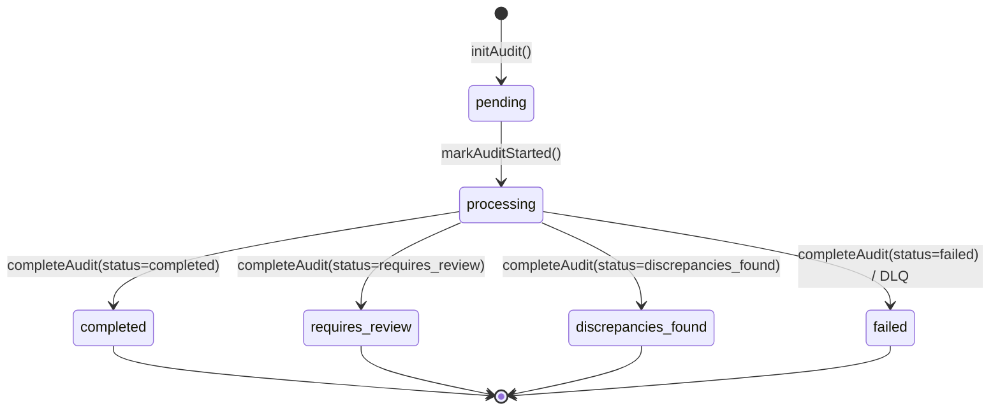
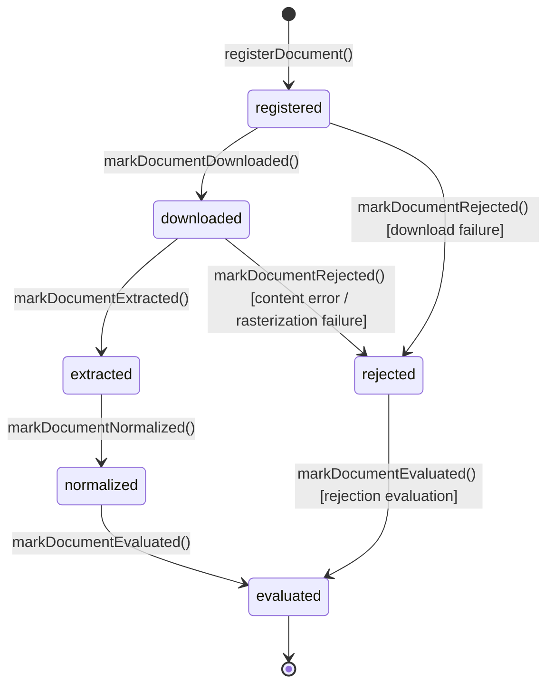
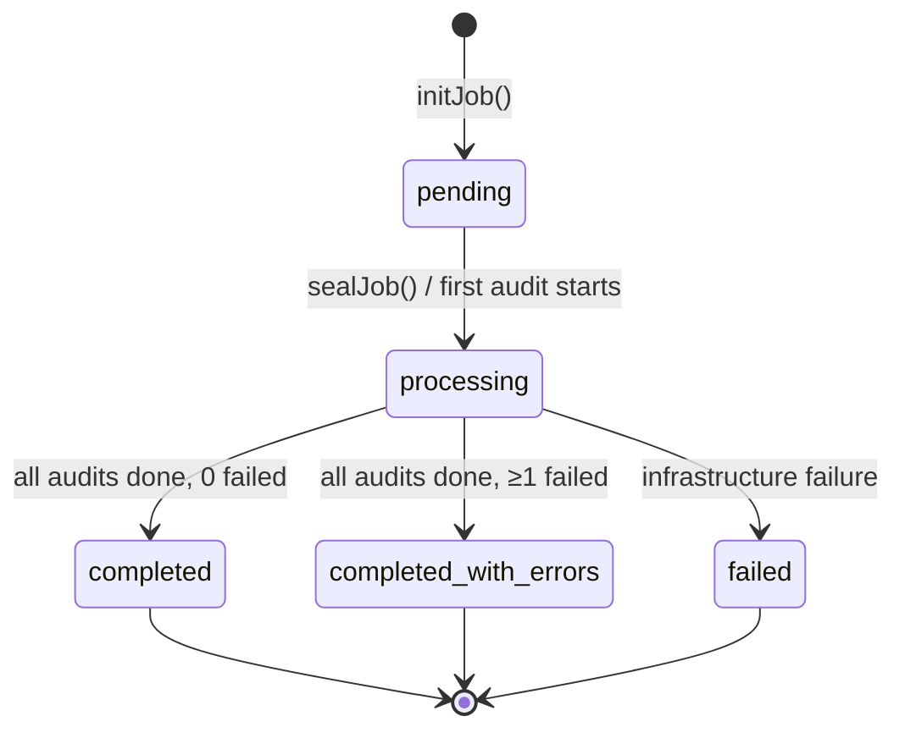

# DOC-05 — SPEC-PIPELINE-STATE-MACHINE

## Máquina de Estados del Pipeline de Auditoría Event-Driven

```yaml
document_id: "DOC-05"
document_name: "SPEC-PIPELINE-STATE-MACHINE"
version: "v0.3.0-review"
status: "REVIEW"
completeness_level: "C"
last_updated: "2026-11-04"
authors:
  - "Agente de IA (skill ddf-agnostic-spec) - borrador sin revisión humana"
reviewers: []
assumptions_count:
  S1: 2
  S2: 2
  S3: 1
  S4: 0
unknowns_critical: 1
unknowns_non_critical: 2
```

---

## §1 — Changelog y Decisiones de Revisión

| Versión | Fecha | Cambio |
|---|---|---|
| v0.2.0-draft | 2026-10-19 | Incorporación del worker de notificación `WebhookDispatcherWorker` para entrega asíncrona de veredictos al cliente (DEC-T-016 y DOC-04). Adición del evento `webhook_dispatched`. |
| v0.1.0-draft | 2026-10-05 | Borrador inicial. Línea base del pipeline event-driven con 7 workers y 13 event types. |

---

## §2 — Resumen Ejecutivo y Alcance

### 2.1 Problema que Resuelve

Un pipeline de auditoría documental necesita coordinar múltiples etapas asíncronas (orquestación, descarga, extracción, normalización, evaluación de reglas, persistencia y notificación al cliente) de forma resiliente, con visibilidad de progreso, recuperación de fallos y priorización de tráfico. La coordinación directa entre componentes genera acoplamiento temporal; los fallos parciales se pierden sin mecanismo de dead letter.

Este documento especifica la **máquina de estados del pipeline** como un grafo dirigido de eventos, definiendo:
1. El **catálogo de event types** y sus transiciones.
2. Los **workers (nodos)** y sus responsabilidades (incluyendo despacho de webhooks).
3. Las **transiciones de estado** de una auditoría (lifecycle).
4. El **mecanismo de retry y dead letter queue**.
5. Las **transiciones de estado de un documento** dentro de una auditoría.
6. El **lifecycle de un batch job**.

### 2.2 Alcance Incluido (In-Scope)

1. Catálogo de 15 event types con payload mínimo.
2. 8 worker types con sus streams de entrada/salida (incluyendo `WebhookDispatcher`).
3. Máquina de estados de auditoría (6 estados).
4. Máquina de estados de documento (5 estados).
5. Máquina de estados de batch job (5 estados).
6. Consumer loop con retry y DLQ.
7. XAUTOCLAIM para recuperación de mensajes abandonados.

### 2.3 Alcance Excluido (Out-of-Scope)

- Lógica interna de extracción → **DOC-03**.
- Motor de reglas → **DOC-02**.
- Puertos de infraestructura → **DOC-04**.
- Modelo de datos → **DOC-01**.

### 2.4 Dependencias entre Documentos

| Este Documento Requiere | Documento Fuente | Estado |
|---|---|---|
| PipelineEvent schema, WebhookDeliveryPort | DOC-04 | DRAFT v0.2.0 |
| ExtractionResult | DOC-03 | DRAFT v0.1.0 |
| FieldBinding, FindingResult | DOC-01, DOC-02 | DRAFT |

---

## §3 — Línea Base en AudFact (Evidencia del Sistema Actual)

### 3.1 Catálogo de Event Types

| Event Type | Constante | Producido Por | Consumido Por | Clasificación |
|---|---|---|---|---|
| `audit_created` | `TYPE_AUDIT_CREATED` | Ingestion API / Controller | Orchestrator | `[CONFIRMADO]` |
| `batch_created` | `TYPE_BATCH_CREATED` | Ingestion API / Controller | Orchestrator | `[CONFIRMADO]` |
| `batch_requested` | `TYPE_BATCH_REQUESTED` | Ingestion API / Controller | BatchRequestedWorker | `[CONFIRMADO]` |
| `document_registered` | `TYPE_DOCUMENT_REGISTERED` | Orchestrator | AttachmentDownloadWorker | `[CONFIRMADO]` |
| `document_downloaded` | `TYPE_DOCUMENT_DOWNLOADED` | DownloadWorker | ExtractionWorker | `[CONFIRMADO]` |
| `document_extracted` | `TYPE_DOCUMENT_EXTRACTED` | ExtractionWorker | Normalizer (implícito) | `[CONFIRMADO]` |
| `document_rejected` | `TYPE_DOCUMENT_REJECTED` | ExtractionWorker / DownloadWorker | RulesEvaluationWorker | `[CONFIRMADO]` |
| `document_normalized` | `TYPE_DOCUMENT_NORMALIZED` | Normalizer | RulesEvaluationWorker | `[CONFIRMADO]` |
| `rules_evaluated` | `TYPE_RULES_EVALUATED` | RulesEvaluationWorker | PersistenceWorker | `[CONFIRMADO]` |
| `audit_completed` | `TYPE_AUDIT_COMPLETED` | PersistenceWorker | WebhookDispatcher / ResultConsumer | `[CONFIRMADO]` |
| `audit_failed` | `TYPE_AUDIT_FAILED` | Consumer (DLQ) | WebhookDispatcher / ResultConsumer | `[CONFIRMADO]` |
| `webhook_dispatched` | `TYPE_WEBHOOK_DISPATCHED` | WebhookDispatcherWorker | Observabilidad / Trazabilidad | `[CONFIRMADO]` |
| `dead_letter` | `TYPE_DEAD_LETTER` | Consumer (retry exhausted) | Admin DLQ controller | `[CONFIRMADO]` |

### 3.2 Workers (Nodos del Pipeline)

| Worker | Clase | Grupo de Consumer | Streams de Entrada | Evento de Salida |
|---|---|---|---|---|
| Orchestrator | [DocumentAuditOrchestrator](../app/Services/Audit/Pipeline/DocumentAuditOrchestrator.php) | `orchestrator` | inbox.{priority,batch} | `document_registered` × N |
| Downloader | [AttachmentDownloadWorker](../app/Services/Audit/Pipeline/AttachmentDownloadWorker.php) | `downloaders` | documents.{priority,batch} | `document_downloaded` |
| Extractor | [DocumentExtractionWorker](../app/Services/Audit/Pipeline/DocumentExtractionWorker.php) | `extractors` | documents.{priority,batch} | `document_extracted` / `document_rejected` |
| Normalizer | [DocumentNormalizer](../app/Services/Audit/Pipeline/DocumentNormalizer.php) | `normalizers` | documents.{priority,batch} | `document_normalized` |
| PolicyEngine | [RulesEvaluationWorker](../app/Services/Audit/Pipeline/RulesEvaluationWorker.php) | `policy` | documents.{priority,batch} | `rules_evaluated` |
| Persistence | [AuditPersistenceWorker](../app/Services/Audit/Pipeline/AuditPersistenceWorker.php) | `persistence` | persistence.{priority,batch} | `audit_completed` / `audit_failed` |
| WebhookDispatcher | `WebhookDispatcherWorker` | `webhook-dispatchers` | results.{priority,batch} | `webhook_dispatched` |
| BatchRequested | [BatchRequestedWorker](../app/Services/Audit/Pipeline/BatchRequestedWorker.php) | `batch-workers` | batch.inbox | `audit_created` × N |

### 3.3 Reglas de Negocio Actuales

| ID | Regla | Evidencia | Clasificación |
|---|---|---|---|
| R-01 | Consumer loop: XREADGROUP bloqueante con `blockMs` configurable (default 5000ms). 1 mensaje por read. | [AuditEventConsumer.php:179-185](../app/Services/Audit/Pipeline/AuditEventConsumer.php#L179-L185) | `[CONFIRMADO]` |
| R-02 | Retry: max 3 intentos por evento. Contador en Redis key `event:{eventId}:attempts`. | [AuditEventConsumer.php:50, 524-526](../app/Services/Audit/Pipeline/AuditEventConsumer.php#L50) | `[CONFIRMADO]` |
| R-03 | Non-retryable exceptions: DomainException, InvalidArgumentException, SqlServerOperationException, AttachmentDownloadException → DLQ directamente. | [AuditEventConsumer.php:543-546](../app/Services/Audit/Pipeline/AuditEventConsumer.php#L543-L546) | `[CONFIRMADO]` |
| R-04 | DLQ: evento `dead_letter` creado con metadata (failed_event_type, failed_stream, failed_stage, attempts, error). Publicación idempotente vía Lua. | [AuditEventConsumer.php:689-713](../app/Services/Audit/Pipeline/AuditEventConsumer.php#L689-L700) | `[CONFIRMADO]` |
| R-05 | Al enviar a DLQ, se finaliza la auditoría: status=`failed`, requires_manual_review=true. Si tiene jobId, se marca en el batch. | [AuditEventConsumer.php:603-647](../app/Services/Audit/Pipeline/AuditEventConsumer.php#L603-L647) | `[CONFIRMADO]` |
| R-06 | XAUTOCLAIM: reclaim periódico de mensajes idle > `pendingReclaimIdleMs` (default 10min). Intervalo configurable. | [AuditEventConsumer.php:60-69, 223-266](../app/Services/Audit/Pipeline/AuditEventConsumer.php#L60-L69) | `[CONFIRMADO]` |
| R-07 | Terminal ACK: Lua script atómico que verifica recibo DLQ, ejecuta XACK, aplica EXPIRE al recibo y elimina attempts key. | [AuditEventConsumer.php:580-588](../app/Services/Audit/Pipeline/AuditEventConsumer.php#L580-L588) | `[CONFIRMADO]` |
| R-08 | Consumer group: creado con `XGROUP CREATE` y cursor `0` al iniciar. Si ya existe, se ignora el error. | [AuditEventConsumer.php:268-275](../app/Services/Audit/Pipeline/AuditEventConsumer.php#L268-L275) | `[CONFIRMADO]` |
| R-09 | AuditState transitions: pending → processing (markAuditStarted) → completed/manual_review/error/failed (completeAudit). | [AuditStateStore.php:17-28, 138-146, 247-255](../app/Services/Audit/Pipeline/AuditStateStore.php#L17-L28) | `[CONFIRMADO]` |
| R-10 | DocumentState transitions: registered → downloaded → extracted → normalized → evaluated. Rejected es terminal desde downloaded o extracted. | [AuditStateStore.php:149-214](../app/Services/Audit/Pipeline/AuditStateStore.php#L149-L214) | `[CONFIRMADO]` |
| R-11 | Lua scripts validan que auditoría no esté en estado terminal antes de registrar documentos (guard clause). | [AuditStateStore.php:288-294](../app/Services/Audit/Pipeline/AuditStateStore.php#L288-L294) | `[CONFIRMADO]` |
| R-12 | Batch terminal event: se publica solo 1 vez, protegido por `claimBatchTerminalEvent()` atómico. | [AuditEventConsumer.php:653-687](../app/Services/Audit/Pipeline/AuditEventConsumer.php#L653-L687) | `[CONFIRMADO]` |
| R-13 | Consumer name: `{role}[-{lane}]-{hostname}-{pid}` para identificación única. | [AuditEventConsumer.php:125-133](../app/Services/Audit/Pipeline/AuditEventConsumer.php#L125-L133) | `[CONFIRMADO]` |
| R-14 | Signal handling: `pcntl_signal_dispatch()` en cada iteración del loop para graceful shutdown. | [AuditEventConsumer.php:164-166](../app/Services/Audit/Pipeline/AuditEventConsumer.php#L164-L166) | `[CONFIRMADO]` |

### 3.4 Casos Borde y Excepciones Documentados

1. **NOGROUP error en XREADGROUP**: Si el consumer group no existe (ej: `FLUSHDB`), Redis retorna `NOGROUP`. El worker detecta esta respuesta y lanza `RuntimeException` para reiniciar el grupo. [AuditEventConsumer.php:268-275](../app/Services/Audit/Pipeline/AuditEventConsumer.php#L268-L275). `[CONFIRMADO]`

2. **Worker muere entre XADD DLQ y XACK**: El mensaje queda en la PEL. `XAUTOCLAIM` lo reclama después de `pendingReclaimIdleMs` (10min). El handler detecta que ya existe recibo DLQ y ejecuta Terminal ACK directamente. [AuditEventConsumer.php:580-588](../app/Services/Audit/Pipeline/AuditEventConsumer.php#L580-L588). `[CONFIRMADO]`

3. **Batch terminal race condition**: Dos workers finalizan el último documento simultáneamente. `claimBatchTerminalEvent()` usa operación atómica Redis (SETNX); solo 1 worker gana y sella el job. [AuditEventConsumer.php:653-687](../app/Services/Audit/Pipeline/AuditEventConsumer.php#L653-L687). `[CONFIRMADO]`

4. **registerDocument en auditoría terminal**: Lua guard clause verifica status antes de registrar. Si la auditoría ya completó/falló, retorna éxito sin modificar estado. [AuditStateStore.php:288-294](../app/Services/Audit/Pipeline/AuditStateStore.php#L288-L294). `[CONFIRMADO]`

5. **Signal dispatch en handler largo**: Si el handler tarda más que `pendingReclaimIdleMs`, otro worker puede reclamar el mismo mensaje vía XAUTOCLAIM. El handler original falla en XACK (ya reclamado) y loguea warning sin propagarle error al pipeline. `[CONFIRMADO]`

---

## §4 — Diseño del Contrato Agnóstico (Especificación Técnica)

### 4.1 Modelo de Datos / Esquemas

#### Schema: EventTypeCatalog

```json
{
  "$schema": "https://json-schema.org/draft/2020-12/schema",
  "$id": "https://schemas.invalid/audit-platform/doc-05/v0.3/event-type-catalog.schema.json",
  "title": "EventTypeCatalog",
  "type": "string",
  "enum": [
    "audit_created",
    "batch_created",
    "batch_requested",
    "document_registered",
    "document_downloaded",
    "document_extracted",
    "document_rejected",
    "document_normalized",
    "rules_evaluated",
    "audit_completed",
    "audit_failed",
    "webhook_dispatched",
    "dead_letter"
  ]
}
```

#### Schema: WorkerConfig

```json
{
  "$schema": "https://json-schema.org/draft/2020-12/schema",
  "$id": "https://schemas.invalid/audit-platform/doc-05/v0.3/worker-config.schema.json",
  "title": "WorkerConfig",
  "type": "object",
  "properties": {
    "max_retries": {
      "type": "integer",
      "minimum": 1,
      "default": 3
    },
    "block_ms": {
      "type": "integer",
      "minimum": 100,
      "default": 5000
    },
    "pending_reclaim_idle_ms": {
      "type": "integer",
      "minimum": 30000,
      "default": 600000
    },
    "pending_reclaim_interval_ms": {
      "type": "integer",
      "minimum": 5000,
      "default": 30000
    },
    "lane": {
      "type": "string",
      "enum": [
        "all",
        "priority",
        "batch"
      ],
      "default": "all"
    }
  },
  "required": [
    "max_retries",
    "block_ms"
  ]
}
```

### 4.2 Grafo de Transiciones del Pipeline

```mermaid
stateDiagram-v2
    direction LR
    
    [*] --> audit_created: solicitud individual
    [*] --> batch_requested: solicitud batch
    
    batch_requested --> audit_created: N instancias
    
    audit_created --> document_registered: orchestration (×N docs)
    
    document_registered --> document_downloaded: download
    document_registered --> document_rejected: download failure
    
    document_downloaded --> document_extracted: extraction (IA)
    document_downloaded --> document_rejected: extraction failure / content error
    
    document_extracted --> document_normalized: normalization
    
    document_normalized --> rules_evaluated: policy evaluation
    document_rejected --> rules_evaluated: rejection evaluation
    
    rules_evaluated --> audit_completed: all docs processed (persistence)
    rules_evaluated --> audit_failed: terminal error (persistence)
    
    audit_completed --> webhook_dispatched: callback configurado y entrega confirmada
    webhook_dispatched --> [*]
    audit_completed --> [*]: sin callback
    audit_failed --> [*]
    
    note right of document_rejected: Rejected = documento no válido para extracción.
    note right of rules_evaluated: Último documento evaluado dispara persistencia.
```



### 4.3 Máquina de Estados — Auditoría



| Estado | Significado | Quién Transiciona |
|---|---|---|
| `pending` | Auditoría creada, esperando orquestación | `initAudit()` |
| `processing` | Al menos un documento siendo procesado | `markAuditStarted()` |
| `completed` | Todos los documentos evaluados sin hallazgos de alta severidad | `completeAudit()` |
| `requires_review` | Hallazgos de alta severidad requieren revisión humana | `completeAudit()` |
| `discrepancies_found` | Discrepancias documentales no críticas detectadas | `completeAudit()` |
| `failed` | Error fatal de pipeline (timeout, proveedor IA caído, excepción no recuperable) | `completeAudit()` / DLQ handler |

### 4.4 Máquina de Estados — Documento



### 4.5 Máquina de Estados — Batch Job



### 4.6 Interfaces

#### Interfaz: PipelineWorker (Nodo del Pipeline)

```typescript
interface PipelineWorker {
  /**
   * Streams de entrada que este worker consume.
   */
  streams(): string[];

  /**
   * Consumer group al que pertenece este worker.
   */
  group(): string;

  /**
   * Nombre único del consumer (hostname + pid + lane).
   */
  consumer(): string;

  /**
   * Procesa un evento del pipeline.
   *
   * Precondiciones: event es un PipelineEvent válido del stream correcto
   * Postcondiciones: 
   *   - Si éxito: publica evento(s) de salida y hace ACK
   *   - Si fallo retryable: no ACK, el mensaje se reclamará vía XAUTOCLAIM
   *   - Si fallo terminal o reintentos agotados: envía a DLQ, marca auditoría como failed
   */
  handle(event: PipelineEvent): void;

  /**
   * Loop principal del consumer.
   *
   * Invariantes:
   *   - Reclama mensajes pending al inicio
   *   - XREADGROUP bloqueante en cada iteración
   *   - Signal dispatch para graceful shutdown
   *   - Retry counter en state store
   */
  run(maxEvents?: number): number;

  /**
   * Solicita terminación graceful del loop.
   */
  requestStop(): void;
}
```

#### Interfaz: RetryPolicy

```typescript
interface RetryPolicy {
  /**
   * Determina si un error es retryable.
   * 
   * Invariante: DomainException, InvalidArgumentException, 
   *   StorageOperationException, DownloadException → NO retryable (DLQ directo)
   */
  isRetryable(error: Error): boolean;

  /**
   * Incrementa y retorna el contador de intentos.
   */
  incrementAttempts(eventId: string): number;

  /**
   * Limpia el contador tras éxito.
   */
  clearAttempts(eventId: string): void;
}

type NonRetryableErrorTypes = [
  "DomainException",
  "InvalidArgumentException", 
  "StorageOperationException",
  "DownloadException"
];
```

### 4.7 Algoritmos

#### ALG-01: ConsumerLoop — Loop principal del worker

```
ALGORITMO: ConsumerLoop
ENTRADA: worker: PipelineWorker, config: WorkerConfig
SALIDA: processedCount: int

1. ASSERT stateStore disponible
2. ensureGroup(): XGROUP CREATE para cada stream activo
3. processed ← reclaimPending()  // Recuperar abandonados al inicio

4. MIENTRAS !stopRequested ∧ (maxEvents=0 ∨ processed < maxEvents):
   4.1. pcntl_signal_dispatch()
   4.2. processed += reclaimPendingIfDue()
   4.3. messages ← XREADGROUP(group, consumer, streams, count=1, block=blockMs)
   4.4. SI messages vacío → CONTINUAR
   4.5. PARA CADA message EN messages:
        dispatchMessage(message)
        processed++

5. RETORNAR processed
```

#### ALG-02: DispatchMessage — Lease, efecto durable y ACK

[CONFIRMADO — diseño futuro] Revisión de DEC-T-019 / VER-07. La presencia de una clave de recepción no prueba éxito.

```text
ENTRADA: mensaje, consumidor, contexto de servicio autorizado
CLAVE: (tenant_id, consumer_group, event_id)
RECIBO: PROCESSING(owner, fencing_token, lease_until) | COMPLETED(effect_digest)

1. Validar schema de evento, contexto de tenant y tipo consumido.
   Mensaje inválido: cuarentena durable con identificador de transporte; ACK solo tras confirmarla.
2. Leer/crear el recibo durable dentro de una transacción:
   a. COMPLETED: verificar efecto y outbox confirmados; ACK sin repetir trabajo.
   b. PROCESSING con lease vigente de otro owner: conservar pendiente; no ACK.
   c. Ausente o lease vencido: adquirir/reclamar, incrementar fencing_token.
3. Ejecutar trabajo usando execution_id y snapshots fijados.
   Renovar lease mientras exista trabajo activo; perderlo impide commit.
   Una llamada externa usa provider_attempt_id; si queda incierta, registrar UNKNOWN
   y conciliar su estado/consumo antes de decidir una nueva llamada.
4. Confirmar en UNA transacción durable:
   verificar owner + fencing_token + lease vigente;
   persistir resultado, consumo conocido y eventos de salida en outbox;
   marcar el recibo COMPLETED con el digest de esos efectos.
5. Hacer ACK después del commit. El relay publica la outbox con event_id estable.
   Un fallo después del commit se recupera por el recibo y la outbox.
6. Un fallo antes del commit deja trabajo recuperable por expiración del lease.
   Un fallo terminal confirma cuarentena/DLQ y el estado terminal antes de ACK.
```

[CONFIRMADO — diseño futuro] El recibo durable usa la misma frontera transaccional que los efectos de plataforma (PostgreSQL y outbox). Redis proyecta estado y transporte. No se garantiza una única invocación externa ante una caída de resultado incierto; cada intento real conserva identidad y conciliación. El tamaño del lease, renovación y retención de recibos requiere contrato operativo y pruebas de fallos antes de aprobar este módulo (U-RECOVERY-01, S3).

#### ALG-03: HandleFailure — Retry o DLQ

```
ALGORITMO: HandleFailure
ENTRADA: event, stream, streamId, error
SALIDA: void (DLQ o NACK implícito)

1. attempts ← incrementar contador durable por (tenant_id, consumer_group, event.event_id)
2. nonRetryable ← error IS DomainException | InvalidArgumentException | StorageOpException | DownloadException

3. SI attempts ≥ maxRetries ∨ nonRetryable:
   3.1. Dentro de una transacción durable, verificar lease y fencing token:
        - Persistir el fallo terminal y la necesidad de revisión.
        - Registrar una vez la finalización del caso en el lote.
        - Insertar audit_failed y dead_letter en outbox con IDs estables.
        - Marcar recibo COMPLETED para este procesamiento terminal.
   3.2. Tras commit, ACK del mensaje original; si falla, la reentrega consulta el recibo.
   3.3. El relay entrega la outbox y actualiza las proyecciones. No borrar el recibo
        hasta cumplir la retención de replay; un contador Redis no reemplaza este commit.
   
4. SI NO (attempts < maxRetries ∧ retryable):
   // No ACK → el mensaje permanece en PEL
   // XAUTOCLAIM lo reclamará tras idle timeout
```

#### ALG-04: ReclaimPending — Recuperación de mensajes abandonados

```
ALGORITMO: ReclaimPending
ENTRADA: maxMessages: int
SALIDA: processed: int

1. PARA CADA stream EN activeStreams:
   1.1. cursor ← "0-0"
   1.2. REPETIR:
        result ← XAUTOCLAIM(stream, group, consumer, minIdleMs, cursor, count=10)
        PARA CADA message EN result.messages:
          dispatchMessage(message)
          processed++
        cursor ← result.next
   1.3. HASTA cursor = "0-0" ∨ stopRequested
```

#### ALG-05: BatchCompletion — Evento terminal de batch

```
ALGORITMO: BatchCompletion
ENTRADA: jobStore, jobId, auditId, parentEventId
SALIDA: void (publica batch_completed o batch_completed_with_errors, o nada)

1. job ← jobStore.getJob(jobId)
   SI job = null → RETORNAR

2. jobStatus ← job.status
3. eventType ← MATCH jobStatus:
     completed → batch_completed
     completed_with_errors → batch_completed_with_errors
     _ → null

4. SI eventType = null → RETORNAR  // Job no ha terminado aún

5. En una transacción durable, insertar evento en outbox con clave única
   (tenant_id, jobId, eventType); duplicado → retornar el evento existente.
6. Relay publica el evento estable y registra entrega; un fallo se reintenta.
   No separar un claim irreversible de la creación durable del evento.
```

### 4.8 Invariantes del Módulo

- **INV-01**: Cada event type tiene exactamente un stream de destino para una prioridad dada. El routing es determinista y exhaustivo.
- **INV-02**: Un evento no-ACK permanece en el PEL (Pending Entries List) hasta ser reclamado vía XAUTOCLAIM o ACK explícito.
- **INV-03**: Tras agotar reintentos (o ante fallo irrecuperable), el estado terminal, el evento DLQ en outbox y el recibo durable se confirman de forma atómica en una única transacción antes de realizar ACK en el transporte de entrada.
- **INV-04**: El ACK en el transporte de mensajería solo se emite tras certificar la persistencia transaccional del recibo terminal/DLQ; la publicación hacia streams o colas DLQ externas se desacopla mediante el outbox relay idempotente (la implementación de referencia AudFact PHP utiliza el script Lua `finishTerminalMessage` como puente operativo transitorio).
- **INV-05**: El batch terminal tiene una sola identidad durable en outbox; su transporte admite reentrega y cada consumidor deduplica tras commit.
- **INV-06**: Las transiciones de estado de documento no retroceden: registered→downloaded→extracted→normalized→evaluated.
- **INV-07**: El Lua script de `registerDocument()` rechaza registros si la auditoría ya está en estado terminal.
- **INV-08**: Consumer name es único por instancia: `{role}-{lane}-{hostname}-{pid}`.
- **INV-09**: Los errores de dominio (DomainException, InvalidArgumentException) nunca se reintentan.

---

## §5 — Análisis de Impacto Inverso y Verificación de Abstracción

### 5.1 Tabla de Cobertura

| Funcionalidad Actual (§3) | Contrato Agnóstico (§4) | ¿Cobertura? |
|---|---|:---:|
| R-01 XREADGROUP bloqueante | ALG-01 paso 4.3 | ✅ |
| R-02 Max 3 retry con counter | ALG-03 paso 1, WorkerConfig | ✅ |
| R-03 Non-retryable exceptions | RetryPolicy.isRetryable + ALG-03 paso 2 | ✅ |
| R-04 DLQ con Lua idempotente | ALG-03 paso 3.2, DOC-04 ALG-04 | ✅ |
| R-05 Finalización pre-DLQ | ALG-03 paso 3.1 | ✅ |
| R-06 XAUTOCLAIM periódico | ALG-04 | ✅ |
| R-07 Terminal ACK tras commit | ALG-03 + INV-04 (recibo durable y outbox antes de ACK) | ✅ |
| R-08 XGROUP CREATE al inicio | ALG-01 paso 2 | ✅ |
| R-09 Audit state transitions | §4.3 máquina de estados | ✅ |
| R-10 Document state transitions | §4.4 máquina de estados | ✅ |
| R-11 Guard clause terminal | INV-07 | ✅ |
| R-12 Batch terminal once | ALG-05 + INV-05 | ✅ |
| R-13 Consumer name unique | INV-08 | ✅ |
| R-14 Signal dispatch | ALG-01 paso 4.1 | ✅ |

**Trazabilidad declarada: 14/14 filas de esta tabla.** Es cobertura del inventario descrito, no evidencia de ejecución o de inventario exhaustivo del sistema.

### 5.2 Prueba de Dominio Dual

| Contrato | Caso AudFact (Salud) | Caso Alternativo (Legal — Revisión de Contratos) | ¿Funciona? |
|---|---|---|:---:|
| ConsumerLoop | Worker PHP con Redis Streams | Worker Go con NATS JetStream | ✅ |
| EventTypeCatalog | 14 tipos de auditoría documental | 12 tipos de revisión contractual | ✅ |
| RetryPolicy | 3 intentos, DomainException no-retryable | 5 intentos, ValidationError no-retryable | ✅ |
| Audit lifecycle | pending→processing→completed | pending→reviewing→approved | ✅ |
| Batch lifecycle | pending→processing→completed_with_errors | pending→reviewing→partially_approved | ✅ |

### 5.3 Auditoría de Fugas de Abstracción

| Término Buscado | ¿Encontrado en §4? | Acción |
|---|:---:|---|
| paciente | ❌ | — |
| médico | ❌ | — |
| fórmula médica | ❌ | — |
| dispensación | ❌ | — |
| medicamento | ❌ | — |
| EPS | ❌ | — |

---

## §6 — Matriz de Trazabilidad y Riesgos

### 6.1 Trazabilidad Bidireccional

| Requisito Funcional | Elemento del Contrato (§4) | Criterio de Aceptación (§7) |
|---|---|---|
| Consumer loop con ACK | ALG-01 ConsumerLoop | TC-01, TC-02 |
| Reclaim de mensajes idle | ALG-02 ReclaimPending | TC-03 |
| Retry con contador + DLQ | ALG-03 RetryPolicy | TC-04, TC-05 |
| Terminal ACK tras commit | ALG-03 + INV-04 (commit durable y outbox) | TC-06 |
| Transiciones de estado de auditoría | StateMachine Auditoría (§4.4) | TC-07 |
| Transiciones de estado de documento | StateMachine Documento (§4.4) | TC-08, TC-09 |
| Batch terminal idempotente | ALG-04 BatchTerminal | TC-10 |

### 6.2 Riesgos

| ID | Riesgo | Probabilidad | Impacto | Mitigación |
|---|---|:---:|:---:|---|
| RISK-01 | XAUTOCLAIM reclaim loop infinito si handler siempre falla | Baja | Alto | maxRetries limita a 3 intentos → DLQ |
| RISK-02 | Consumer group desaparece en runtime (flushdb, error de operador) | Baja | Alto | Detección explícita de NOGROUP con RuntimeException |
| RISK-03 | Batch terminal event nunca se publica si último worker muere post-markAudit pre-publish | Baja | Medio | XAUTOCLAIM reclamará el mensaje pendiente |

### 6.2 Supuestos Declarados

| ID | Supuesto | Severidad | Justificación | Ruta de Validación |
|---|---|:---:|---|---|
| A-01 | El idle timeout de XAUTOCLAIM (default 10min) es suficiente para que un worker legítimo termine su procesamiento. | S2 | [AuditEventConsumer.php:60-63](../app/Services/Audit/Pipeline/AuditEventConsumer.php#L60-L63). Configurable. | Monitoreo de duración de handlers |
| A-02 | Leer 1 mensaje por XREADGROUP es suficiente para evitar starvation entre streams priority/batch. | S1 | [AuditEventConsumer.php:183](../app/Services/Audit/Pipeline/AuditEventConsumer.php#L183). | Benchmark de throughput |
| A-03 | El modelo de consumer groups (competing consumers) provee distribución equitativa entre workers del mismo grupo. | S1 | Comportamiento nativo de Redis Streams. | N/A |
| A-04 | `pcntl_signal_dispatch()` es suficiente para graceful shutdown en un contexto PHP-FPM + CLI. | S2 | [AuditEventConsumer.php:164-166](../app/Services/Audit/Pipeline/AuditEventConsumer.php#L164-L166). Solo aplica en CLI; FPM usa shutdown handlers. | Verificación operacional |

### 6.3 Desconocidos No Críticos

| ID | Hecho | Motivo | Clasificación |
|---|---|---|:---:|
| U-01 | ¿Existe un mecanismo de alerta proactiva cuando la PEL crece más allá de un umbral? | No encontrado en el código. Solo logging. | `[DESCONOCIDO]` |
| U-02 | ¿Existe back-pressure entre el orchestrator y los extractors cuando la cola de documentos crece? | No encontrado; el MAXLEN del stream es el único control. | `[DESCONOCIDO]` |

---

## §7 — Criterios de Aceptación Verificables

### Consumer Loop

| ID | Descripción | Input | Output Esperado | Tipo |
|---|---|---|---|---|
| TC-01 | Consumer procesa 1 evento y ACK | 1 evento válido en stream | processed=1, evento ACK'd | Unitario |
| TC-02 | Consumer para tras maxEvents | maxEvents=3, 5 en stream | processed=3 | Unitario |
| TC-03 | Consumer ejecuta reclaimPending al inicio | 2 mensajes idle en PEL | processed=2 antes del loop principal | Unitario |

### Retry y DLQ

| ID | Descripción | Input | Output Esperado | Tipo |
|---|---|---|---|---|
| TC-04 | 3 fallos → DLQ + audit_failed | 3 RuntimeExceptions | dead_letter publicado, status=failed | Unitario |
| TC-05 | DomainException → DLQ inmediato sin retry | 1 DomainException | dead_letter publicado en attempt 1 | Unitario |
| TC-06 | Terminal ACK condicionado: sin commit durable → no ACK | Fallo en commit de estado terminal o outbox | Mensaje no ACK'd en transporte (recuperable vía lease/reclaim) | Unitario |

### State Transitions

| ID | Descripción | Input | Output Esperado | Tipo |
|---|---|---|---|---|
| TC-07 | Audit: pending → processing → completed | markAuditStarted + completeAudit | status=completed | Unitario |
| TC-08 | Document: registered → rejected (download) → evaluated | markRejected + markEvaluated | status=evaluated, docs_rejected=1 | Unitario |
| TC-09 | registerDocument en auditoría terminal → no-op | status=completed + registerDocument | retorna true (guard), sin cambio | Unitario |

### Batch

| ID | Descripción | Input | Output Esperado | Tipo |
|---|---|---|---|---|
| TC-10 | Batch terminal: job se sella 1 sola vez | 2 workers intentan claimBatchTerminal | Solo 1 patchJob ejecutado, 0 eventos publicados | Unitario |

---

## §8 — Puerta de Calidad — Revisión del 2026-11-03

| Comprobación | Estado | Evidencia / límite |
| --- | --- | --- |
| Schemas y referencias | COMPROBACIÓN LOCAL | `node opt/tools/validate-ddf.cjs` valida JSON, schemas y controles documentales; la salida identifica conteos y versiones. |
| Algoritmos y contratos | REVIEW | Especificación de diseño; no acredita implementación de puertos, transacciones ni motor. |
| Pruebas del SaaS | PENDIENTE | Los escenarios de este documento requieren código y fixtures ejecutables del repositorio futuro. |
| Dominio dual | PENDIENTE DE EJECUCIÓN | Los ejemplos no prueban ejecución del mismo motor en dos dominios. |
| Aprobación de implementación | NO | Nivel C; ver dependencias del maestro y U-DOC-05. |

[DESCONOCIDO] U-DOC-05 (S3): conformidad integral de este módulo con los contratos de aplicación, sus adaptadores y pruebas de recuperación/aislamiento. Bloquea su aprobación como guía completa del SaaS.

[CONFIRMADO] Los PASS históricos por inspección y las referencias a 137 comprobaciones previas no son certificados actuales. El comprobador restaurado tiene un alcance propio y no reproduce la suite histórica perdida. Persistencia, autorización, proveedor IA, normalización completa, revisión humana y benchmark siguen requiriendo pruebas de implementación.

### Clasificación vigente

```yaml
completeness_level: C
implementation_ready: false
blockers:
  - U-DOC-05
  - Contratos de aplicación y validación integrada del repositorio futuro
next_actions:
  - Ejecutar las pruebas de integración de este módulo contra contratos versionados
  - Mantener separados los resultados documentales y los del motor
```
