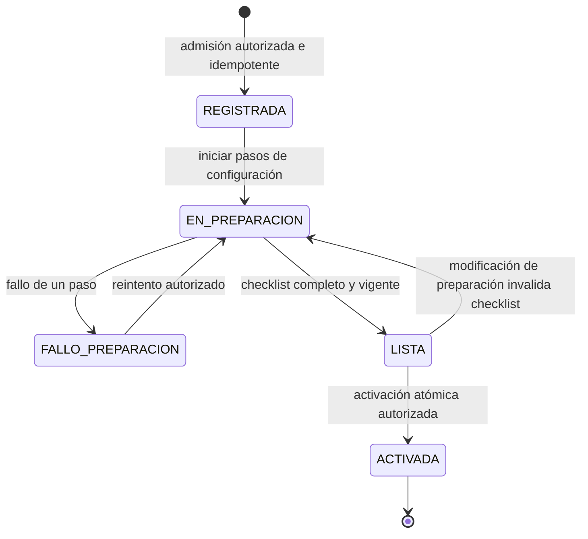

# SPEC-SAAS-MASTER — Especificación maestra del SaaS documental B2B

## 1. Metadatos y control de estado

```yaml
document_id: SPEC-SAAS-MASTER
version: 0.2.0-draft
status: DRAFT_COMPLETE
completeness_level: C
last_updated: 2026-10-19
decision_mode: una_pregunta_de_producto_a_la_vez
active_gap: NINGUNO_INVENTARIO_INICIAL_COMPLETO
implementation_ready: true
```

Este documento registra el cierre progresivo de decisiones para la nueva plataforma. Su estado DRAFT y nivel D indican descubrimiento pendiente; ninguna recomendación de producto equivale a una decisión del usuario. Los DOC-01 a DOC-07 conservan sus estados de revisión propios.

## 2. Objetivo, alcance y autoridad

[CONFIRMADO] El usuario define como objetivo construir un nuevo motor SaaS global B2B, multitenant y configurable por dominio, negocio, tipo documental y campos auditados. Fuente: conversación del 2026-10-06.

[CONFIRMADO] El usuario autoriza resolver los gaps uno a uno: las decisiones de producto o negocio se consultan mediante una pregunta por vez; las decisiones técnicas se complementan desde arquitectura. Fuente: instrucción del usuario del 2026-10-06.

El alcance de esta fase es la especificación. Sus entregables son decisiones trazables, contratos consistentes y criterios de aceptación. La selección final de stack, los contratos públicos definitivos y la ejecución de la migración dependen del cierre de los gaps correspondientes.

### 2.1 Reglas de autoridad documental

1. El objetivo y las decisiones explícitas del usuario gobiernan el alcance de producto.
2. Este documento registra decisiones de alcance, sus fuentes y el estado de los gaps; los contratos especializados se definen en su documento propietario.
3. Cada contrato compartido debe tener una sola definición versionada y referencias desde sus consumidores. Si dos documentos divergen, registrar la contradicción y resolverla; no elegir una versión silenciosamente.
4. Una decisión técnica adoptada para la especificación describe el diseño futuro, no el estado implementado de AudFact.
5. Las pruebas comprueban los contratos aprobados. Una prueba o implementación divergente no modifica el contrato sin una decisión explícita y un cambio versionado.
6. Cada respuesta del usuario se registra con su significado, impacto, criterios de aceptación y decisiones que todavía deja abiertas.
7. No convertir una decisión de producto pendiente en un supuesto aceptado por transcurso de tiempo.

### 2.2 Inventario documental inicial

| Documento | Responsabilidad actual | Trabajo identificado |
|---|---|---|
| [DOC-01](DOC-01-SPEC-DOMAIN-METAMODEL.md) | Meta-modelo y definición de procesos | Separar cliente legado de tenant SaaS; alinear identidad, configuración y versiones. |
| [DOC-02](DOC-02-SPEC-RULE-ENGINE.md) | Comparación y políticas de veredicto | Delimitar operadores de plataforma y políticas configurables. |
| [DOC-03](DOC-03-SPEC-AI-PROVIDER-SPI.md) | Extracción y proveedores de IA | Definir capacidades, contexto autorizado, presupuestos y pruebas de conformidad. |
| [DOC-04](DOC-04-SPEC-PORTS-AND-ADAPTERS.md) | Puertos y adaptadores | Resolver contexto de tenant opcional y exposición de SQL/conexiones al consumidor del puerto. |
| [DOC-05](DOC-05-SPEC-PIPELINE-STATE-MACHINE.md) | Ejecución y eventos | Especificar aislamiento, idempotencia, versiones y recuperación. |
| [DOC-06](DOC-06-PROFILE-HEALTH-DISPENSATION.md) | Perfil de referencia AudFact | Documentar el negocio actual y su migración, sin asumir que las EPS son tenants. |
| [DOC-07](DOC-07-SPEC-GOLDEN-BENCHMARK.md) | Benchmark y replay | Separar paridad, corrección, reproducibilidad y capacidad; respaldar cada resultado con ejecución. |

La ubicación y numeración de los contratos adicionales del SaaS se decidirán después de delimitar sus responsabilidades. No asignarles estado APPROVED por aparecer en este inventario.

## 3. Línea base confirmada

| ID | Hecho y clasificación | Evidencia |
|---|---|---|
| BASE-01 | [CONFIRMADO] AudFact no tiene la segmentación por tenants requerida para el nuevo SaaS. | Aclaración explícita del usuario después de consultar GET /clients, conversación del 2026-10-06. |
| BASE-02 | [CONFIRMADO] El catálogo actual devuelve clientes de negocio identificados por NitSec y NitCom. La consulta revisada no recibe contexto de tenant. | C:/Users/USER/Desktop/AudFact/app/Models/ClientsModel.php, ClientsModel::getAllClients(), líneas observadas 47-79; GET /clients devolvió 21 registros. |
| BASE-03 | [CONFIRMADO] Las configuraciones de documentos del cliente se consultan por NitSec. | C:/Users/USER/Desktop/AudFact/app/Models/ClientsModel.php, ClientsModel::getDocumentsByClient(), líneas observadas 82-110. |
| BASE-04 | [CONFIRMADO] DOC-01 exige tenant_id en AuditCase, pero DOC-04 permite omitirlo en AuditState e InitOptions. Esta es una inconsistencia de las especificaciones actuales. | C:/Users/USER/Desktop/AudFact/opt/DOC-01-SPEC-DOMAIN-METAMODEL.md, schema AuditCase, required; C:/Users/USER/Desktop/AudFact/opt/DOC-04-SPEC-PORTS-AND-ADAPTERS.md, schemas y puertos de sección 4, líneas observadas 219 y 326. |
| BASE-05 | [CONFIRMADO] Una auditoría persistida devuelve `EstadoDetallado=manual_review`, `RequiereRevisionHumana=1` y `auditExecuted=true`: 3 documentos, 30 campos, 29 coincidencias y una discrepancia alta en `CodigoProducto` de `AUTORIZACION`. El hallazgo es `VALOR_DISTINTO`, comparación `exact`, entre el código `15` del registro y `20071759-1` del soporte. | GET `http://localhost:8080/audit/results/D12260901883`, ejecutado el 2026-10-06; respuesta `success=true`. Se registra un resumen sin nombres ni documentos de identidad. |
| BASE-06 | [CONFIRMADO] `POST /audit/single` solicita el procesamiento de una dispensación existente. Valida `disDetNro` y `disId` opcional, resuelve la identidad y la fuente de verdad, publica `audit_created` y responde HTTP 202 con `audit_id` y estado `pending`. | Lectura del 2026-10-06: `app/Controllers/AuditController.php`, `single()`, líneas 22-117; rutas en `app/Routes/web.php`. El portal lo consume mediante `frontend/lib/api/audfact.ts::runAuditSingle()`, líneas 116-137. |
| BASE-07 | [CONFIRMADO] `POST /audit/async` solicita un lote por cliente y fechas: `facNitSec`, `date`, `dateTo` opcional y `limit` 1..100, por defecto 100. Requiere `X-Idempotency-Key`, publica `batch_requested` y responde HTTP 202 con `job_id` y estado `pending`; una clave ya reclamada devuelve HTTP 409 con el job existente. | Lectura del 2026-10-06: `app/Controllers/AuditController.php`, `async()`, líneas 391-473. El portal lo consume mediante `frontend/lib/api/audfact.ts::enqueueAuditBatch()`, líneas 127-139. La barrera tiene TTL configurado por `AUDIT_IDEMPOTENCY_KEY_TTL`, por defecto 300 segundos. |
| BASE-08 | [CONFIRMADO] Los contratos en revisión de DOC-01 y DOC-02 tienen vocabularios incompatibles: severidad `HIGH/MEDIUM/LOW` frente a `high/medium/low`; estrategias `QUANTITY_COVERAGE/VISUAL` en DOC-01 y `TOLERANCE` en DOC-02. | Lectura del 2026-10-06: DOC-01, sección 4.3 y schema Common, líneas 315-356; DOC-02, schemas ComparisonStrategy/Severity, líneas 208-261. Extracción JSON de cuatro schemas de DOC-01 y seis de DOC-02 confirmó los enums; no se ejecutó un validador semántico de JSON Schema. |
| BASE-09 | [CONFIRMADO] El validador `opt/tools/validate-doc-01.cjs` referenciado por DOC-01 no está disponible en el workspace observado. | `Test-Path -LiteralPath 'opt/tools/validate-doc-01.cjs'` devolvió False; `Get-ChildItem -LiteralPath 'opt' -Recurse -File` listó únicamente los siete DOC y el maestro. DOC-01, secciones 4.4/4.5/7.1/8.1, declara ese mecanismo de validación. Los resultados históricos no se consideran reejecutados. |
| BASE-10 | [CONFIRMADO] La comparación numérica actual usa dos modos: sin factor de conversión exige valor documental mayor o igual al de referencia; con factor usa una banda de límites abiertos en ambos extremos. Tipos no sumables pasan a comparación exacta y valores no numéricos producen INCONCLUSIVE. | `app/Services/Audit/Pipeline/DocumentPolicyEngine.php`, `evaluateBusinessField()` y `isQuantityWithinTolerance()`, líneas observadas 983-1053. DOC-02 ALG-04, líneas 569-593, describe ambos comportamientos bajo el nombre TOLERANCE. GAP-04 debe distinguir nombre, parámetros y semántica antes de reconciliarlo con QUANTITY_COVERAGE. |

La consulta SQL de la clave primaria registrada en DOC-01 es evidencia histórica de ese documento y no fue reejecutada en esta sesión. Una clave de configuración por cliente no demuestra aislamiento SaaS.

[DESCONOCIDO] BASE-05 no establece el catálogo de cada código ni su relación de homologación. GAP-04/11 deben verificar la semántica y el oráculo de esa comparación antes de usar el caso como benchmark de corrección. El estado persistido confirma la señal de revisión humana; el circuito de asignación, decisión y trazabilidad del revisor todavía requiere evidencia propia.

## 4. Decisiones y contratos en construcción

### 4.1 Decisiones técnicas adoptadas para la especificación

Estas reglas desarrollan el objetivo autorizado. Requieren implementación y verificación posteriores; no se presentan como capacidades actuales.

| ID | Regla normativa | Impacto y comprobación requerida |
|---|---|---|
| DEC-T-001 | Separar la identidad del tenant SaaS de los identificadores de clientes y sistemas externos. NitSec se conserva como referencia de negocio del adaptador AudFact. | DOC-01 y DOC-06. La identidad del tenant no se deriva automáticamente de NitSec; comprobar referencias de negocio repetidas en ámbitos independientes. |
| DEC-T-002 | Toda operación que actúe sobre recursos de un tenant exige contexto autorizado y verificable. Los procesos globales o con acceso a varios tenants tienen identidades y permisos explícitos. | DOC-03 a DOC-05 y contrato SaaS de seguridad. Comprobar rechazo de acceso cruzado en API, estado, archivos, caché, eventos, workers y DLQ. |
| DEC-T-003 | La configuración publicada se versiona y cada ejecución conserva la versión efectiva de proceso, reglas, extracción y evidencia utilizada. | DOC-01 a DOC-05. Un cambio de configuración no modifica una ejecución ya iniciada; el alcance exacto de snapshots se especifica en GAP-07. |
| DEC-T-004 | Los tipos documentales, campos y políticas de negocio se expresan mediante perfiles. Los operadores y capacidades admitidas del motor tienen semántica explícita y límites versionados. | DOC-01, DOC-02 y DOC-06. Comprobar perfiles de dos dominios con el mismo motor; las capacidades nuevas pasan por un contrato de extensión. |
| DEC-T-005 | Separar la identidad interna del usuario de sus membresías. Cada membresía vincula un usuario con un tenant y sus permisos propios; toda solicitud valida el contexto efectivo de tenant. | DEC-P-002 y contrato SaaS de identidad/autorización por especificar en GAP-05. Comprobar ausencia de herencia de permisos y solicitudes concurrentes en distintos tenants. |
| DEC-T-006 | Combinar las acciones permitidas por un rol con el alcance de su asignación por cliente y proceso. Autorizar mediante una asignación que satisfaga todas las dimensiones requeridas; denegar por defecto y no mezclar dimensiones de asignaciones diferentes. | DEC-P-003 y reglas ORG-AUTH-01 a ORG-AUTH-08 de sección 4.3.1; GAP-05 concretará contratos de seguridad y mecanismos de cumplimiento. Comprobar escalamiento por mezcla de roles/alcances, acceso directo y agregados. |
| DEC-T-007 | Portal web y API B2B consumen los mismos servicios de aplicación y contratos de negocio. El backend aplica autorización y validación a ambos canales; la interfaz puede anticipar validaciones, y la decisión del backend es autoritativa. | DEC-P-004. GAP-05/06 concretarán identidades, credenciales y contratos de integración. Comprobar consistencia de operaciones comunes y ausencia de vías de acceso que eviten el alcance autorizado. |
| DEC-T-008 | La configuración por empresa utiliza definiciones declarativas y plantillas versionadas. La publicación valida una revisión concreta y crea una versión inmutable; cada auditoría fija su versión efectiva al ser admitida. | DEC-P-005 y reglas CFG-AUTH-01 a CFG-AUTH-07 de sección 4.4.1. GAP-04/05/07 concretarán schemas, operadores, permisos y publicación transaccional. Comprobar rechazo de configuración inválida, aislamiento y estabilidad de auditorías admitidas antes de un cambio. |
| DEC-T-009 | La revisión humana tiene un ciclo de trabajo propio y decisiones trazables, vinculadas a una ejecución y versión de resultado concretas. El resultado automático se conserva; la decisión operativa efectiva se resuelve mediante la política publicada del proceso. | DEC-P-006 y reglas REV-01 a REV-07 de sección 4.4.2. GAP-05/06/07 concretarán permisos, schemas, transiciones y concurrencia. Comprobar separación de resultados, acceso autorizado y rechazo de decisiones obsoletas. |
| DEC-T-010 | El procesamiento individual y por lotes comparte el contrato de auditoría de un expediente. Cada ejecución y job pertenecen a un tenant y alcance autorizados; los identificadores y filtros del negocio actual se traducen mediante el adaptador del perfil AudFact. | DEC-P-007 y reglas PROC-01 a PROC-05 de sección 4.4.3. GAP-06/07/09/12 concretarán schemas públicos, idempotencia, selección del lote, límites y compatibilidad. Comprobar equivalencia de evaluación, consulta de avance y rechazo de acceso fuera de alcance. |
| DEC-T-011 | El lanzamiento con un primer perfil exige validar el núcleo mediante un segundo dominio independiente. Ambas pruebas utilizan el mismo artefacto del núcleo y las mismas versiones de contratos; los perfiles, adaptadores y fixtures cambian por configuración. | DEC-P-008, DEC-T-004 y reglas DOM-01 a DOM-06 de sección 4.4.4. DOC-01 a DOC-05 especificarán contratos comunes; DOC-06 conserva el perfil AudFact y DOC-07 define datasets, oráculos y replay. La prueba dual ejecutada es un gate de release, pendiente de implementación. |
| DEC-T-012 | El alta asistida utiliza un flujo de aprovisionamiento autorizado, trazable e idempotente, con activación condicionada a verificaciones explícitas. Los permisos operativos de plataforma se separan de los permisos sobre datos de negocio del tenant. | DEC-P-009 y reglas ONB-01 a ONB-08 de sección 4.4.6. GAP-05/06/07/10/13 concretarán identidad, permisos, schemas, recuperación, residencia y recursos. Comprobar activación incompleta, solicitudes repetidas, recuperación y ausencia de acceso implícito del operador. |
| DEC-T-013 | Separar el registro de consumo técnico de la facturación comercial. Medir por tenant y ejecución mediante eventos deduplicables y autorizados; aplicar límites técnicos durante la admisión y ejecución, independientemente de cómo se cobre el servicio. | DEC-P-010 y reglas MTR-01 a MTR-06 de sección 4.4.7. GAP-07/08/09 define unidades, presupuestos, reserva y conciliación. Comprobar eventos repetidos, intentos reales, acceso cruzado y admisión concurrente. |
| DEC-T-015 | Vocabulario compartido con propietario único: DOC-01/Common para severidad; DOC-02 para operadores, resultados y Finding. Registro de operadores 1.0.0, parámetros cerrados y números decimales exactos; QUANTITY_COVERAGE y TOLERANCE tienen semánticas independientes. | BASE-08/10; DOC-01 v0.3/DOC-02 v0.2 y 137 comprobaciones ejecutadas en §8.10. La elección de fuente/factor queda declarada en el perfil; código y SQL arbitrarios se excluyen. |
| DEC-T-014 | La configuración utiliza campos y documentos tipados y un registro versionado de operadores admitidos. Cada contrato compartido tiene un propietario único y referencias desde sus consumidores; validar estructura, referencias, tipos, capacidades y revisión exacta antes de publicar. | DEC-P-005, DEC-T-004/008 y reglas PRO-01 a PRO-06 de sección 4.6. BASE-08/09/10 obligan a reconciliar DOC-01/02 y recuperar una validación reproducible antes de cerrar GAP-04. No se elige una variante de schema silenciosamente. |
| DEC-T-016 | Modelo Push API-First y Desacoplamiento de BD de Clientes. El núcleo del Pipeline opera exclusivamente sobre el contrato canónico AuditCase (DOC-01) y persiste sus resultados en la base de datos interna de la plataforma SaaS (AuditStoragePort). Queda estrictamente prohibido que el pipeline central establezca conexiones directas (JDBC/PDO/TCP) o ejecute sentencias contra las bases de datos transaccionales de los tenants (SQL Server, MongoDB, Oracle, etc.). Toda ingestión se realiza mediante envío a la API B2B (CaseIngestionPort), y los resultados se entregan al cliente mediante Webhooks asíncronos firmados (WebhookDeliveryPort) o consulta REST. La extracción directa desde bases de datos externas se confina a Conectores Periféricos independientes (ej. Conector SQL de Salud para AudFact). | DEC-P-004, DEC-P-007, DOC-01, DOC-04 y DOC-06. Elimina la fuga de abstracción de SQL en DataRepository; garantiza que tenants con MongoDB (ej. Legal) o cualquier otro motor se integren sin cambios en el núcleo. |
| DEC-T-017 | Identidad y Autenticación Central con Aislamiento Multidimensional en el MVP. La plataforma SaaS implementa su propio servicio central de identidad (Argon2id, tokens JWT firmados con RS256/EdDSA y scopes de tenant/cliente/proceso) y API Keys seguras con hash SHA-256 para machine-to-machine. Discolnets es formalmente el Primer Tenant de referencia. El contexto de seguridad `SecurityContext` es inmutable y obligatorio en cada operación; el SSO federado empresarial por tenant queda formalmente diferido a Post-MVP. | DEC-P-012, DEC-P-002, DEC-P-003 y sección 4.7. Garantiza autenticación simple, segura y sin fricción en el MVP, habilitando a Discolnets y conectores periféricos a operar de inmediato. |

### 4.2 GAP-01 — Definición del tenant SaaS

```yaml
gap_id: GAP-01
status: RESUELTO
severity: S4
decision_owner: usuario
classification: CONFIRMADO
decision_id: DEC-P-001
source: respuesta_explicita_del_usuario_2026-10-06
```

**DEC-P-001 — Aceptada por el usuario.** Cada tenant representa una empresa contratante y puede administrar varios clientes de negocio y varios procesos de auditoría.

Respuesta fuente del 2026-10-06: «Sí: una empresa contratante por tenant, con varios clientes y procesos.»

Ejemplo normativo: el tenant de la empresa A administra los clientes A1 y A2 y los procesos de auditoría P1 y P2. La empresa B tiene otro tenant; sus recursos conservan un ámbito independiente aunque una contraparte de negocio también aparezca entre sus clientes. Este ejemplo expresa el diseño futuro, no una migración ya ejecutada.

Consecuencias técnicas de DEC-P-001 y DEC-T-001/002:

1. `tenant_id` es una identidad interna de la plataforma, separada de `client_id`, de los procesos y de referencias externas como `NitSec`.
2. Cada cliente y proceso operativo tiene un tenant propietario inequívoco. Las definiciones reutilizables de plataforma requieren una publicación explícita; no habilitan acceso a datos de otro tenant.
3. Una coincidencia de identificadores externos entre tenants no permite fusionar clientes ni compartir expedientes, evidencias o resultados.
4. La asignación de los clientes históricos a empresas contratantes se documentará en GAP-12. Los 21 clientes observados no se convierten automáticamente en 21 tenants.
5. Pertenencia de usuarios, grupos empresariales, administración delegada y eventual compartición de datos se deciden por separado. DEC-P-001 no los autoriza por sí sola.

Criterios de cierre de GAP-01: definición confirmada con fuente explícita; distinción entre empresa contratante y cliente de negocio; ejemplo de pertenencia; consecuencias y dependencias pendientes registradas. Cumplidos en esta sección. Las pruebas de aislamiento corresponden al cierre técnico de GAP-05 y a la implementación posterior.

### 4.3 GAP-02 — Pertenencias y fronteras organizacionales

```yaml
gap_id: GAP-02
status: RESUELTO_DECISIONES_DE_PRODUCTO
severity: S3
decision_owner: usuario_y_arquitectura
classification: CONFIRMADO
decision_ids:
  - DEC-P-002
  - DEC-P-003
remaining_technical_contracts: GAP-05
```

**DEC-P-002 — Aceptada por el usuario.** Un usuario puede pertenecer a varios tenants, con permisos independientes en cada uno.

Respuesta fuente del 2026-10-06: «Sí: un usuario puede pertenecer a varios tenants, con permisos independientes.»

Consecuencias técnicas de DEC-P-002 y DEC-T-005:

1. Un usuario puede tener membresías en varios tenants; cada pareja `(user_id, tenant_id)` tiene como máximo una membresía vigente. El ciclo de vida y su historial se especificarán en GAP-05.
2. Roles y permisos se evalúan dentro de la membresía del tenant efectivo. Ser administrador de A no otorga permisos administrativos en B.
3. Autenticarse no otorga acceso a todos los tenants. Seleccionar uno exige una membresía válida y la autorización de la operación solicitada.
4. El contexto de tenant acompaña cada solicitud y ejecución autorizada. No se deduce de una preferencia global de «último tenant seleccionado», que produciría ambigüedad entre sesiones o pestañas concurrentes.
5. La identidad usa un identificador interno estable. La integración con proveedores de identidad y el enlace de cuentas se especificarán en GAP-05; no se fusionan identidades automáticamente por coincidencia de correo electrónico.

Casos de aceptación especificados, aún no ejecutados sobre el motor futuro:

| ID | Dado | Cuando | Resultado requerido |
|---|---|---|---|
| ORG-01 | U1 puede consultar casos en A y administrar configuración en B; en A carece del permiso de administrar configuración. | U1 intenta administrar configuración en A. | DENEGADO; los permisos de B no se transfieren. |
| ORG-02 | U1 tiene membresías en A y B; carece de membresía en C. | U1 solicita un recurso de C. | DENEGADO; el recurso no se revela. |
| ORG-03 | U1 tiene permisos de consulta en A y B, y envía solicitudes concurrentes con ambos contextos. | Se resuelven ambas solicitudes. | Cada solicitud opera exclusivamente sobre el tenant indicado y autorizado; cambiar una selección de interfaz no altera la otra solicitud. |

**DEC-P-003 — Aceptada por el usuario.** Dentro de cada tenant se permite restringir el acceso por cliente y proceso de auditoría, además del rol.

Respuesta fuente del 2026-10-06: «Acepto tu recomendacion de permitirlo!!», en respuesta a la recomendación explícita de asignaciones por cliente y proceso. El cierre registra esa aceptación como decisión de producto, no como control ya implementado.

### 4.3.1 Semántica técnica del alcance adoptada

Propietario provisional de estas reglas: `SPEC-SAAS-MASTER`, versión de metadatos. GAP-05 las trasladará al contrato especializado de identidad y acceso mediante un cambio versionado y referencias desde los consumidores; mientras tanto, no se define una segunda versión en DOC-01.

| ID | Regla normativa del diseño futuro |
|---|---|
| ORG-AUTH-01 | La identidad del usuario, su membresía y el tenant efectivo deben estar habilitados para la operación. El recurso debe pertenecer a ese tenant; ninguna asignación cambia su tenant propietario. |
| ORG-AUTH-02 | Una asignación de acceso une la membresía, un rol con acciones permitidas y un alcance. La autorización de una acción y sus dimensiones se resuelven dentro de la misma asignación; no se toma una acción de una asignación y un alcance más amplio de otra. |
| ORG-AUTH-03 | El alcance de una dimensión aplicable se representa como una selección explícita de IDs internos o como TODOS_DEL_TENANT. Una selección vacía no concede acceso; omitir una dimensión aplicable es una configuración inválida y produce denegación. TODOS_DEL_TENANT incluye recursos actuales y futuros del tenant y requiere una asignación explícita autorizada. |
| ORG-AUTH-04 | Para un recurso que pertenece al cliente C y al proceso P, una misma asignación debe permitir la acción y cubrir tanto C como P. Varias asignaciones se combinan como alternativas completas; nunca como un producto cartesiano de clientes y procesos. |
| ORG-AUTH-05 | El catálogo de acciones declara las dimensiones obligatorias según el recurso: tenant, cliente, proceso o cliente y proceso. La clasificación proviene del contrato del servidor y de la propiedad del recurso; no se deduce de la ausencia de parámetros enviados por el solicitante. Las acciones administrativas sobre el tenant necesitan sus propios permisos explícitos. |
| ORG-AUTH-06 | Denegar si no existe una asignación válida completa. Tener una membresía o un rol no implica acceso universal; la interfaz refleja las autorizaciones, y el backend las comprueba en cada operación. |
| ORG-AUTH-07 | Aplicar las mismas fronteras a detalles, búsquedas, archivos, descargas, exportaciones, métricas y reportes. Filtrar el conjunto autorizado antes de paginar, contar o agregar; un acceso por URL o identificador directo tampoco evita la comprobación. |
| ORG-AUTH-08 | Crear o modificar roles y asignaciones exige permiso administrativo explícito y un alcance de delegación autorizado. Una membresía no permite otorgarse permisos. Versionado, revocación, propagación a caché y autorizaciones de trabajos asíncronos se detallarán en GAP-05 y GAP-07. |

Para recursos con cliente y proceso, la condición de permiso se expresa así:

```text
PERMITIR(usuario, tenant, accion, recurso) =
  usuario_habilitado
  AND tenant_habilitado
  AND membresia_habilitada(usuario, tenant)
  AND recurso.tenant_id = tenant.id
  AND EXISTE asignacion DE esa_membresia TAL_QUE
      accion ESTA_EN acciones_del_rol(asignacion)
      AND recurso.client_id ESTA_EN alcance_clientes(asignacion)
      AND recurso.process_id ESTA_EN alcance_procesos(asignacion)
```

`ESTA_EN` acepta una selección que contiene el ID o el selector explícito TODOS_DEL_TENANT. Ningún selector autoriza recursos de otro tenant. El catálogo de roles/acciones y los schemas de las asignaciones están pendientes de GAP-03/GAP-05; esta condición no los presenta como contratos completos.

| ID | Dado | Cuando | Resultado requerido |
|---|---|---|---|
| ORG-04 | U1 tiene una asignación que permite consultar en A, cliente C1 y proceso P1. | Consulta un caso de A/C1/P1. | PERMITIDO. |
| ORG-05 | La única asignación de U1 permite consultar en A/C1/P1. | Consulta un caso de A/C2/P1 o de A/C1/P2. | DENEGADO en ambos casos, incluso mediante identificador directo. |
| ORG-06 | U1 tiene asignaciones para consultar A/C1/P1 y A/C2/P2. | Consulta A/C1/P2 o A/C2/P1. | DENEGADO; la unión de asignaciones no crea nuevas combinaciones. |
| ORG-07 | U1 puede consultar todos los clientes/procesos de A mediante una asignación, y modificar únicamente A/C1/P1 mediante otra. | Intenta modificar A/C2/P2. | DENEGADO; el alcance de consulta no amplía la modificación. |
| ORG-08 | U1 únicamente puede consultar A/C1/P1; existen otros casos en A/C2/P2. | Solicita listado, total, dashboard o exportación de casos. | Los datos y agregados solo consideran A/C1/P1; no revelan datos de A/C2/P2. |
| ORG-09 | U1 tiene una asignación de consulta en A con selecciones vacías, o sin una dimensión requerida. | Solicita un caso de A. | DENEGADO; la omisión no equivale a acceso universal. |
| ORG-10 | U1 tiene acceso explícito a todos los clientes/procesos de A y no tiene membresía en B. | Solicita un caso de B. | DENEGADO; TODOS_DEL_TENANT se limita a A. |

Los casos ORG-04 a ORG-10 están especificados y no ejecutados contra una implementación futura. Fundamento técnico: [OWASP Authorization Cheat Sheet](https://cheatsheetseries.owasp.org/cheatsheets/Authorization_Cheat_Sheet.html) recomienda mínimo privilegio, denegación por defecto y comprobación por solicitud; [OWASP Multi-Tenant Security](https://cheatsheetseries.owasp.org/cheatsheets/Multi_Tenant_Security_Cheat_Sheet.html) trata el aislamiento del contexto de tenant. La combinación concreta de asignaciones es una decisión de arquitectura de esta especificación, no una fórmula atribuida a OWASP.

Cierre de GAP-02: resueltas las decisiones de producto sobre varias membresías y alcance interno; definidos límites semánticos y criterios de aceptación. El catálogo de acciones, ciclo de vida, delegación y mecanismos ejecutables de seguridad continúan en GAP-05 según el MVP de GAP-03. Agrupaciones empresariales y compartición entre tenants no quedan autorizadas por estas decisiones; cualquier requisito adicional se registra en el levantamiento del MVP.

### 4.4 GAP-03 — Alcance funcional del MVP

```yaml
gap_id: GAP-03
status: RESUELTO_DECISIONES_DE_PRODUCTO
severity: S4
decision_owner: usuario
classification: CONFIRMADO
resolved_subdecisions:
  - canales_de_operacion_del_mvp
  - responsable_de_configurar_procesos_en_el_mvp
  - revision_humana_de_resultados_en_el_mvp
  - procesamiento_individual_y_por_lotes_como_operacion_actual
  - audfact_como_primer_perfil_del_lanzamiento_comercial
  - alta_asistida_de_nuevas_empresas
  - facturacion_y_cobro_externos_con_consumo_y_limites_en_saas
remaining_technical_contracts: GAP-04_a_GAP-13
```

**DEC-P-004 — Aceptada por el usuario.** El MVP incluye portal web para usuarios y administradores y API B2B para integraciones empresariales.

Respuesta fuente del 2026-10-06: «El MVP incluirá portal web + API B2B.»

Consecuencias técnicas de DEC-P-004 y DEC-T-007:

1. Los canales comparten los contratos de procesos, expedientes y resultados que se aprueben para el MVP. La lógica de auditoría y la aplicación de políticas se definen en servicios del backend.
2. El contexto autorizado de tenant y los límites por cliente/proceso se comprueban en cada operación, incluyendo llamadas directas de integraciones. La identidad de un usuario del portal o de un consumidor B2B se resuelve mediante contratos de seguridad de GAP-05/06.
3. Cada capacidad aprobada indica quién puede utilizarla y en qué canales se ofrece. DEC-P-004 no implica que todas las operaciones administrativas se expongan a todos los consumidores B2B.
4. Los contratos comunes tienen una definición canónica con versiones y criterios de compatibilidad. El transporte, los endpoints, credenciales, límites de consumo y evolución de API se especificarán en GAP-06/07 después de delimitar las capacidades.

Casos de aceptación especificados para capacidades comunes, aún no implementados:

| ID | Dado | Cuando | Resultado requerido |
|---|---|---|---|
| CHAN-01 | Un usuario y un consumidor B2B tienen autorización para consultar la misma versión persistida de un resultado. | Consultan ese resultado por sus canales respectivos. | Los datos de negocio coinciden; las envolturas de presentación pueden diferir según sus contratos. |
| CHAN-02 | Un usuario y un consumidor B2B están limitados al cliente C1 y proceso P1 del tenant A. | Solicitan un recurso de A/C2/P2 o de otro tenant, incluso mediante URL o identificador directo. | DENEGADO en ambos canales; no se revela el recurso fuera de alcance. |
| CHAN-03 | Una operación común tiene restricciones de entrada definidas en su contrato de negocio. | El portal o una integración envían entradas que incumplen esas restricciones. | El backend rechaza ambas solicitudes según el contrato; la validación de interfaz no sustituye esa comprobación. |

**DEC-P-005 — Aceptada por el usuario.** Los administradores autorizados de cada empresa pueden configurar sus procesos de auditoría desde el portal, partiendo de plantillas y definiendo tipos de documentos, campos y reglas, con validación y publicación de versiones.

Respuesta fuente del 2026-10-06: «Acepto tu recomendacion!!», en respuesta a la recomendación de configuración por empresa desde plantillas, con validación y publicación de versiones. La respuesta confirma esta capacidad para el MVP; no aprueba los contratos técnicos completos ni acredita su implementación.

### 4.4.1 Configuración por empresa y publicación

Estas reglas desarrollan DEC-P-005 y las decisiones de versionado DEC-T-003/008. Su propietario provisional es el maestro; los contratos definitivos se repartirán entre DOC-01, DOC-02 y GAP-04/05/07 con una única definición por contrato.

| ID | Regla normativa del diseño futuro |
|---|---|
| CFG-AUTH-01 | Crear, editar y publicar configuraciones requiere permisos explícitos dentro del tenant y del alcance autorizado del proceso. Poder ejecutar auditorías no concede permiso para editar o publicar sus reglas. El catálogo de permisos se concretará en GAP-05. |
| CFG-AUTH-02 | Instanciar una plantilla crea una configuración propiedad del tenant, con referencia a la versión de origen. Las plantillas autorizadas de plataforma contienen definiciones de configuración; excluyen credenciales, conexiones privadas, evidencias y resultados de tenants. Las plantillas privadas de otro tenant requieren un contrato de compartición explícito, aún no definido. |
| CFG-AUTH-03 | La configuración expresa documentos, campos y reglas mediante capacidades declarativas admitidas por el motor. Las reglas combinan operadores publicados; el motor no ejecuta código ni SQL suministrado mediante perfiles. Los operadores, límites e instrucciones de extracción admitidas se especificarán en GAP-04/08. |
| CFG-AUTH-04 | Editar produce un borrador. Publicar valida la revisión exacta del borrador, sus referencias y la compatibilidad de reglas/tipos con el motor. Un error impide publicar y deja intacta la versión operativa. Los schemas y diagnósticos exactos se especificarán en GAP-04. |
| CFG-AUTH-05 | Una publicación válida crea una versión inmutable y activa esa versión para nuevas admisiones mediante una transición atómica. El servidor verifica la revisión esperada del borrador para rechazar una publicación basada en una revisión obsoleta. El contrato transaccional se especificará en GAP-07. |
| CFG-AUTH-06 | Una auditoría fija la versión efectiva publicada al ser admitida. Esa referencia acompaña la cola, ejecución y reintentos; no se vuelve a resolver «la última versión» durante su procesamiento. Una configuración nueva no modifica resultados previos ni el significado de trabajos ya admitidos. |
| CFG-AUTH-07 | Publicar una nueva versión de una plantilla no cambia las configuraciones derivadas ya publicadas. Adoptar esa actualización exige una revisión explícita de la configuración del tenant y una nueva publicación validada. Registrar autor, revisión de origen y versión publicada en la trazabilidad de configuración. |

Casos de aceptación especificados, aún no ejecutados sobre el motor futuro:

| ID | Dado | Cuando | Resultado requerido |
|---|---|---|---|
| CFG-01 | Un administrador autorizado del tenant A instancia la plantilla T/v1 y edita sus campos. | Guarda el borrador de A. | La plantilla T/v1 y las configuraciones de otros tenants permanecen iguales; la configuración de A conserva la referencia de origen. |
| CFG-02 | El proceso P tiene la versión operativa v1 y un borrador con referencias inválidas o capacidades no admitidas. | Un administrador autorizado intenta publicarlo. | PUBLICACION_RECHAZADA; v1 continúa operativa y el borrador conserva diagnósticos de validación. |
| CFG-03 | U1 puede ejecutar el proceso P de A, pero no publicar configuraciones. | Intenta publicar un borrador de P mediante portal o API. | DENEGADO; el permiso de ejecución no concede publicación. |
| CFG-04 | Un borrador pasó de revisión r1 a r2 después de la lectura de un administrador. | Se intenta publicar indicando la revisión esperada r1. | CONFLICTO_DE_REVISION; no se publica silenciosamente r2 ni se altera la versión operativa. |
| CFG-05 | Una auditoría fue admitida con v1 y está esperando ejecución. | Se publica v2 y luego se procesa o reintenta esa auditoría. | La auditoría utiliza v1; las nuevas admisiones posteriores a la publicación utilizan v2. |
| CFG-06 | El tenant A tiene una configuración publicada derivada de T/v1. | La plataforma publica T/v2. | La configuración de A continúa con su versión y referencia originales hasta una adopción explícita y nueva publicación. |

Los nombres de resultado de esta tabla expresan condiciones de aceptación; no fijan todavía códigos HTTP ni un schema de errores. La necesidad de aprobación por una segunda persona, las plantillas iniciales y las capacidades de edición detalladas permanecen por especificar; no se infieren de DEC-P-005.

### 4.4.2 Revisión humana de resultados

**DEC-P-006 — Aceptada por el usuario.** El MVP incluye revisión humana para discrepancias, evidencia insuficiente y casos inciertos, conservando el resultado automático y registrando por separado la decisión del revisor.

Respuesta fuente del 2026-10-06: «sí, por favor!!», en respuesta a la pregunta explícita sobre incluir revisión humana conservando el resultado automático y registrando la decisión del revisor. BASE-05 aporta evidencia del indicador actual; la aceptación del MVP proviene de esta respuesta posterior.

Reglas técnicas adoptadas para desarrollar DEC-P-006; su propietario provisional es el maestro y sus contratos especializados se definirán en GAP-05/06/07:

| ID | Regla normativa del diseño futuro |
|---|---|
| REV-01 | Separar el estado técnico de la ejecución automática, su resultado, el estado de revisión humana y la decisión operativa efectiva. Terminar el procesamiento automático no implica que una revisión requerida esté resuelta. |
| REV-02 | La política publicada del proceso define los motivos que requieren revisión y las decisiones humanas admitidas. Un caso con revisión requerida conserva esa condición hasta una resolución autorizada o una transición explícita admitida por la política. La política de resolución efectiva y los motivos exactos se especificarán en GAP-04/06. |
| REV-03 | Consultar evidencias, asumir una revisión, decidir y reabrir una revisión requieren permisos explícitos en el tenant y alcance de cliente/proceso del expediente. Poder ejecutar una auditoría no concede permiso para decidir su revisión. El catálogo de acciones y la administración delegada se concretarán en GAP-05. |
| REV-04 | Cada decisión identifica tenant, expediente, ejecución automática, versión de resultado, versiones de evidencias examinadas, versión de política, identidad del revisor, instante de registro, código de decisión admitido y justificación. Identidad, contexto y hora de registro se verifican o asignan en el servidor; no se confía en la atribución enviada por el solicitante. |
| REV-05 | Una decisión humana no sobrescribe el resultado automático. Correcciones y reaperturas producen registros nuevos que referencian el antecedente. El historial y las evidencias vinculadas siguen la política de retención de GAP-10. Los canales muestran la procedencia de la decisión efectiva y la condición de revisión pendiente. |
| REV-06 | Registrar una decisión comprueba la revisión esperada y la ejecución/versión objetivo en una transición atómica. Un conflicto o una versión obsoleta no cambia la decisión efectiva. El reproceso genera otra ejecución; una decisión sobre la ejecución anterior mantiene su asociación histórica y no se aplica automáticamente a la nueva. |
| REV-07 | La decisión efectiva se deriva de la política publicada, el resultado automático y una resolución humana válida vinculada a ese resultado. Conservar ambos permite evaluar desacuerdos y correcciones. Una decisión del revisor no se convierte automáticamente en oráculo del benchmark; GAP-11 exige su protocolo de validación. |

Casos de aceptación especificados, aún no ejecutados sobre el motor futuro:

| ID | Dado | Cuando | Resultado requerido |
|---|---|---|---|
| REV-TC-01 | La ejecución automática E1 termina con un motivo de revisión requerido por su política. | El usuario consulta el expediente. | El resultado automático está disponible y la revisión sigue pendiente; el expediente no se presenta como revisión resuelta. |
| REV-TC-02 | Un revisor autorizado decide sobre E1/R1 con evidencias y política identificadas y justificación válida. | Se registra la resolución. | Se crea una decisión atribuida al revisor, se conserva R1 y se determina el resultado efectivo según la política vinculada. |
| REV-TC-03 | U1 puede consultar o ejecutar el expediente A/C1/P1, pero no decidir revisiones. | Intenta registrar una resolución. | DENEGADO; R1 y la revisión pendiente permanecen iguales. |
| REV-TC-04 | Un revisor está limitado a A/C1/P1. | Solicita evidencia o intenta decidir sobre A/C2/P2 o sobre otro tenant. | DENEGADO; se aplica el mismo alcance a lectura y decisión. |
| REV-TC-05 | Dos revisores leen la revisión n del mismo expediente y ejecución. | El primero registra su decisión; el segundo intenta decidir usando n. | La primera decisión se conserva; la segunda operación recibe CONFLICTO_DE_REVISION y no reemplaza la resolución vigente. |
| REV-TC-06 | E1 tenía una decisión humana D1 y luego el expediente se reprocesa como E2. | Se determina el estado de E2. | D1 continúa vinculada a E1; E2 utiliza su propio resultado y política y requiere una resolución propia si corresponde a sus motivos de revisión. |
| REV-TC-07 | Una solicitud omite la justificación o refiere una versión de resultado incompatible con la revisión objetivo. | Se intenta registrar la resolución. | VALIDACION_RECHAZADA; no se altera la decisión efectiva. |

Los nombres de resultados de la tabla son condiciones de aceptación y no fijan códigos HTTP. Asignación de colas, categorías de decisión, requisitos de doble aprobación y otras restricciones del revisor quedan por concretar en los contratos de GAP-05/06 según las capacidades del MVP.

### 4.4.3 Procesamiento individual y por lotes

**DEC-P-007 — Aceptada por el usuario.** El MVP conserva las modalidades actuales de procesamiento 1:1 y en lote, mediante sus operaciones de API y su utilización desde el portal.

Respuesta fuente del 2026-10-06: «Esa funcionalidad debe ser como hoy está implementada, existe un endpoint para el procesamiento 1:1 y en lote.» La interpretación se apoya en BASE-06/07 y en los consumidores del portal existentes: se solicita procesar expedientes disponibles en la fuente conectada. Esta respuesta no incorpora una capacidad nueva de carga manual de archivos.

Referencia funcional vigente, comprobada mediante lectura de código:

| Modalidad | Solicitud actual | Admisión y seguimiento actuales |
|---|---|---|
| Individual, 1:1 | `POST /audit/single`; `disDetNro` requerido y `disId` opcional. | HTTP 202 con `audit_id`, `status=pending`, `dis_id` y `dis_det_nro`; avance mediante `GET /audit/status/{auditId}`. |
| Lote | `POST /audit/async`; `facNitSec`, `date`, `dateTo` opcional y `limit` opcional; cabecera `X-Idempotency-Key` obligatoria. | HTTP 202 con `job_id` y `status=pending`; avance mediante `GET /audit/jobs/{jobId}` y listado mediante `GET /audit/jobs`. La repetición de una clave vigente devuelve HTTP 409 con el job existente. |

Ambas modalidades encolan el trabajo y permiten consultar su avance y resultado. El límite HTTP actual de 100 expedientes y el TTL actual de idempotencia describen la línea base; los compromisos de capacidad del SaaS se decidirán en GAP-09. Las referencias `DisId`, `DisDetNro` y `FacNitSec` conservan su significado dentro del adaptador AudFact, con una identidad interna del tenant independiente.

Reglas técnicas adoptadas para desarrollar DEC-P-007; propietario provisional: este maestro, antes de concretar contratos en GAP-05/06/07:

| ID | Regla normativa del diseño futuro |
|---|---|
| PROC-01 | Ofrecer operaciones diferenciadas para admitir una auditoría y un lote, con respuesta asíncrona e identificadores estables para seguimiento. Especificar en GAP-06/12 la versión pública y la compatibilidad de los endpoints de referencia y sus payloads. |
| PROC-02 | Portal y API utilizan los mismos servicios de admisión y evaluación. El procesamiento por lote utiliza el contrato de una ejecución individual y conserva el resultado y estado de cada expediente, además del avance agregado del job. |
| PROC-03 | Autorizar la admisión, selección y consulta del lote y de cada expediente con contexto de tenant y alcance por cliente/proceso. Un filtro de negocio, una clave de idempotencia o un UUID no concede acceso. Los jobs, estados y agregados conservan las mismas fronteras de autorización. |
| PROC-04 | Traducir identidad externa, filtros y acceso a evidencias mediante el adaptador del perfil conectado. El núcleo procesa expedientes y definiciones versionadas; no exige identificadores de dispensación, tipos documentales ni nombres de campos del sector salud. |
| PROC-05 | Delimitar el conjunto del lote, su política de versiones, reintentos, errores por expediente e idempotencia en GAP-06/07, y límites/colas en GAP-09. La admisión de un job no declara completadas sus auditorías; sus estados distinguen pendiente, ejecución y resultados según el contrato aprobado. |

Casos de aceptación especificados, pendientes de ejecución sobre el motor futuro:

| ID | Dado | Cuando | Resultado requerido |
|---|---|---|---|
| PROC-TC-01 | Un solicitante autorizado dispone de un expediente y de una configuración publicada válida. | Solicita procesamiento individual. | Recibe admisión asíncrona e identificador; puede consultar avance y resultado dentro de su alcance. |
| PROC-TC-02 | Un lote autorizado contiene varios expedientes; uno falla técnicamente. | Se procesa el lote. | Cada expediente conserva su estado y resultado; el agregado informa pendientes y fallos según el contrato, sin presentar el fallo como un veredicto documental. |
| PROC-TC-03 | Las mismas evidencias, referencias, versiones y salidas de extracción están fijadas para un expediente. | Se evalúa individualmente y como miembro de un lote. | La evaluación documental coincide; el modo de admisión no cambia las reglas de negocio. |
| PROC-TC-04 | U1 está limitado a A/C1/P1. | Intenta procesar o consultar expedientes, jobs o agregados de otro ámbito. | DENEGADO; la operación de lote y la consulta por identificador respetan el alcance autorizado. |
| PROC-TC-05 | Dos perfiles de dominios diferentes aportan expedientes mediante adaptadores conformes. | Se utilizan ambas modalidades con el mismo núcleo. | Se procesan según sus perfiles sin exigir campos ni identificadores de salud en el contrato del núcleo. |

La carga manual de archivos queda fuera de las capacidades confirmadas de este levantamiento y no se impone como requisito del MVP. Si se solicita después, se registra como una decisión adicional con su contrato de ingestión.

### 4.4.4 Perfil del lanzamiento y prueba de dominio dual

**DEC-P-008 — Aceptada por el usuario.** El lanzamiento comercial comienza con AudFact como primer perfil de negocio. Desde el inicio se verifica que el motor funciona también con un segundo dominio.

Respuesta fuente del 2026-10-06: «Sí, adelante!!», en respuesta a «¿El lanzamiento comercial comenzará con AudFact como primer perfil de negocio?» y a la recomendación de verificar desde el inicio el motor con otro dominio. Es una decisión sobre el alcance del lanzamiento; no aprueba los contratos especializados ni acredita una prueba ya ejecutada.

El perfil de referencia se define en [DOC-06](DOC-06-PROFILE-HEALTH-DISPENSATION.md). Un perfil es una definición de negocio reutilizable y versionada; cada tenant conserva su configuración, permisos, conexiones y datos propios. Comercializar el mismo perfil a varias empresas no fusiona sus tenants ni establece una configuración global editable por esas empresas.

Reglas técnicas adoptadas para desarrollar DEC-P-008; propietario provisional: este maestro, antes de especificar los contratos y datasets en GAP-04/11:

| ID | Regla normativa del diseño futuro |
|---|---|
| DOM-01 | Conservar documentos, campos, políticas e identificadores externos de cada negocio en su perfil y adaptadores. El contrato del núcleo identifica tenant, proceso, expediente, definiciones y versiones; no fija un catálogo de campos del perfil inicial. |
| DOM-02 | Ejecutar la prueba dual con un mismo artefacto versionado del núcleo y las mismas versiones de contratos de plataforma. Admitir diferencias en los perfiles, adaptadores conformes y fixtures; rechazar una prueba que requiera editar o recompilar el núcleo para reconocer el segundo dominio. Registrar los identificadores de artefactos y versiones en el informe. |
| DOM-03 | Usar como segundo dominio técnico de validación compras B2B: cotejo de factura de proveedor contra orden de compra. Esta selección es una decisión de arquitectura para las pruebas; no incorpora un segundo dominio comercial al alcance confirmado. El perfil de prueba, su adaptador y sus evidencias utilizan datos sintéticos y versiones identificadas. |
| DOM-04 | Cubrir admisión individual/lote, validación y publicación de configuración, acceso autorizado, extracción conforme, evaluación, resultados y condición de revisión en ambos perfiles. Probar campos y tipos documentales definidos únicamente por el segundo perfil, además de casos de coincidencia, discrepancia, evidencia ausente y fallo técnico. La matriz completa se especifica en DOC-07 según los contratos reconciliados. |
| DOM-05 | Fijar evidencias, referencias, perfiles, operadores y salidas de extracción para comprobar el replay de evaluación. Separar esa comprobación de la exactitud de extracción con IA, de la paridad histórica, de la seguridad y del rendimiento. DOC-07 define oráculos revisados, denominadores, umbrales y tamaños de dataset; un número de fixtures no constituye una garantía estadística. |
| DOM-06 | Condicionar el release a evidencia ejecutada de ambos dominios y a las pruebas de aislamiento. Una revisión de nombres o un ejemplo redactado no declara superada la prueba dual. El informe identifica casos, resultados esperados/obtenidos, versiones y fallos; su publicación y control de versiones deben cumplir AC-07. |

Casos de aceptación especificados; no son resultados de pruebas ejecutadas:

| ID | Dado | Cuando | Resultado requerido |
|---|---|---|---|
| DOM-TC-01 | Un artefacto del núcleo K/v1 y contratos C/v1; perfiles de referencia A/v1 y de compras B/v1 con adaptadores conformes. | Se admite y procesa un expediente de cada perfil, individualmente y por lote. | Ambas modalidades utilizan K/v1 y C/v1; cambiar de perfil no modifica el núcleo. Cada expediente conserva su perfil y versión. |
| DOM-TC-02 | Fixture sintético de compras B/v1: campo `numero_orden`, referencia canónica `OC-001`, extracción fijada `OC-002` y operador de comparación exacta. | Se evalúa el campo. | Se registra una discrepancia con referencia `OC-001` y valor observado `OC-002`, vinculada al campo y evidencia del perfil B. Los códigos y schemas definitivos se fijan en DOC-02/07; no se requiere un identificador del perfil AudFact. |
| DOM-TC-03 | Una auditoría de B fue admitida con B/v1; se publica B/v2 antes de ejecutarla. | Se procesa o reintenta la auditoría. | Se utiliza B/v1 conforme a CFG-AUTH-06; publicar B/v2 no cambia A ni auditorías ya admitidas. |
| DOM-TC-04 | Dos tenants usan el mismo perfil A/v1, con configuraciones y permisos propios; U1 solo está autorizado en el primero. | U1 consulta, procesa o intenta modificar recursos del segundo. | DENEGADO; compartir la definición del perfil no comparte datos ni acceso. |
| DOM-TC-05 | El adaptador de B falla al recuperar una evidencia por un problema técnico. | Se procesa el expediente. | Se conserva un fallo técnico conforme al contrato de pipeline; no se produce un veredicto de negocio que atribuya el fallo al contenido documental. |
| DOM-TC-06 | Solo existe un ejemplo documental del segundo dominio, sin informe de ejecución. | Se evalúa el gate de prueba dual del release. | PENDIENTE; el ejemplo no satisface DOM-06 ni acredita AC-05. |

### 4.4.5 Alcance confirmado del MVP

El siguiente inventario delimita el MVP y vincula sus capacidades con decisiones explícitas. Cierra el alcance de producto de GAP-03; los contratos especializados y la validación de implementación conservan sus dependencias:

| Capacidad | Decisión de producto | Contratos que completan su definición |
|---|---|---|
| Empresa contratante con clientes/procesos; usuarios con membresías y permisos independientes | DEC-P-001/002/003 | GAP-04/05: identidad, autorización, ciclo de vida y configuración. |
| Portal web y API B2B | DEC-P-004 | GAP-05/06/07: autenticación, operaciones, schemas y compatibilidad. |
| Configuración por empresa mediante plantillas, validación y publicación | DEC-P-005 | GAP-04/05/07: capacidades declarativas, permisos y versiones. |
| Procesamiento individual/lote y consulta de avance/resultados | DEC-P-007 | GAP-06/07/09: admisión, seguimiento, idempotencia y límites. |
| Revisión humana con resultado automático conservado | DEC-P-006 | GAP-04/05/06/07: política, evidencia, atribución y concurrencia. |
| AudFact como primer perfil comercial y prueba del núcleo en otro dominio | DEC-P-008 | GAP-04/11/12: perfiles, validación dual y transición del negocio actual. |
| Alta asistida de nuevas empresas | DEC-P-009 | GAP-05/06/07/10/13: permisos, aprovisionamiento, activación, recuperación y residencia. |
| Facturación y cobro externos, con consumo y límites por tenant dentro del SaaS | DEC-P-010 | GAP-07/08/09: métricas, deduplicación, presupuesto y control de capacidad. |

### 4.4.6 Alta asistida de nuevas empresas

**DEC-P-009 — Aceptada por el usuario.** El alta de nuevas empresas en el MVP será asistida por un operador de la plataforma, para verificar la empresa y preparar su conexión de datos. Después, los administradores autorizados de la empresa gestionan sus usuarios y procesos dentro de los permisos del tenant.

Respuesta fuente del 2026-10-06: «Acepto tu recomendacion!!», en respuesta a la recomendación explícita de alta asistida. Esta aceptación confirma la modalidad inicial de incorporación de empresas; no presenta un flujo ya implementado ni fija un mecanismo de verificación legal, facturación o cobro.

Reglas técnicas adoptadas para desarrollar DEC-P-009; propietario provisional: este maestro, antes de concretar contratos en GAP-05/06/07/10/13:

| ID | Regla normativa del diseño futuro |
|---|---|
| ONB-01 | Crear, preparar y activar un tenant exige acciones explícitas del catálogo de administración de plataforma, una identidad autorizada y el alcance de la operación. Conservar por separado las asignaciones de plataforma y las membresías de tenants. Un usuario de un tenant no recibe permiso para crear o activar empresas por tener un rol administrativo local. |
| ONB-02 | Registrar una operación de alta con identificador estable y una identidad interna de tenant independiente de NitSec o de referencias comerciales. La admisión deduplica por identidad autorizada del solicitante, tipo de operación y clave de idempotencia; compara la huella de la entrada. Repetir la misma solicitud devuelve la operación y el tenant existentes; reutilizar la clave con otra entrada genera conflicto. GAP-06/07 fija el schema, la vigencia y la conservación del registro. |
| ONB-03 | Preparar la configuración desde una versión identificada de la plantilla autorizada, con propiedad del tenant y publicación validada. Vincular conexiones y evidencias al tenant mediante adaptadores conformes. Las credenciales se almacenan mediante referencias a un mecanismo de secretos; la elección de ese mecanismo pertenece a GAP-13. Las comprobaciones de conectividad usan el contexto autorizado y no convierten el acceso del adaptador en permiso de consulta del operador. |
| ONB-04 | Confirmar la empresa y el administrador inicial según un protocolo definido en GAP-05/10. La aceptación de una invitación verifica destinatario, tenant, vigencia y propósito; no fusiona identidades automáticamente por correo. Crear la membresía y sus asignaciones mediante un permiso de incorporación explícito. La identidad del operador no se convierte automáticamente en administrador del tenant que incorpora. |
| ONB-05 | Activar mediante una transición atómica que verifica la revisión esperada del alta y su checklist vigente: empresa y administrador confirmados, membresía inicial habilitada, perfil publicado válido, conexiones requeridas verificadas, ubicación/política de datos aprobadas y límites técnicos definidos. Las operaciones de preparación tienen permisos propios; la admisión de auditorías y las credenciales B2B operativas requieren un tenant activado. El protocolo y los valores pendientes de GAP-05/08/09/10 impiden considerar completo ese checklist. |
| ONB-06 | Persistir progreso, referencias de recursos, intentos y resultados de cada paso. Un fallo parcial conserva el tenant sin activar y admite reintentos autorizados desde el paso fallido, comprobando sus efectos previos. La recuperación no crea otro tenant ni reutiliza recursos privados de una empresa distinta. Contratos de compensación, cancelación y limpieza se completan en GAP-07/10/13 antes de implementarlos. |
| ONB-07 | Los permisos de alta permiten las operaciones de preparación expresamente definidas y el acceso a sus diagnósticos autorizados. No conceden lectura de documentos, expedientes ni resultados de negocio. El acceso de soporte a esos datos requiere otro contrato y autorización explícita en GAP-05; denegar si no existe ese permiso. |
| ONB-08 | Registrar autor y contexto verificados por el servidor, operación, tenant, revisión, paso, instante, resultado y motivo de activación o fallo. La trazabilidad utiliza referencias y códigos de diagnóstico sanitizados; excluye claves, contraseñas, tokens y contenido de documentos de negocio. Las solicitudes del portal y los trabajos de aprovisionamiento aplican las mismas verificaciones de identidad y alcance. |

Estados propuestos del registro de alta; no definen todavía el ciclo de vida completo del tenant ni sus schemas públicos:



La activación vuelve a comprobar el checklist y su revisión; `LISTA` no sustituye ese control. Repetir una activación ya completada devuelve el resultado existente sin recrear recursos. Suspensión, baja y eliminación se definirán en GAP-05/10; este diagrama describe únicamente la incorporación inicial.

Casos de aceptación especificados, pendientes de ejecución sobre una implementación:

| ID | Dado | Cuando | Resultado requerido |
|---|---|---|---|
| ONB-TC-01 | Un operador autorizado solicita el alta con clave K y entrada E; existe una segunda solicitud concurrente idéntica. | Se admiten ambas. | Ambas se vinculan al mismo tenant y operación; los pasos de preparación no duplican recursos. |
| ONB-TC-02 | Existe una solicitud admitida con clave K y huella H1. | El mismo solicitante reutiliza K con una entrada de huella H2 distinta. | CONFLICTO_DE_IDEMPOTENCIA; se conservan la operación y el tenant originales. |
| ONB-TC-03 | Un administrador tiene permisos exclusivamente dentro del tenant A. | Intenta dar de alta o activar una empresa usando su rol local. | DENEGADO; requiere un permiso de administración de plataforma. |
| ONB-TC-04 | El perfil del tenant está preparado, pero falta la confirmación del administrador, una conexión requerida o la aprobación de ubicación/política de datos. | Se intenta activar el tenant. | ACTIVACION_RECHAZADA; el tenant no admite auditorías y se identifican los puntos pendientes mediante diagnósticos autorizados. |
| ONB-TC-05 | Un paso creó un recurso propiedad del tenant A; el paso siguiente falló. | Un operador autorizado reintenta la operación. | Se verifica y reutiliza el efecto previo de A; no se crea otro tenant ni se afecta un recurso de B. El progreso y el reintento quedan registrados. |
| ONB-TC-06 | El operador pudo preparar y activar A, pero no tiene un permiso sobre sus datos de negocio. | Intenta consultar documentos o resultados de A. | DENEGADO; se mantienen los permisos del administrador inicial y la frontera de datos del tenant. |
| ONB-TC-07 | Un operador leyó una revisión r1 marcada LISTA; otra operación cambia la preparación a r2. | Intenta activar indicando r1. | CONFLICTO_DE_REVISION; no se activa con un checklist obsoleto. |
| ONB-TC-08 | Una conexión falla y su proveedor devuelve un mensaje con credenciales o tokens. | Se registran el fallo y su diagnóstico. | El registro conserva actor, tenant, paso y código sanitizado; el diagnóstico accesible y los logs no exponen secretos. |

Los nombres de resultados describen condiciones de aceptación, no códigos HTTP. Los endpoints administrativos, roles, schemas de invitación, pasos concretos de aprovisionamiento y mecanismos de revocación siguen pendientes de sus contratos especializados.

### 4.4.7 Facturación externa y control de consumo

**DEC-P-010 — Aceptada por el usuario.** En el MVP, la facturación y el cobro se gestionan fuera de la plataforma. El SaaS conserva el registro de consumo y los límites por tenant.

Respuesta fuente del 2026-10-06: «Acepto tu recomendacion!!», recibida mientras se documentaba DEC-P-009, en respuesta a la pregunta sobre facturación/cobro externos frente a suscripciones y cobro automático dentro del producto. La aceptación no define tarifas, impuestos, moneda, suspensión por impago ni un proveedor de pagos.

Reglas técnicas adoptadas para desarrollar DEC-P-010; propietario provisional: este maestro, antes de concretar contratos en GAP-05/07/08/09:

| ID | Regla normativa del diseño futuro |
|---|---|
| MTR-01 | Registrar el consumo con identidad de tenant, operación/ejecución, evento estable, métrica, unidad, cantidad, instante y referencia del origen autorizado. El productor se verifica en el servidor; un consumidor B2B no establece su propio consumo enviando contadores. Las métricas y unidades concretas se fijan en GAP-08/09. |
| MTR-02 | Deduplicar entregas repetidas del mismo evento de consumo; una repetición conserva su cantidad original. Una misma identidad de evento con otro contenido produce conflicto y diagnóstico. Los reintentos que efectivamente consumen recursos generan eventos propios; no se confunden con la redelivery de un evento previo. |
| MTR-03 | Separar auditorías admitidas, ejecuciones, intentos de proveedor, uso de caché y métricas reales de IA. Un fallo de negocio o técnico no determina por sí solo cuánto recurso fue consumido ni qué unidad es facturable. GAP-08/09 define la atribución de consumo y la conciliación con cada proveedor. |
| MTR-04 | Aplicar cuotas y presupuestos técnicos por tenant, además de límites de plataforma/proveedor, con reservas o admisiones atómicas que impidan exceder el límite mediante solicitudes concurrentes. Cada etapa comprueba el presupuesto que le corresponde antes de consumir recursos adicionales. Un reproceso administrativo no evita esos controles. Valores, ventanas, liberación y recuperación de reservas se especifican en GAP-07/08/09. |
| MTR-05 | Consultas y exportaciones de consumo requieren permisos y filtran el ámbito autorizado antes de agregar o paginar. El registro conserva referencias de trazabilidad y cantidades; excluye contenido documental y secretos. Conservar y corregir registros mediante un protocolo auditable de GAP-07/10. |
| MTR-06 | El módulo de consumo informa unidades técnicas y disponibilidad de cuotas. El MVP no ejecuta cobros ni genera automáticamente facturas comerciales. Una tarifa futura o una referencia a gestión externa no altera los permisos, las fronteras del tenant ni resultados ya emitidos. Un módulo comercial posterior necesita su contrato propio. |

Casos de aceptación especificados, pendientes de ejecución sobre la implementación:

| ID | Dado | Cuando | Resultado requerido |
|---|---|---|---|
| MTR-TC-01 | Un productor autorizado emite un evento E de una unidad técnica para A/E1. | El transporte entrega E dos veces. | El consumo registrado de esa métrica aumenta una sola unidad; ambas entregas se vinculan al mismo evento. |
| MTR-TC-02 | Dos intentos reales de IA consumieron recursos y tienen IDs distintos; luego se repite el evento del primero. | Se registran las tres entregas. | Se contabilizan ambos intentos reales y se deduplica la entrega repetida; las unidades facturables continúan bajo la política comercial externa. |
| MTR-TC-03 | A tiene capacidad remanente para una auditoría; dos solicitudes compiten por ella. | Se intenta reservar el cupo de ambas. | Solo una lo reserva; la otra recibe una condición de límite según el contrato. No se inicia consumo adicional sin presupuesto autorizado. |
| MTR-TC-04 | U1 solo puede consultar consumo de A. | Solicita métricas o exportación de B o de ámbitos de A fuera de su asignación. | DENEGADO o filtrado según la operación; no se incluyen datos fuera del ámbito permitido en los agregados. |
| MTR-TC-05 | La misma identidad de evento E ya se registró con cantidad 1. | Se recibe E con cantidad 2. | CONFLICTO_DE_EVENTO; no se modifica silenciosamente el registro original ni se duplica el consumo. |

### 4.4.8 Cierre del alcance de producto de GAP-03

Criterios cumplidos: canales, responsables de configuración, revisión humana, modalidades de procesamiento, perfil comercial inicial, alta de empresas y modalidad de facturación/cobro tienen respuesta explícita y consecuencias registradas. El inventario de sección 4.4.5 define el alcance funcional confirmado.

Límites del MVP: registro autogestionado de nuevas empresas y cobro automático quedan fuera del alcance inicial por DEC-P-009/010. La carga manual de archivos no forma parte de las capacidades confirmadas por DEC-P-007. Un segundo dominio se utiliza para verificación técnica; DEC-P-008 no incorpora su comercialización al primer lanzamiento. La configuración de perfiles utiliza capacidades admitidas del motor y no código/SQL aportado por tenants, según CFG-AUTH-03.

GAP-03 queda `RESUELTO_DECISIONES_DE_PRODUCTO`. Volúmenes, compromisos de servicio, precios/presupuestos, regiones, idiomas, retención, migración y stack conservan sus decisiones en GAP-08 a GAP-13. El cierre de alcance no acredita contratos aprobados ni un release apto para producción.

### 4.5 Contratos formales pendientes

[CONFIRMADO] Las decisiones DEC-P-001 a DEC-P-010 cierran las decisiones de producto de GAP-01/02/03 y fijan el inventario del MVP. El modelo formal completo, la incorporación de empresas, los contratos de admisión, la autorización, el consumo y el mapeo de migración requieren GAP-04 a GAP-13. No se publica todavía un schema de Tenant aprobado ni un mapeo automático de los clientes actuales a tenants futuros.

Los schemas y puertos existentes son propuestas en revisión. Sus contratos compartidos se reconciliarán con las decisiones registradas; la presencia de tenant_id en un payload no acredita autorización ni aislamiento.

### 4.6 GAP-04 — Perfiles, campos, reglas y extensibilidad

**DEC-P-011 — Aceptada por el usuario.** En el MVP, un administrador autorizado puede publicar cambios de documentos, campos y reglas tras validarlos. La publicación crea una versión inmutable y deja trazabilidad; no exige una segunda persona aprobadora. Los permisos de edición y publicación permanecen separados.

Fuente: respuesta “Acepto tu recomendacion!!” del 2026-10-06 a publicación directa frente a aprobación obligatoria por otra persona. Desarrolla CFG-AUTH-01/04/05/07; algoritmo en DOC-01 §4.7.1. Autorización y commit transaccional se concretan en GAP-05/07.


```yaml
gap_id: GAP-04
status: RESUELTO_CONTRATOS_BASE
decision_owner: arquitectura_y_usuario_para_politica_de_publicacion
active_subdecision: ninguna_decision_de_producto_pendiente
remaining_contracts: []
downstream_gates:
  - GAP-05_autorizacion_ejecutable
  - GAP-07_plan_compilado_publicacion_atomica_e_historial
  - GAP-08_10_capacidades_y_normalizacion
  - GAP-11_prueba_dual_del_motor_y_oraculo
  - AC-07_ubicacion_versionada_y_CI
```

Trabajo técnico independiente de la política de aprobación; reglas adoptadas por DEC-T-014 y propietario provisional del registro: este maestro:

| ID | Regla normativa del diseño futuro |
|---|---|
| PRO-01 | Los perfiles separan tipos documentales, catálogo de campos, enlaces campo/documento, tipos de valor, colecciones y política de resultado. El tenant instancia una configuración propia desde una plantilla versionada y conserva su origen; la definición reutilizable no contiene conexiones privadas ni datos de negocio. |
| PRO-02 | Cada campo tiene clave estable, tipo de valor, cardinalidad y reglas de normalización declaradas. Los enlaces identifican explícitamente documento y ubicación raíz/colección; etiquetas visibles no sirven como identidad de contrato. Valores ausentes, ilegibles y fallos técnicos tienen representaciones diferenciadas. El tratamiento de decimales, fechas y colecciones se fija mediante contratos tipados y casos de borde. |
| PRO-03 | Un operador admitido tiene ID, versión, firma de entrada/salida, schema de parámetros, semántica, capacidades requeridas y clasificación de fallos. La plataforma publica su implementación y conformidad; los tenants seleccionan y parametrizan operadores admitidos. Un operador o parámetro desconocido invalida la publicación, sin fallback silencioso a EXACT. |
| PRO-04 | La publicación verifica la revisión exacta con schemas compilados, referencias locales cerradas, unicidad de IDs, enlaces existentes, compatibilidad de tipos/operadores, límites de complejidad y política consistente. Rechazar ciclos en dependencias de reglas/perfiles, referencias externas no registradas, expresiones ejecutables y campos requeridos sin definición. La recursión estructural declarada de colecciones se limita por nivel de conformidad; no equivale a una regla cíclica. El resultado de validación identifica revisión y errores; no acredita otra revisión del borrador. |
| PRO-05 | El compilador produce un plan con versiones de perfil, reglas, normalización y contrato de extracción resueltas, además de las capacidades exigidas. Su publicación y la fijación por ejecución siguen CFG-AUTH-05/06. Cambiar una implementación o semántica de operador requiere una versión nueva y validación; no modifica silenciosamente ejecuciones admitidas. |
| PRO-06 | Cada contrato compartido tiene una sola definición versionada y un propietario declarado. DOC-01 define el meta-modelo de proceso/campo/valor; DOC-02 define operadores y resultados de evaluación. Sus referencias deben apuntar a los contratos reconciliados. BASE-08 exige una decisión de vocabulario explícita y actualizaciones coordinadas; renombrar QUANTITY_COVERAGE como TOLERANCE no prueba equivalencia semántica. |

Bloqueos confirmados para el cierre técnico:

| ID | Bloqueo | Resolución y evidencia requerida |
|---|---|---|
| PRO-BLOCK-01 — RESUELTO | BASE-08: vocabularios incompatibles. | DOC-01/Common Severity; DOC-02 operadores/resultados/Finding; referencias compiladas y 20 comprobaciones compartidas. |
| PRO-BLOCK-02 — RESUELTO LOCALMENTE | BASE-09: validador citado ausente. | opt/tools/validate-ddf.cjs y aliases disponibles; dependencias exactas del lockfile, 137 comprobaciones/0 fallos. Versionado/CI pendiente por RISK-06, sin ocultar /opt/ ignorado. |
| PRO-BLOCK-03 — RESUELTO | Política de publicación. | DEC-P-011: administrador autorizado, validación exacta, inmutabilidad y trazabilidad; DOC-01 §4.7.1. |
| PRO-BLOCK-04 — RESUELTO, CONTRATO | BASE-10: dos modos numéricos agrupados. | QUANTITY_COVERAGE: documento >= referencia. TOLERANCE: abs(diferencia) < factor positivo. Factor literal o selector declarado; 18 casos numéricos. Paridad completa del adaptador legacy pendiente de GAP-11/12. |

Casos de aceptación especificados, pendientes de implementación:

| ID | Dado | Cuando | Resultado requerido |
|---|---|---|---|
| PRO-TC-01 | Un perfil contiene un campo que referencia un tipo inexistente o un enlace a un documento inexistente. | Se valida la revisión del borrador. | PUBLICACION_RECHAZADA con referencia concreta a la violación; la versión vigente permanece igual. |
| PRO-TC-02 | Un perfil solicita un operador desconocido o un parámetro fuera de su schema. | Se intenta publicar. | PUBLICACION_RECHAZADA; no se sustituye el operador por EXACT ni se descarta el parámetro silenciosamente. |
| PRO-TC-03 | Dos borradores usan claves iguales en tenants distintos y tienen configuraciones propias. | Se valida o publica uno de ellos. | Se resuelven sus referencias dentro del ámbito autorizado; no se altera la configuración del otro tenant. |
| PRO-TC-04 | Un schema de hallazgo acepta una severidad que el schema del proceso rechaza. | Se verifica el conjunto de contratos compartidos. | GATE_RECHAZADO hasta reconciliar el vocabulario y demostrar compatibilidad de productores/consumidores. |
| PRO-TC-05 | La referencia numérica es 10 y el documento contiene 11, con normalización y extracción fijadas. | Se aplica cobertura mínima; luego una tolerancia simétrica abierta de 1. | Cobertura produce MATCH y tolerancia produce MISMATCH por estar en el límite. Los modos no se consideran intercambiables por compartir tipo numérico. |

DEC-P-011 y DEC-T-015 cierran GAP-04 en definición de perfiles y contratos base comprobados. “RESUELTO_CONTRATOS_BASE” no declara implementada la publicación, autorización ni el motor. Los componentes que necesitan contratos de otros gaps conservan sus gates; la preparación global sigue en false.

| Criterio | Evidencia ejecutada | Gate posterior |
|---|---|---|
| PRO-TC-01/02, tipos/documentos/operadores/parámetros | Mutaciones N-06/07/14 a N-21 y SV-01 a SV-07 | Rechazo de publicación y versión vigente intacta: GAP-05/07. |
| PRO-TC-03, contexto de tenant/proceso | SV-CASE-01 y casos negativos de tenant/proceso/documento | Aislamiento de repositorios y publicación concurrente: GAP-05/07. |
| PRO-TC-04, vocabularios | Referencias cerradas y compatibilidades compartidas | Contratos finales de DOC-03 a DOC-05 en sus gaps. |
| PRO-TC-05, cobertura/tolerancia | NUM-02/06 y límites/decimales/factor | Paridad del perfil y benchmark: GAP-11/12. |

### 4.7 GAP-05 — Identidad, autorización y aislamiento

```yaml
gap_id: GAP-05
status: RESUELTO_PRODUCTO
severity: S4
decision_owner: usuario (SSO) + arquitectura (contratos de seguridad)
classification: CONFIRMADO
decision_id: DEC-P-012
source: respuesta_explicita_del_usuario_2026-10-19
```

**DEC-P-012 — Aceptada por el usuario.** La plataforma SaaS implementa **identidad y autenticación central en el MVP** (correo electrónico único por usuario con contraseña hasheada mediante Argon2id, tokens de acceso JWT firmados con RS256/EdDSA y API Keys criptográficas para integración B2B/M2M). El SSO corporativo federado propio de cada empresa (SAML 2.0 / OIDC por tenant como Azure AD u Okta) queda formalmente clasificado como capacidad modular **Post-MVP (Tier Enterprise)**.

[CONFIRMADO] **Discolnets como Primer Tenant (Tenant #1 / Design Partner):**
El usuario establece formalmente que Discolnets (Discolnet S.A.S.), con su dominio actual de dispensación de medicamentos y su lógica de negocio de salud, es el **primer cliente multi-tenant** que operará sobre la plataforma SaaS. Sus usuarios humanos (auditores, coordinadores y administradores) accederán mediante credenciales del proveedor central de identidad de la plataforma SaaS, y su conector periférico de salud enviará casos a través de `CaseIngestionPort` autenticado mediante API Keys B2B machine-to-machine.

#### 4.7.1 Reglas Normativas de Identidad, Autenticación y Aislamiento

| ID | Regla normativa |
|---|---|
| SEC-AUTH-01 | **Identidad Humana Central**: El SaaS gestiona las cuentas de usuario mediante correo electrónico único global. Contraseñas protegidas con Argon2id. Emisión de tokens de acceso JWT (RS256/EdDSA, TTL ≤ 60 min) y refresh tokens opacos con rotación obligatoria y revocación inmediata. |
| SEC-AUTH-02 | **Identidad de Servicios M2M (API Keys)**: Para ingestión B2B desde conectores de tenants (ej. Conector Discolnets), se emiten API Keys con prefijo (`sk_live_...`), de alta entropía (≥ 256 bits). La base de datos interna de la plataforma SaaS solo almacena su hash unidireccional SHA-256. |
| SEC-AUTH-03 | **Contexto de Seguridad Inmutable (`SecurityContext`)**: Toda petición HTTP o tarea de worker evalúa un `SecurityContext` inmutable que contiene: `tenant_id`, `subject_id`, `subject_type` (`USER` \| `SERVICE`), `roles`, `permissions`, `client_scopes` y `process_scopes`. |
| SEC-AUTH-04 | **Denegación por Defecto y Validación de Tenant**: El `tenant_id` enviado en el cuerpo JSON, parámetros de URL o headers jamás concede autoridad por sí mismo. El backend valida obligatoriamente que coincida con el `tenant_id` del `SecurityContext`. Cualquier discrepancia produce HTTP 403 `TENANT_MISMATCH`. |
| SEC-AUTH-05 | **Autorización Multidimensional (DEC-P-003)**: El acceso a un caso o veredicto exige que la membresía del usuario o la API Key tenga permiso sobre la acción (`audit:read`, `audit:write`, `review:resolve`), y que sus alcances incluyan el `client_id` (EPS en Discolnets) y el `process_id` del expediente. |
| SEC-AUTH-06 | **Aislamiento Estricto en Almacenamiento**: Toda consulta en `AuditStoragePort`, `StateStore` (Redis) y `DocumentStorage` particiona o prefija forzosamente las claves y colecciones por `tenant_id` (`tenant:{tenant_id}:...`). Ningún tenant puede consultar ni modificar datos de otro. |
| SEC-AUTH-07 | **Separación de Identidades de Plataforma**: Los operadores globales (`SUPERADMIN`) operan a nivel del panel de administración del SaaS para aprovisionar tenants y monitorear telemetría operativa (DEC-T-012), pero no tienen acceso a datos de salud ni expedientes confidenciales de los clientes. |
| SEC-AUTH-08 | **Diferimiento de SSO Federado**: La integración SAML 2.0 / OIDC por tenant queda formalmente excluida del alcance del MVP y se programa como capacidad modular para la fase Enterprise. |

#### 4.7.2 Casos de Aceptación de Seguridad (GAP-05)

| ID | Dado | Cuando | Resultado Requerido |
|---|---|---|---|
| SEC-TC-01 | Un usuario del tenant A (Discolnets) posee un JWT válido emitido por la plataforma. | Intenta consultar un caso perteneciente al tenant B enviando el `case_id` del tenant B. | HTTP 404 `NOT_FOUND` o HTTP 403 `FORBIDDEN`. Ninguna información del tenant B es revelada. |
| SEC-TC-02 | Un conector envía un lote a `CaseIngestionPort` con una API Key del tenant A, pero en el payload JSON envía `"tenant_id": "tenant-B"`. | Se valida la solicitud de admisión. | HTTP 403 `TENANT_MISMATCH`; el lote es rechazado antes de ingresar a Redis Streams o persistencia. |
| SEC-TC-03 | Un usuario autenticado de Discolnets tiene permisos únicamente para el cliente `EPS_SANITAS`. | Intenta revisar un expediente del cliente `EPS_SURA` dentro del mismo tenant. | HTTP 403 `CLIENT_SCOPE_UNAUTHORIZED`; denegación por defecto conforme a DEC-P-003. |
| SEC-TC-04 | Se revoca una API Key de un conector o un refresh token de usuario. | Se presenta inmediatamente la credencial revocada en una nueva solicitud. | HTTP 401 `UNAUTHORIZED`; la revocación es efectiva en tiempo real sin esperar expiración de TTL de larga duración. |
| SEC-TC-05 | Una petición B2B no incluye encabezado `Authorization: Bearer <token_o_api_key>`. | Llega a cualquier endpoint de ingestión, configuración o veredictos. | HTTP 401 `AUTHENTICATION_REQUIRED`. |


### 4.8 GAP-06 — Ingestión Push API-First, Contratos Canónicos de Admisión y Ciclo de Revisión Humana

```yaml
gap_id: GAP-06
status: RESUELTO_PRODUCTO_Y_ARQUITECTURA
severity: S4
decision_owner: usuario + arquitectura
classification: CONFIRMADO
decision_id: DEC-T-018
source: validacion_empirica_discolnets_y_respuesta_usuario_2026-10-19
```

**DEC-T-018 — Modelo Híbrido de Ingestión Push B2B y Transporte Documental:**
La plataforma SaaS admite casos exclusivamente mediante llamadas HTTPS Push (`CaseIngestionPort`) operando sobre el contrato canónico `AuditCase` (DOC-01). Para el transporte y acceso a los documentos físicos (PDFs, imágenes), el SaaS adopta un **modelo híbrido de resolución de artefactos**:
1. **Canal Primario de Enlaces Remotos / Streaming (`REMOTE_URL`)**:
   El payload JSON del expediente proporciona las URIs directas de streaming o descarga para cada artefacto (`artifacts[].storage.uri`). Este modelo aprovecha directamente los endpoints de descarga del tenant connector (ej. conector de Discolnets sirviendo `/dispensation/{disDetNro}/attachments/download/{attachmentId}` o URLs prefirmadas de S3/Cloud). Durante la etapa `DocumentDownloadStage` del pipeline, el worker de la plataforma SaaS realiza un streaming HTTP(S) seguro del binario con timeouts, validación de integridad (`checksum_sha256`) y tamaño máximo por documento.
2. **Canal Secundario de Carga Directa a Almacenamiento SaaS (`STORED_CONTENT`)**:
   Para tenants o integradores que no dispongan de un servidor público o endpoint HTTPS para servir sus archivos (ej. ERPs cerrados sin conectividad entrante), el SaaS expone la capacidad de generar URLs prefirmadas de subida a su propio Object Storage (`POST /api/v1/cases/{caseId}/artifacts/{artifactId}/upload-url`), permitiendo que el conector suba el binario directamente al SaaS antes de confirmar la admisión del caso.

**Ciclo de Trabajo de Revisión Humana (Desarrollo formal de DEC-P-006):**
Para casos con discrepancias, baja confianza de extracción o incertidumbre en reglas de negocio:
- El resultado del análisis de IA se preserva intacto e inmutable (`AuditVerdict`).
- El expediente transiciona al estado `pending_human_review`.
- Los revisores humanos autorizados consultan su bandeja (`GET /api/v1/reviews/inbox`), reclaman el expediente mediante un lease/bloqueo temporal con TTL (`POST /api/v1/cases/{caseId}/review/claim`), y emiten una resolución formal trazable (`POST /api/v1/cases/{caseId}/review/resolve`) con decisión (`HUMAN_APPROVED`, `HUMAN_REJECTED`, `HUMAN_NEED_INFO`), código de hallazgo y justificación obligatoria.
- La resolución humana se persiste en una entidad separada (`HumanResolution`), garantizando que jamás se sobrescriba el veredicto del modelo de IA, posibilitando auditorías de doble ciego y calibración continua del benchmark.

#### 4.8.1 Reglas Normativas de Ingestión y Revisión Humana

| ID | Regla normativa |
|---|---|
| ING-01 | **Push Canónico Exclusivo**: El SaaS no consulta ni lee bases de datos externas de los tenants. Toda admisión entra por `POST /api/v1/cases` (1:1) o `POST /api/v1/cases/batch` (Lote), validando el schema JSON `AuditCase` (DOC-01). Entrada inválida genera HTTP 422 `UNPROCESSABLE_ENTITY` inmediato. |
| ING-02 | **Idempotencia Estricta en Admisión**: Peticiones de admisión individual y por lote exigen la cabecera `X-Idempotency-Key: <uuid_o_token>` (almacenada en Redis con TTL de 24h). Solicitudes repetidas con la misma clave mientras el caso está en proceso o terminado devuelven HTTP 409 con el identificador del caso/job existente sin reencolar duplicados. |
| ING-03 | **Respuesta Asíncrona (HTTP 202 Accepted)**: La admisión confirma la recepción, asigna `audit_id` (o `job_id`), persiste el snapshot inmutable del caso en `AuditStoragePort`, publica el evento `audit_created` (o `batch_created`) en Redis Streams y responde en ≤ 200 ms. |
| ING-04 | **Streaming Seguro de Artefactos Remotos**: Para artefactos con `storage.kind = "REMOTE_URL"`, el conector del tenant provee URLs seguras (como los endpoints de streaming de Discolnets `/dispensation/{id}/attachments/download/{attachmentId}`). El worker del SaaS descarga el documento con timeout estricto (30s) y límite de peso (50 MB por archivo). Si la descarga falla tras 3 reintentos, el estado del documento transiciona a `document_rejected` sin tumbar el worker. |
| ING-05 | **URLs Prefirmadas para Almacenamiento SaaS**: Para artefactos con `storage.kind = "STORED_CONTENT"`, el SaaS emite URLs prefirmadas de subida (PUT) con vigencia de 15 minutos en el bucket de la plataforma. Una vez completada la subida, el conector invoca `POST /api/v1/cases/{caseId}/artifacts/{artifactId}/complete-upload`. |
| ING-06 | **Notificación Asíncrona vía Webhook (`WebhookDeliveryPort`)**: Al finalizar la auditoría (o resolverse la revisión humana), el SaaS despacha un evento HTTP POST firmado con HMAC-SHA256 en la cabecera `X-SaaS-Signature` a la `callback_url` registrada por el tenant. Reintentos exponenciales con jitter (hasta 5 intentos) y fallback a Dead Letter Queue ante fallos permanentes. |
| ING-07 | **Consulta Alternativa Pull**: Tenants que no implementen receptores de webhooks pueden consultar el estado y veredicto final mediante `GET /api/v1/cases/{caseId}/verdict` o el avance del lote en `GET /api/v1/jobs/{jobId}`. |
| REV-AUTH-01 | **Aislamiento Multidimensional en Revisión**: Un usuario humano solo puede consultar, reclamar o resolver casos cuya pertenencia de tenant, cliente de negocio (EPS en Discolnets) y proceso correspondan con sus alcances asignados en `SecurityContext` (DEC-P-003). |
| REV-AUTH-02 | **Bloqueo Concurrente de Revisión (Claim Lease)**: Reclamar un expediente para revisión adquiere un bloqueo temporal (lease) de 15 minutos renovable en Redis. Si dos auditores intentan reclamar simultáneamente el mismo expediente, el segundo recibe HTTP 409 `CASE_ALREADY_CLAIMED`. |
| REV-AUTH-03 | **Inmutabilidad del Veredicto IA y Trazabilidad Humana**: La resolución humana (`HumanResolution`) no sobreescribe ni altera el `AuditVerdict` generado por la IA ni la extracción original. Ambas entidades se vinculan mediante la ejecución (`execution_id`) y versión de política (`policy_version`). |
| REV-AUTH-04 | **Concurrencia Optimista al Resolver**: Registrar una resolución humana requiere enviar la versión esperada del expediente (`If-Match` o `expected_revision`). Si el caso fue modificado concurrentemente o reprocesado, la resolución es rechazada con HTTP 409 `REVISION_CONFLICT`. |

#### 4.8.2 Casos de Aceptación de Ingestión y Revisión Humana (GAP-06)

| ID | Dado | Cuando | Resultado Requerido |
|---|---|---|---|
| ING-TC-01 | Un conector de Discolnets autenticado vía API Key envía un caso individual con artefactos apuntando a su endpoint local de streaming. | Invoca `POST /api/v1/cases` con `storage.kind = "REMOTE_URL"`. | HTTP 202 `ACCEPTED` con `audit_id` y `status = "pending"`. El worker descarga los artefactos exitosamente durante el pipeline. |
| ING-TC-02 | Un conector envía un lote de 50 casos enviando una cabecera `X-Idempotency-Key: "idemp-001"`. | El lote es admitido y 5 segundos después el conector reenvía la misma petición con idéntico `X-Idempotency-Key`. | La segunda petición devuelve HTTP 409 `CONFLICT` con el `job_id` original sin duplicar casos en Redis Streams. |
| ING-TC-03 | Un conector envía un caso donde uno de los artefactos apunta a una URL remota inalcanzable (HTTP 404/500 persistente). | El worker de descarga intenta obtener el binario 3 veces. | El artefacto transiciona a `document_rejected`; la auditoría continúa evaluando los documentos restantes y reporta discrepancia por documento faltante. |
| ING-TC-04 | Un conector solicita subir binarios directamente al SaaS. | Invoca `POST /api/v1/cases/{caseId}/artifacts/art-1/upload-url`. | HTTP 200 con URL prefirmada PUT y headers obligatorios con TTL de 15 min. |
| ING-TC-05 | Finaliza la auditoría de un caso que tenía configurada `callback_url`. | El pipeline emite el evento final de veredicto. | El conector del tenant recibe un POST en su webhook con firma HMAC-SHA256 válida en `X-SaaS-Signature` conteniendo el veredicto canónico. |
| REV-TC-01 | Un caso finaliza el análisis automático con discrepancia en el acta de entrega y estado `pending_human_review`. | Un auditor con permisos de cliente reclama el caso vía `POST /api/v1/cases/{caseId}/review/claim`. | HTTP 200 con `claimed_by = user_id` y lease de 15 minutos; el caso aparece bloqueado para otros revisores. |
| REV-TC-02 | Dos revisores del mismo tenant intentan reclamar simultáneamente el mismo expediente en revisión. | Ambos envían petición claim con milisegundos de diferencia. | El primer revisor recibe HTTP 200 y el segundo HTTP 409 `CASE_ALREADY_CLAIMED`. |
| REV-TC-03 | El revisor que reclamó el caso registra una resolución `HUMAN_APPROVED` con justificación técnica válida. | Envía `POST /api/v1/cases/{caseId}/review/resolve`. | HTTP 200; se persiste `HumanResolution` atribuida al usuario sin alterar `AuditVerdict`; el estado operativo del caso transiciona a `resolved`. |
| REV-TC-04 | Un revisor intenta resolver un caso sin proveer el campo obligatorio `justification` o con justificación menor a 10 caracteres. | Envía `POST /api/v1/cases/{caseId}/review/resolve`. | HTTP 422 `VALIDATION_ERROR`; la resolución no es admitida y el caso permanece pendiente de revisión. |


### 4.9 GAP-07 — Versionado, Eventos, Snapshots Inmutables y Reproducibilidad

```yaml
gap_id: GAP-07
status: RESUELTO_ARQUITECTURA
severity: S4
decision_owner: arquitectura
classification: CONFIRMADO
decision_id: DEC-T-019
source: especificacion_tecnica_arquitectura_2026-10-19
```

**DEC-T-019 — Envelope Inmutable de Ejecución y Trazabilidad Criptográfica:**
La plataforma SaaS garantiza la reproducibilidad determinista, la idempotencia estricta y la trazabilidad inmutable de toda auditoría a través de tres pilares arquitectónicos:
1. **Envelope Inmutable de Ejecución (`AuditExecutionEnvelope`)**:
   Toda auditoría admitida se asocia a un `execution_id` único (UUID v4). El envelope congela de forma inmutable al momento de la admisión:
   - `case_snapshot`: Payload del expediente canónico admitido (`AuditCase`).
   - `policy_snapshot`: Snapshot serializado del plan de proceso compilado (`CompiledPlan`), con su versión semántica exacta (`policy_version`), catálogo de reglas y campos requeridos.
   - `artifacts_manifest`: Lista de artefactos con sus hashes SHA-256 calculados tras la descarga.
   - `model_manifest`: Snapshot de configuración del proveedor de IA (modelo, temperatura, system prompt y hash del `responseSchema`).
   - **Invariante de Reintento (`U-SAAS-01`)**: Si un worker o etapa falla transitoriamente (ej. timeout de red), los reintentos operan obligatoriamente sobre el mismo `execution_id` y sus snapshots fijados. Jamás se resuelve una versión más reciente de la política ni se alteran los parámetros del modelo.
   - **Invariante de Reproceso**: Un reproceso manual o re-auditoría forzada crea forzosamente un nuevo `execution_id`, vinculándolo a la versión activa vigente de la política, y preservando el veredicto y snapshots de la ejecución previa en el historial histórico de `AuditStoragePort`.
2. **Publicación y Activación Atómica de Perfiles (`ProcessDefinitionVersion`)**:
   - Versionado semántico estricto (`v{major}.{minor}.{patch}`).
   - Transición de publicación gobernada por verificación de revisión optimista (`expected_draft_revision`).
   - El compilador genera un `CompiledPlan` inmutable que se persiste en `AuditStoragePort`.
   - La activación de una nueva versión actualiza atómicamente el puntero de versión activa para admisiones futuras; los casos ya admitidos o en cola conservan su versión congelada (`CFG-05`).
3. **Envelope Canónico de Eventos e Idempotencia en Redis Streams (`EventEnvelope`)**:
   - Todos los eventos del pipeline (`audit_created`, `document_downloaded`, `document_extracted`, `rules_evaluated`, `audit_completed`, etc.) adoptan una estructura uniforme con `event_id`, `event_type`, `tenant_id`, `execution_id`, `audit_id`, `case_id`, `payload` y `metadata` (`idempotency_key`, `timestamp`, `attempt`).
   - Deduplicación atómica en la recepción de cada worker mediante clave Redis `idemp:{tenant_id}:{event_id}` (TTL 48h). Eventos duplicados por re-entregas de red o XAUTOCLAIM se descartan inmediatamente antes de consumir cuotas de LLM o mutar el estado.
4. **Ledger de Consumo Técnico Deduplicable (`TenantConsumptionRecord` / DEC-T-013)**:
   - Registro atómico de tokens (prompt, completion, thought), latencia y costo estimado por intento.
   - Clave única de deduplicación en persistencia `consumption:{execution_id}:{attempt_number}` que previene doble contabilidad de costos ante eventos repetidos en el bus.

#### 4.9.1 Reglas Normativas de Versionado y Reproducibilidad

| ID | Regla normativa |
|---|---|
| VER-01 | **Inmutabilidad del Envelope de Ejecución**: Toda ejecución de auditoría queda sellada bajo un `execution_id` único que congela `case_snapshot`, `policy_snapshot`, `artifacts_manifest` y `model_manifest`. Ningún componente puede alterar estos snapshots tras la admisión. |
| VER-02 | **No-Regresión en Reintentos Técnicos**: Ante fallos recuperables de workers (reintentos 1 a 3), la tarea reanuda utilizando el snapshot fijado en el envelope. Queda prohibido consultar el catálogo dinámico para obtener una versión más nueva durante un reintento. |
| VER-03 | **Aislamiento de Casos en Tránsito (`CFG-05`)**: Publicar una nueva versión de proceso ($v_{n+1}$) afecta únicamente a casos admitidos con posterioridad al commit atómico. Casos en cola o en procesamiento completan su ciclo con la versión $v_n$ con la que fueron admitidos. |
| VER-04 | **Reproceso con Nueva Identidad de Ejecución**: Una solicitud de reauditoría o reproceso genera un nuevo `execution_id`. El veredicto anterior permanece inmutable en el historial; el nuevo veredicto referencia la ejecución previa como antecedente (`supersedes_execution_id`). |
| VER-05 | **Publicación Atómica con Concurrencia Optimista**: La publicación de un borrador de proceso valida `expected_draft_revision`. Si dos administradores intentan publicar sobre el mismo borrador, el segundo recibe HTTP 409 `REVISION_CONFLICT`. |
| VER-06 | **Integridad Criptográfica de Artefactos**: Cada documento descargado en `DocumentDownloadStage` genera un hash SHA-256 verificado. Si el binario cambia en la fuente externa durante un reintento, el worker detecta la discrepancia y emite `document_rejected` por corrupción de integridad. |
| VER-07 | **Deduplicación de Eventos en Stream**: Cada worker ejecuta una verificación `SET idemp:{tenant_id}:{event_id} 1 EX 172800 NX` en Redis antes de procesar un mensaje. Si la clave ya existe, el mensaje se reconoce (`XACK`) y se descarta sin reprocesar. |
| VER-08 | **Ledger de Consumo Deduplicable**: `AuditStoragePort.recordConsumption()` es idempotente por la clave compuesta `(execution_id, attempt_number)`. Peticiones duplicadas de contabilización no incrementan los contadores de facturación técnica. |

#### 4.9.2 Casos de Aceptación de Versionado y Reproducibilidad (GAP-07)

| ID | Dado | Cuando | Resultado Requerido |
|---|---|---|---|
| VER-TC-01 | Un caso C1 es admitido con la versión de proceso v1.0.0 y queda encolado en Redis Streams. | Se publica y activa la versión v1.1.0 antes de que el worker inicie el caso C1. | C1 es evaluado estrictamente con las reglas de v1.0.0; la publicación de v1.1.0 no altera su ejecución. |
| VER-TC-02 | Un administrador edita el borrador de un proceso en revisión 4. | Otro administrador publica la revisión 4. El primer administrador intenta publicar su borrador desactualizado. | La publicación es rechazada con HTTP 409 `REVISION_CONFLICT`; la versión publicada previamente se preserva intacta. |
| VER-TC-03 | Un worker de extracción falla por caída de red con Gemini en el intento 1. | El mensaje es reintentado en el intento 2 tras 5 segundos. | El worker reanuda con el mismo `execution_id` y snapshot de parámetros; no consulta nuevas versiones ni altera los prompts congelados. |
| VER-TC-04 | Un caso finalizó con veredicto V1 bajo la ejecución E1. Se solicita un reproceso explícito. | Se invoca `POST /api/v1/cases/{caseId}/reprocess`. | Se crea la ejecución E2 con nuevo `execution_id`, adoptando la política activa actual; V1 y E1 se conservan íntegros en el historial. |
| VER-TC-05 | Redis Streams entrega un evento duplicado `document_downloaded` debido a un timeout en XAUTOCLAIM. | El worker recibe el mensaje con un `event_id` ya registrado en `idemp:...`. | El worker descarta el evento duplicado, ejecuta `XACK` y no re-invoca la extracción ni consume tokens de Gemini. |
| VER-TC-06 | El worker despacha dos veces el evento de consumo técnico del intento 1 por reintento de red. | `AuditStoragePort.recordConsumption()` recibe ambas llamadas con `(E1, attempt: 1)`. | La segunda llamada es reconocida de forma idempotente sin duplicar los tokens ni los costos en el ledger del tenant. |


### 4.10 GAP-08 — IA Multimodal, Proveedores Agnósticos, Capacidades y Presupuestos

```yaml
gap_id: GAP-08
status: RESUELTO_PRODUCTO_Y_ARQUITECTURA
severity: S4
decision_owner: usuario (aprovisionamiento y desacoplamiento) + arquitectura (SPI)
classification: CONFIRMADO
decision_id: DEC-P-013 / DEC-T-020
source: respuesta_explicita_usuario_2026-10-19
```

**DEC-P-013 — Aprovisionamiento Centralizado de IA y Gestión de Presupuestos:**
La plataforma SaaS gestiona de manera **centralizada** las credenciales, llaves de API y facturación de infraestructura de IA para todos los tenants en el MVP. Los tenants no requieren gestionar llaves de IA ni cuentas de nube externas para operar el servicio; su consumo se monitorea y gobierna mediante presupuestos y cuotas mensuales configurables (`monthly_budget_usd` o cuota de tokens). El soporte BYOK (Bring Your Own Key) queda formalmente diferido al tier Enterprise Post-MVP.

**DEC-T-020 — Arquitectura Estrictamente Agnóstica al Proveedor de IA (`AiProviderSPI`):**
Conforme a la directiva expresa del usuario, **la plataforma es 100% agnóstica al proveedor de IA**. Queda terminantemente prohibido que los workers del pipeline o los servicios de negocio invoquen directamente SDKs específicos (como `@google/genai` o APIs propietarias) o asuman formatos propietarios. Toda interacción con modelos de IA se realiza exclusivamente mediante la interfaz SPI `AIGateway` (DOC-03):
1. **Adaptador de Referencia (Tier 1 — Google Gemini)**: La plataforma implementa `GeminiGatewayAdapter` conforme a la documentación canónica oficial (`v1beta/models/{model}:generateContent` con `responseMimeType: application/json` y `responseSchema`). Utiliza `gemini-2.5-flash` para la extracción multimodal estructurada de alta velocidad y `gemini-1.5-pro` para arbitraje semántico de alta complejidad (`DOC-03`).
2. **Extensibilidad Agnóstica**: El sistema permite incorporar nuevos proveedores (Anthropic Claude, OpenAI, o modelos locales en vLLM/Ollama para implementaciones on-premise) implementando únicamente las interfaces `AIGateway`, `ExtractionSchemaCompiler` y `AiFailureClassifier`, sin modificar el motor de reglas ni los workers del pipeline.
3. **Compilación Determinista de Esquemas (`ExtractionSchemaCompiler`)**: Transforma los campos agnósticos del perfil (`FieldDefinition`) al esquema nativo requerido por el proveedor activo, generando un `contract_hash` determinista (SHA-256) que gobierna la invalidación y reutilización de caché.
4. **Caché Agnóstica de Extracción (`ExtractionCacheManager`)**: Almacena resultados de extracción indexados por `SHA-256(documentHash + contractHash + promptContextHash + extractorVersion)` (TTL 24h), reduciendo llamadas redundantes a la IA ante reauditorías de expedientes con los mismos soportes.
5. **Clasificación Universal y Tipada de Fallos (`AiFailureClassifier`)**: Estandariza las respuestas anómalas en tres categorías:
   - *Transitorios*: 429 (Rate limit), 500/503 (Servicio no disponible), timeouts $\rightarrow$ Reintentos con backoff exponencial.
   - *Terminales Técnicos*: Bloqueos de seguridad (`CONTENT_FILTERED`), truncamiento por límite de tokens, violación estructural insalvable $\rightarrow$ Envío a DLQ y rechazo documental sin reintentos inútiles.
   - *De Dominio*: Documento borroso, ilegible o tipo discordante $\rightarrow$ Generación de hallazgo formal en la evaluación.

#### 4.10.1 Reglas Normativas de IA y Presupuestos

| ID | Regla normativa |
|---|---|
| AI-SPI-01 | **Desacoplamiento Estricto del Core**: Ningún worker, controlador ni entidad del dominio interactúa con bibliotecas o APIs de proveedores de IA específicos. Todas las llamadas se realizan a través de `AIGateway` (DOC-03). |
| AI-SPI-02 | **Compilación Canónica de Esquemas**: `ExtractionSchemaCompiler` compila los tipos agnósticos de campos (`STRING`, `INT`, `DECIMAL`, `DATE`, `ENUM`, `ARRAY_OF_OBJECTS`) en el esquema tipado del proveedor (ej. `responseSchema`). El `contract_hash` resultante se calcula determinísticamente tras ordenamiento recursivo de claves (`ksort`). |
| AI-SPI-03 | **Caché de Extracción Determinista**: La extracción se omite si existe una entrada válida en caché con el hash compuesto exacto del documento y contrato. El consumo de caché se registra en las métricas con `cache_hit: true` y 0 tokens facturados. |
| AI-SPI-04 | **Circuit Breaker Particionado por Carril**: `AIGateway` mantiene estados de Circuit Breaker independientes en Redis para los carriles `priority` y `batch` (`cb:gemini:{lane}:state`). Si un carril supera el umbral de fallos consecutivos (default 3), entra en cooldown (default 60s), impidiendo agotar recursos en cascada. |
| AI-SPI-05 | **Clasificación Universal de Fallos**: Los adaptadores de proveedor mapean códigos y errores propietarios a la taxonomía canónica: `RATE_LIMIT_EXCEEDED`, `SERVICE_UNAVAILABLE`, `CONTENT_FILTERED`, `MALFORMED_OUTPUT`, `UNREADABLE_DOCUMENT`. |
| AI-QUOTA-01 | **Aprovisionamiento Centralizado y Partición de Llaves**: La plataforma almacena las credenciales de los proveedores de IA cifradas a nivel de infraestructura. Cada carril de procesamiento dispone de llaves dedicadas (`GEMINI_API_KEY_PRIORITY`, `GEMINI_API_KEY_BATCH`) para evitar que el procesamiento en lote estrangule la cuota de auditorías individuales prioritarias. |
| AI-QUOTA-02 | **Límite Presupuestal por Tenant (`MTR-04`)**: Toda solicitud de admisión verifica en Redis que el tenant no haya superado su presupuesto mensual (`monthly_budget_usd`). Si la cuota fue excedida, la admisión es rechazada con HTTP 429 `TENANT_AI_QUOTA_EXCEEDED`. |

#### 4.10.2 Casos de Aceptación de IA y Presupuestos (GAP-08)

| ID | Dado | Cuando | Resultado Requerido |
|---|---|---|---|
| AI-TC-01 | Un worker de extracción invoca `AIGateway.sendStructuredRequest()` con un PDF. | Se procesa la extracción multimodal mediante `GeminiGatewayAdapter`. | Se retorna un DTO canónico `ExtractionResult` tipado; ninguna clase ni cabecera específica del SDK de Google es expuesta fuera del adaptador. |
| AI-TC-02 | Dos llamadas compilan exactamente la misma lista de campos en diferente orden de declaración. | Se ejecuta `ExtractionSchemaCompiler.compile()`. | Ambos contratos producen exactamente el mismo `contract_hash` SHA-256 debido a la canonicalización determinista. |
| AI-TC-03 | Se procesa un documento idéntico con el mismo contrato de extracción dentro de la ventana de TTL. | El worker ejecuta la fase de extracción. | Se recupera el resultado desde `ExtractionCacheManager`; no se invoca la API externa y se reporta `cache_hit: true` con 0 tokens de consumo. |
| AI-TC-04 | El proveedor de IA responde con `finishReason: "SAFETY"` / `CONTENT_FILTERED`. | El adaptador procesa la respuesta. | Se clasifica como fallo terminal no reintentable; el documento transiciona a `document_rejected` y se cancelan los reintentos automáticos. |
| AI-TC-05 | El carril `batch` acumula 3 fallos 503 consecutivos en la API de IA. | Llega un nuevo expediente en el carril `batch`. | El Circuit Breaker se activa en estado `OPEN`; la petición es detenida inmediatamente lanzando `CircuitBreakerOpenError` sin saturar la red. El carril `priority` permanece operativo y aislado. |
| AI-TC-06 | El tenant A ha consumido el 100% de su cuota mensual de tokens asignada. | El conector del tenant A intenta admitir un nuevo caso vía `CaseIngestionPort`. | HTTP 429 `TENANT_AI_QUOTA_EXCEEDED`; el caso es rechazado en la puerta de entrada sin encolarse ni generar costos. |


### 4.11 GAP-09 — Volumen, Servicio, Concurrencia y Contrapresión

```yaml
gap_id: GAP-09
status: RESUELTO_PRODUCTO_Y_ARQUITECTURA
severity: S4
decision_owner: usuario (capacidad y SLA) + arquitectura (concurrencia y contrapresión)
classification: CONFIRMADO
decision_id: DEC-P-014 / DEC-T-021
source: respuesta_explicita_usuario_2026-10-19
```

**DEC-P-014 — Tamaño de Lote y Compromisos de Nivel de Servicio (SLA):**
La plataforma SaaS ratifica formalmente la **línea base de AudFact** para el alcance operativo del MVP:
- **Límite Físico de Lote en Ingestión HTTP**: Máximo **100 expedientes por solicitud** (`MAX_BATCH_SIZE = 100`) en `POST /api/v1/cases/batch`. Si un cliente requiere auditar volúmenes mayores, el conector despacha múltiples lotes concurrentes respetando las cuotas de encolamiento.
- **SLA del Carril Prioritario (1:1)**: Procesamiento en tiempo real con latencia **p95 ≤ 15 segundos** (p99 ≤ 25s) por auditoría individual completa (ingestión, streaming de artefactos, extracción multimodal con Gemini Flash, normalización y evaluación de reglas).
- **Procesamiento Batch Equitativo (Fair-Share)**: El carril batch procesa de forma asíncrona y continua con distribución justa entre tenants, evitando la monopolización de recursos por un único cliente masivo.

**DEC-T-021 — Arquitectura de Concurrencia, Aislamiento y Contrapresión:**
Para sostener los compromisos de servicio y evitar saturación de memoria o red:
1. **Aislamiento Físico de Carriles en Redis Streams**:
   - `inbox.priority` / `documents.priority`: Atendido por un pool dedicado de workers prioritarios con cuota de concurrencia reservada en el gateway de IA (`GEMINI_API_KEY_PRIORITY`). Tiempo de respuesta de admisión HTTP ≤ 200 ms.
   - `inbox.batch` / `documents.batch`: Atendido por el pool general de workers batch, escalable horizontalmente y protegido por compuertas de contrapresión.
2. **Planificación Equitativa entre Tenants (Fair-Share Scheduling en Batch)**:
   - Los workers del carril batch no consumen linealmente un único stream sin discriminación; utilizan particionamiento o despacho intercalado (Round-Robin ponderado por tenant) cuando múltiples empresas tienen lotes activos simultáneos, garantizando que un tenant con 10.000 casos no deje en inanición (*starvation*) a otro tenant con 50 casos.
3. **Compuerta de Contrapresión (Prefetch Gate)**:
   - Incorporación obligatoria del mecanismo de histéresis 90/70 (`AuditDocumentPrefetchGate`): si el uso de memoria o la tasa de fallos de red en los workers alcanza el 90% de la capacidad operativa, el worker pausa la lectura de nuevos eventos (`XREADGROUP`) hasta que la carga descienda por debajo del 70%, previniendo caídas catastróficas por *Out-Of-Memory*.
4. **Límites de Encolamiento Concurrente por Tenant**:
   - Máximo de 10 jobs batch activos o encolados simultáneamente por tenant (`MAX_CONCURRENT_JOBS_PER_TENANT = 10`). Peticiones adicionales reciben HTTP 429 `TENANT_CONCURRENT_JOBS_EXCEEDED` con encabezado `Retry-After`.

#### 4.11.1 Reglas Normativas de Capacidad y Servicio

| ID | Regla normativa |
|---|---|
| CAP-01 | **Límite Estricto de Lote**: `CaseIngestionPort.submitBatch()` valida que `total_cases <= 100`. Si el lote excede 100 casos, la admisión es rechazada inmediatamente con HTTP 422 `BATCH_SIZE_EXCEEDED`. |
| CAP-02 | **Aislamiento Absoluto de Prioridad**: El carril prioritario opera con workers y llaves de proveedor de IA dedicadas. La saturación, congestión o fallo masivo en el carril batch jamás degrada el SLA del carril prioritario. |
| CAP-03 | **SLA de Admisión Asíncrona**: Toda petición válida a `POST /api/v1/cases` o `POST /api/v1/cases/batch` confirma la admisión (HTTP 202) con latencia p99 ≤ 200 ms. |
| CAP-04 | **SLA de Extracción y Veredicto 1:1**: El carril prioritario garantiza un tiempo de ciclo completo (desde admisión hasta emisión del veredicto) de p95 ≤ 15s bajo condiciones normales de red. |
| CAP-05 | **Contrapresión en Workers (Prefetch Gate)**: Los workers de extracción monitorean activamente el consumo de recursos. Al alcanzar el umbral crítico (90%), pausan temporalmente la admisión de nuevos mensajes del stream sin perder el ack de mensajes en vuelo. |
| CAP-06 | **Protección Anti-Monopolio (Fair-Share)**: Si dos o más tenants tienen lotes encolados en el carril batch, la asignación de workers procesa bloques intercalados por tenant, garantizando una tasa mínima de progreso para cada empresa activa. |
| CAP-07 | **Límite de Concurrencia de Jobs**: Un tenant no puede mantener más de 10 jobs batch en estado `pending` o `processing`. El encolamiento adicional se bloquea con HTTP 429 hasta que al menos un job alcance estado terminal. |

#### 4.11.2 Casos de Aceptación de Capacidad y Servicio (GAP-09)

| ID | Dado | Cuando | Resultado Requerido |
|---|---|---|---|
| CAP-TC-01 | Un conector envía un lote con 101 expedientes a `CaseIngestionPort.submitBatch()`. | Se valida la solicitud de admisión. | HTTP 422 `BATCH_SIZE_EXCEEDED`; ningún caso ingresa al pipeline ni a Redis. |
| CAP-TC-02 | Un conector envía un caso individual al carril prioritario. | Se mide el tiempo de respuesta HTTP y el tiempo total de auditoría. | HTTP 202 retornado en ≤ 200 ms; veredicto emitido y notificado en ≤ 15 segundos (p95). |
| CAP-TC-03 | El carril batch tiene 10 lotes encolados (1.000 casos) consumiendo el 100% de los workers batch. | Llega una solicitud de auditoría individual al carril prioritario. | La auditoría prioritaria es atendida inmediatamente por el pool prioritario independiente en ≤ 15 s, sin encolamiento detrás del lote. |
| CAP-TC-04 | El Tenant A tiene 500 casos encolados y el Tenant B encola 20 casos 1 minuto después. | Se monitorea la ejecución de los workers batch. | Los casos del Tenant B se intercalan mediante Fair-Share y comienzan a procesarse inmediatamente sin esperar a que finalicen los 500 casos del Tenant A. |
| CAP-TC-05 | El Tenant A tiene 10 jobs batch en proceso simultáneamente. | Intenta registrar un 11° job mediante `POST /api/v1/cases/batch`. | HTTP 429 `TENANT_CONCURRENT_JOBS_EXCEEDED` con header `Retry-After: 30`. |
| CAP-TC-06 | El pool de workers de extracción alcanza el 90% de saturación de memoria. | Se activa `AuditDocumentPrefetchGate`. | El worker pausa la lectura de Redis Streams (`XREADGROUP`) y no consume mensajes adicionales hasta descender al 70% de memoria. |


### 4.12 GAP-10: Alcance global, regiones, idiomas, residencia y retención de datos

```yaml
gap_id: GAP-10
status: RESUELTO_PRODUCTO_Y_ARQUITECTURA
severity: S4
decision_owner: usuario (residencia y retención) + arquitectura (ciclo de vida y privacidad)
classification: CONFIRMADO
decision_id: DEC-P-015 / DEC-T-022
source: respuesta_explicita_usuario_2026-10-19
```

**DEC-P-015 — Despliegue en Región Américas, Localización e Inmutabilidad de Veredictos:**
La plataforma SaaS define la siguiente política de alcance global y retención de datos para su operación comercial:
1. **Región Inicial y Despliegue**: Despliegue primario en región Américas (`us-east4` / `us-central1` en GCP o `us-east-1` en AWS) optimizado para baja latencia hacia Colombia y América Latina (RTT ≤ 80 ms), cumpliendo con requerimientos comerciales y de conectividad de los clientes iniciales.
2. **Internacionalización (i18n) e Idioma Canónico**:
   - Idioma nativo de la plataforma y mensajes del sistema: Español (Latinoamérica, `es-419` / `es-CO`).
   - Soporte i18n extensible: Cabecera estándar HTTP `Accept-Language` en API para internacionalización de mensajes de error, catálogos de discrepancias y respuestas HTTP (soporte inicial en `es`, fallback en `en`).
   - Dominio agnóstico multilingüe: Las extracciones y reglas pueden procesar documentos en cualquier idioma soportado por los modelos multimodales, con normalización configurable por perfil.
3. **Inmutabilidad y Permanencia de Veredictos y Auditorías**:
   - Los metadatos de auditoría, expedientes, reglas evaluadas, veredictos finales (`AuditVerdict`), resoluciones humanas (`HumanResolution`) y trazabilidad de consumo técnico se almacenan de forma **permanente e inmutable** en la base de datos de la plataforma SaaS.
4. **Política de Purga Rápida de Archivos Binarios Temporales (48-72 horas)**:
   - Los archivos binarios y documentos temporales descargados o cargados (`STORED_CONTENT`) se conservan en almacenamiento de objetos temporal (S3/GCS bucket con ciclo de vida) por una ventana de **48 a 72 horas** (default 72h) para auditorías resueltas o fallidas terminales.
   - Tras vencer el período de gracia, los binarios se purgan físicamente de los buckets del SaaS (`ArtifactRetentionCleaner`).
   - **Trazabilidad Criptográfica Permanente**: El hash SHA-256 de cada archivo, sus metadatos y el manifiesto (`artifacts_manifest`) permanecen permanentemente en el `AuditExecutionEnvelope`, garantizando la verificabilidad forense aún cuando el binario temporal haya sido purgado.

**DEC-T-022 — Arquitectura del Ciclo de Vida de Datos, Habeas Data y Purga Criptográfica:**
Para dar soporte operacional a la retención y gobernanza de datos:
1. **Purga Automatizada y Transición de Estados**:
   - Componente programado (`ArtifactRetentionCleaner`) que identifica artefactos con antigüedad superior a 72h en estados finales (`COMPLETED`, `FAILED`, `MANUAL_REVIEW_RESOLVED`).
   - Invoca `AuditStoragePort.purgeArtifactBinary(tenant_id, case_id, artifact_id)`, liberando el almacenamiento físico y marcando el artefacto como `PURGED` con `purged_at: <ISO8601>`, manteniendo intactos `content_hash_sha256`, `mime_type`, `file_size_bytes` y nombre.
2. **Derecho al Olvido y Cumplimiento Normativo (Habeas Data / GDPR / Ley 1581)**:
   - Endpoint administrativo: `DELETE /api/v1/cases/{caseId}/data` (requiere permiso `cases:delete_pii`).
   - Anonimización/Ofuscación irreversible de datos sensibles del paciente/cliente en la fuente de verdad (`truth_source`) y en los valores extraídos (`extracted_values`), reemplazándolos por pseudónimos o máscaras criptográficas (p. ej. `***-REDACTED-***`).
   - El veredicto técnico (`AuditVerdict`) y el registro de auditoría en el ledger de facturación (`AuditConsumptionLedger`) se preservan sin datos personales para soporte contable y auditoría de servicio.
3. **Aislamiento Criptográfico en Reposo y en Tránsito**:
   - Cifrado obligatorio en reposo: AES-256 en bases de datos relacionales y buckets de almacenamiento de objetos, gestionado con claves maestras rotables por plataforma o KMS.
   - Cifrado en tránsito: TLS 1.3 estricto para toda comunicación con clientes B2B, webhooks salientes y llamadas al gateway de IA.

#### 4.12.1 Reglas Normativas de Retención, Residencia y Privacidad

| ID | Regla normativa |
|---|---|
| DATA-RET-01 | **Permanencia de Veredictos**: Los registros de casos, veredictos, discrepancias y traza de consumo son inmutables y permanentes; no se eliminan durante purgas operativas ordinarias. |
| DATA-RET-02 | **Ventana de Purga de Binarios**: Los archivos binarios temporales de casos en estado terminal son eliminados físicamente al transcurrir entre 48 y 72 horas desde el veredicto o cierre del caso. |
| DATA-RET-03 | **Preservación del Hash Criptográfico**: Al purgar un binario, la plataforma preserva obligatoriamente `content_hash_sha256`, tamaño y metadatos en el expediente para trazabilidad forense. |
| DATA-RET-04 | **Derecho al Olvido (Anonimización de PII)**: Ante una solicitud de supresión de datos personales, la plataforma ofusca irreversiblemente los campos de PII en `truth_source` y campos extraídos, registrando la fecha y el operador que autorizó la acción, sin alterar los veredictos emitidos. |
| DATA-RET-05 | **Localización y Latencia Regional**: La infraestructura central se aprovisiona en la región Américas con conectividad optimizada hacia Latinoamérica (latencia de red ≤ 80 ms a Colombia). |
| DATA-RET-06 | **Soporte de Internacionalización**: Las APIs y servicios responden respetando la cabecera `Accept-Language`, proveyendo mensajes en español (`es-419` / `es-CO`) por defecto e inglés (`en`) como alternativa. |
| DATA-RET-07 | **Cifrado Integral**: Todo dato en tránsito utiliza TLS 1.3 y todo dato en reposo (BD y buckets) utiliza AES-256 gestionado por KMS. |

#### 4.12.2 Casos de Aceptación de Retención y Residencia (GAP-10)

| ID | Dado | Cuando | Resultado Requerido |
|---|---|---|---|
| DATA-TC-01 | Un caso con más de 72 horas en estado `COMPLETED` almacena un archivo temporal en el bucket de almacenamiento. | Se ejecuta la tarea programada `ArtifactRetentionCleaner`. | El binario físico es eliminado del bucket de almacenamiento; el artefacto en BD cambia su estado a `PURGED` con marca temporal `purged_at`; el hash `content_hash_sha256` se conserva intacto. |
| DATA-TC-02 | Un usuario o cliente intenta descargar un artefacto con estado `PURGED`. | Ejecuta `GET /api/v1/cases/{caseId}/artifacts/{artifactId}/download`. | HTTP 410 `GONE` informando que el binario fue purgado por política de retención, pero devolviendo los metadatos y el hash SHA-256. |
| DATA-TC-03 | Un cliente consume la API B2B sin cabecera `Accept-Language` y luego con `Accept-Language: en`. | Se evalúan los mensajes de error devueltos en las respuestas HTTP. | Sin cabecera retorna descripciones en español (`es-419`); con `Accept-Language: en` retorna descripciones en inglés. |
| DATA-TC-04 | Un oficial de cumplimiento emite una orden de derecho al olvido sobre un caso mediante `DELETE /api/v1/cases/{caseId}/data`. | Se procesa la solicitud de anonimización. | Los datos identificables del paciente/cliente en `truth_source` y `extracted_values` son sustituidos por máscaras criptográficas; el `AuditVerdict` y el consumo en el ledger se mantienen intactos. |
| DATA-TC-05 | Se requiere auditar la integridad histórica de un caso cuyos binarios fueron purgados hace 6 meses. | Se compara el hash de un soporte aportado externamente con el hash registrado en el `AuditExecutionEnvelope`. | La plataforma valida de forma determinista si el hash SHA-256 coincide o difiere, sin requerir la presencia del binario original en su almacenamiento interno. |

### 4.13 GAP-11: Validación, benchmark y prueba de dominio dual

```yaml
gap_id: GAP-11
status: RESUELTO_PRODUCTO_Y_ARQUITECTURA
severity: S4
decision_owner: usuario (oráculo y estrategia dual) + arquitectura (hashing y framework de replay)
classification: CONFIRMADO
decision_id: DEC-P-016 / DEC-T-023
source: respuesta_explicita_usuario_2026-10-19
```

**DEC-P-016 — Oráculo Curado por Negocio, Métricas Separadas y Validación de Dominio Dual:**
La plataforma SaaS establece la siguiente política de certificación de calidad y paridad funcional:
1. **Oráculo Curado de Verdad (Ground Truth)**:
   - El Golden Benchmark no asume ciegamente las decisiones históricas del sistema legado (`AudDispEst`) como verdad absoluta (mitigando `RISK-04`), reconociendo que los sistemas legados pueden contener discrepancias no detectadas o errores históricos.
   - El oráculo de referencia se conforma mediante un **Golden Dataset Curado**, donde cada expediente y cada resultado de campo ha sido revisado y formalmente aprobado por auditores y expertos de negocio.
2. **Separación Conceptual de Métricas de Calidad**:
   - **Métrica de Corrección (Accuracy / Ground Truth Concordance)**: Porcentaje de campos y veredictos en que el motor coincide con el Oráculo Curado. Criterio de liberación: ≥ 99.5% en la suite de certificación.
   - **Métrica de Paridad Histórica (Legacy Delta)**: Medición comparativa contra registros legados de AudFact para detectar divergencias, clasificar correcciones intencionales de bugs históricos vs regresiones indeseadas.
   - **Métrica de Determinismo**: 100% de identidad bit a bit (mismo hash SHA-256 canónico) en ejecuciones repetidas sobre los mismos fixtures sin llamadas de IA vivas.
3. **Prueba Obligatoria de Dominio Dual en CI/CD**:
   - La plataforma no puede considerarse un motor SaaS agnóstico hasta demostrar su funcionamiento sobre **dos perfiles de dominio completamente disjuntos** usando exactamente el mismo código y binarios del núcleo:
     - **Perfil 1: Salud y Dispensación Farmacéutica** (`health-dispensation` / Discolnets): Auditoría cruzada entre fórmula médica, acta de entrega, autorización y factura de venta farmacéutica.
     - **Perfil 2: Compras y Logística B2B** (`procurement-logistics`): Auditoría cruzada entre orden de compra, remisión/guía de despacho, factura electrónica comercial y acta de recepción técnica de mercancía.

**DEC-T-023 — Arquitectura del Framework de Replay Determinístico y Suite de Calibración (DOC-07):**
Para certificar el comportamiento del motor de reglas y la estabilidad entre plataformas:
1. **Replay Determinístico sin Dependencias Vivas (`ParityBenchmarkRunner`)**:
   - La suite de benchmark opera sobre Golden Fixtures auto-contenidos que incorporan datos de referencia (`source_truth`), configuración de campos (`fields_config`) y valores documentales pre-extraídos (`fields`), aislando la evaluación de fluctuaciones de red o costos de IA.
2. **Algoritmo de Hashing Canónico SHA-256 (`ALG-01`)**:
   - Extrae el conjunto de hallazgos (`hallazgos.items`).
   - Ordena los hallazgos alfabéticamente por nombre de campo (`campo`).
   - Proyecta cada elemento a la tupla canónica `{campo, resultado, valueType}` excluyendo metadatos volátiles (timestamps, duraciones, IDs de transacción).
   - Serializa a JSON canónico UTF-8 y genera hash criptográfico SHA-256. Dos ejecuciones con el mismo hash demuestran determinismo absoluto.
3. **Validación Estructural de Hallazgos (Shape Canónica)**:
   - Todo hallazgo generado debe contener obligatoriamente las 8 claves canónicas: `campo`, `resultado`, `valorFuenteVerdad`, `valorDocumento`, `valueType`, `tipo_auditoria`, `severidad`, `documento`.
4. **Matriz de Cobertura de Tipos de Valor**:
   - El Golden Set debe incluir fixtures que cubran la totalidad de los 13 tipos de valor del meta-modelo canónico (`AuditFieldValueType`: `text`, `code`, `nit`, `date`, `currency`, `quantity`, etc.).
5. **Invarianza Estricta del Núcleo**:
   - Queda estrictamente prohibido incluir bifurcaciones condicionales de dominio en el motor de reglas (p. ej. `if (domain == 'salud')` o referencias a tablas de salud). Toda variación de comportamiento debe derivarse exclusivamente de la configuración declarativa del `PolicyProfile`.

#### 4.13.1 Reglas Normativas de Validación y Benchmark

| ID | Regla normativa |
|---|---|
| BENCH-01 | **Separación entre Corrección y Paridad**: El sistema distingue formalmente la métrica de paridad histórica frente al sistema legado de la métrica de corrección frente al oráculo curado por expertos. |
| BENCH-02 | **Determinismo Absoluto**: Dos ejecuciones del motor sobre el mismo expediente y con la misma política deben producir un hash canónico SHA-256 idéntico (100% determinismo). |
| BENCH-03 | **Certificación de Dominio Dual**: Ninguna versión del núcleo SaaS puede considerarse lista para producción (Release Gate) sin pasar con 100% de éxito la suite de pruebas automatizadas sobre los 2 dominios canónicos (`health-dispensation` y `procurement-logistics`). |
| BENCH-04 | **Invarianza del Núcleo**: El motor de reglas (`RuleEngine`) y el pipeline no contienen dependencias, clases ni condicionales acoplados a un negocio particular. |
| BENCH-05 | **Cobertura de Tipos de Valor**: El Golden Set debe incluir al menos un caso de prueba para cada uno de los 13 tipos de valor del meta-modelo canónico. |
| BENCH-06 | **Inmutabilidad y Versionado de Fixtures**: Los golden fixtures son inmutables y están versionados en el repositorio de código. Las modificaciones a un resultado esperado requieren aprobación explícita de cambio de especificación. |
| BENCH-07 | **Validación de Integridad Documental**: Todo documento debe superar las 7 validaciones de integridad secuenciales antes de pasar a la fase de extracción o evaluación. |
| BENCH-08 | **Datos Redactados y Sintéticos**: Los fixtures del Golden Benchmark no contienen datos personales reales (PII), garantizando cumplimiento de privacidad y residencia. |

#### 4.13.2 Casos de Aceptación de Validación y Dominio Dual (GAP-11)

| ID | Dado | Cuando | Resultado Requerido |
|---|---|---|---|
| BENCH-TC-01 | Un fixture canónico de salud o logística se ejecuta dos veces consecutivas en el motor de reglas. | Se calcula el hash canónico SHA-256 de los hallazgos en ambas corridas. | `hash_run_1 === hash_run_2` de forma determinista (100% identidad bit a bit). |
| BENCH-TC-02 | El motor evalúa el caso canónico de salud (`golden_D65260408592`). | Se comparan los veredictos generados contra `expected.campo_results`. | 100% de coincidencia exacta con el oráculo curado en todos los campos evaluados. |
| BENCH-TC-03 | El mismo motor de reglas evalúa un fixture del segundo dominio canónico (`procurement-logistics` con orden de compra y remisión B2B). | Se procesa la evaluación sin modificar el core ni añadir condicionales de negocio. | El motor genera hallazgos y emite un veredicto estructurado válido conforme a las reglas del perfil de logística. |
| BENCH-TC-04 | Se evalúan los hallazgos emitidos en las pruebas de ambos dominios. | Se valida la estructura JSON de cada elemento en `hallazgos.items`. | Cada hallazgo contiene exactamente las 8 claves obligatorias sin omisiones ni campos adicionales no tipados. |

### 4.14 GAP-12: Migración, coexistencia y recuperación

```yaml
gap_id: GAP-12
status: RESUELTO_PRODUCTO_Y_ARQUITECTURA
severity: S4
decision_owner: usuario (coexistencia y corte) + arquitectura (conector y recuperación)
classification: CONFIRMADO
decision_id: DEC-P-017 / DEC-T-024
source: respuesta_explicita_usuario_2026-10-19
```

**DEC-P-017 — Coexistencia Progresiva (Strangler Fig), Modo Sombra y Conmutación Granular por Cliente:**
Para mitigar al 100% los riesgos de discontinuidad de servicio en Discolnets (Tenant #1 / Design Partner):
1. **Estrategia de Transición sin Downtime (Strangler Fig)**:
   - Se prohíbe el corte abrupto masivo ("Big Bang"). El sistema monolítico de AudFact y la nueva plataforma SaaS desacoplada operan de forma concurrente y paralela durante toda la fase de transición.
2. **Modo Sombra de Validación (Shadow Pipeline / Dual Run)**:
   - El conector periférico de Discolnets puede configurarse en modo sombra para despachar copias de dispensaciones hacia el SaaS en segundo plano. El SaaS procesa y emite veredictos que se comparan contra las auditorías del sistema legado (`MigrationShadowComparator`), permitiendo auditar la precisión y estabilidad del SaaS en condiciones reales sin impactar la base de datos de producción de Discolnet ni alterar la facturación a EPSs.
3. **Conmutación Granular por Cliente de Negocio (EPS por EPS)**:
   - El traspaso operativo oficial al SaaS se ejecuta cliente por cliente (`NitSec` / EPS), controlado por directivas dinámicas de enrutamiento en el conector periférico (`EPS_ROUTING_TARGET = LEGACY | SHADOW | SAAS_PRIMARY`).
4. **Capacidad de Rollback Inmediato y Bidireccional**:
   - Si durante la conmutación de una EPS se presenta cualquier inconsistencia o degradación, la directiva puede conmutarse nuevamente a `LEGACY` en segundos de forma no destructiva.
5. **Gobernanza del Histórico Transaccional**:
   - No se exige un costoso proceso de re-auditoría masiva previa ("backfill"). Los millones de registros pasados se conservan intactos en `AudDispEst` como archivo histórico en solo lectura. Para dispensaciones nuevas procesadas en el SaaS, el conector recibe un webhook y replica el veredicto en `AudDispEst` para mantener retrocompatibilidad con los reportes analíticos de Discolnet.

**DEC-T-024 — Arquitectura del Conector Periférico de Migración y Plan de Continuidad:**
Para garantizar la separación estricta de responsabilidades y la resiliencia operativa:
1. **Conector Periférico Desacoplado (`DiscolnetConnector`)**:
   - Componente puente autónomo que se ejecuta en el perímetro de Discolnets.
   - Consulta dispensaciones candidatas en `vw_discolnet_dispensas` utilizando la lógica verificada de `InvoicesModel` (filtrado por soportes obligatorios y tipos válidos).
   - Mapea el modelo relacional a la estructura estándar `AuditCase` (DOC-01) y la transmite al SaaS vía `CaseIngestionPort.submitCase()`.
   - Expone un endpoint de recepción de webhooks firmado con HMAC (`POST /webhook/saas-verdict`) que recibe el `AuditVerdict` y actualiza transaccionalmente `AudDispEst` en SQL Server.
2. **Migrador y Validador de Configuraciones (`AuditConfigMigrator`)**:
   - Herramienta determinista que lee las reglas de auditoría por EPS de `AudDisp`, `AudDispCampo` y `AudDispCampoCatalogo`.
   - Las compila al esquema canónico `PolicyProfile` (DOC-01 / DOC-02), generando un hash criptográfico SHA-256 de la política y registrándola como versión inmutable `v1.0.0` en la base de datos del SaaS.
3. **Objetivos de Recuperación ante Desastres (DRP)**:
   - **RPO (Recovery Point Objective)**: ≤ 1 minuto. Persistencia continua de eventos en Redis Streams (AOF) y réplicas transaccionales de almacenamiento.
   - **RTO (Recovery Time Objective)**: ≤ 15 minutos. Despliegue de infraestructura y contenedores automatizado con scripts declarativos inmutables.

#### 4.14.1 Reglas Normativas de Migración, Coexistencia y Recuperación

| ID | Regla normativa |
|---|---|
| MIG-01 | **Coexistencia sin Interrupción**: La migración debe ejecutarse sin suspender el procesamiento regular de dispensaciones en Discolnets. |
| MIG-02 | **Aislamiento del Modo Sombra**: Las auditorías procesadas en modo sombra no alteran el estado operativo ni facturación de la dispensación en la base de datos de Discolnet. |
| MIG-03 | **Granularidad de Conmutación (EPS por EPS)**: El enrutamiento de tráfico entre el sistema legado y el SaaS se gobierna de forma independiente para cada cliente de negocio (EPS). |
| MIG-04 | **Rollback Bidireccional Inmediato**: Todo cliente de negocio migrado puede devolverse al pipeline legado de forma inmediata si se presenta una falla crítica o discrepancia inaceptable. |
| MIG-05 | **Compatibilidad Espejo en Coexistencia**: Durante la coexistencia, el conector sincroniza los veredictos emitidos por el SaaS de vuelta a la tabla legacy `AudDispEst` vía webhook, asegurando que los sistemas downstream de Discolnet continúen funcionando normalmente. |
| MIG-06 | **Compilación Determinista de Políticas**: La migración de reglas legacy a políticas SaaS valida y congela un hash SHA-256 de la configuración para garantizar equivalencia formal. |
| MIG-07 | **Solo Lectura para Histórico Legacy**: La base de datos legacy permanece en modo solo lectura para auditorías históricas previas a la fecha de corte. |
| MIG-08 | **Tolerancia a Fallos en el Conector**: Si el conector pierde conectividad con el SaaS, encola los eventos localmente y reintenta con backoff exponencial sin duplicar admisiones (idempotencia garantizada por `idempotency_key = DisDetNro`). |

#### 4.14.2 Casos de Aceptación de Migración y Coexistencia (GAP-12)

| ID | Dado | Cuando | Resultado Requerido |
|---|---|---|---|
| MIG-TC-01 | El conector periférico está configurado con `EPS_ROUTING_TARGET = SHADOW` para la EPS Compensar. | Se procesa una dispensación de Compensar. | El caso se envía al SaaS y genera veredicto en su almacenamiento interno; el registro en `AudDispEst` de Discolnet no se modifica. |
| MIG-TC-02 | Se habilita `EPS_ROUTING_TARGET = SAAS_PRIMARY` para la EPS Famisanar. | Se envía una dispensación y el SaaS emite el veredicto en ≤ 15s. | El SaaS notifica al conector vía Webhook firmado; el conector actualiza `AudDispEst` con el resultado y hallazgos en < 1s post-veredicto. |
| MIG-TC-03 | Una EPS en producción SaaS experimenta anomalías de red y el operador conmuta su configuración a `LEGACY`. | Ingresan nuevas dispensaciones para esa EPS. | El conector enruta las dispensaciones al motor legado de inmediato, sin pérdida de datos ni bloqueo de la cola. |
| MIG-TC-04 | Se ejecuta la herramienta `AuditConfigMigrator` sobre la configuración legacy de Coosalud (`FacNitSec`). | Se procesa la compilación de reglas y campos. | Se genera un `PolicyProfile` compilado en JSON Schema válido contra `DOC-01` y `DOC-02` con su hash SHA-256 registrado. |
| MIG-TC-05 | Se produce una caída de red saliente de 60 segundos entre el conector y el SaaS. | Se restablece la conectividad. | El conector entrega los casos represados con sus respectivas claves de idempotencia; el SaaS procesa los casos sin admisiones duplicadas. |

### 4.15 GAP-13: Stack y operación de referencia

```yaml
gap_id: GAP-13
status: RESUELTO_PRODUCTO_Y_ARQUITECTURA
severity: S4
decision_owner: usuario (stack y runtime) + arquitectura (observabilidad y orquestación)
classification: CONFIRMADO
decision_id: DEC-P-018 / DEC-T-025
source: respuesta_explicita_usuario_2026-10-19
```

**DEC-P-018 — Stack Tecnológico Canónico Asíncrono y Base de Datos con Aislamiento RLS:**
La plataforma SaaS define el siguiente stack oficial para la reingeniería desacoplada del núcleo y su operación de referencia:
1. **Runtime del Núcleo y Workers**: **TypeScript / Node.js (LTS)** con arquitectura asíncrona no bloqueante (event loop de alto rendimiento). Proporciona soporte nativo y tipado estricto para los esquemas JSON Schema (draft-2020-12), streaming eficiente de artefactos binarios y validación canónica de contratos compartidos.
2. **Base de Datos Interna de la Plataforma (`AuditStoragePort`)**: **PostgreSQL 16+** con **Row-Level Security (RLS)** obligatorio a nivel de tabla (`tenant_id = current_setting('app.current_tenant_id')`). Garantiza aislamiento criptográfico y lógico absoluto de datos entre tenants, impidiendo fugas multi-tenant incluso ante errores en la capa de aplicación.
3. **Broker de Eventos y Caché Distribuido**: **Redis 7.2+** operando con Redis Streams (`inbox.priority`, `inbox.batch`, `documents.*`, `results.*`), grupos de consumidores (`XREADGROUP`), control de histéresis de prefetch y almacenamiento en memoria para sesiones y leases de revisión humana.
4. **Frontend / Portal B2B**: **Next.js (App Router)** empaquetado en contenedores inmutables, consumiendo la API REST B2B mediante contratos OpenAPI 3.1.
5. **Almacenamiento de Objetos (Artifacts)**: Almacenamiento compatible S3 / GCS con políticas de ciclo de vida automáticas (purga en 48-72h) y emisión de URLs prefirmadas (`createArtifactUploadUrl`).

**DEC-T-025 — Arquitectura de Microservicios Modulares, Observabilidad y Despliegue:**
Para sostener alta disponibilidad, tolerancia a fallos y observabilidad integral:
1. **Descomposición Modular de Servicios en Contenedores**:
   - `api-ingress`: Microservicio HTTP/REST que implementa `CaseIngestionPort`, valida JWT/API Keys, aplica rate limiting y admite expedientes en ≤ 150 ms publicando en Redis Streams.
   - `extraction-pool`: Workers que consumen `documents.{lane}`, ejecutan streaming de artefactos, validación de integridad física (`IntegrityValidator`), invocan `AIGateway` (SPI DOC-03) y publican `document_extracted`.
   - `policy-engine-pool`: Workers deterministas que consumen `rules.evaluate`, ejecutan el motor de reglas canónico (`RuleEngine` DOC-02) y emiten `AuditVerdict`.
   - `webhook-dispatcher`: Worker que consume `results.{lane}`, firma con HMAC-SHA256 y despacha al conector del tenant (`WebhookDeliveryPort`) con reintentos exponenciales.
   - `retention-cleaner`: Servicio programado que ejecuta la purga de binarios temporales (`ArtifactRetentionCleaner`) y tareas de mantenimiento.
2. **Observabilidad Distribuida Estándar (OpenTelemetry)**:
   - Trazabilidad distribuida W3C (`traceparent`, `tracestate`) propagada a través de peticiones HTTP, eventos en Redis Streams y webhooks salientes.
   - Métricas en formato Prometheus (`/metrics`) para monitoreo de saturación de colas, latencias p95/p99 por carril, costos de IA en USD y tasas de error.
   - Logs estructurados en JSON con correlación `tenant_id`, `case_id`, `execution_id` y redacción automática de datos sensibles (PII).
3. **Orquestación y Despliegue de Referencia**:
   - **Desarrollo Local**: Docker Compose reproduciendo la totalidad de servicios (PostgreSQL con RLS, Redis 7.2, MinIO S3 mock, API Ingress, Workers, Next.js).
   - **Producción**: Contenedores inmutables (Zero-Source) orquestados mediante Kubernetes (Helm) o contenedores gestionados (Cloud Run / ECS), con escalabilidad horizontal automática basada en backlog de streams (`XLEN`).

#### 4.15.1 Reglas Normativas de Stack y Operación

| ID | Regla normativa |
|---|---|
| OPS-01 | **Aislamiento Nativo por RLS**: Toda tabla en PostgreSQL con datos de tenants debe tener habilitado Row-Level Security (`ALTER TABLE ... ENABLE ROW LEVEL SECURITY`) con política obligatoria vinculada a `app.current_tenant_id`. |
| OPS-02 | **Inmutabilidad de Contenedores**: Los contenedores de producción son inmutables (Zero-Source); no se admiten montajes de código fuente en producción ni parches en caliente. |
| OPS-03 | **Propagación de Trazabilidad**: Toda petición HTTP y evento en Redis Streams transporta obligatoriamente los encabezados de trazabilidad distribuida (`traceparent`, `tracestate`). |
| OPS-04 | **Escalabilidad Horizontal Autónoma**: Los workers de extracción y evaluación de políticas deben escalar horizontalmente de forma independiente según el backlog de los streams. |
| OPS-05 | **Health Checks en Dos Niveles**: Cada componente expone `/health/liveness` (proceso vivo) y `/health/readiness` (conectividad validada a PostgreSQL y Redis). |
| OPS-06 | **Despliegues sin Downtime (Zero-Downtime Deployment)**: Las actualizaciones del core utilizan estrategias Blue/Green o Rolling Update, garantizando que casos en vuelo completen su ciclo con la versión congelada con la que iniciaron. |
| OPS-07 | **Sanitización de Logs en Origen**: Queda prohibido emitir logs con claves de API, secretos JWT, identificaciones de pacientes o datos clínicos sensibles en texto plano. |
| OPS-08 | **Paridad de Entornos**: El entorno de desarrollo local con Docker Compose debe reproducir con exactitud los mismos servicios (PostgreSQL, Redis Streams, S3 mock / MinIO) y versiones que producción. |

#### 4.15.2 Casos de Aceptación de Stack y Operación (GAP-13)

| ID | Dado | Cuando | Resultado Requerido |
|---|---|---|---|
| OPS-TC-01 | Se ejecuta una consulta directa contra la tabla de casos de PostgreSQL sin configurar la variable de sesión `app.current_tenant_id`. | Se evalúa la respuesta del motor PostgreSQL. | 0 filas retornadas; la política RLS bloquea el acceso de forma nativa. |
| OPS-TC-02 | Un conector cliente despacha un expediente a `POST /api/v1/cases` del microservicio `api-ingress`. | Se mide el tiempo de respuesta HTTP y la publicación del evento. | Retorna HTTP 202 en ≤ 150 ms con `case_id` y publica `case_submitted` en `inbox.priority`. |
| OPS-TC-03 | El stream `inbox.batch` acumula un backlog de más de 500 eventos pendientes. | El orquestador monitorea la métrica de cola `redis_stream_backlog`. | El escalador horizontal incrementa automáticamente las réplicas de `extraction-pool` sin afectar la latencia del carril prioritario. |
| OPS-TC-04 | Se genera una solicitud de auditoría desde el portal web o API B2B. | Se inspeccionan los logs y trazas distribuidas en Jaeger / Cloud Trace. | El identificador `trace_id` se propaga intacto a través de HTTP, Redis Streams, workers y webhook final. |
| OPS-TC-05 | Se simula la desconexión del contenedor Redis. | Se consulta el endpoint `/health/readiness` de `api-ingress`. | Retorna HTTP 503 `Service Unavailable` y el balanceador retira la instancia del pool de tráfico. |
| OPS-TC-06 | Se despliega una nueva imagen de contenedor con versión `v1.1.0`. | Casos admitidos bajo `v1.0.0` están en vuelo en Redis Streams. | Los casos en vuelo completan su auditoría con `v1.0.0` sin abortar y las nuevas admisiones se atienden con `v1.1.0` sin downtime. |


## 5. Impacto inverso y límites de abstracción

| Elemento | Tratamiento requerido |
|---|---|
| NitSec / FacNitSec actuales | Conservar su semántica de cliente de negocio y referencia externa. |
| Clientes de AudFact | Conservarlos como clientes de negocio dentro del tenant de una empresa contratante según DEC-P-001; documentar la asignación histórica en GAP-12. |
| APIs, SQL y workers productivos | La presente fase documenta el diseño futuro. Cualquier modificación de runtime necesita su especificación y validación de migración. |
| Dominios de negocio | Encapsular nombres, documentos, campos y políticas en perfiles; comprobar reutilización mediante casos ejecutables. |
| Estado de los DOC existentes | Mantener revisión y bloqueos reales; resolver contradicciones antes de certificar implementabilidad. |

## 6. Registro de gaps, dependencias y riesgos

El registro se amplía al descubrir dependencias. La totalidad de los 13 gaps del inventario inicial (GAP-01 a GAP-13) han sido formalmente resueltos mediante decisiones de producto del usuario y contratos técnicos de arquitectura. La especificación maestra alcanza completitud de diseño para la reingeniería desacoplada.

| ID | Tema | Responsable del cierre | Resultado requerido |
|---|---|---|---|
| GAP-01 — RESUELTO | Entidad que representa el tenant | Usuario | DEC-P-001: empresa contratante, con varios clientes y procesos; ejemplo y consecuencias en sección 4.2. |
| GAP-02 — RESUELTO, DECISIONES DE PRODUCTO | Usuarios, clientes, procesos y pertenencias | Usuario + arquitectura | DEC-P-002/003 y ORG-AUTH-01 a 08: varias membresías, permisos independientes y alcance por cliente/proceso. Implementación y contratos de seguridad en GAP-05. |
| GAP-03 — RESUELTO, DECISIONES DE PRODUCTO | Alcance funcional del MVP | Usuario | DEC-P-004 a DEC-P-010; inventario y límites en sección 4.4.5/4.4.8. Contratos de implementación pendientes en GAP-04 a GAP-13. |
| GAP-04 — RESUELTO, CONTRATOS BASE | Perfiles, campos, reglas y extensibilidad | Arquitectura + usuario | DEC-P-011, DEC-T-014/015, DOC-01/02 conciliados y 137 comprobaciones. Seguridad, transacciones/capacidades y prueba del motor conservan gates en GAP-05/07/08/10/11; versionado/CI pendiente de AC-07. |
| GAP-05 — RESUELTO, DECISIONES DE PRODUCTO | Identidad, seguridad y aislamiento entre tenants | Usuario (SSO) + arquitectura | DEC-P-012 y DEC-T-017: Identidad central con Argon2id, JWT y API Keys B2B para MVP; SSO federado diferido a Post-MVP. Discolnets como Tenant #1. Reglas SEC-AUTH-01 a 08 y criterios SEC-TC-01 a 05. |
| GAP-06 — RESUELTO, CONTRATOS BASE | Ingestión, APIs B2B y revisión humana | Usuario + arquitectura | DEC-P-006/007, DEC-T-016/018: Ingestión Push API-First (`CaseIngestionPort`), modelo híbrido de artefactos (`REMOTE_URL` y `STORED_CONTENT`), webhooks (`WebhookDeliveryPort`) y ciclo de revisión humana con lease concurrido. Reglas ING-01 a 07, REV-AUTH-01 a 04 y criterios ING-TC-01 a 05, REV-TC-01 a 04. |
| GAP-07 — RESUELTO, CONTRATOS BASE | Versionado, eventos y reproducibilidad | Arquitectura | DEC-T-019: Envelope inmutable por ejecución (`AuditExecutionEnvelope`), snapshots de política, artefactos (SHA-256) y modelo IA; eventos tipados en Redis Streams con deduplicación y ledger de consumo deduplicable. Reglas VER-01 a 08 y criterios VER-TC-01 a 06. |
| GAP-08 — RESUELTO, CONTRATOS BASE | IA, capacidades y presupuestos | Usuario (aprovisionamiento) + arquitectura (SPI) | DEC-P-013 / DEC-T-020: Arquitectura 100% agnóstica de IA (`AiProviderSPI` / `AIGateway`), Gemini como adaptador de referencia (Tier 1), aprovisionamiento centralizado en SaaS con cuotas por tenant, compilador de esquemas determinista y caché SHA-256. Reglas AI-SPI-01 a 05, AI-QUOTA-01 a 02 y criterios AI-TC-01 a 06. |
| GAP-09 — RESUELTO, CONTRATOS BASE | Volumen, servicio y costo objetivo | Usuario (capacidad y SLA) + arquitectura (concurrencia) | DEC-P-014 / DEC-T-021: Lote máx 100 casos por llamada HTTP, carril prioritario 1:1 con SLA p95 ≤ 15s (p99 ≤ 25s), aislamiento de carriles en Redis, planificación Fair-Share entre tenants y contrapresión con Prefetch Gate (90/70). Reglas CAP-01 a 07 y criterios CAP-TC-01 a 06. |
| GAP-10 — RESUELTO, CONTRATOS BASE | Alcance global y ciclo de vida de datos | Usuario (residencia y retención) + arquitectura (privacidad) | DEC-P-015 / DEC-T-022: Región Américas (US-East/us-central), idioma español con soporte i18n, veredictos permanentes en BD SaaS y purga automática de binarios temporales en 48-72h. Derecho al olvido (Habeas Data) y hashes SHA-256 preservados. Reglas DATA-RET-01 a 07 y criterios DATA-TC-01 a 06. |
| GAP-11 — RESUELTO, CONTRATOS BASE | Validación y benchmark | Usuario (oráculo y estrategia dual) + arquitectura (hashing y framework) | DEC-P-016 / DEC-T-023: Golden Dataset curado por expertos (separando corrección ≥ 99.5% de paridad histórica), certificación obligatoria en CI/CD con dominio dual (salud/dispensación y compras/logística B2B) sobre el mismo core. Algoritmo de hash canónico SHA-256 (ALG-01) y 8 claves estructurales. Reglas BENCH-01 a 08 y criterios BENCH-TC-01 a 06. |
| GAP-12 — RESUELTO, CONTRATOS BASE | Migración y recuperación | Usuario (coexistencia y corte) + arquitectura (conector y recuperación) | DEC-P-017 / DEC-T-024: Coexistencia progresiva (Strangler Fig), modo sombra (shadow pipeline), conmutación granular EPS por EPS con rollback bidireccional inmediato. Conector periférico desacoplado (DiscolnetConnector), migrador de configuración (AuditConfigMigrator) y preservación del archivo histórico legacy en solo lectura. Reglas MIG-01 a 08 y criterios MIG-TC-01 a 06. |
| GAP-13 — RESUELTO, CONTRATOS BASE | Stack y operación de referencia | Usuario (stack y runtime) + arquitectura (observabilidad y orquestación) | DEC-P-018 / DEC-T-025: TypeScript/Node.js asíncrono para el núcleo, PostgreSQL 16+ con RLS para almacenamiento interno del SaaS, Redis 7.2+ Streams, Next.js para frontend, S3/GCS para artefactos, microservicios modulares en contenedores y observabilidad OpenTelemetry W3C. Reglas OPS-01 a 08 y criterios OPS-TC-01 a 06. |

### 6.1 Reglas de conducción

1. Resolver primero las decisiones que condicionan contratos posteriores.
2. Para un tema de negocio pendiente, presentar una única pregunta concreta; registrar respuesta antes de ejecutar trabajo dependiente.
3. Para un tema técnico, especificar la decisión, alternativas relevantes, riesgos y validación usando requisitos confirmados.
4. Si una decisión técnica depende de una preferencia, presupuesto o compromiso de servicio no definido, convertir ese punto en una pregunta de producto.
5. Mantener separados estado propuesto, decisión adoptada, contrato verificado y capacidad implementada.
6. Un gap se cierra con evidencia y criterios verificables; una respuesta general no cierra automáticamente sus subdecisiones.

### 6.2 Riesgos activos

| ID | Riesgo | Tratamiento |
|---|---|---|
| RISK-01 — RESUELTO | Confundir clientes legados con tenants y migrar fronteras de acceso incorrectas. | [CONFIRMADO] DEC-P-001, DEC-P-017 y DEC-T-024 formalizan a Discolnets como Tenant #1 y a las EPS como clientes de negocio dentro del tenant. Riesgo mitigado y cerrado en GAP-12. |
| RISK-02 | Considerar aprobado un diseño por contener checklists marcados sin ejecución. | Registrar comandos, versiones, entradas y resultados en el gate que corresponda. |
| RISK-03 | Inferir decisiones de producto y fijarlas en schemas sin respuesta del usuario. | Una pregunta activa por vez; decisiones pendientes permanecen bloqueadas. |
| RISK-04 — RESUELTO | Perseguir paridad con errores legados y confundirla con corrección. | [CONFIRMADO] DEC-P-016 separa la métrica de paridad histórica de la de corrección frente al oráculo curado por expertos. Riesgo cerrado en GAP-11. |
| RISK-05 | Mezclar permisos de una asignación con alcances de otra y crear acceso más amplio que el concedido. | DEC-T-006, ORG-AUTH-02/04 y casos ORG-06/07; pruebas ejecutables de seguridad en GAP-05. |
| RISK-06 — RESUELTO | Las especificaciones de `opt/` quedaban fuera del control de versiones por la regla `/opt/` observada en `.gitignore`, línea 14. | [CONFIRMADO] Regla `/opt/` eliminada de `.gitignore` el 2026-10-19. `opt/` ahora es rastreado por Git (`git status opt/` confirma archivos listados). Riesgo cerrado y criterio AC-07 desbloqueado. |
| RISK-07 | Sobrescribir el resultado automático, perder la atribución humana o aplicar una decisión a una ejecución diferente. | DEC-T-009, REV-04 a REV-07 y casos REV-TC-02/05/06/07; contratos y pruebas ejecutables en GAP-06/07. |
| RISK-08 | Incorporar reglas del primer negocio en el núcleo y considerar suficiente un ejemplo de otro dominio sin ejecución. | DEC-T-011, DOM-01/02/06 y DOM-TC-01/02/06; mismo artefacto del núcleo, contratos compartidos y prueba dual ejecutada antes del release. |
| RISK-09 | Duplicar empresas por reintentos, activar con preparación incompleta o conceder al operador acceso implícito a datos de negocio. | DEC-T-012, ONB-02/05/06/07 y ONB-TC-01/02/04/05/06/07; contratos y pruebas ejecutables en GAP-05/06/07/10/13. |
| RISK-10 | Doblar consumo por eventos repetidos, ocultar el costo de intentos reales o exceder cupos mediante admisiones concurrentes. | DEC-T-013, MTR-02/03/04 y MTR-TC-01/02/03/05; contratos y ejecución en GAP-07/08/09. |
| RISK-11 | Implementar vocabularios incompatibles o trasladar validaciones históricas no reproducibles. | Resueltos los contratos base DOC-01/02 y validador local; §8.10. Mantener controles al integrar DOC-03/04/05, dependencias y CI. |

## 7. Criterios de aceptación del cierre documental

| ID | Criterio verificable |
|---|---|
| AC-01 | Cada decisión de producto tiene fuente explícita; ninguna recomendación sin respuesta figura como aceptada. |
| AC-02 | Cliente legado y tenant SaaS tienen definiciones distintas y un mapeo de migración explícito cuando corresponda. |
| AC-03 | Cada contrato compartido tiene propietario, versión y consumidores identificados; sus schemas y fixtures se validan mediante herramientas registradas. |
| AC-04 | Cada requisito crítico se vincula con contrato, criterio de aceptación y evidencia de verificación; no quedan contradicciones críticas abiertas. |
| AC-05 | La suite especificada cubre aislamiento, configuración versionada, dos dominios, reintentos y recuperación. Sus ejecuciones se distinguen de las pruebas solo redactadas. |
| AC-06 | El estado listo para implementar exige cerrar decisiones S3/S4 que afecten el alcance implementado. La aptitud de un release exige pruebas ejecutadas sobre su implementación. |
| AC-07 | La guía canónica y sus contratos aprobados están en control de versiones con propietario, revisión y validación en CI. Cumplido: regla `/opt/` eliminada de `.gitignore` el 2026-10-19. |

## 8. Puerta de calidad y estado de la sesión

| Comprobación | Estado | Evidencia o bloqueo |
|---|---|---|
| Objetivo y conducción autorizados | CONFIRMADO | Instrucciones del usuario registradas en sección 2. |
| Línea base cliente/tenant distinguida | CONFIRMADO | BASE-01 a BASE-03; corrección semántica de DOC-01. |
| Tenant del nuevo SaaS definido | CONFIRMADO | GAP-01 resuelto; DEC-P-001 y respuesta explícita del usuario en sección 4.2. |
| Membresías múltiples de usuarios | CONFIRMADO | DEC-P-002 y respuesta explícita del usuario en sección 4.3. |
| Alcance de permisos dentro del tenant | CONFIRMADO | DEC-P-003 y reglas técnicas de sección 4.3.1; implementación no verificada. |
| Canales de operación del MVP | CONFIRMADO | DEC-P-004: portal web + API B2B; implementación no verificada. |
| Configuración de procesos por empresa | CONFIRMADO | DEC-P-005: plantillas, validación y publicación de versiones; implementación no verificada. |
| Revisión humana incluida en el MVP | CONFIRMADO | DEC-P-006: resultado automático conservado y decisión humana separada; implementación no verificada. |
| Procesamiento individual y por lotes | CONFIRMADO | DEC-P-007; BASE-06/07 acreditan contratos actuales por lectura de código. Contratos del nuevo SaaS pendientes. |
| Perfil del lanzamiento comercial | CONFIRMADO | DEC-P-008: AudFact inicial, con validación del núcleo mediante otro dominio. |
| Modalidad de alta de nuevas empresas | CONFIRMADO | DEC-P-009: incorporación asistida por un operador; flujo y permisos futuros especificados, sin implementación verificada. |
| Publicación de configuración | CONFIRMADO | DEC-P-011: publicación directa por administrador autorizado, validación, inmutabilidad y trazabilidad. |
| Modalidad de facturación y cobro | CONFIRMADO | DEC-P-010: gestión externa, con registro de consumo y límites por tenant dentro del SaaS. |
| Desacoplamiento de bases de datos de clientes | CONFIRMADO | DEC-T-016: Modelo Push API-First. Prohibición de SQL/conexiones directas del core a BDs de clientes; resultados a BD propia del SaaS y retorno vía webhooks. |
| SSO corporativo en el MVP | CONFIRMADO | DEC-P-012: No en el MVP; identidad central de plataforma y API Keys B2B. SSO federado diferido a Post-MVP. |
| Primer tenant de la plataforma | CONFIRMADO | Discolnets (dominio de salud y dispensación) como Tenant #1 de referencia. |
| Prueba dual del motor ejecutada | PENDIENTE | DOM-01 a DOM-06 y DOM-TC-01 a DOM-TC-06 son requisitos especificados; motor futuro sin implementación verificada. |
| Alcance funcional del MVP | CONFIRMADO | GAP-03 resuelto en decisiones de producto; capacidades y límites en sección 4.4.5/4.4.8. |
| Contratos SaaS reconciliados | PENDIENTE | Contratos base DOC-01/02/04 comprobados; GAP-05 a GAP-13 siguen pendientes. |
| Guía canónica bajo control de versiones | CONFIRMADO | Regla `/opt/` eliminada de `.gitignore` el 2026-10-19; `opt/` rastreado por Git. |
| Schemas y pruebas del SaaS ejecutados | PENDIENTE | Esta sesión inicia el descubrimiento; no certifica el motor futuro. |
| Preparación para reescritura | NO | Descubrimiento y contratos críticos pendientes. |

Registro vigente del 2026-10-19: decisiones de producto DEC-P-001 a DEC-P-012 confirmadas; GAP-01/02/03/04/05 resueltos a nivel de producto. GAP-06 activo: ingestión Push API-First y ciclo de revisión humana. Los contratos SaaS completos siguen sin aprobación.

### 8.1 Verificación documental del 2026-10-06

| Alcance | Comando y resultado | Límite de la evidencia |
|---|---|---|
| Skills y registros | `node .agent/skills/_shared/scripts/validate-skills.mjs`: PASS, 22 skills y 9 bundles. | Valida registros y estructura de skills; no ejecuta contratos del SaaS. |
| Portal humano | `npm.cmd run build` en `website/`: compilación exitosa, código de salida 0. | El portal no incorpora actualmente `opt/`; este resultado cubre su compilación y la documentación publicada. |
| Especificaciones e instrucciones editadas | Lectura UTF-8 y verificación de enlaces Markdown locales en maestro, DOC-01 y skill DDF: PASS; maestro con sus ocho secciones. | Comprueba integridad documental; no valida todos los schemas existentes ni ejecuta los casos de aceptación futuros. |
| Changelog modificado | `git diff --check -- plans/changelog.md`: código de salida 0. | La revisión global detectó finales de línea/espacios en cambios preexistentes de CATALOG.md, aliases.json y AGENTS.md; se preservan esos cambios del usuario. |

Matriz de impacto documental:

| Archivo | Requirió cambio | Razón | Estado |
|---|---|---|---|
| `opt/SPEC-SAAS-MASTER.md` | Sí | Autoridad documental, decisiones y conducción progresiva de gaps. | Actualizado; DRAFT. |
| `opt/DOC-01-SPEC-DOMAIN-METAMODEL.md` | Sí | Corregir semántica de cliente legado y referenciar decisiones SaaS. | Actualizado; REVIEW. |
| `plans/changelog.md` | Sí | Registrar esta sesión y la sincronización de skills. | Actualizado. |
| `plans/api-endpoints.md`, `plans/architecture.md`, `AGENTS.md`, `README.md` | No | La sesión especifica la plataforma futura; no cambia endpoints, runtime, variables ni conteos de componentes actuales. | N/A; se preservan cambios preexistentes. |

Matriz de impacto en skills:

| Skill o registro | Requirió cambio | Razón | Estado |
|---|---|---|---|
| `ddf-agnostic-spec` | Sí | Consultar el maestro, distinguir clientes de tenants y registrar decisiones explícitas del usuario como diseño futuro. | Actualizada y validada. |
| `CATALOG.md` | Sí | Mapear la especificación maestra a sus skills. | Actualizado; registros validados. |
| `write-sdd-spec`, `audfact-docs-sync` | No | Sus flujos aplicables se mantienen; el presente maestro registra descubrimiento, no certifica una especificación de implementación cerrada. | Consultadas. |

### 8.2 Verificación después de aceptar DEC-P-003

Cambios de esta aceptación: maestro `0.1.3-draft`, nota de decisiones de DOC-01 `v0.2.2-review` y registro del changelog. La skill DDF y CATALOG.md conservan sus instrucciones y mapeos vigentes; no requirieron otra modificación. Se preservaron los cambios preexistentes del workspace, incluido `.gitignore`.

Resultados obtenidos: lectura UTF-8 y enlaces locales PASS; ocho secciones del maestro confirmadas; `git diff --check -- plans/changelog.md` con código 0; `npm.cmd run build` en `website/` con código 0. El portal sigue sin publicar `opt/`. No se ejecutaron ORG-01 a ORG-10 ni pruebas de permisos del nuevo motor: son criterios de aceptación de la especificación, pendientes de contratos y de implementación.

Comprobación adicional: `git check-ignore -v` confirmó que el maestro y DOC-01 están ignorados por `.gitignore:14:/opt/`. Registrado RISK-06 y el criterio AC-07; no se alteró esa regla preexistente ni se creó otra copia canónica.

### 8.3 Verificación después de aceptar DEC-P-004

Actualizados el maestro `0.1.4-draft` y `plans/changelog.md`. DOC-01 y las skills no requirieron cambios adicionales: la decisión afecta canales del MVP, y los mapeos e instrucciones existentes ya gobiernan este registro. No cambian runtime, endpoints, variables ni conteos actuales.

Resultados obtenidos: UTF-8, enlaces locales y ocho secciones del maestro PASS; `git diff --check -- plans/changelog.md` con código 0; `npm.cmd run build` en `website/` con código 0. CHAN-01 a CHAN-03 permanecen como criterios especificados, pendientes de implementación. RISK-06 sigue abierto; esta aceptación no aprueba ni publica la guía canónica.

### 8.4 Verificación después de aceptar DEC-P-005

Actualizados el maestro `0.1.5-draft` y `plans/changelog.md`. Las skills y sus registros mantienen las instrucciones aplicables; DOC-01 se reconciliará con los contratos de publicación en GAP-04/07. Esta aceptación no cambia código, infraestructura ni variables de entorno.

Resultados obtenidos: UTF-8, enlaces locales y ocho secciones del maestro PASS; `git diff --check -- plans/changelog.md` con código 0; `npm.cmd run build` en `website/` con código 0. CFG-01 a CFG-06 son criterios especificados, aún no ejecutados. GAP-03 permanece abierto por revisión humana y las demás capacidades; RISK-06 permanece abierto antes de aprobar la guía canónica.

### 8.5 Verificación del caso persistido BASE-05

Consulta GET solicitada por el usuario: transporte curl finalizado con código 0 y cuerpo `success=true`. Registrado un resumen de estado, conteos y hallazgo, sin persistir la respuesta completa ni datos personales en la especificación.

Actualizados el maestro `0.1.6-draft` y `plans/changelog.md`; las skills y sus registros no necesitaron modificaciones. UTF-8, enlaces locales y ocho secciones PASS; revisión de espacios del changelog y compilación de Docusaurus finalizadas con código 0. La decisión de revisión humana del MVP sigue pendiente; la consulta no ejecuta una nueva auditoría ni verifica una decisión de un revisor.

### 8.6 Verificación después de aceptar DEC-P-006

Actualizados el maestro `0.1.7-draft` y `plans/changelog.md` para registrar la aceptación de revisión humana, sus reglas y casos de aceptación. Las skills y sus registros mantienen los mapeos e instrucciones aplicables; no necesitaron cambios adicionales. Los contratos especializados de revisión permanecen en GAP-05/06/07.

Resultados obtenidos: UTF-8, enlaces locales y ocho secciones PASS; revisión de espacios del changelog y compilación de Docusaurus con código 0. REV-TC-01 a REV-TC-07 son criterios especificados, pendientes de ejecución sobre una implementación. GAP-03 continúa con la decisión de ingreso de expedientes; RISK-06 permanece abierto antes de aprobar la guía canónica.

### 8.7 Verificación después de aceptar DEC-P-007

Actualizado el maestro `0.1.8-draft`: procesamiento individual y por lotes conforme a la operación actual, evidencia BASE-06/07, reglas PROC-01 a PROC-05 y criterios PROC-TC-01 a PROC-TC-05. La pregunta activa pasa a los perfiles del lanzamiento comercial. Se corrigieron divergencias documentales del contrato HTTP de lote y dos omisiones en las listas de rutas; no se modificaron controladores, frontend, variables ni infraestructura.

| Alcance | Resultado obtenido | Límite de la evidencia |
|---|---|---|
| Skills | `node .agent/skills/_shared/scripts/validate-skills.mjs`: PASS, 22 skills y 9 bundles. | Estructura y registros; no verifica la ejecución del SaaS. |
| Portal documental | `npm.cmd run build` en `website/`: código 0, compilación exitosa. | Verifica la documentación publicada; `opt/` sigue fuera de este portal. |
| Consistencia documental | Comprobación de solo lectura mediante Node: UTF-8 de seis archivos, 31 rutas coherentes entre fuente, dos skills, README y documento API; ocho secciones, enlaces locales y estado DRAFT del maestro: PASS. | El README y el documento API incluyen además el webhook MCP, fuera del router. No valida todos los schemas de los DOC. |
| Espacios de cambios de este turno | `git diff --check -- README.md plans/api-endpoints.md plans/changelog.md .agent/skills/audfact-api-rest/SKILL.md .agent/skills/audfact-project-overview/SKILL.md`: código 0. | Se preservan cambios preexistentes ajenos al alcance. |
| Versionado de la guía | `git check-ignore -v opt/SPEC-SAAS-MASTER.md`: confirma `.gitignore:14:/opt/`. | RISK-06 permanece abierto; la especificación local no cumple todavía AC-07. |

Matriz de impacto documental de esta aceptación:

| Archivo | Requirió cambio | Razón | Estado |
|---|---|---|---|
| `opt/SPEC-SAAS-MASTER.md` | Sí | Registrar DEC-P-007, evidencia y siguiente subdecisión. | Actualizado; DRAFT. |
| `plans/api-endpoints.md` | Sí | Corregir cabecera, fechas, límites, respuestas y alcance temporal de idempotencia conforme al controlador actual. | Actualizado. |
| `README.md` | Sí | Completar rutas existentes y aclarar contratos de procesamiento y límite HTTP. | Actualizado. |
| `plans/changelog.md` | Sí | Registrar aceptación y correcciones documentales/de skills. | Actualizado. |
| `plans/architecture.md`, `AGENTS.md`, DOC-01 a DOC-07 | No | Esta aceptación conserva modalidades; los contratos especializados se reconciliarán en sus gaps. | N/A; cambios preexistentes preservados. |

Matriz de impacto en skills de esta aceptación:

| Skill o registro | Requirió cambio | Razón | Estado |
|---|---|---|---|
| `audfact-api-rest` | Sí | Completar 31 rutas y documentar contratos de procesamiento verificados en código. | Actualizada y validada. |
| `audfact-project-overview` | Sí | Corregir conteo y dos rutas omitidas. | Actualizada y validada. |
| `ddf-agnostic-spec`, `write-sdd-spec`, `audfact-docs-sync`, `CATALOG.md` | No | Sus instrucciones y mapeos ya cubren esta aceptación; no se crean archivos gobernados. | Consultados; sin cambio adicional. |

PROC-TC-01 a PROC-TC-05 son criterios de aceptación, pendientes de implementación y ejecución. Esta verificación no envió solicitudes POST ni inició auditorías. GAP-03 sigue abierto y `implementation_ready` continúa en `false`.

### 8.8 Verificación después de aceptar DEC-P-008

Actualizado el maestro `0.1.9-draft`: AudFact como primer perfil comercial, validación dual del núcleo, DEC-T-011, reglas DOM-01 a DOM-06 y casos DOM-TC-01 a DOM-TC-06. Compras B2B se seleccionó como dominio técnico de prueba con datos sintéticos. La pregunta activa pasa al alta de nuevas empresas; no se dio por cerrada esa decisión ni GAP-03.

Resultados obtenidos: `node .agent/skills/_shared/scripts/validate-skills.mjs` PASS, 22 skills y 9 bundles; `npm.cmd run build` en `website/` con código 0; `git diff --check -- plans/changelog.md .agent/skills/ddf-agnostic-spec/SKILL.md` con código 0. Comprobación de solo lectura mediante Node: UTF-8 de tres archivos, enlaces locales, ocho secciones del maestro, ocho decisiones de producto únicas, seis casos de prueba dual y una pregunta activa: PASS.

| Archivo documental | Requirió cambio | Razón | Estado |
|---|---|---|---|
| `opt/SPEC-SAAS-MASTER.md` | Sí | Registrar DEC-P-008, reglas de validación dual y subdecisión siguiente. | Actualizado; DRAFT. |
| `plans/changelog.md` | Sí | Registrar la aceptación y sincronización de la skill. | Actualizado. |
| `README.md`, `plans/api-endpoints.md`, `plans/architecture.md`, `AGENTS.md`, DOC-01 a DOC-07 | No | Se define el perfil comercial y su gate futuro; los contratos especializados se reconciliarán en GAP-04/11/12. | Sin cambios adicionales; cambios preexistentes preservados. |

| Skill o registro | Requirió cambio | Razón | Estado |
|---|---|---|---|
| `ddf-agnostic-spec` | Sí | Conservar prueba dual aunque se comercialice un perfil; separar métricas del benchmark y justificar tamaños/umbrales en GAP-11. | Actualizada y validada. |
| `write-sdd-spec`, `audfact-docs-sync`, `CATALOG.md` | No | Instrucciones y mapeos ya cubren el alcance; no se crean ni renombran archivos gobernados. | Consultados; sin cambios adicionales. |

DOM-TC-01 a DOM-TC-06 permanecen como criterios especificados. No se ejecutó una prueba dual del nuevo motor. `git check-ignore -v opt/SPEC-SAAS-MASTER.md` volvió a confirmar `.gitignore:14:/opt/`; RISK-06 y AC-07 siguen pendientes. El portal documental compila, pero todavía no publica `opt/`. La guía permanece en descubrimiento y `implementation_ready` continúa en `false`.

### 8.9 Verificación después de aceptar DEC-P-009 y DEC-P-010

Actualizados el maestro `0.1.11-draft` y `plans/changelog.md`: alta asistida, permisos del operador, aprovisionamiento recuperable, facturación/cobro externos y control de consumo. GAP-03 cierra sus decisiones de producto; GAP-04 queda activo con una pregunta sobre política de publicación y bloqueos documentales confirmados. Se preservaron las modificaciones preexistentes del workspace y no se modificó el runtime.

| Verificación | Resultado obtenido | Alcance y limitación |
|---|---|---|
| Integridad del maestro y changelog | Comprobación de solo lectura mediante Node: UTF-8, enlaces locales, ocho secciones, diez decisiones de producto únicas, 18 casos de aceptación nuevos y una pregunta activa: PASS. | Verifica el registro y la estructura; ONB-TC, MTR-TC y PRO-TC son casos especificados, no ejecuciones del motor futuro. |
| Portal documental | `npm.cmd run build` en `website/`: compilación exitosa, código 0. | El portal sigue sin publicar `opt/`; este build no valida sus schemas ni el diagrama del aprovisionamiento. |
| Espacios del changelog | `git diff --check -- plans/changelog.md`: código 0. | Alcance limitado al archivo modificado en Git; los cambios preexistentes permanecen intactos. |
| Contratos DOC-01/02 | Extracción de cuatro y seis bloques JSON Schema respectivamente, lectura de sus enums y comprobación de existencia del validador citado. | Diagnóstico: BASE-08/09/10. La sintaxis JSON pudo leerse; no se ejecutó compilación semántica de schemas, fixtures ni prueba dual. GAP-04 no se declara resuelto. |
| Control de versiones | `git check-ignore -v opt/SPEC-SAAS-MASTER.md`: confirma `.gitignore:14:/opt/`. | RISK-06 y AC-07 permanecen pendientes antes de aprobar la guía canónica. |

| Archivo documental | Requirió cambio | Razón | Estado |
|---|---|---|---|
| `opt/SPEC-SAAS-MASTER.md` | Sí | Registrar dos aceptaciones, cierre de alcance del MVP y trabajo/bloqueos de GAP-04. | Actualizado; DRAFT. |
| `plans/changelog.md` | Sí | Registrar decisiones, evidencia y estado de la conducción. | Actualizado. |
| `README.md`, `plans/api-endpoints.md`, `plans/architecture.md`, `AGENTS.md`, DOC-01 a DOC-07 | No | Las aceptaciones definen alcance futuro; la reconciliación formal de DOC-01/02 está pendiente dentro de GAP-04. | Sin cambios adicionales; se preservan cambios preexistentes. |

| Skill o registro | Requirió cambio | Razón | Estado |
|---|---|---|---|
| `ddf-agnostic-spec`, `write-sdd-spec`, `audfact-docs-sync` | No | Las instrucciones vigentes ya exigen evidencia, decisiones explícitas, referencias canónicas y separación de pruebas redactadas/ejecutadas. | Consultadas; sin modificación adicional. |
| `CATALOG.md` | No | El maestro y los documentos inspeccionados conservan sus mapeos; no se crean ni renombran archivos gobernados. | Revisado; sin modificación adicional. |

Estado histórico de §8.9: la pregunta de GAP-04 todavía permanecía sin respuesta antes de DEC-P-011. No se adopta una de esas opciones por el tiempo transcurrido. La preparación para reescritura conserva `implementation_ready: false`.

### 8.10 Verificación después de aceptar DEC-P-011

Aceptada la publicación directa de configuraciones por administrador autorizado. Conciliados DOC-01 v0.3.0-review y DOC-02 v0.2.0-draft, actualizado el consumidor DOC-06 v0.1.1-draft y creado el comprobador compartido con aliases. GAP-04 cierra contratos base; GAP-05 queda activo con la única pregunta de producto sobre SSO corporativo en el MVP, todavía sin respuesta.

| Comprobación | Comando / mecanismo | Resultado ejecutado |
|---|---|---|
| Schemas y contratos compartidos | node opt/tools/validate-ddf.cjs; Node v26.0.0, Ajv 8.20.0, ajv-formats 2.1.1 | 137 comprobaciones, 0 fallos: 11 schemas, 38 fixtures, 10 políticas, 18 casos numéricos, 20 compatibilidades, 27 tipos, 8 conjuntos, 5 controles del validador. |
| Fuente de herramientas | website/package-lock.json, SHA-256 130e796bd9d82e9c162e2c62e800ed65d182978b73c5c5117b5e8790aad69d91 | Dependencias exactas comprobadas; no se instalaron dependencias ni cambió el lockfile. |
| Contratos de salud/compras B2B | Fixtures sintéticos de DOC-01 contra el mismo validador | Conformidad documental; no prueba del motor ni ejecución IA. Logística conserva ejemplos estructurales adicionales. |
| Reportes históricos | Sustituidos los reportes de DOC-01/02 por alcance y evidencia actuales | No trasladar PASS históricos de texto, completitud, paridad ni prueba dual del motor. Ambos documentos conservan completitud C por dependencias SaaS. |
| Skills | node .agent/skills/_shared/scripts/validate-skills.mjs | PASS: 22 skills, 9 bundles. |
| Documentación web | npm.cmd run build en website | PASS: build generado. Avisos de localStorage experimental y actualización de Docusaurus sin efecto en la compilación. El portal no publica opt/. |
| Integridad de archivos | UTF-8, fences y espacios; git diff --check sobre CATALOG/changelog | Cambios de esta sesión verificados; el chequeo global encontró advertencias de whitespace/CRLF en aliases.json y AGENTS.md preexistentes, que se preservan. |

| Documentación | Cambió | Motivo |
|---|---|---|
| Maestro | Sí | DEC-P-011/DEC-T-015, evidencia de cierre de contratos base y siguiente gap. |
| DOC-01/02/06 y opt/tools | Sí | Propiedad única, parámetros/tipos cerrados, modos numéricos, publicación y validador reproducible. |
| plans/changelog.md | Sí | Trazabilidad de aceptación y comprobaciones reales. |
| README/API/arquitectura/AGENTS y DOC-03/04/05/07 | Sin cambios nuevos | No se implementa runtime; su integración se mantiene en los gaps correspondientes. |

| Skills | Cambió | Motivo |
|---|---|---|
| ddf-agnostic-spec y CATALOG.md | Sí | Referenciar validador/contratos compartidos y gobernar opt/tools. |
| Otras skills y registros | Sin cambios nuevos | Se preservan cambios preexistentes; no cambia entorno ni contratos del runtime. |

### 8.11 Verificación después de adoptar DEC-T-016 y resolver RISK-06 (2026-10-19)

1. **Resolución de RISK-06 / AC-07**: Eliminada la regla `/opt/` de `.gitignore` (línea 14). `git status opt/` confirma que todos los documentos canónicos ahora están formalmente bajo control de versiones de Git.
2. **Adopción de DEC-T-016**: Ratificada la arquitectura de ingestión Push API-First. Queda prohibido el acceso directo del núcleo a bases de datos de clientes (SQL Server, MongoDB, etc.).
3. **Desacoplamiento de Puertos**: Aprobada la reestructuración de DOC-04 para reemplazar `DataRepository` (SQL) por `CaseIngestionPort`, `AuditStoragePort` (BD interna de la plataforma) y `WebhookDeliveryPort` (retorno asíncrono al cliente).

### 8.12 Verificación después de adoptar DEC-P-012 y resolver GAP-05 (2026-10-19)

1. **Adopción de DEC-P-012 y DEC-T-017**: Ratificada la decisión de producto sobre identidad central en el MVP (Argon2id, JWT con RS256/EdDSA y API Keys B2B). Se difiere el SSO federado empresarial por tenant (SAML 2.0 / OIDC) a la fase Enterprise Post-MVP.
2. **Designación de Discolnets como Tenant #1**: Formalizado que Discolnets (Discolnet S.A.S.), con su dominio y lógica de salud/dispensación, es el primer cliente multi-tenant de la plataforma. Sus operadores humanos ingresan con credenciales de la plataforma SaaS y su conector periférico ingesta vía API Keys B2B.
3. **Formalización de Reglas de Seguridad (SEC-AUTH-01 a 08 y SEC-TC-01 a 05)**: Incorporadas las reglas normativas para `SecurityContext` inmutable, denegación por defecto, validación obligatoria de `tenant_id` y aislamiento en almacenamiento.
4. **Activación de GAP-06**: El siguiente foco de producto y contratos de arquitectura pasa a ser `GAP-06` (Ingestión Push API-First, esquemas canónicos de admisión y ciclo de vida de revisión humana).

### 8.13 Verificación después de adoptar DEC-T-018 y resolver GAP-06 (2026-10-19)

1. **Adopción de DEC-T-018 y Modelo Híbrido de Ingestión**: Ratificado el modelo Push API-First mediante `CaseIngestionPort`. Se formaliza el soporte híbrido de transporte documental:
   - Primario (`REMOTE_URL`): URLs de streaming/descarga servidas por el conector del tenant (demostrado operativamente con los endpoints de Discolnets `/dispensation/{disDetNro}/attachments/download/{attachmentId}`).
   - Secundario (`STORED_CONTENT`): URLs prefirmadas emitidas por el SaaS (`POST /api/v1/cases/{caseId}/artifacts/{artifactId}/upload-url`) para tenants sin infraestructura de hosting propia.
2. **Ciclo de Trabajo de Revisión Humana**: Formalizado el flujo de revisión desacoplado (DEC-P-006) con bandejas filtradas por alcances multidimensionales, leases de concurrencia temporal (`POST /cases/{caseId}/review/claim`) para evitar colisiones entre revisores, y persistencia de `HumanResolution` independiente e inmutable respecto a `AuditVerdict`.
3. **Formalización de Reglas Normativas y Casos de Aceptación**: Registradas las reglas `ING-01` a `ING-07` y `REV-AUTH-01` a `REV-AUTH-04`, junto con los criterios de prueba `ING-TC-01` a `05` y `REV-TC-01` a `04`.
4. **Cierre de GAP-06 y Activación de GAP-07**: Cerrado GAP-06 en nivel de contratos base y activado `GAP-07` (*Versionado, eventos, snapshots y reproducibilidad*).

### 8.14 Verificación después de adoptar DEC-T-019 y resolver GAP-07 (2026-10-19)

1. **Adopción de DEC-T-019 y Envelope Inmutable de Ejecución**: Especificado el contrato `AuditExecutionEnvelope` con congelamiento estricto de `case_snapshot`, `policy_snapshot` (versión de política compilada), `artifacts_manifest` (hashes SHA-256) y `model_manifest` (parámetros de IA). Se prohíbe re-resolver versiones más recientes durante reintentos técnicos (`U-SAAS-01`).
2. **Publicación y Activación Atómica de Procesos**: Especificado el versionado semántico estricto con control de concurrencia optimista (`expected_draft_revision`), garantizando que casos admitidos previamente completen su ciclo con la versión congelada con la que ingresaron (`CFG-05`).
3. **Idempotencia y Deduplicación en Redis Streams**: Estandarizado el envelope canónico de eventos con clave de deduplicación atómica `idemp:{tenant_id}:{event_id}` (TTL 48h), previniendo doble consumo de tokens LLM o escrituras divergentes.
4. **Ledger de Consumo Técnico Deduplicable**: Definida la clave compuesta `(execution_id, attempt_number)` para asegurar que `AuditStoragePort.recordConsumption()` sea idempotente ante entregas repetidas de red.
5. **Formalización de Reglas Normativas y Casos de Aceptación**: Registradas las reglas `VER-01` a `VER-08` y los casos ejecutables `VER-TC-01` a `VER-TC-06`.
6. **Cierre de GAP-07 y Activación de GAP-08**: Cerrado GAP-07 en nivel de contratos base y activado `GAP-08` (*IA, capacidades, presupuestos y fallos tipados*).

### 8.15 Verificación después de adoptar DEC-P-013, DEC-T-020 y resolver GAP-08 (2026-10-19)

1. **Adopción de DEC-P-013 y Aprovisionamiento Centralizado de IA**: Ratificado que el SaaS gestiona centralizadamente la infraestructura y credenciales de IA en el MVP, midiendo el consumo de tokens y aplicando cuotas y límites presupuestales por tenant (`monthly_budget_usd`). El modelo BYOK se difiere formalmente a Enterprise.
2. **Adopción de DEC-T-020 y Desacoplamiento Total de Proveedores de IA**: Se ratifica de forma categórica que la plataforma es **100% agnóstica al proveedor de IA**. Queda prohibido el acoplamiento a SDKs específicos en el core; toda interacción se delega al SPI `AIGateway` (DOC-03).
3. **Google Gemini como Adaptador de Referencia (Tier 1)**: Mapeo canónico a Structured Outputs (`responseSchema`), `gemini-2.5-flash` para extracción multimodal de alto rendimiento y `gemini-1.5-pro` para arbitraje semántico complejo.
4. **Resiliencia, Caché y Fallos Tipados**: Formalizado el Circuit Breaker por carril (`priority` vs `batch`), la invalidación determinista de caché por hash compuesto SHA-256 (ahorro de costos en reauditorías) y la taxonomía canónica de fallos (`AiFailureClassifier`).
5. **Formalización de Reglas Normativas y Casos de Aceptación**: Registradas las reglas `AI-SPI-01` a `AI-SPI-05`, `AI-QUOTA-01` a `AI-QUOTA-02` y los casos ejecutables `AI-TC-01` a `AI-TC-06`.
6. **Cierre de GAP-08 y Activación de GAP-09**: Cerrado GAP-08 en nivel de contratos base y activado `GAP-09` (*Volumen, servicio, concurrencia y costo objetivo*).

### 8.16 Verificación después de adoptar DEC-P-014, DEC-T-021 y resolver GAP-09 (2026-10-19)

1. **Adopción de DEC-P-014 y Línea Base de Servicio**: Ratificado el tamaño máximo de lote en 100 casos por solicitud HTTP (`MAX_BATCH_SIZE = 100`) y el SLA del carril prioritario en p95 ≤ 15s para auditorías 1:1.
2. **Adopción de DEC-T-021 y Concurrencia Equitativa**: Formalizado el particionamiento de carriles prioritario/batch en Redis Streams, la planificación Fair-Share entre tenants para evitar monopolios de workers, y el límite de 10 jobs batch concurrentes por tenant.
3. **Mecanismos de Contrapresión (Prefetch Gate)**: Confirmada la integración del patrón de histéresis 90/70 para pausar el prefetch de eventos y proteger a los workers frente a saturación de memoria.
4. **Formalización de Reglas Normativas y Casos de Aceptación**: Registradas las reglas `CAP-01` a `CAP-07` y los casos de prueba ejecutables `CAP-TC-01` a `CAP-TC-06`.
5. **Cierre de GAP-09 y Activación de GAP-10**: Cerrado GAP-09 en nivel de contratos base y activado `GAP-10` (*Alcance global, regiones, idiomas, residencia y retención de datos*).

### 8.17 Verificación después de adoptar DEC-P-015, DEC-T-022 y resolver GAP-10 (2026-10-19)

1. **Adopción de DEC-P-015 y Despliegue en Región Américas**: Ratificado el despliegue de la infraestructura central en la región Américas (`us-east4` / `us-central1` en GCP o `us-east-1` en AWS) optimizado para baja latencia (≤ 80 ms RTT hacia Colombia) e internacionalización estándar mediante la cabecera HTTP `Accept-Language` (español `es-419` / `es-CO` canónico, fallback `en`).
2. **Inmutabilidad de Veredictos y Purga de Binarios**: Formalizada la persistencia permanente e inmutable de los expedientes, discrepancias y veredictos finales (`AuditVerdict`), combinada con la purga física automatizada de binarios temporales (`STORED_CONTENT`) tras 48-72 horas (`ArtifactRetentionCleaner`).
3. **Preservación Forense Criptográfica**: Garantizado que al purgar un archivo binario, el `AuditExecutionEnvelope` retiene permanentemente el hash SHA-256 (`content_hash_sha256`) y los metadatos documentales, permitiendo verificación de autenticidad en cualquier momento histórico.
4. **Cumplimiento de Privacidad y Habeas Data**: Definido el mecanismo de supresión y derecho al olvido (`DELETE /api/v1/cases/{caseId}/data`), anonimizando de forma irreversible los datos identificables del paciente/cliente en la fuente de verdad y en extracciones, conservando el veredicto técnico y el registro de costos contables en el ledger.
5. **Formalización de Reglas Normativas y Casos de Aceptación**: Registradas las reglas `DATA-RET-01` a `DATA-RET-07` y los casos ejecutables `DATA-TC-01` a `DATA-TC-06`.
6. **Cierre de GAP-10 y Activación de GAP-11**: Cerrado GAP-10 en nivel de contratos base y activado `GAP-11` (*Validación, benchmark y prueba de dominio dual*).

### 8.18 Verificación después de adoptar DEC-P-016, DEC-T-023 y resolver GAP-11 (2026-10-19)

1. **Adopción de DEC-P-016 y Oráculo Curado por Negocio**: Ratificada la construcción del Golden Benchmark a partir de un conjunto curado y formalmente validado por expertos de negocio, separando nítidamente la métrica de corrección (Ground Truth Concordance ≥ 99.5%) de la métrica de paridad histórica frente al sistema legado de AudFact (mitigando y resolviendo definitivamente `RISK-04`).
2. **Certificación Obligatoria de Dominio Dual**: Formalizado el requisito de Release Gate en CI/CD que exige evaluar de forma exitosa y sin fallos dos perfiles canónicos disjuntos (`health-dispensation` para salud y `procurement-logistics` para compras y logística B2B) sobre el mismo código binario del núcleo, sin condicionales de negocio en el core.
3. **Determinismo y Hashing Canónico SHA-256 (ALG-01)**: Confirmada la estandarización del algoritmo de proyección `{campo, resultado, valueType}` ordenado léxicamente y serializado a UTF-8 sin metadatos volátiles, garantizando 100% de reproducibilidad en repeticiones de prueba (replay determinístico).
4. **Validación Estructural e Integridad Documental**: Exigencia obligatoria de las 8 claves canónicas en cada hallazgo emitido (`CanonicalFinding`) y verificación estricta de las 7 etapas secuenciales de integridad física antes de la extracción.
5. **Formalización de Reglas Normativas y Casos de Aceptación**: Registradas las reglas `BENCH-01` a `BENCH-08` y los casos de prueba ejecutables `BENCH-TC-01` a `BENCH-TC-06`.
6. **Cierre de GAP-11 y Activación de GAP-12**: Cerrado GAP-11 en nivel de contratos base y activado `GAP-12` (*Migración, coexistencia y recuperación*).

### 8.19 Verificación después de adoptar DEC-P-017, DEC-T-024 y resolver GAP-12 (2026-10-19)

1. **Adopción de DEC-P-017 y Coexistencia Progresiva (Strangler Fig)**: Ratificada la estrategia de migración sin riesgo y sin downtime para Discolnets (Tenant #1). Se prohíbe el corte abrupto masivo ("Big Bang") y se formaliza el modo sombra (shadow pipeline) y la conmutación granular EPS por EPS con capacidad de rollback inmediato.
2. **Mitigación y Cierre Definitivo de RISK-01**: Queda formalmente sellado el mapeo estructural: Discolnets (Discolnet S.A.S.) es el Tenant #1 de la plataforma SaaS, mientras que las EPS (Famisanar, Compensar, Coosalud, etc.) son clientes de negocio subordinados (`clients`), eliminando toda ambigüedad en el modelo de aislamiento.
3. **Conector Periférico y Compatibilidad Espejo**: Definido `DiscolnetConnector` como puente perimetral que consume `CaseIngestionPort` y recibe webhooks de veredictos para sincronizar la tabla legacy `AudDispEst` en tiempo real, garantizando retrocompatibilidad con los procesos downstream de Discolnet.
4. **Compilación de Políticas y Archivo Histórico**: Especificada la herramienta `AuditConfigMigrator` para traducir configuraciones legacy a `PolicyProfile` compilados e inmutables, preservando el historial de auditorías pasadas en SQL Server en modo solo lectura.
5. **Formalización de Reglas Normativas y Casos de Aceptación**: Registradas las reglas `MIG-01` a `MIG-08` y los casos ejecutables `MIG-TC-01` a `MIG-TC-06`.
6. **Cierre de GAP-12 y Activación de GAP-13**: Cerrado GAP-12 en nivel de contratos base y activado `GAP-13` (*Stack y operación de referencia*).

### 8.20 Verificación después de adoptar DEC-P-018, DEC-T-025 y resolver GAP-13 (2026-10-19)

1. **Adopción de DEC-P-018 y Stack Tecnológico Canónico**: Ratificado el stack de referencia para el núcleo de la nueva plataforma SaaS: runtime asíncrono en TypeScript / Node.js (LTS), base de datos interna relacional en PostgreSQL 16+ con aislamiento estricto por Row-Level Security (RLS) mandatario, Redis 7.2+ Streams para colas de eventos con control de contrapresión, y frontend en Next.js (App Router).
2. **Arquitectura Modular de Microservicios en Contenedores**: Descompuestos los componentes autónomos en `api-ingress`, `extraction-pool`, `policy-engine-pool`, `webhook-dispatcher` y `retention-cleaner`, permitiendo escalado horizontal independiente según la carga de trabajo.
3. **Observabilidad Distribuida (OpenTelemetry)**: Estandarizado el contexto de trazabilidad distribuida W3C (`traceparent`, `tracestate`) propagado end-to-end desde la ingestión HTTP hasta la notificación por webhook, con métricas Prometheus y logs estructurados JSON con sanitización automática de PII.
4. **Formalización de Reglas Normativas y Casos de Aceptación**: Registradas las reglas `OPS-01` a `OPS-08` y los casos ejecutables `OPS-TC-01` a `OPS-TC-06`.
5. **Cierre de GAP-13 y Completitud del Inventario Inicial de Gaps (v0.2.0-draft)**: Con la resolución de GAP-13, la totalidad de los 13 gaps del inventario inicial (GAP-01 a GAP-13) han quedado formalmente cerrados con trazabilidad bidireccional, decisiones confirmadas por el usuario, reglas normativas y suites de criterios de aceptación verificables. La especificación maestra alcanza el estado `DRAFT_COMPLETE` lista para implementación.
