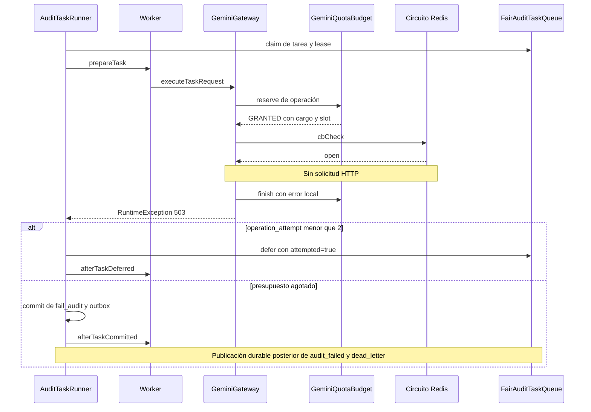

# Auditoría independiente: Circuit Breaker, ejecución durable v2 y DLQ

**Fecha:** 2026-11-09. **Dictamen: PARCIALMENTE JUSTIFICADO CON OMISIONES CRÍTICAS.**

El mecanismo central del diagnóstico está confirmado en el código: un rechazo local por circuito abierto se clasifica como fallo de operación, consume el presupuesto de reintentos y puede cerrar definitivamente la auditoría con un evento en DLQ. Sin embargo, cambiar solamente la excepción deja problemas de contabilidad de cuota, recuperación del circuito y aplazamiento indefinido. Además, el circuito durable no registra éxitos: sus fallos no son consecutivos, aunque los logs y la especificación los describan así.

## 1. Alcance, versiones y límites de la evidencia

- Commit señalado: `5a3205090373eac223a5083e4089cb4cddbc8b6a`.
- HEAD inspeccionado: `7e808dbd569a0ed5deca978283d9ff0cb4c8c1f2`.
- `git diff --name-only 5a32050 HEAD` devuelve únicamente `app/Models/InvoicesModel.php`. Los componentes del incidente tienen el mismo código en ambos commits.
- Se revisaron gateway, runner, cola y scripts Lua, presupuesto Gemini, workers de extracción y semántica, locks semánticos, commit/outbox, mantenimiento, configuración, controlador individual, reproceso DLQ, pruebas y SDD del despliegue.
- Los conteos de producción, payloads DLQ y desaparición de timeouts son antecedentes proporcionados por el solicitante. Esta auditoría no consultó el servidor de producción ni verificó sus imágenes, variables efectivas o logs históricos.
- Se ejecutaron pruebas focalizadas existentes y una reproducción aislada del circuito con transporte HTTP simulado. No se modificó código de producción ni configuración operativa.

**Distinción de confianza:** alta para la cadena causal del código; media para atribuir todos los eventos del incidente a ella. El mensaje local `503` del circuito no demuestra por sí mismo que el proveedor haya respondido HTTP 503.

### Precisiones sobre nombres y protocolo

| Referencia del diagnóstico | Código efectivamente disponible |
|---|---|
| `AuditTaskRunner::runTask()` | El método es `tick()`, en `app/Services/Audit/Pipeline/AuditTaskRunner.php:24`. |
| `executeOperationWithContract()` | No existe en este árbol. La envoltura durable es `GeminiGateway::executeTaskRequest()`, en `app/Services/Audit/GeminiGateway.php:195`. |
| `AUDIT_PIPELINE_EXECUTION_VERSION=2` | El runtime fija `AuditExecutionConfig::VERSION = 2`; `fromEnv()` no lee esa variable. Véase `app/Services/Audit/Pipeline/AuditExecutionConfig.php:12` y `:38`. Quedan referencias a la variable en algunas pruebas. |
| Auditoría individual como ejemplo de v1 | `/audit/single` encola una auditoría y responde 202; no constituye una ruta síncrona v1. Véase `app/Controllers/AuditController.php:90` y `:120`. |

## 2. Dominios y método de revisión

Se aplicó `architecture-assessment`, enrutada mediante `audit-skill-router`, para revisar límites de error, aislamiento, estados compartidos y concurrencia. La skill `audfact-audit-gemini` aportó el contrato del pipeline. `find-docs` y Context7 se usaron para contrastar las reglas de expiración Redis.

La evaluación se concentra en el incidente. No constituye una auditoría global de seguridad, calidad de todo el repositorio o gobernanza organizacional. Las prioridades y la puntuación posterior se limitan a estos componentes.

## 3. Hallazgos consolidados

Los responsables y plazos siguientes son propuestas de asignación, no compromisos acordados.

| ID | Severidad | Componente y evidencia | Comando de evidencia | Riesgo técnico e impacto | Prioridad | Recomendación / tipo | Responsable propuesto / plazo |
|---|---|---|---|---|---|---|---|
| ARCH-001 | Crítica | `app/Services/Audit/GeminiGateway.php:511`; `app/Services/Audit/Pipeline/AuditTaskRunner.php:65`, `:90` | `rg -n 'throw new.*RuntimeException|task_operation_retry|TYPE_DEAD_LETTER' app/Services/Audit/GeminiGateway.php app/Services/Audit/Pipeline/AuditTaskRunner.php` | Una protección local contra indisponibilidad produce fallos terminales de auditorías válidas. Impacto alto en disponibilidad del procesamiento. | P0 | Aplazamiento durable tipado sin consumir intentos / corrección inmediata. | Backend pipeline / antes del siguiente lote masivo. |
| ARCH-002 | Alta | `app/Services/Audit/GeminiGateway.php:296`, `:406`, `:537`; `core/RedisClient.php:315` | `rg -n 'cbRecordSuccess|cbRecordFailure|CB_STATE|val == 1' app/Services/Audit/GeminiGateway.php core/RedisClient.php` | Fallos no consecutivos abren el circuito; el contador puede sobrevivir a la reapertura. Recuperación frágil en una ruta crítica. | P1 | Definir ventana y semántica de éxitos; recuperación con sondeo limitado / incremental. | Backend + SRE / mismo ciclo de corrección. |
| ARCH-003 | Alta | `app/Services/Audit/GeminiGateway.php:220`, `:238`; `app/Services/Audit/Pipeline/GeminiQuotaBudget.php:226`, `:257` | `rg -n 'quota->reserve|quota->finish|_http_attempts|ZREM' app/Services/Audit/GeminiGateway.php app/Services/Audit/Pipeline/GeminiQuotaBudget.php` | Se cargan cuotas y fallos HTTP por solicitudes no enviadas. El presupuesto común puede restringir también el carril prioritario. | P1 | Decidir admisión antes del cargo; resolver atómicamente la carrera con el circuito / incremental. | Backend pipeline / junto con ARCH-001. |
| ARCH-004 | Media | `app/Services/Audit/GeminiGateway.php:505`; `app/Services/Audit/Pipeline/FairAuditTaskQueue.php:290`, `:319`; `app/Services/Audit/Pipeline/AuditExecutionMaintenance.php:227` | `rg -n 'due_at_ms|operation_attempt|recovery_count|STATE_OPEN' app/Services/Audit/Pipeline/FairAuditTaskQueue.php app/Services/Audit/GeminiGateway.php` | Un cambio ingenuo a deferral puede generar reactivaciones inmediatas o espera ilimitada sin alerta. | P1 | PTTL/reloj Redis, jitter, presupuesto temporal observable y política de intervención / incremental. | Backend + SRE / mismo ciclo. |
| ARCH-005 | Alta | `tests/Services/Audit/GeminiGatewayTest.php:306`, `:316`; `tests/Integration/GeminiTaskExecutionRedisTest.php:166`, `:282` | `rg -n 'testOpenCircuit|testRetryExhaustion|withTask|new GeminiGateway' tests/Services/Audit/GeminiGatewayTest.php tests/Integration/GeminiTaskExecutionRedisTest.php` | La cobertura del despliegue no verifica el contrato completo circuito abierto → cuota → runner → deferral/DLQ. Permite una regresión de alto impacto aun con CI verde. | P1 | Pruebas del ciclo completo con Redis real y HTTP simulado / corrección del contrato de validación. | Backend + QA / requisito de despliegue. |

### 3.1 Verificación de las cinco premisas

| Premisa | Resultado | Evidencia y precisión |
|---|---|---|
| 1. Errores 503 con 30+ workers abren el circuito con umbral 3 y cooldown 60 s. | **Compatible, pero no demostrada en producción y conceptualmente incompleta.** | Los defaults son 3/60 (`GeminiGateway.php:534`). Fallos de red y respuestas no 2xx salvo 400 alimentan el contador (`:320`, `:328`, `:346`). No se requieren tres errores consecutivos ni 30 workers. También cuentan 429, 401, 403, 404 y otros códigos; el código no restringe el contador a 503/5xx. |
| 2. El circuito abierto lanza `RuntimeException(..., 503)`. | **Confirmada.** | `GeminiGateway.php:505–514`. Es un 503 generado localmente; no hubo HTTP. |
| 3. El runner la captura como `Throwable`, no como aplazamiento. | **Confirmada.** | `AuditTaskRunner.php:62–68`. La excepción no es permanente por su clase ni pertenece a las excepciones HTTP tipadas que se clasifican como permanentes. |
| 4. Se agotan tres intentos en aproximadamente 6 s. | **Correcta como ejemplo mínimo aproximado, no como tiempo garantizado.** | `AuditTaskRunner.php:71–76`: esperas de 1000–1250 ms y 5000–5250 ms. El jitter total es 0–500 ms. Se suman preparación, rasterización, Redis, espera de cola y cualquier HTTP anterior. |
| 5. El circuito sigue abierto y las tareas terminan en DLQ. | **Confirmada bajo esas condiciones temporales.** | `AuditTaskRunner.php:79–99` genera `fail_audit`, `audit_failed` y `dead_letter`. Si el TTL vence antes de la siguiente ejecución, la llamada puede continuar: no todas las tareas que encuentran el circuito abierto están destinadas a fallar. |

El aumento de 84 a más de 190 entradas es consistente con el defecto, pero el repositorio no permite calcular cuántas facturas únicas corresponden a esas entradas ni confirmar el error remoto inicial.

### 3.2 Cadena real de ejecución y reintentos



Aspectos omitidos en la descripción inicial:

1. **No son tres iteraciones inmediatas del `for` de la línea 50.** Ese bucle sirve para volver a preparar efectos ante `RETRY_PREPARE`. Una excepción sale del bucle. Los reintentos de error son turnos distintos, persistidos por `defer()` y reclamados después.
2. **El presupuesto es por operación registrada.** `AuditTaskRunner.php:69–71` distingue `count_tokens` y `generate_content` cuando dispone de una excepción tipada. La tarea nace con `operation=count_tokens` y `operation_attempt=0` (`AuditTask.php:46`). El circuito arroja una excepción genérica, por lo que se usa la operación previamente registrada, que puede no representar la operación que acaba de intentar empezar. Los éxitos no actualizan por sí solos ese campo.
3. **`Attempts: 3` no significa tres HTTP.** Puede significar tres rechazos locales o una mezcla de HTTP real y rechazos del circuito. Si la tarea ya había consumido presupuesto, puede llegar al cierre tras un único rechazo local adicional.
4. **El cierre afecta a la auditoría raíz.** `AuditTaskCommitter.php:148–149` escribe `audit.status=failed`. La tarea queda `completed` porque sus efectos terminales fueron confirmados (`:185–191`); eso no significa que la auditoría haya sido exitosa. Otras tareas de una raíz ya terminal pueden confirmarse vacías (`AuditTaskRunner.php:41–45`).
5. **La DLQ se materializa mediante outbox.** El runner registra efectos durables; no hace directamente un `XADD` a la DLQ en el `catch`. El tiempo de publicación agrega otra diferencia entre el instante del fallo y el crecimiento visible del stream.

Para una tarea nueva, circuito estable en abierto y preparación despreciable:

| Turno | `operation_attempt` al entrar | Resultado |
|---|---:|---|
| Primero | 0 | Rechazo local; aplaza 1000–1250 ms; contador pasa a 1. |
| Segundo | 1 | Rechazo local; aplaza 5000–5250 ms; contador pasa a 2. |
| Tercero | 2 | Rechazo local; cierre técnico; DLQ informa 3. |

El total **solo de las esperas configuradas** es 6,0–6,5 s. `Retry-After` se respeta para `GeminiOperationException` (`AuditTaskRunner.php:75`), pero la `RuntimeException` del circuito no lleva ese dato estructurado: el TTL dentro del texto no modifica el backoff.

### 3.3 Reservas: no hay fuga normal de slots, sí cargos artificiales

El orden exacto es `reserve()` → `executeSingleOperation()` → `cbCheck()`. Por ello, el rechazo del circuito llega cuando ya existe un recibo de intento.

`executeTaskRequest()` captura **cualquier** `Throwable`, guarda `quota_finishes` y llama a `finish()` antes de relanzarlo (`GeminiGateway.php:238–255`). En condiciones normales:

| Recurso / contador | Efecto del rechazo local |
|---|---|
| Slot `inflight` Gemini | Se libera: `FINISH` ejecuta `ZREM` (`GeminiQuotaBudget.php:257`). |
| Recibo de intento | Queda `failed`; con la excepción actual registra `http_status=503`, aunque no hubo HTTP (`GeminiGateway.php:239–243`). |
| RPM | Se conserva el cargo hasta salir de la ventana de 60 s. La poda se hace en `reserve()`/`metrics()` (`GeminiQuotaBudget.php:135`, `:188`). |
| TPM | En generación se conserva la reserva estimada `ceil(tokens × 1.05)`; en `count_tokens` se reserva 0 (`GeminiGateway.php:223`). No se devuelve por el rechazo local. |
| RPD | Se conserva el cargo en el bucket del día; `finish()` no lo decrementa. El cambio de día usa `America/Los_Angeles` (`GeminiQuotaBudget.php:104–109`). |
| Métricas | `reserve()` ya incrementó `*_http_attempts` (`:233`); `finish(error=true)` incrementa `*_request_failures` (`:254`). Se contaminan con eventos sin HTTP. |

Son cargos del **presupuesto interno**, no evidencia de consumo facturado por Google. Con 100 rechazos locales de generación y 1000 tokens contados por petición, el mecanismo reservaría internamente 100 RPM, 100 RPD y 105000 TPM durante la ventana correspondiente, aun con cero envíos de esas peticiones. Es un ejemplo algebraico, no una medición del incidente.

Si se cambia únicamente a `QuotaDeferredException` dentro de `cbCheck()`, esta también pasa por el `catch (Throwable)` del gateway: se seguirá ejecutando `finish(error=true)`, ahora normalmente con código 0, porque su constructor no asigna código HTTP (`QuotaDeferredException.php:9–11`). Se corrige el consumo de intentos del runner, pero **no** los cargos ficticios.

**Límites de la limpieza:** si `finish()` falla, su error se registra y el siguiente turno intenta reconciliar los recibos guardados antes de reutilizar respuestas (`GeminiGateway.php:204–205`). Si `saveArtifact()` arroja una excepción antes de ese `finish()`, puede interrumpir esta ruta; si retorna `false`, el bloque de error no comprueba ese retorno. Los slots pendientes se recuperan al vencer el lease por `recoverExpired()` (`GeminiQuotaBudget.php:156–171`), invocado también por mantenimiento (`AuditExecutionMaintenance.php:127`). El lease actual es de 600000 ms. Esto es recuperación condicionada a Redis y mantenimiento sanos, no una garantía de liberación instantánea bajo cualquier fallo.

### 3.4 Carriles: qué está aislado y qué se comparte

Las claves del Circuit Breaker, antes de aplicar `REDIS_PREFIX`, son:

| Gateway configurado | Estado | Contador |
|---|---|---|
| `batch` | `cb:gemini:batch:state` | `cb:gemini:batch:fails` |
| `priority` | `cb:gemini:priority:state` | `cb:gemini:priority:fails` |
| `all` | `cb:gemini:state` | `cb:gemini:fails` |

Fuente: `GeminiGateway.php:474–485`. Los workers batch de extracción y semántica comparten **el mismo** estado batch; el aislamiento no es por etapa, worker, modelo ni operación. Lo mismo sucede dentro de priority. Esto explica que aparezcan fallos en ambas etapas durante una apertura.

Los servicios VIP corresponden a `priority`; `vip` no es un valor del enum. `AuditLane::fromString('vip')` produciría `ALL`, porque el nombre no está reconocido (`AuditLane.php:14–16`, `:33`). Compose sí configura correctamente extracción con `AUDIT_WORKER_LANE=priority` (`docker-compose.yml:175`). Los servicios semánticos seleccionan el carril mediante `--priority-only` y `--batch-only` (`docker-compose.yml:346`, `:357`).

**Caveat de `all`:** `withTask()` clona el gateway y asigna tarea, cuota y cola, pero no cambia el carril (`GeminiGateway.php:146–152`). Un gateway creado con `all` sigue usando las claves genéricas aunque la tarea sea batch o priority. La garantía de aislamiento depende de construirlo con el carril correcto, como hacen los workers dedicados (`DocumentExtractionWorker.php:95`; `SemanticEvaluationWorker.php:22`).

**La cuota no está aislada por carril.** Su clave base depende de `scope` y `model` (`GeminiQuotaBudget.php:46`), y su arbitraje contempla ambos carriles (`:207–219`). Con igual scope/model comparten RPM/TPM/RPD/inflight. Un circuito batch abierto no bloquea directamente el circuito priority, pero sus cargos locales artificiales pueden reducir el presupuesto disponible para priority. Las API keys por carril tienen fallback a la común (`GeminiGateway.php:76–84`); no puede suponerse que pertenezcan a proyectos de cuota independientes.

### 3.5 Seguridad de `QuotaDeferredException` y limpieza del worker

La ruta está diseñada para aplazamientos sin consumir el presupuesto de error:

- `AuditTaskRunner.php:62–64` llama `defer($task, dueAtMs, reason)` sin `attempted=true`.
- `FairAuditTaskQueue.php:132` define `attempted=false` por defecto.
- El Lua valida estado activo, propietario, fence y lease (`:289`), mueve la tarea a `delayed`, registra fecha/motivo y **no incrementa** `operation_attempt` (`:290–294`).
- Libera el slot activo por job, elimina el lease y agrega el índice delayed; mantiene el artefacto (`:295–299`). No depende de conservar un mensaje pendiente del stream: la admisión ya confirmó `XACK` junto con el registro durable (`:260`).
- El mantenimiento devuelve la tarea vencida a `pending` (`:315–327`). También se ejecuta mantenimiento al buscar trabajo en `claim()` (`:75–87`).

`cleanup($worker, $task, false)` delega en `afterTaskDeferred()` y captura errores de limpieza (`AuditTaskRunner.php:117–123`). Su efecto depende del worker:

| Worker | Comportamiento al aplazar |
|---|---|
| Semántica | `afterTaskDeferred()` libera los locks de pares poseídos y limpia `$owned` (`SemanticEvaluationWorker.php:147–157`). `SemanticFlightStore::release()` comprueba identidad y fence, por lo que no borra el lock de otro intento (`SemanticFlightStore.php:72–78`). |
| Extracción | Hereda un `afterTaskDeferred()` vacío (`AuditEventConsumer.php:133–135`). **Conserva deliberadamente el BLOB** para el siguiente intento. Lo libera al commit (`DocumentExtractionWorker.php:301–303`). |
| Rasterizador | Los archivos temporales se limpian en su propio `finally` (`DocumentPdfRasterizer.php:212–214`), incluso si posteriormente el gateway rechaza la llamada. |

Por tanto, el aplazamiento tipado es compatible con el contrato actual, pero no significa “eliminar todos los recursos”: preserva los necesarios para reanudar. Si la espera supera el TTL del BLOB, la entrada debe recuperarse desde su fuente y validar su hash mediante `AuditDocumentInput`.

Dos límites adicionales merecen prueba: el runner ignora el booleano de `defer()`; un lease obsoleto puede hacer que retorne `false`. Y si `defer()` arroja una excepción, el `cleanup()` posterior no se ejecuta, ya que no está en un `finally`. Los fences y la recuperación de leases permiten recuperación posterior, pero no justifican afirmar limpieza incondicional.

### 3.6 Contexto sin tarea y auditoría individual

Con `$this->task === null`, `sendWithStructuredOutput()` y `sendPrebuiltBody()` pasan por `cbCheck()` y `executePost()` (`GeminiGateway.php:132–137`, `:173–178`). En ese contexto, conservar la `RuntimeException` 503 mantiene el contrato actual; no existe una cola durable asociada a la que entregar `dueAtMs`.

El camino directo conserva sus reintentos HTTP internos y su llamada a `cbRecordSuccess()` (`GeminiGateway.php:394–406`). Estos reintentos no son los del runner durable. Los métodos de operación individual usados por tests también pueden invocarse sin tarea, con un grant sintético.

Esto **no equivale a afirmar que v1 sigue habilitada en producción**. El runtime programado es exclusivamente v2; `/audit/single` publica `audit_created` con `source=single` y responde 202 (`AuditController.php:90–120`). Sus tareas posteriores usan el pipeline durable y deben recibir el aplazamiento tipado cuando corresponda.

### 3.7 Contador, expiración y recuperación del circuito

La ruta durable añade `cbCheck()` y `cbRecordFailure()`, pero **no contiene `cbRecordSuccess()`**. La única invocación de éxito está en el camino directo (`GeminiGateway.php:406`).

`cbRecordFailure()` incrementa el contador con TTL `cooldown × 2` y abre el circuito al alcanzar el umbral (`:534–540`). `RedisClient::incrWithExpire()` aplica ese TTL únicamente cuando el contador nace con valor 1 (`core/RedisClient.php:315–318`). Con los defaults, el comportamiento durable es:

1. Acumular fallos durante una ventana de hasta 120 s iniciada por el primer fallo, sin descontarlos ni resetearlos por éxitos.
2. Al llegar a 3, escribir `open` con 60 s de expiración.
3. Cada fallo adicional de una solicitud que ya estaba en vuelo puede volver a escribir `open`, renovando esos 60 s.
4. Al expirar el estado, `get(...) ?? closed` permite todas las nuevas llamadas. No existe estado `half-open`, ni propietario de sondeo, ni límite de pruebas de recuperación.
5. El contador puede seguir vivo cuando expira el estado. Un nuevo fallo puede reabrir inmediatamente con un contador ya por encima del umbral.

Los rechazos locales de `cbCheck()` **no** incrementan el contador ni renuevan el TTL por sí mismos. No debe confundirse esa propiedad con las renovaciones causadas por respuestas tardías de solicitudes admitidas antes de la apertura.

**Añadir sin más la actual `cbRecordSuccess()` también es insuficiente bajo concurrencia.** Esa función borra estado y contador sin comprobar la generación (`:524–525`). Un éxito tardío iniciado antes de la apertura podría cerrar un circuito recién abierto por otros workers. Además, un éxito de `countTokens` no demuestra que `generateContent` se haya recuperado. Hay que definir el alcance del circuito y las transiciones atómicas, no solo agregar la llamada ausente.

### 3.8 Riesgo de aplazamientos indefinidos

Sí existe si se adopta el cambio propuesto sin una política adicional:

- Un deferral no incrementa `operation_attempt`.
- Tampoco incrementa `recovery_count`; este cuenta recuperación de leases vencidos, no aplazamientos (`FairAuditTaskQueue.php:315–320`).
- `DEADLINE_MS=450000` se calcula a partir del lease del turno actual (`GeminiGateway.php:211`), que se renueva en cada `claim`. **No es un límite de edad total de la tarea.**
- Las tareas delayed no son terminales y el GC no las retira como tales (`AuditExecutionMaintenance.php:227`). La capacidad de pendientes y delayed está acotada por admisión, pero pueden ocuparla durante una indisponibilidad prolongada.

Una espera larga por dependencia caída puede ser una decisión correcta. Debe observarse y tener política explícita: tiempo acumulado por motivo, edad máxima según SLA, alerta/intervención y, si se decide finalizar, un motivo técnico específico de dependencia no disponible. No debe convertirse en un hallazgo clínico ni contarse como una serie de HTTP fallidos inexistentes.

La fórmula `now + ttl × 1000` requiere tratar `ttl=0`, `-1` y `-2`. El wrapper actual devuelve además `-2` ante algunos errores Redis (`core/RedisClient.php:399–408`). Una fecha pasada o inmediata se convierte en `now` dentro de `defer()`, generando reactivaciones muy frecuentes. Para una implementación robusta, leer estado, `PTTL` y `TIME` en una operación atómica, distinguir ausencia de clave y fallo operativo, usar un piso positivo cuando corresponda y agregar dispersión. Redis documenta `-1` como clave sin expiración y `-2` como clave inexistente. [Referencia oficial de PTTL](https://redis.io/docs/latest/commands/pttl/).

### 3.9 Rasterización y duración real de los turnos

El commit modifica de forma independiente el rasterizador: bloques de hasta 25 páginas, solapamiento de una página, sondeo de página 51 y limpieza final (`DocumentPdfRasterizer.php:164–190`, `:212`). Esto es compatible con la desaparición reportada de los timeouts monolíticos, pero no demuestra que todo timeout sea imposible.

La rasterización sucede **antes** de llegar al gateway (`DocumentExtractionWorker.php:558–562`). Por tanto, una tarea sin resultado cacheado puede volver a rasterizar antes de descubrir que el circuito sigue abierto. Eso aumenta el costo de CPU y puede alargar mucho los supuestos seis segundos. No se identificó una dependencia por la cual el rasterizador produzca la excepción de circuito abierto. Un mayor caudal hacia Gemini tras resolver el cuello de botella es una hipótesis adicional plausible que requiere métricas, no un hecho demostrado.

## 4. Solución técnica recomendada

### 4.1 Contención inmediata del defecto

**Modificar la clasificación del rechazo local:** en `GeminiGateway::cbCheck()` (`:505–514`), con contexto durable completo, emitir `QuotaDeferredException` con un motivo estable como `gemini_circuit_open`, fecha calculada con reloj Redis y espera válida. Mantener la excepción 503 para invocaciones sin tarea. La clase ya está importada y su contrato admite `dueAtMs` y `reason`.

Pseudocódigo contractual; los helpers representan trabajo por implementar, no métodos existentes:

```text
decision = leer atomicamente estado, PTTL y reloj Redis
si el circuito permite admision:
    continuar
si hay contexto de tarea durable:
    dueAtMs = decision.redisNowMs + esperaValidada + jitter
    lanzar QuotaDeferredException(dueAtMs, "gemini_circuit_open")
en otro caso:
    conservar el rechazo RuntimeException 503
```

No aumentar los tres intentos ni reducir el cooldown para esconder el problema. El rechazo local debe ser una decisión de admisión, no un intento fallido. Este cambio aislado es una **contención**, no la corrección completa de ARCH-003.

Una regla concreta inicial para un estado `open` con expiración válida es `dueAtMs = redisNowMs + max(250, pttlMs + 1) + jitterMs`, con jitter determinista por tarea/episodio entre 0 y 1000 ms. Los números son parámetros propuestos para probar, no requisitos del proveedor. Si la lectura atómica encuentra la clave ausente (`PTTL=-2`), debe evaluar la política de admisión/sondeo vigente; si encuentra `open` sin expiración (`-1`), debe alertar y aplazar con una espera positiva acotada mientras se repara el estado. Un error de Redis no debe interpretarse silenciosamente como una clave ausente. Validar también que umbral y cooldown sean enteros positivos: hoy se convierten directamente con `(int)`, y `RedisClient::set()` con TTL no positivo escribe sin expiración (`GeminiGateway.php:534–535`; `core/RedisClient.php:218–222`).

### 4.2 Corregir el orden de admisión y la contabilidad

En `executeTaskRequest()`:

1. Mantener primero la reconciliación de `quota_finishes` y la reutilización de respuestas (`GeminiGateway.php:204–208`). Un resultado ya obtenido debe poder confirmarse aunque el circuito esté abierto.
2. Evaluar la admisión del circuito **por cada operación pendiente**, antes del cargo de `reserve()` (`:213–220`). Puede abrirse entre `count_tokens` y `generate_content`.
3. Cerrar la carrera entre comprobar el circuito y reservar. La opción preferida para la corrección completa es incluir la admisión del circuito en la operación Lua de reserva, usando las claves explícitas del circuito correspondiente. Si está abierto, devolver `DEFERRED` con fecha/motivo antes de modificar cargos, recibos, turnos de cuota o métricas HTTP.
4. Un grant concedido representa una solicitud ya admitida. Las llamadas admitidas justo antes de una apertura pueden terminar, con concurrencia acotada; sus resultados se asocian a la generación del circuito. Evitar un segundo rechazo local posterior al cargo que vuelva a producir intentos ficticios.
5. Si el diseño exige conservar la comprobación justo antes del transporte, incorporar una cancelación idempotente y atómica de reserva **confirmadamente no enviada**, distinta de `finish(error=true)`: revertir solo sus propios cargos/slot y registrar `not_sent`, sin inflar intentos HTTP. Nunca devolver cargos de una solicitud enviada o de resultado incierto.

Mover solo el chequeo antes de `reserve()` y conservar intacto el chequeo posterior reduce el problema habitual, pero deja la carrera concurrente. La política elegida debe probar explícitamente ese intercalado.

### 4.3 Definir una recuperación consistente del circuito

La corrección debe especificar si el umbral representa fallos consecutivos o tasa de fallos en una ventana. Para el volumen descrito se recomienda una ventana con mínimo de muestras, separación explícita de señales por operación y recuperación con sondeos limitados. Son decisiones de diseño propuestas, no comportamiento presente.

- Estados `closed → open → half-open`, con un sondeo o una cantidad pequeña de sondeos admitidos por circuito; el resto se aplaza.
- Transiciones y contadores atómicos con generación/propietario: un éxito de una solicitud antigua no puede cerrar una apertura posterior.
- El sondeo debe ejercer la operación que falló; `countTokens` exitoso no basta para declarar saludable la generación.
- Diferenciar 429 por cuota, fallos transitorios de red/5xx y errores permanentes de autenticación/modelo. Estos últimos requieren alerta/configuración, no un ciclo silencioso de espera indefinida.
- Mantener aislamiento por carril y explicitar si el alcance incluye modelo, proyecto y operación. Si se cambian claves, planificar la transición; `all` no debe mezclar inadvertidamente tareas dedicadas.

El patrón oficial describe el estado half-open como mecanismo para limitar la carga de recuperación y exige adaptar el manejo de excepciones a la aplicación. Se usa aquí como fundamento del diseño; las cifras operativas siguientes no provienen de esa referencia. [Circuit Breaker, Microsoft Architecture Center](https://learn.microsoft.com/en-us/azure/architecture/patterns/circuit-breaker).

### 4.4 Contratos de aceptación antes del despliegue

| Caso | Resultado exigido |
|---|---|
| Circuito abierto al llegar una tarea nueva | Cero HTTP, cero cargo nuevo de cuota, tarea delayed, mismo `operation_attempt`, cero DLQ. |
| Circuito abierto con intento previo 2 | El aplazamiento conserva ese presupuesto; no cierra la tarea por el rechazo local. |
| Apertura entre conteo y generación | Reutiliza el conteo guardado; aplaza generación sin cargo ficticio. |
| Respuesta completa ya persistida | Confirma/reutiliza sin HTTP aunque el circuito esté abierto. |
| Varias tareas/carriles/etapas | Batch no cierra priority; las cuotas comunes siguen su política; verificar también gateway `all`. |
| Error real HTTP/network | Registra una vez el intento enviado y conserva el presupuesto/reintento legítimo y `Retry-After`. |
| Éxitos intercalados con errores | Cumple la política de ventana/consecutividad elegida y su denominador; no depende del texto del log. |
| Éxito tardío de una generación anterior | No cierra un circuito abierto después del inicio de esa solicitud. |
| TTL al límite, clave ausente o sin expiración | No genera un loop inmediato; diferencia error operativo de ausencia; observa anomalías. |
| Deferral semántico y extracción | Libera locks/slot de job; conserva BLOB y artefactos recuperables; temporales limpios. |
| `defer()` falso, Redis fallando y muerte del worker | No confirma efectos obsoletos; existe recuperación y evidencia de limpieza pendiente. |
| Caída prolongada | Se cumplen alerta/SLA/cancelación acordados y no crecen intentos HTTP sin transporte. |
| Recuperación tras cooldown con 30+ workers | Solo se admite el número de sondeos previsto; la reapertura no libera una estampida. |

Estas pruebas deben atravesar **gateway con `withTask()` + cuota + runner + cola/outbox**, con Redis real aislado y HTTP simulado. Probar únicamente la clase de excepción no verifica el contrato.

## 5. Calibración operativa para el clúster descrito

**No hay evidencia suficiente para declarar que 10, 15 o 30 sea el umbral correcto.** El número de workers no determina por sí solo la frecuencia de errores ni el caudal efectivo: influyen la latencia, los slots por job, los cache hits, las dos operaciones remotas y los límites compartidos.

El código admite slots configurables por etapa (`AuditExecutionConfig.php:38–67`). `.env.example:133–136` contiene 24 para extracción y 8 para semántica; los defaults del constructor siguen siendo 1. Compose propone 24 extractores batch y 6 semánticos batch (`docker-compose.yml:211`, `:359`). No se verificaron los valores efectivos de producción.

### Recomendación sobre las variables actuales

| Parámetro | Recomendación fundamentada |
|---|---|
| `CB_GEMINI_THRESHOLD=3` | No aumentarlo como solución causal. Primero corregir la clasificación, la cuota y la semántica del contador. Mientras eso no cambie, significa tres fallos acumulados en hasta 120 s, mezclando operaciones. Conservarlo provisionalmente permite evaluar la corrección sin modificar simultáneamente sensibilidad y comportamiento. Cualquier aumento debe ser una mitigación medida y temporal. |
| `CB_GEMINI_COOLDOWN=60` | Conservar 60 s inicialmente, con aplazamiento alineado y recuperación controlada. No reducirlo a menos del presupuesto de retries para evitar DLQ. Actualmente también determina la ventana del contador (`×2`), por lo que cambiarlo altera dos comportamientos a la vez. Separar ambos conceptos en el diseño futuro. |

Ejemplo ilustrativo: a 5 solicitudes HTTP por segundo, la ventana de 120 s contiene 600 solicitudes; 3 errores equivalen al 0,5% de ese volumen. A 10 solicitudes/s son 1200 y 3 equivalen al 0,25%. El contador actual no usa estos porcentajes: el ejemplo muestra por qué un umbral absoluto de 3 puede abrir por errores aislados en tráfico alto. **Esas tasas no fueron medidas en AudFact.**

Para evaluar una política nueva en pruebas de carga, un punto de partida explícitamente experimental es: ventana de 30 s, mínimo de 20 resultados, apertura con al menos 10 fallos y tasa de fallos igual o superior al 50%, cooldown inicial de 60 s y un sondeo por circuito al recuperar. Debe complementarse con una política para tráfico bajo y validarse por operación/carril. **No puede implementarse cambiando únicamente `CB_GEMINI_THRESHOLD`.**

Las métricas necesarias son: HTTP realmente enviados por operación/carril, 429/5xx/red, latencias p50/p95/p99, tasa de éxitos, tiempo abierto, reaperturas, edad y cantidad de delayed, consumo real frente a reservado, cantidad de sondeos y concurrencia efectiva. Reducir o aumentar workers/inflight exige demostrar con esas series que la concurrencia causa la degradación; el payload de DLQ no basta.

## 6. Verificaciones ejecutadas y explicación del CI verde

### Pruebas existentes

Comando ejecutado desde la raíz:

```powershell
php vendor/bin/phpunit --configuration phpunit.xml --filter 'GeminiGatewayTest|GeminiQuotaBudgetTest|FairAuditTaskQueueMetricsTest|GeminiTaskExecutionRedisTest' --do-not-cache-result
```

Resultado: PHP 8.2.12; PHPUnit 10.5.63; **41 casos, 140 aserciones, 9 omitidos, código de salida 0**, duración 16,666 s. Es decir, 32 casos ejecutados satisfactoriamente. Los nueve omitidos requieren `RUN_REDIS_INTEGRATION=1` y Redis real. No se volvió a ejecutar ni certificar aquí la suite completa de 1060 tests.

Los tests nuevos del circuito (`GeminiGatewayTest.php:306–324`) construyen un gateway **sin `withTask()`** y esperan una `RuntimeException` 503. Verifican que no salga HTTP, pero no observan la reserva ni el tratamiento del runner. La prueba de agotamiento de integración (`GeminiTaskExecutionRedisTest.php:166`) simula tres HTTP 503; no establece una apertura de circuito por otro worker antes del primer envío ni verifica el contrato del rechazo local.

Además, el doble de Redis de integración construye su propia conexión y sobreescribe `eval/get`, mientras el CB usa también `isAvailable`, `set`, `incr`, `ttl` y `del` (`tests/Support/IsolatedAuditRedis.php:16–41`). La nueva prueba debe garantizar que **todas** esas operaciones correspondan al mismo Redis aislado; no basta con inyectar la instancia y asumirlo.

Por tanto, el CI verde es compatible con el defecto: valida partes que cumplen sus expectativas actuales, pero falta una prueba de composición que exija aplazar el rechazo local sin cuota y sin DLQ.

### Reproducción aislada adicional

Se ejecutó `GeminiGateway::sendSingleAttempt()` real con Guzzle `MockHandler`, grants sintéticos válidos y un doble Redis en memoria. Se fijaron umbral 3/cooldown 60, sin llamadas externas. La prueba fue de la lógica del gateway, **no** de la concurrencia/expiración real de Redis ni del runner completo.

| Invocación | Respuesta simulada / observada | Contador después | Estado |
|---|---|---:|---|
| 1 | HTTP 503 → `GeminiOperationException:503` | 1 | closed |
| 2 | HTTP 200 → éxito | 1 | closed |
| 3 | HTTP 503 → `GeminiOperationException:503` | 2 | closed |
| 4 | HTTP 200 → éxito | 2 | closed |
| 5 | HTTP 503 → `GeminiOperationException:503` | 3 | open |
| 6 | `RuntimeException:503` local; quedó sin consumir la respuesta 200 del mock | 3 | open |

Resultado adicional: **5 solicitudes HTTP simuladas, 0 invocaciones a `del()` para restablecer éxitos**. Esto corrobora ejecutablemente el hallazgo de fallos no consecutivos. La secuencia puede repetirse usando el patrón de `singleOperationContext()` y `singleOperationGateway()` de `tests/Services/Audit/GeminiGatewayTest.php:396` y un doble Redis que persista el contador entre llamadas.

### Validación y alcance del artefacto

El informe se compiló como MDX para verificar sintaxis; su JSON estructurado y las referencias con rutas completas se validaron automáticamente. El build existente del portal (`npm run build` en `website/`) terminó con código 0. La comprobación MDX directa cubre este nuevo informe, que todavía no está publicado en el portal. `git diff --check` no detectó errores de espacios y el hook documental terminó satisfactoriamente.

| Documento | Cambio | Motivo |
|---|---|---|
| Este informe en `plans/reports/` | Creado | Evidencia, dictamen y solución propuesta de la auditoría. |
| `plans/changelog.md` | Entrada agregada | Registrar el informe y el alcance real de la validación. |
| README, AGENTS y planes de implementación | Sin cambio | No se implementó una modificación arquitectónica, de API o configuración. Los desvíos pertinentes de la SDD se identifican en el informe. |

| Skill / registro | Cambio | Motivo |
|---|---|---|
| `audfact-audit-gemini`, `audfact-project-overview` | Sin cambio | Auditoría documental; no se cambió el contrato desplegado. Las afirmaciones operativas se verificaron contra código. |
| `CATALOG.md` | Sin cambio | El informe está cubierto por el mapeo existente de `plans/*`; no hay módulo ni skill nueva. |

## 7. Evidencia pendiente

| Brecha material | Método de obtención | Impacto en confianza |
|---|---|---|
| Correlación exacta del incidente y configuración desplegada | Verificar digest/SHA de contenedores; leer solo las variables no sensibles CB, slots y cuota; correlacionar apertura del circuito con logs HTTP, task IDs y timestamps de DLQ. | Impide atribuir cada entrada y confirmar el detonante 503/concurrencia. |
| Prueba completa con Redis real y carreras concurrentes | Implementar/ejecutar los contratos de aceptación sobre Redis aislado con HTTP simulado, leases, outbox y workers reales. | Impide certificar una solución todavía no implementada y su atomicidad bajo fallos. |
| Distribución operativa y política de SLA | Medir caudal/error/latencia por operación y carril; acordar edad máxima y respuesta a dependencia caída. | Impide fijar un umbral óptimo y el límite de aplazamiento prolongado. |

Hay tres brechas materiales: confianza **media** para la evaluación operativa global del incidente. No invalidan los hechos estáticos ni la reproducción del contador.

## 8. Puntuación del dominio y resultado global acotado

Se aplica la rúbrica determinista de la skill a los módulos inspeccionados, no al proyecto entero. La evidencia pendiente anterior se considera antes de puntuar.

| Control arquitectónico | Valor | Evidencia / razón |
|---|---:|---|
| Responsabilidades y límites claros | 1 | Runner, cola, cuota, worker, committer y outbox tienen responsabilidades identificables. |
| Dependencias y acoplamiento controlados | 0,5 | Gateway conoce tarea, cuota y cola; la decisión del CB no participa en la admisión de cuota. |
| Ausencia de violaciones/ciclos críticos en el flujo revisado | 1 | No se identificó un ciclo de dependencia crítico en esta cadena. |
| Separación de dominio e infraestructura | 0,5 | Se separan efectos y commit, pero gateway mezcla transporte, circuito y contabilidad durable. |
| Límites de error y aislamiento consistentes | 0 | ARCH-001 convierte indisponibilidad local en cierre de auditoría. |
| Gestión de estado sin efectos globales ocultos | 0 | Contador compartido sin éxito durable y cargos por solicitudes no enviadas. |
| Extensibilidad de una mejora realista | 0,5 | El deferral tipado existe, pero añadirlo sin coordinar cuota introduce efectos secundarios. |
| Estrategia explícita de escalabilidad | 1 | Scheduler justo, slots configurables, leases/fences y presupuesto compartido están implementados. |

Suma: 4,5/8. Puntuación bruta: `round(4.5 / 8 × 5, 1) = 2.8`. El hallazgo crítico ARCH-001 sin mitigar activa el límite de arquitectura en 2,0.

| Dominio | Bruta / 5 | Peso | Ponderada después del límite | Límite aplicado | Confianza |
|---|---:|---:|---:|---|---|
| Arquitectura del flujo revisado | 2,8 | 100% | 2,00 | Sí: máximo 2,0 por ARCH-001 | Media |

**Resultado global del alcance: 2,0/5; clasificación C; techo aplicado: sí.** Esta cifra no reemplaza el dictamen causal ni califica toda la arquitectura de AudFact.

## 9. Interacción de riesgos y plan de acción

El circuito abre por errores remotos agregados; el scheduler interpreta el rechazo local como un intento de tarea fallido; el presupuesto registra ese mismo rechazo como actividad HTTP y puede restringir otros carriles. La mejora de rasterización puede aumentar el caudal que expone esta combinación. La falta de una prueba integrada explica que los tests unitarios verdes no detectaran el contrato roto.

| Horizonte | Acción | Tipo / prioridad | Responsable propuesto | Criterio verificable |
|---|---|---|---|---|
| Inmediato, antes de otro lote grande | Implementar deferral tipado, resolver admisión/cuota y probar el ciclo completo. | Corrección inmediata / P0–P1 | Backend + QA | Cero DLQ y cero intentos/cuota por circuito ya abierto. |
| Inmediato, tras validar la recuperación | Identificar auditorías afectadas y reprocesar mediante el mecanismo existente, de forma acotada. | Operativa / P1 | Operaciones | Nuevas raíces recuperadas trazables y sin duplicación. |
| Hasta 30 días | Completar recuperación half-open, señal por operación, TTL robusto y métricas de espera. | Incremental / P1 | Backend + SRE | Sondeos acotados, ninguna reactivación inmediata sostenida y alertas por edad. |
| Hasta 60 días | Calibrar con series reales y pruebas con carga concurrente representativa. | Incremental / P2 | SRE + QA | Umbral/cooldown justificados por SLO, sin penalización indebida a priority. |
| Hasta 90 días | Consolidar el contrato de admisión/resiliencia y pruebas periódicas de caída/recuperación. | Estructural / P2 | Arquitectura + Backend | Transiciones atómicas documentadas y pruebas de regresión reproducibles. |

**Recuperación de las auditorías ya fallidas:** corregir el gateway no las revive. El reproceso existente crea una nueva raíz con `audit_created` y `recoverFailedAudit()` (`app/Controllers/AuditDlqController.php:120–125`), manteniendo trazabilidad. Debe usarse después de verificar la recuperación; no basta con volver a entregar una tarea perteneciente a una raíz terminal. La selección debe basarse en IDs/motivo y ventana del incidente, no únicamente en el crecimiento agregado de la DLQ. Esta auditoría no ejecutó reprocesos ni purgas.

**Documentación que requiere corregirse al implementar:** `plans/sdd-cb-v2-rasterizer-chunks.md:207` y `:281` hablan de fallos consecutivos, y `:893` supone que las tareas diferidas se reintentan sin reflejar el consumo actual de intentos. La especificación debe distinguir el comportamiento desplegado del comportamiento que se pretende corregir.

## 10. Conclusión técnica

El diagnóstico está acertado en el defecto que produce DLQ: **el rechazo del circuito consume reintentos que deberían reservarse para operaciones realmente intentadas**. Está incompleto en la causa de apertura, en el cálculo temporal y en los efectos secundarios del arreglo.

La solución recomendada es un aplazamiento durable sin consumo de intentos **integrado con la admisión de cuota**, acompañado de una política consistente de contador/recuperación, tratamiento explícito del TTL y observabilidad de esperas prolongadas. La calibración del umbral viene después de ese contrato y de medir el tráfico real.

## 11. Salida estructurada

```json
{
  "verdict": "PARCIALMENTE JUSTIFICADO CON OMISIONES CRITICAS",
  "target_commit": "5a3205090373eac223a5083e4089cb4cddbc8b6a",
  "inspected_head": "7e808dbd569a0ed5deca978283d9ff0cb4c8c1f2",
  "production_inspected": false,
  "production_code_modified": false,
  "domain_scores": [{
    "domain": "Architecture",
    "raw_score": 2.8,
    "capped_score": 2.0,
    "weight": 1.0,
    "weighted_score": 2.0,
    "cap_applied": true,
    "confidence": "Medium"
  }],
  "global_score": 2.0,
  "classification": "C",
  "ceiling_rule_applied": true,
  "confidence": "Medium",
  "caps_triggered": ["ARCH-001: riesgo arquitectonico critico sin mitigar"],
  "validation": {
    "phpunit_total": 41,
    "phpunit_executed": 32,
    "phpunit_skipped": 9,
    "phpunit_assertions": 140,
    "phpunit_exit_code": 0,
    "full_suite_rerun": false,
    "simulated_http_calls": 5,
    "circuit_opened_after_nonconsecutive_failures": true
  },
  "findings": [
    {
      "id": "ARCH-001", "severity": "Critical", "priority": "P0",
      "component": "Circuit Breaker y AuditTaskRunner",
      "evidence": ["app/Services/Audit/GeminiGateway.php:511", "app/Services/Audit/Pipeline/AuditTaskRunner.php:90"],
      "evidence_command": "rg -n 'task_operation_retry|TYPE_DEAD_LETTER' app/Services/Audit/Pipeline/AuditTaskRunner.php"
    },
    {
      "id": "ARCH-002", "severity": "High", "priority": "P1",
      "component": "Contador y recuperacion del circuito",
      "evidence": ["app/Services/Audit/GeminiGateway.php:406", "app/Services/Audit/GeminiGateway.php:537", "core/RedisClient.php:315"],
      "evidence_command": "rg -n 'cbRecordSuccess|cbRecordFailure' app/Services/Audit/GeminiGateway.php"
    },
    {
      "id": "ARCH-003", "severity": "High", "priority": "P1",
      "component": "Admision y contabilidad GeminiQuotaBudget",
      "evidence": ["app/Services/Audit/GeminiGateway.php:220", "app/Services/Audit/Pipeline/GeminiQuotaBudget.php:226", "app/Services/Audit/Pipeline/GeminiQuotaBudget.php:257"],
      "evidence_command": "rg -n '_http_attempts|_request_failures|INCR' app/Services/Audit/Pipeline/GeminiQuotaBudget.php"
    },
    {
      "id": "ARCH-004", "severity": "Medium", "priority": "P1",
      "component": "Deferrals, TTL y edad de tareas",
      "evidence": ["app/Services/Audit/Pipeline/FairAuditTaskQueue.php:290", "app/Services/Audit/Pipeline/FairAuditTaskQueue.php:319", "core/RedisClient.php:399"],
      "evidence_command": "rg -n 'due_at_ms|recovery_count|operation_attempt' app/Services/Audit/Pipeline/FairAuditTaskQueue.php"
    },
    {
      "id": "ARCH-005", "severity": "High", "priority": "P1",
      "component": "Cobertura del contrato integrado",
      "evidence": ["tests/Services/Audit/GeminiGatewayTest.php:306", "tests/Integration/GeminiTaskExecutionRedisTest.php:166"],
      "evidence_command": "rg -n 'testOpenCircuit|testRetryExhaustion|withTask' tests/Services/Audit/GeminiGatewayTest.php tests/Integration/GeminiTaskExecutionRedisTest.php"
    }
  ]
}
```
