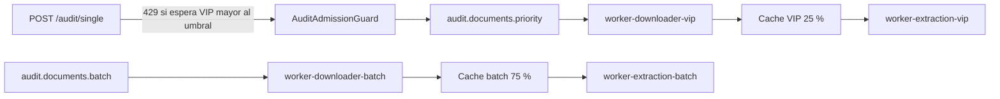

# SDD-BATCH-002 (Fase 3): Aislamiento de Carriles VIP/Batch, Protección de Admisión de `POST /audit/single` y Sincronización Descarga-Extracción

> **Versión:** 1.3 (revisión 2026-11-22: verificación por grep de `R-F3-07..10` y aclaración de L6; 1.2 = decisiones del usuario del mismo día; 1.1 = verificación cruzada del mismo día; 1.0 = redacción original 2026-11-19). **Estado:** borrador de especificación (sin implementar); ver `Registro de revisión ASEO (2026-11-22)`. **Fecha:** 2026-11-19. **Idioma:** español.
> **Relación con otras especificaciones:** continúa a `plans/sdd-hotfix-mantenimiento-ejecucion.md` (Fase 1, `SDD-BATCH-000`) y `plans/sdd-estabilizacion-batch-y-mantenimiento.md` (Fase 2, `SDD-BATCH-001`), que difieren a esta fase `SUP-04` (refutado en producción, `P-F2-07`). No es la «Fase 2» de `plans/sdd-fase-2-aislamiento-carril-vip.md` (2026-09-07), que particionó los pools de extracción.
> **Convención de identificadores:** requisitos `REQ-F3-xx`; decisiones `DEC-F3-xx`; invariantes `INV-F3-xx`; supuestos `SUP-F3-xx`; riesgos `R-F3-xx`; criterios `CA-F3-xx`; hallazgos de producción `P-F3-xx`.
> **Alcance de cierre:** esta especificación **no** modifica código; define el cambio. El **despliegue** exige las fases `SDD-BATCH-000` y `SDD-BATCH-001` desplegadas y estables; el código y sus pruebas pueden escribirse antes, contra el diseño de `SDD-BATCH-001`, porque `digitsOrDefault()` y `v2_services` no existen en `HEAD` y los crea esa fase (verificado con grep; ver FASE 4) (dependencia técnica explícita de `SDD-BATCH-001`: el input `operation` (`deploy`/`rollback`) del workflow `deploy-production.yml`, la lista `v2_services` de su paso de cutover y la regla `digitsOrDefault()` de `AuditExecutionConfig` que esta spec replica; más dependencia de ventana operativa: ver Sección 14).

## Registro de incorporación del diagnóstico de producción (2026-11-19)

Hallazgos aportados por el agente de diagnóstico de `172.16.0.3` (ventana `14:56Z–20:08Z`). Los logs y métricas no fueron vistos directamente por el autor de esta especificación: se clasifican `[CONFIRMADO en fuente externa]`. Lo verificable en el repositorio se cita con `ruta — símbolo, líneas observadas`.

| ID | Hallazgo | Verificación en código | Incorporación |
| --- | --- | --- | --- |
| `P-F3-01` | Una ráfaga de `1.576 req/h` en `POST /audit/single` desde `52.117.172.102` saturó el caché documental global (`71,4–88,2 %`, `4.428+` `prefetch_pauses`) y detuvo a los `16` `worker-downloader` (`documents_batch` lag `33.367 → 57.000`) con `extraction.batch` en `queued = 0` y `24` extractores ociosos (`P-F2-07`) | `[CONFIRMADO]` caché y compuerta únicos: `app/Services/Audit/Pipeline/AuditDocumentCache.php` — `INDEX = 'audit:document-cache:{budget}'`, líneas observadas: 15, 117-120; `AuditDocumentPrefetchGate.php` — `canRead()`, 29-52; `AttachmentDownloadWorker.php` — `canReadNewMessages()`, 56-59, y `streams()` con ambos streams, 71-77; `docker-compose.yml` — `worker-downloader` sin `--priority-only`/`--batch-only`, 217-240 | `REQ-F3-01..03` |
| `P-F3-02` | `1.576 req/h` equivalen a `0,438 req/s`, por debajo de `audit_limit` (`2 r/s`): un límite de tasa por IP no habría frenado la ráfaga; el daño proviene del volumen sostenido hacia una cola VIP de capacidad fija | `[CONFIRMADO]` cálculo `1576 / 3600`; `docker/nginx-ha.conf.template` — `limit_req_zone audit_limit rate=2r/s`, línea 6 | `DEC-F3-05` (contrapresión) como control principal; `DEC-F3-06` (Nginx) como defensa en profundidad |
| `P-F3-03` | `extraction.priority` acumuló `3.192` tareas con `2` `worker-extraction-vip` (espera `69,6 min` > TTL `3.600 s`), es decir `~45,9 tareas/min` | `[CONFIRMADO en fuente externa]` (medición); `[CONFIRMADO]` réplicas `docker-compose.yml:184`, `:349` | Base numérica de `DEC-F3-05` y `DEC-F3-08` |
| `P-F3-04` | Entre `14:57Z` y `20:07Z`, `documentCache.misses` pasó de `2.298` a `6.565` (`+4.267`), `recovery_duration_ms` de `8,33 M` a `23,08 M` (`~4,1 h` acumuladas de re-descarga) con `141` `recovery_failed` y `135` `hash_mismatch`: los blobs caducan (TTL `3.600 s`) antes de que el extractor los tome | `[CONFIRMADO en fuente externa]`; `[CONFIRMADO]` TTL `AuditDocumentCache::DEFAULT_TTL_SECONDS = 3600`, línea 14 | `DEC-F3-04` |
| `P-F3-05` | `audit.documents.batch` retuvo `54.552` eventos de NUEVA EPS; los `6` jobs de las `15:00Z` esperaron `~3 h` en `queued`. `audit.documents.priority` acumuló `12.025` mensajes (`lag 11.975`) sin eventos `document_registered` reales | `[CONFIRMADO]` los grupos `downloaders/extractors/normalizers/policy` comparten cada stream de documentos (`AuditEventPublisher.php`, líneas observadas: 38-39) y cada evento ajeno se confirma uno a uno (`AuditEventConsumer.php` — `dispatchMessage()`, 353-366, `ackMessage()`, 789-798) tras lecturas `COUNT 1` (244-250) | `REQ-F3-07` (lectura por lote, solo descargadores); la equidad entre jobs queda en Non Goals |
| `P-F3-06` | `audit.dlq` creció de `256` a `295` eventos (`gemini_operation_failed` `91`, `PROVIDER_BLOCKED` `42`, errores SQL `db2` `73`, legados `> 50` páginas `38`, BLOB vacío `3`) | `[CONFIRMADO]` `AttachmentDownloadException` no reintentable va a DLQ en el primer intento (`AuditEventConsumer.php:631`) | Fuera de alcance: causas externas (Gemini, SQL); ver Sección 3 |

## Registro de revisión ASEO (2026-11-22)

Revisión derivada de la verificación cruzada de las tres especificaciones (`SDD-BATCH-000/001/002`) contra el código en `HEAD` (`2d1a467`) conforme a `system.md` (CP3, CP4, 17.1). Evidencia: 18 afirmaciones verificadas por dos verificadores independientes (grep del orquestador y agente Sonnet), con `archivo:línea`.

| Campo | Valor |
| --- | --- |
| Versión anterior → nueva | 1.0 → 1.1 |
| Motivo | Cierre de hallazgos de la verificación cruzada 000/001/002 y control de deriva con `HEAD` `2d1a467` (`system.md` 17.1) |
| Cambios | (1) L6: dependencia técnica explícita de `SDD-BATCH-001` (`operation`, `v2_services`, `digitsOrDefault()`); (2) baseline de caché `3 GiB` (`3221225472`) y cuota VIP `768 MiB`; (3) baseline de réplicas `semantic-batch 12`, `extraction-batch 36`; (4) `DEC-F3-08`: `worker-semantic-batch` pasa de `8` a `12` (sin cambio respecto de HEAD) y sustituye `SUP-04`; memoria adicional `+8 GiB` → `+7 GiB`; (5) renombrado de `worker-downloader` también en `v2_services` y en el `docker compose stop` de `SDD-BATCH-001`; (6) `AGENTS.md`: Mapa de Endpoints REST (`429`) y `plans/changelog.md`; (7) `CA-F3-09` ampliado con grep de `worker-downloader` sin sufijo |
| Contratos modificados | Valores por defecto de réplicas de `DEC-F3-08` (`AUDIT_WORKER_SEMANTIC_BATCH_REPLICAS:-12`); ningún contrato HTTP/Redis cambia respecto de 1.0 |
| Tareas afectadas | Ninguna implementada |
| Autor del cambio | Claude (Sonnet 5.5), por instrucción del usuario |
| Estado de aprobación | `PENDING_APPROVAL` (sin aprobar ni implementar) |


## Revisión 1.2 — decisiones del usuario (2026-11-22)

Guía paso a paso de `system.md` (CP3) para llevar la spec a Nivel A. Cada decisión fue tomada por el usuario mediante pregunta explícita; las lecturas de código citan `archivo:línea`.

| Campo | Valor |
| --- | --- |
| Versión anterior → nueva | 1.1 → 1.2 |
| Decisiones del usuario | (D1) `AUDIT_DOCUMENT_STREAM_READ_COUNT` por defecto `5` en lugar de `10` (`5 × 60 s = 300 s < 600 s`); (D2) el `429` con `Retry-After: 60` aplica a todos los clientes, incluido el integrador (`SUP-F3-04` cerrado); (D4) baseline `HEAD` por ser producción copia fiel de local (`SUP-F3-03` mitigado); (D5) umbral VIP `20 min` aprobado (`DEC-F3-05`); (D6) memoria adicional `+7 GiB` aceptada (`DEC-F3-08`) |
| Lecturas de código | `GoogleDriveAuthService.php:35,61` (timeout `60 s`); `AuditDocumentInput.php:14,28` (solo lectura); `frontend/lib/api/errors.ts:14,30-31` (manejo de `429`); `frontend/lib/schemas/domain.ts:107` (`documentCache` acepta campos nuevos) |
| Cambios | `DEC-F3-07`, `AuditExecutionConfig::documentStreamReadCount()`, `CA-F3-08`, `R-F3-03`, Prerequisito 4; `SUP-F3-01` (Mitigado), `SUP-F3-02`, `03`, `04`, `05`; 0.8, 0.9; Fase 3; 0.11 y Fase 4 |
| Contratos modificados | Default de `AUDIT_DOCUMENT_STREAM_READ_COUNT`: `10` → `5` (reversible a `1` sin código) |
| Nivel | `Nivel C` → **`Nivel A — Implementable, despliegue condicionado a los Prerequisitos de la Sección 14`** |
| Autor del cambio | Claude (Sonnet 5.5), por decisión explícita del usuario |
| Estado de aprobación | `PENDING_APPROVAL` (sin aprobar ni implementar) |


## Clasificación del Cambio (Triage)

| Dimensión | Valor | Justificación |
| --- | --- | --- |
| Tipo | Infraestructura | Aislamiento de recursos compartidos (caché, compuertas, pools) y control de admisión. |
| Riesgo | Alto | Cambia el runtime de workers en producción, claves Redis del caché documental y el contrato de error de `POST /audit/single`. |
| Persistencia afectada | Sí | Claves Redis `audit:document-cache:{budget}*` (Sección 9). Sin cambios en SQL Server. |
| Contrato externo afectado | Sí | `POST /audit/single` añade la respuesta `429` con `Retry-After` (Sección 10); `GET /metrics/async` añade `documentCache.lanes`. |
| Cambio arquitectónico | Sí | Un pool y un presupuesto de caché por carril en la etapa de descarga. |
| Producción afectada | Sí | `[CONFIRMADO en fuente externa]` `P-F3-01..04`. |
| Requiere 0.3.1 (cobertura de abstracciones) | No | No se reemplaza un mapeo estático por una abstracción dinámica. `[CONFIRMADO]` |

## FASE 0 — Descubrimiento Empírico Obligatorio

### 0.1 Perímetro de Impacto

| Archivo | Ruta | Categoría | Propósito | Líneas Afectadas | Verificado por Lectura |
| --- | --- | --- | --- | --- | --- |
| `AuditDocumentCache.php` | `app/Services/Audit/Pipeline/AuditDocumentCache.php` | MODIFIED | Presupuesto por carril, `release` con respaldo al índice heredado, `usage()` con edad residente | 12-188 | Sí (L1-188) |
| `AuditDocumentPrefetchGate.php` | `app/Services/Audit/Pipeline/AuditDocumentPrefetchGate.php` | MODIFIED | Cierre por residencia además de capacidad | 9-52 | Sí (L1-53) |
| `AttachmentDownloadWorker.php` | `app/Services/Audit/Pipeline/AttachmentDownloadWorker.php` | MODIFIED | Caché y compuerta por carril del evento; `readCount()` | 14-77, 94-150 | Sí (L1-140; L141-217 no leídas: no contienen caché ni compuerta, símbolos `documentHash`, `blobKey`, `requiredString`, `elapsedMs` según búsqueda de símbolos) |
| `AuditEventConsumer.php` | `app/Services/Audit/Pipeline/AuditEventConsumer.php` | MODIFIED | Método protegido `readCount()` en lugar del literal `1` | 136-300, 353-400, 786-812 | Sí (rangos citados) |
| `DocumentExtractionWorker.php` | `app/Services/Audit/Pipeline/DocumentExtractionWorker.php` | MODIFIED | `release()` con el carril de la tarea | 74-130, 296-330 | Sí (rangos citados; los `release()` de `:361,378,415,437,461,491` se reemplazan con el mismo helper, ubicados por búsqueda de símbolo) |
| `AuditDocumentMetrics.php` | `app/Services/Audit/Pipeline/AuditDocumentMetrics.php` | MODIFIED | `snapshot()` suma ambos carriles y publica `lanes` | 38-58 | Sí (líneas 14-70 observadas por búsqueda de símbolo y lectura parcial) |
| `AuditAdmissionGuard.php` | `app/Services/Audit/Pipeline/AuditAdmissionGuard.php` | MODIFIED | `priorityLaneAtCapacity()` | 1-71 | Sí (L1-70) |
| `AuditExecutionConfig.php` | `app/Services/Audit/Pipeline/AuditExecutionConfig.php` | MODIFIED | Lectores de las variables nuevas | 10-98 | Sí (delegado a `SDD-BATCH-001`: L1-98) |
| `AuditController.php` | `app/Controllers/AuditController.php` | MODIFIED | `single()` invoca la contrapresión prioritaria | 22-110, 644-653 | Sí (rangos citados) |
| `ObservabilityController.php` | `app/Controllers/ObservabilityController.php` | IMPACTED | Lee `AuditDocumentMetrics::snapshot()` (`:136`) | 125-140 | Sí (línea 136 observada por búsqueda; contrato aditivo) |
| `FairAuditTaskQueue.php` | `app/Services/Audit/Pipeline/FairAuditTaskQueue.php` | IMPACTED | `metrics()` provee `oldest_wait_ms` por etapa y carril | 181-222 | Sí (L181-222) |
| `audit-worker.php` | `bin/audit-worker.php` | INSPECTED | Ya acepta `--priority-only` / `--batch-only` para `downloader` | 33-36, 57-85, 120, 142-155 | Sí (L28-160) |
| `docker-compose.yml` | `docker-compose.yml` | MODIFIED | Dos servicios de descarga y réplicas por defecto | 163-240, 341-363 | Sí (L150-366) |
| `nginx-ha.conf.template` | `docker/nginx-ha.conf.template` | MODIFIED | Reemplaza el `location = /audit` sin efecto | 1-123 | Sí (L1-120) |
| `deploy-production.yml` | `.github/workflows/deploy-production.yml` | MODIFIED | Variables, defaults y listas de servicios | 205-212, 231-232, 379-380, 429-435, 455-456, 576, 601 | Sí (líneas citadas, observadas por búsqueda textual) |
| `.env.example`, `AGENTS.md`, `README.md` | raíz | MODIFIED | Catálogo de variables y servicios | `.env.example:124-134`; `AGENTS.md:411`; `README.md:101,245` | Sí (líneas citadas por búsqueda textual) |
| `plans/docker-operations.md`, `plans/high-availability.md`, `plans/features/audit-workflow.md`, `website/docs/features/audit-workflow.md`, `.agent/skills/audfact-runtime-docker/SKILL.md` | `plans/`, `website/`, `.agent/` | MODIFIED | Documentación operativa que nombra `worker-downloader` | citadas en 0.2 | Sí (líneas citadas por búsqueda textual) |

#### Criterio de Cierre del Perímetro

| Método de Búsqueda | Patrón | Resultado | Evidencia |
| --- | --- | --- | --- |
| Búsqueda por símbolo | `new AuditDocumentCache`, `AuditDocumentPrefetchGate`, `audit:document-cache` en `app/`, `core/`, `bin/`, `tests/`, `.github/workflows/` | Productores: `AttachmentDownloadWorker:40-45`, `DocumentExtractionWorker:123`, `AuditDocumentMetrics:42,58`; tests listados en 0.2 | Búsqueda realizada 2026-11-19 |
| Búsqueda textual | `git grep -E "worker-downloader\|AUDIT_WORKER_DOWNLOADER_REPLICAS\|location = /audit"` | Archivos de 0.1 y 0.2; sin coincidencias adicionales en código | Búsqueda realizada 2026-11-19 |
| Búsqueda en rutas | `post('/audit'`, `get('/audit'` en `app/` | Sin ruta `/audit` exacta; solo `/audit/single`, `/audit/async` (`app/Routes/web.php:39-40`) | `location = /audit` sin tráfico |
| Búsqueda en consumidores de `/audit/single` | `audit/single`, `audit/async` en `app/wrap/`, `bin/schedule-daily-batches.php`, `frontend/` | `bin/schedule-daily-batches.php:197` usa `BatchJobStore::initJob()` (sin HTTP); `app/wrap/`: sin coincidencias; `frontend/lib/api/endpoints.ts:24-25` define ambos endpoints | Búsqueda realizada 2026-11-19 |
| Búsqueda en configuración | `AUDIT_DOCUMENT_CACHE`, `REPLICAS` | `.env.example:124-134,155-157`; `deploy-production.yml:205-212,231-232` | Líneas citadas |
| Búsqueda en tests | `AuditDocumentCache*`, `PrefetchGate*`, `AttachmentDownloadWorker*`, `AuditAdmissionGuard*`, `AuditController*`, `Observability*` | 9 archivos en 0.2 | Listado `tests/` 2026-11-19 |
| Búsqueda en workflows/CI | `worker-downloader` | `deploy-production.yml:576,601` | Líneas citadas |

### 0.2 Grafo de Dependencias Acopladas

| Archivo Afectado | Dependencia | Ruta Dependencia | Línea(s) | Relación | Mecanismo | Tipo de Consumidor |
| --- | --- | --- | --- | --- | --- | --- |
| `AuditDocumentCache` | `AttachmentDownloadWorker` (put) | `app/Services/Audit/Pipeline/AttachmentDownloadWorker.php` | 40-43, 145 | Directa | Estática | Repositorio local |
| `AuditDocumentCache` | `DocumentExtractionWorker` (release) | `app/Services/Audit/Pipeline/DocumentExtractionWorker.php` | 123, 310, 323 | Directa | Estática | Repositorio local |
| `AuditDocumentCache` | `AuditDocumentInput` (lectura y recuperación) | `app/Services/Audit/Pipeline/AuditDocumentInput.php` | `:14`, `:28` (`read($key)`) | Directa | Estática | Repositorio local |
| `AuditDocumentCache` | `AuditDocumentMetrics` (claves `:bytes`, `:expires`) | `app/Services/Audit/Pipeline/AuditDocumentMetrics.php` | 42, 58 | Directa | Contractual | Repositorio local |
| `AuditDocumentMetrics` | `ObservabilityController::asyncMetrics()` | `app/Controllers/ObservabilityController.php` | 136 | Directa | Contractual | Repositorio local; cliente externo `[DESCONOCIDO]` |
| `AuditAdmissionGuard` | `AuditController::assertAuditAdmission()` | `app/Controllers/AuditController.php` | 644-653 | Directa | Estática | Repositorio local |
| `AuditEventConsumer::run()` | `AttachmentDownloadWorker` y demás consumidores por stream | `app/Services/Audit/Pipeline/*.php` | 244-250 | Directa | Estática | Repositorio local |
| `worker-downloader` | `deploy-production.yml` (salud y logs) | `.github/workflows/deploy-production.yml` | 576, 601 | Directa | Operacional | Repositorio local |
| `worker-downloader` | Documentación operativa | `plans/docker-operations.md:221,254-258`; `plans/high-availability.md:28,95`; `.agent/skills/audfact-runtime-docker/SKILL.md:176` | citadas | Directa | Operacional | Repositorio local |
| `AuditDocumentCache` (tests) | `AuditDocumentCacheTest`, `AuditDocumentCacheRedisTest`, `AuditDocumentPrefetchGateTest`, `AuditDocumentInputTest`, `ObservabilityControllerTest` | `tests/` | `AuditDocumentCacheRedisTest:16,38-39`; `ObservabilityControllerTest:74,131,204,249` | Directa | Estática | Repositorio local |
| `POST /audit/single` | Frontend | `frontend/lib/api/endpoints.ts` | 24 | Directa | Contractual | Cliente externo (la UI); tratamiento de `429` `[DESCONOCIDO]` |

### 0.3 Análisis de Impacto Inverso (Regresiones)

| Cambio Propuesto | Componente Afectado | Ruta:Línea | Tipo de Regresión | Corrección |
| --- | --- | --- | --- | --- |
| Reemplazar el servicio `worker-downloader` por `worker-downloader-vip` y `worker-downloader-batch` | Verificación de salud y logs del deploy | `.github/workflows/deploy-production.yml:576,601` | Pipeline | Sustituir `worker-downloader` por ambos servicios en las dos listas; sin ello, el job de deploy valida un servicio inexistente |
| Ídem | Documentación operativa y skill de Docker | `plans/docker-operations.md:221,254-258`, `.agent/skills/audfact-runtime-docker/SKILL.md:176` | DX | Actualizar los comandos a los dos servicios nuevos |
| Mantener `AUDIT_WORKER_DOWNLOADER_REPLICAS` como réplicas del carril batch | Variables ya fijadas en GitHub y `.env` de producción | `deploy-production.yml:205,429` | Runtime | El nombre se conserva; se agrega `AUDIT_WORKER_DOWNLOADER_VIP_REPLICAS`; ninguna variable existente pierde efecto |
| Caché con índice por carril | Blobs en vuelo al desplegar (escritos en el índice heredado) | `AuditDocumentCache.php:82-90,179-187` | Data | `release()` ejecuta primero el índice del carril y, si la entrada no existe, ajusta el índice heredado; el `DEL` del blob ocurre siempre (`RELEASE_LUA` actual) |
| `usage()` devuelve un tercer valor | `AuditDocumentPrefetchGate`, `AuditDocumentCacheTest`, `AuditDocumentCacheRedisTest` | `AuditDocumentCache.php:98-115` | Test | Actualizar la validación `count($raw) !== 2` y las pruebas que afirman la forma del arreglo |
| `snapshot()` añade `lanes` | `ObservabilityControllerTest` (claves `:bytes`) | `tests/Controllers/ObservabilityControllerTest.php:74,131,204,249` | Test | El doble de Redis debe responder a las claves por carril; cambio aditivo en la respuesta |
| `POST /audit/single` responde `429` con contrapresión | Frontend de auditoría 1:1 y cualquier integrador | `frontend/lib/api/endpoints.ts:24` | Contract | Cambio aditivo documentado en Sección 10; verificación de manejo de `429` en el cliente (`SUP-F3-05`) |
| Reemplazar `location = /audit` | Tráfico a `/audit` exacto | `app/Routes/web.php:39-40` | Runtime | Sin ruta `/audit`: el bloque no recibe tráfico (0.1); el reemplazo cubre las dos rutas reales |
| `readCount()` mayor a 1 en descargadores | Reclamo de pendientes (`pendingReclaimIdleMs`) | `AuditEventConsumer.php:62` | Runtime | Valor por defecto `5` (decisión del usuario 2026-11-22; `SUP-F3-02` cerrado); `AUDIT_DOCUMENT_STREAM_READ_COUNT=1` revierte sin código |

### 0.4 Verificación de Semántica de Herramientas

| Herramienta | Asunción | Evidencia | Estado |
| --- | --- | --- | --- |
| Redis `XREADGROUP ... COUNT n` | `COUNT` se aplica por stream y devuelve hasta `n` mensajes | `core/RedisClient.php — xReadGroupMulti()`, 573-613 (pasa `COUNT` tal cual a `XREADGROUP`) | `[CONFIRMADO]` firma; semántica de Redis `[CONFIRMADO]` por documentación oficial de `XREADGROUP` |
| Redis Lua `ZRANGE ... WITHSCORES` | Devuelve el miembro de menor puntaje (el que expira primero) | Uso de `ZRANGEBYSCORE` sobre el mismo `ZSET` en `AuditDocumentCache.php:142` | `[CONFIRMADO]` por analogía de uso; verificación empírica en `AuditDocumentCacheRedisTest` (Sección 16) |
| Nginx `limit_req` tras `try_files` | La redirección interna a `/index.php` aplica también `api_limit` del bloque `~ \.php$` | `docker/nginx-ha.conf.template:95-104`, patrón idéntico al `location = /audit` vigente | `[INFERIDO]` por lectura de configuración; no verificable con grep (sin binario ni fuente de Nginx en el repo; imagen `nginx:1.25-alpine`); impacto bajo porque `audit_limit` es más estricto que `api_limit` (`R-F3-10`); verificación empírica en Sección 14 (Validaciones Previas) |
| `FairAuditTaskQueue::metrics()` | `oldest_wait_ms` es `0` si no hay tareas en espera y valida estructura | `FairAuditTaskQueue.php:210-220` | `[CONFIRMADO]` |

### 0.5 Matriz de Entornos de Ejecución

| Aspecto | Local / Desarrollo | Producción LAN (`172.16.0.3`) | CI |
| --- | --- | --- | --- |
| Carril de workers | `AUDIT_WORKER_LANE` por defecto `all` (`bin/audit-worker.php:80`): un proceso lee ambos carriles | Procesos por carril (`--priority-only`/`--batch-only`) para extracción y semántica; descarga sin carril | Sin workers; pruebas con Redis aislado (`IsolatedAuditRedis`) |
| Compuerta de descarga en modo `all` | Evalúa ambos carriles y cierra si cualquiera cierra | No aplica tras el cambio | N/A |
| Nginx | `docker/nginx.conf` sin rate limiting | `docker/nginx-ha.conf.template` con zonas `api_limit` y `audit_limit` | N/A |
| Réplicas | Defaults del Compose | Variables de GitHub Environment `production` (valores efectivos `[DESCONOCIDO]`, `SUP-F3-03`) | N/A |

### 0.6 Inventario de Información

| Afirmación | Clasificación | Evidencia |
| --- | --- | --- |
| Los descargadores no usan carril en Compose y comparten caché y compuerta | `[CONFIRMADO]` | `docker-compose.yml:217-240`; `AuditDocumentCache.php:15` |
| `bin/audit-worker.php downloader` acepta carril | `[CONFIRMADO]` | `bin/audit-worker.php:33-36,69-83,120` |
| `AuditEvent` hereda `is_priority` a los eventos siguientes | `[CONFIRMADO]` | `app/Services/Audit/Pipeline/AuditEvent.php:28` (`ROUTING_PAYLOAD_KEYS`) y `AuditController.php:94` |
| El límite global de admisión (`80 %` de `20.000` por etapa) no detuvo la ráfaga VIP | `[CONFIRMADO]` | `AuditAdmissionGuard.php:47-60`; `AuditExecutionConfig.php:27,54`; `3.192 < 16.000` |
| La especificación `2026-09-07` descartó particionar `downloader` por «duración de milisegundos y sin contención» | `[CONFIRMADO]` | `plans/sdd-fase-2-aislamiento-carril-vip.md:196` |
| Esa premisa es refutada por la contención del presupuesto de caché | `[CONFIRMADO en fuente externa]` | `P-F3-01` |
| Rendimiento VIP de `~45,9 tareas/min` con `2` réplicas | `[CONFIRMADO en fuente externa]` | `P-F3-03` |
| El tiempo máximo de una descarga de adjunto | `[DESCONOCIDO]` | Búsqueda de `timeout|CURLOPT|retries` en `AttachmentDownloadService.php` sin coincidencias |

### 0.7 Información Faltante Crítica

Ninguna.

### 0.8 Información Faltante Importante

| # | Faltante | Impacto | Cierre |
| --- | --- | --- | --- |
| 1 | Valores efectivos de réplicas en producción tras el escalado operativo del 2026-11-19 | Define si los defaults nuevos suben o bajan la capacidad real | Operación lista `gh variable list --env production` y `docker compose ps` (`SUP-F3-03`). **Cerrado 2026-11-22 por decisión del usuario:** producción es copia fiel de local; baseline efectivo = valores de `HEAD` (`docker-compose.yml:184,211,236,349,359`). El `gh variable set` previo al deploy (Sección 14) sigue siendo obligatorio |
| 2 | Tiempo máximo de una descarga (cliente HTTP de adjuntos) | Condiciona `readCount()` | Lectura del cliente HTTP usado por `AttachmentDownloadService` (`SUP-F3-02`). **Cerrado 2026-11-22:** descarga vía `GoogleDriveAuthService` con timeout `60 s` (`GoogleDriveAuthService.php:35,61`) |
| 3 | Manejo de `429` en el cliente `frontend/` | Determina el mensaje que ve el usuario | Lectura del cliente HTTP del frontend (`SUP-F3-05`). **Cerrado 2026-11-22:** `frontend/lib/api/errors.ts:30-31` muestra un mensaje específico para `429` y `:14` lo marca reintentable |

### 0.9 Información Faltante Opcional

- ~~Líneas exactas de `AuditDocumentInput.php` que usan el caché~~ **Cerrado 2026-11-22:** `AuditDocumentInput.php:14` (inyección de `AuditDocumentCache`) y `:28` (`$this->cache->read($key)`); solo lee, no escribe ni libera, y no se modifica.
- Consumo de `DocumentNormalizer` de eventos ajenos (candidata a `readCount()`; fuera de alcance, ver Sección 3).

### 0.10 Supuestos Declarados

| ID | Supuesto | Clasificación | Riesgo si falla | Severidad | Estado | Condición de cierre |
| --- | --- | --- | --- | --- | --- | --- |
| `SUP-F3-01` | La cuota VIP del `25 %` del caché (`768 MiB` de `3 GiB`, `1.024` entradas) cubre la demanda VIP bajo contrapresión | `[INFERIDO]` | Si el carril VIP se queda sin cuota, el VIP recupera desde origen (`recovered`) y se ralentiza; el carril batch no se ve afectado | S2 | Mitigado (parámetro configurable sin código; la medición es posterior al deploy) | Medir `documentCache.lanes.priority` durante `24 h`; ajustar `AUDIT_DOCUMENT_CACHE_PRIORITY_SHARE_PERCENT` sin código |
| `SUP-F3-02` | `5` mensajes por lectura × duración máxima de una descarga `< pendingReclaimIdleMs` (`600.000 ms`) | `[CONFIRMADO]` timeout del cliente HTTP de Drive `60 s` (`GoogleDriveAuthService.php:35,61`): `5 × 60 s = 300 s < 600 s`. Con el default original `10` la regla no se cumplía (`10 × 60 s = 600 s`), por lo que el usuario fijó `5` el 2026-11-22 | Reclamo de pendientes duplicaría descargas | S2 | Cerrado | `AUDIT_DOCUMENT_STREAM_READ_COUNT=1` revierte sin código | Cerrado por decisión del usuario (`5`) y lectura de `GoogleDriveAuthService.php` |
| `SUP-F3-03` | Los defaults de réplicas de esta especificación son menores o iguales al escalado operativo vigente | `[CONFIRMADO]` baseline `HEAD` por decisión del usuario (2026-11-22): producción es copia fiel de local | Un deploy bajaría capacidad ya ampliada | S2 | Mitigado | `gh variable set` explícito de cada réplica con el valor efectivo antes del deploy (Sección 14) |
| `SUP-F3-04` | `52.117.172.102` es un integrador legítimo; recibir `429` es aceptable | `[CONFIRMADO]` decisión del usuario (2026-11-22): el `429` con `Retry-After: 60` es aceptable para todos los clientes, incluido el integrador | Pérdida de auditorías 1:1 de un integrador sin reintento | S2 | Cerrado | Decisión registrada; `CA-F3-05` y la validación previa de Sección 14 verifican el comportamiento |
| `SUP-F3-05` | El cliente `frontend/` muestra el mensaje del error `429` sin romper el flujo | `[CONFIRMADO]` `frontend/lib/api/errors.ts:14,30-31`: mensaje específico para `429` y reintentable (el texto dice «unos segundos» mientras `Retry-After` es `60 s`; ajuste opcional) | Error genérico para el usuario | S2 | Cerrado | Prueba manual (Sección 16) |

### 0.11 Clasificación de Completitud Inicial

`Nivel B` provisional (2026-11-19): perímetro leído (con rangos), sin información crítica faltante y cinco supuestos `S2` abiertos. Reclasificado a **Nivel A** el 2026-11-22 (ver Fase 4).

## FASE 1 — Especificación

### 1. Objetivo

Eliminar la inanición de los jobs batch causada por la saturación del carril VIP, mediante:

- **(a)** presupuesto de caché y compuerta de descarga independientes por carril, con un pool de descarga por carril (`REQ-F3-01..03`);
- **(b)** contrapresión de admisión en `POST /audit/single` basada en la espera real de la cola prioritaria (`REQ-F3-04`);
- **(c)** cierre de la descarga cuando los blobs residentes envejecen sin ser extraídos, para evitar la caducidad por TTL (`REQ-F3-05`);
- **(d)** reglas de Nginx efectivas sobre las rutas reales (`REQ-F3-06`);
- **(e)** topología de réplicas persistida en el repositorio (`REQ-F3-08`) y lectura por lote en descargadores (`REQ-F3-07`).

Impacto medible esperado `[INFERIDO]`: con los `16` descargadores batch independientes de la cuota VIP, `extraction.batch` deja de quedar en `queued = 0` con el carril VIP saturado; los blobs batch dejan de caducar (`misses` batch sin aumento atribuible a TTL).

### 2. Alcance

#### Incluido

- Presupuesto, compuerta y pool de descarga por carril; liberación con respaldo al índice heredado.
- Contrapresión VIP en `POST /audit/single` (`429`, `Retry-After: 60`).
- Cierre por residencia en la compuerta de prefetch.
- `location` de Nginx para `/audit/single` y `/audit/async`.
- Réplicas por defecto de descarga, extracción VIP y semántica; variables nuevas y su sincronización en GitHub.
- `AUDIT_DOCUMENT_STREAM_READ_COUNT` para el descargador.

#### Excluido

- Equidad entre jobs/clientes dentro de `batch` (`DEC-F3-09`).
- Triaje de `audit.dlq` (`P-F3-06`).
- Optimización de `#DISP..#Sopo` y aumento de `AUDIT_BATCH_FREEZE_QUERY_TIMEOUT_SECONDS` (`SDD-BATCH-001`).
- División de `audit.documents.*` por etapa (descartada en `SDD-BATCH-001`, Sección 2).
- Cambios en el normalizador.

### 3. Non Goals

- Cambiar la política `FIFO` por job en los streams de documentos.
- Reintentar o reclasificar los eventos de `audit.dlq`.
- Introducir un segundo Redis o particionar por cliente.
- Cambiar umbrales `90/70 %` de capacidad de la compuerta.

### 4. Estado Actual

| Elemento | Estado | Evidencia |
| --- | --- | --- |
| Pool de descarga | Un servicio, `16` réplicas, lee `audit.documents.priority` y `audit.documents.batch` con `COUNT 1` | `docker-compose.yml:217-240`; `AttachmentDownloadWorker.php:71-77`; `AuditEventConsumer.php:244-250` |
| Presupuesto de caché | Único: `audit:document-cache:{budget}` (`3 GiB` = `3221225472` bytes, `4.096` entradas, TTL `3.600 s`; `AuditDocumentCache.php:29-30`, `.env.example:156-157`, `deploy-production.yml:455`) | `AuditDocumentCache.php:14-30,117-120` |
| Compuerta | Cierra a `90 %` de bytes o entradas y reabre a `70 %`, para ambos carriles | `AuditDocumentPrefetchGate.php:12-13,36-49` |
| Liberación | `DocumentExtractionWorker` libera por clave tras confirmar la tarea | `DocumentExtractionWorker.php:308-324` |
| Admisión VIP | Solo guardas globales (`audit:admission:paused`, heartbeat, `80 %` de `20.000` por etapa, memoria Redis) | `AuditAdmissionGuard.php:16-60` |
| Nginx | `location = /audit` sin tráfico; `/audit/single` y `/audit/async` bajo `api_limit` (`10 r/s`, burst `20`) | `docker/nginx-ha.conf.template:94-104`; `app/Routes/web.php:39-40` |
| Réplicas | `worker-extraction-vip 2`, `worker-semantic-vip 1`, `worker-semantic-batch 12`, `worker-extraction-batch 36`, `worker-downloader 16` | `docker-compose.yml:184,349,359,211,236` (el valor `6` de semantic-batch citado en `SDD-BATCH-001` es previo al commit `2d1a467`) |

### 5. Estado Objetivo



- Cada carril tiene su pool de descarga, su índice de caché y su compuerta; la saturación de uno no cierra al otro (`INV-F3-01`).
- La compuerta de cada carril cierra por capacidad (`>= 90 %`) o por residencia (`>= 50 %` del TTL, con ocupación `>= 10 %`).
- `POST /audit/single` responde `429` cuando la espera del extremo de la cola prioritaria supera `AUDIT_PRIORITY_ADMISSION_MAX_WAIT_MS` (`1.200.000`, `20 min`).

### 6. Decisiones Arquitectónicas

| ID | Decisión | Alternativas descartadas | Justificación |
| --- | --- | --- | --- |
| `DEC-F3-01` | Un servicio de descarga por carril (`--priority-only` / `--batch-only`) | Un pool único con compuerta por carril | `AuditEventConsumer::activeStreams()` filtra por carril del proceso (`:95-105`) y extracción y semántica ya usan esa convención (`docker-compose.yml:163-215,341-363`); un pool único obligaría a alternar compuertas dentro del bucle de lectura. Revierte la exclusión de `plans/sdd-fase-2-aislamiento-carril-vip.md:196`, cuya premisa (sin contención) queda refutada por `P-F3-01` |
| `DEC-F3-02` | El carril de un blob es `payload.is_priority === true ? priority : batch`, en `put` y en `release` | Codificar el carril en la clave del blob | La clave `audit:blob:{audit}:{doc}:{hash}` y `assertKey()` no cambian; `is_priority` ya se hereda entre eventos (`AuditEvent.php:28`) |
| `DEC-F3-03` | Cuota por carril: `AUDIT_DOCUMENT_CACHE_PRIORITY_SHARE_PERCENT` (entero `1..99`, defecto `25`); el carril batch recibe el resto. Sobre el total de `AUDIT_DOCUMENT_CACHE_MAX_BYTES`/`MAX_ENTRIES` | Presupuesto fijo en código | Parametrizable en caliente (`SUP-F3-01`); la suma de carriles nunca excede el total vigente (`INV-F3-02`) |
| `DEC-F3-04` | La compuerta cierra también por residencia: `oldest_age_ms * 100 >= ttl_ms * 50` con ocupación `>= 10 %`; reabre con `<= 25 %` y capacidad `<= 70 %` | Detener por longitud de cola de extracción | El índice `expires` ya contiene la edad de cada blob (`AuditDocumentCache.php:142,174`); no acopla descarga a `FairAuditTaskQueue`. El umbral de ocupación evita que un blob huérfano cierre el carril |
| `DEC-F3-05` | Contrapresión VIP: `429` + `Retry-After: 60` cuando `oldest_wait_ms >= AUDIT_PRIORITY_ADMISSION_MAX_WAIT_MS` (`1.200.000`) en cualquier etapa del carril `priority` | Límite por IP en Nginx; límite por longitud de cola | `P-F3-02` demuestra que la tasa por IP no frena la ráfaga; `oldest_wait_ms` es la señal directa de la espera y está disponible (`FairAuditTaskQueue.php:219`). Con `45,9 tareas/min` (`P-F3-03`), `20 min` equivalen a `~918` tareas, margen de `3,0x` frente a `TTL 3.600 s` |
| `DEC-F3-06` | Nginx: `location ~ ^/audit/(single\|async)$` con `limit_req zone=audit_limit burst=5 nodelay` y `limit_req_status 429`; se elimina `location = /audit` | Mantener el bloque sin tráfico | Defensa en profundidad contra ráfagas por IP; no es el control de volumen (`P-F3-02`). Elimina código muerto (`clean-rebuild-policy`) |
| `DEC-F3-07` | `AuditEventConsumer::readCount()` (protegido, defecto `1`); `AttachmentDownloadWorker` lo sobrescribe con `AuditExecutionConfig::documentStreamReadCount()` (defecto `5`, rango `1..50`; `5 × 60 s` de timeout de Drive `< 600 s` de reclaim) | Cambiar `COUNT` global | Solo el descargador procesa mensajes de milisegundos con eventos ajenos mayoritarios (`P-F3-05`); el resto conserva `1` |
| `DEC-F3-08` | Réplicas por defecto: `worker-downloader-vip 4` (nuevo), `worker-downloader-batch 16` (`AUDIT_WORKER_DOWNLOADER_REPLICAS`, sin cambio), `worker-extraction-vip 6`, `worker-semantic-vip 3`, `worker-semantic-batch 12` (`AUDIT_WORKER_SEMANTIC_BATCH_REPLICAS`, sin cambio: ya es `12` en `docker-compose.yml:359`) | Valores de la mitigación operativa temporal de `SDD-BATCH-001` `SUP-04` para VIP (`10`/`4`). Esta decisión **sustituye** `SUP-04` (estado `Refutado — diferido a Fase 3`) | Quedan dentro de la envolvente verificada en `SUP-04` (`< 64` inflight Gemini). `6 / 45,9×(2/6)` mantiene espera VIP `< 24 min` bajo el mismo volumen `[INFERIDO]` por escalado lineal. Memoria adicional: `+4 GiB` (extracción VIP) `+2 GiB` (descarga VIP) `+1 GiB` (semántica VIP) = `+7 GiB` (semántica batch sin cambio); la holgura medida es `35 GiB` (`[CONFIRMADO en fuente externa]`) |
| `DEC-F3-09` | No se implementa equidad entre jobs | Cuotas por NIT | Sin requisito ni evidencia de diseño; `SDD-BATCH-001` ya limita un job activo por NIT (`INV-03`) |
| `DEC-F3-10` | En `AUDIT_WORKER_LANE=all` (desarrollo) la compuerta de descarga es la conjunción de ambos carriles | Una compuerta por mensaje | Comportamiento conservador sin consumidor productivo; evita ramas por mensaje |

#### 6.1 Estrategia de Cambio y Excepciones

Estrategia: **Refactorización incremental** con compuerta de decisión de `clean-rebuild-policy`: el caché y la compuerta se extienden (no se reescriben) porque sus contratos activos (`put/read/release/usage`, `limits`, `counters`) se preservan. **Excepciones: ninguna.** El respaldo de `release()` al índice heredado es una ventana de migración con retiro verificable (Sección 14: eliminación de claves heredadas a las `2 h`) y no un adaptador permanente.

### 7. Dependencias

| Dependencia | Uso | Estado |
| --- | --- | --- |
| Redis `7` (Lua, `ZSET`, `HASH`) | Índices por carril | `[CONFIRMADO]` (`AuditDocumentCache.php:138-187`) |
| `SDD-BATCH-000` / `SDD-BATCH-001` | Ventana operativa estable previa | Decisión externa: orden de despliegue |
| GitHub Environment `production` | Variables nuevas | `gh variable set` obligatorio (`AGENTS.md`) |

#### 7.1 Fuentes de Verdad

| Dato | Fuente |
| --- | --- |
| Carril del documento | `payload.is_priority` del evento |
| Capacidad por carril | `AUDIT_DOCUMENT_CACHE_*` y `AUDIT_DOCUMENT_CACHE_PRIORITY_SHARE_PERCENT` |
| Espera de la cola VIP | `FairAuditTaskQueue::metrics()[stage]['priority']['oldest_wait_ms']` |

#### Procedimiento de Resolución de Conflictos

Si `is_priority` falta o no es booleano `true`, el carril es `batch`. Si el índice del carril no contiene la clave en `release()`, se ajusta el índice heredado; el blob se elimina en cualquier caso.

### 8. Invariantes

| ID | Invariante |
| --- | --- |
| `INV-F3-01` | La capacidad usada por un carril nunca cierra la compuerta del otro. |
| `INV-F3-02` | `max_bytes(priority) + max_bytes(batch) <= AUDIT_DOCUMENT_CACHE_MAX_BYTES` y lo mismo para entradas. |
| `INV-F3-03` | Un blob se elimina siempre que se libera, exista o no en el índice. |
| `INV-F3-04` | El contador de uso de cada índice se autocorrige por `prune()` en `<= TTL` si una liberación usó el carril equivocado. |
| `INV-F3-05` | La contrapresión VIP no se aplica a `POST /audit/async` ni a la creación de jobs por cron. Tampoco cubre los otros productores de eventos VIP: reinyección desde la DLQ (`AuditDlqController.php:122`) y evaluación semántica (`SemanticEvaluationStore.php:24`); ver `R-F3-08`. |
| `INV-F3-06` | `AUDIT_DOCUMENT_STREAM_READ_COUNT=1` reproduce el comportamiento anterior. |

### 9. Modelo de Datos

#### SQL Server

`N/A` `[CONFIRMADO]`: ningún cambio de esquema, vista ni consulta.

#### Redis (Claves, Estructuras, Políticas de Retención)

| Clave | Tipo | Descripción | Retención | Estado |
| --- | --- | --- | --- | --- |
| `audit:document-cache:{budget}:priority:expires` / `:sizes` / `:bytes` | `ZSET` / `HASH` / `string` | Índice del carril VIP | Autolimpieza por `prune()`; los blobs conservan `EX ttl` | Nueva |
| `audit:document-cache:{budget}:batch:expires` / `:sizes` / `:bytes` | `ZSET` / `HASH` / `string` | Índice del carril batch | ídem | Nueva |
| `audit:document-cache:{budget}:expires` / `:sizes` / `:bytes` | `ZSET` / `HASH` / `string` | Índice heredado (solo `release()` de blobs previos al despliegue) | Se elimina a las `2 h` del despliegue | Heredada, en retiro |
| `audit:blob:*` | `string` | Blobs; formato de clave sin cambios | `EX 3600` | Sin cambio |

#### Script de Cambio

No hay migración de datos: los índices por carril se crean al primer `put`. Eliminación del índice heredado (a las `2 h`, `2 × TTL`):

```bash
docker compose exec redis redis-cli DEL \
  "audfact:audit:document-cache:{budget}:expires" \
  "audfact:audit:document-cache:{budget}:sizes" \
  "audfact:audit:document-cache:{budget}:bytes"
```

(El prefijo `audfact:` es el observado en las claves `audfact:audit:reservation:disid:*`, `P-F2-04`; confirmar el prefijo efectivo con `redis-cli --scan --pattern '*document-cache*'` antes de ejecutar.)

#### Orden de Ejecución

1. Desplegar la imagen con el código nuevo y los dos servicios de descarga (los workers viejos de descarga se detienen).
2. Los blobs en vuelo se liberan por el respaldo al índice heredado.
3. A las `2 h`, eliminar el índice heredado.

#### Migración de Datos

`N/A`: el caché es prescindible (`AuditDocumentCache.php:11`); un blob no hallado se recupera desde su origen (`recovered`).

#### Rollback

Re-desplegar la imagen anterior: el código previo usa solo el índice heredado, ignora los índices por carril (expiran con sus blobs) y su `RELEASE_LUA` elimina el blob aunque no figure en el índice (`AuditDocumentCache.php:179-187`). Los índices por carril restantes se eliminan con `DEL` sobre `audit:document-cache:{budget}:priority:*` y `:batch:*`.

### 10. Contratos

#### Clasificación del Contrato

| Contrato | Clasificación |
| --- | --- |
| `POST /audit/single` | Aditivo: nuevo código de error `429` |
| `GET /metrics/async` | Aditivo: nuevo campo `documentCache.lanes` |
| CLI `bin/audit-worker.php downloader` | Sin cambio (ya admite `--priority-only` y `--batch-only`) |

#### Antes

`POST /audit/single` responde `200/202`, `404`, `422`, `503` (`Retry-After: 5`, `AuditController.php:644-653`).

#### Después

Añade `429` con cabecera `Retry-After: 60` y cuerpo `{"error": "La cola prioritaria está saturada; reintente más tarde"}` cuando se cumple `DEC-F3-05`. `GET /metrics/async`:

```json
"documentCache": {
  "limits": { "...": "sin cambio" },
  "counters": { "...": "sin cambio" },
  "lanes": {
    "priority": { "reserved_bytes": 0, "reserved_entries": 0, "max_bytes": 0, "max_entries": 0, "oldest_age_ms": 0 },
    "batch":    { "reserved_bytes": 0, "reserved_entries": 0, "max_bytes": 0, "max_entries": 0, "oldest_age_ms": 0 }
  }
}
```

### 11. Trazabilidad de Requisitos

| Requisito | Descripción | Origen | Sección 13 | Criterio |
| --- | --- | --- | --- | --- |
| `REQ-F3-01` | Caché con presupuesto por carril y `release()` con respaldo heredado | `P-F3-01`, `DEC-F3-02..03` | `AuditDocumentCache`, `DocumentExtractionWorker` | `CA-F3-01`, `CA-F3-02` |
| `REQ-F3-02` | Compuerta y servicio de descarga por carril | `P-F3-01`, `DEC-F3-01`, `DEC-F3-10` | `AttachmentDownloadWorker`, `docker-compose.yml` | `CA-F3-03` |
| `REQ-F3-03` | `usage()` publica `oldest_age_ms`; `snapshot()` publica `lanes` | `DEC-F3-04` | `AuditDocumentCache`, `AuditDocumentMetrics` | `CA-F3-04` |
| `REQ-F3-04` | Contrapresión VIP `429` | `P-F3-02..03`, `DEC-F3-05` | `AuditAdmissionGuard`, `AuditController`, `AuditExecutionConfig` | `CA-F3-05` |
| `REQ-F3-05` | Cierre por residencia | `P-F3-04`, `DEC-F3-04` | `AuditDocumentPrefetchGate` | `CA-F3-06` |
| `REQ-F3-06` | Nginx efectivo | `P-F3-02`, `DEC-F3-06` | `nginx-ha.conf.template` | `CA-F3-07` |
| `REQ-F3-07` | Lectura por lote en el descargador | `P-F3-05`, `DEC-F3-07` | `AuditEventConsumer`, `AttachmentDownloadWorker` | `CA-F3-08` |
| `REQ-F3-08` | Réplicas y variables persistidas | `P-F3-03`, `DEC-F3-08` | `docker-compose.yml`, `deploy-production.yml`, `.env.example`, `AGENTS.md` | `CA-F3-09` |

### 12. Impact Analysis

| Componente | Impacto | Mitigación |
| --- | --- | --- |
| Workers de descarga | Dos servicios; `+4` réplicas VIP | `DEC-F3-08`, `SUP-F3-03` |
| Redis | Tres claves por carril adicionales; sin crecimiento de memoria total (suma de cuotas `<=` total) | `INV-F3-02` |
| API | Nueva respuesta `429` | `SUP-F3-04`, `SUP-F3-05` |
| Deploy | Listas de servicios y variables | 0.3 |
| Documentación | Nombres de servicio | 0.3, Sección 13 |

### 13. Cambios por Archivo

#### [MODIFY] `app/Services/Audit/Pipeline/AuditDocumentCache.php`

- **Constructor:** añadir `private readonly ?AuditLane $lane = null` (último parámetro con valor por defecto; llamadas existentes no cambian). Con `$lane` nulo o `ALL`, el índice es el heredado y los límites son los del constructor, sin escalado (compatibilidad con pruebas y modo `all`).
- **`forLane(AuditLane $lane): self` (nuevo, público):**

```php
public function forLane(AuditLane $lane): self
{
    if ($lane->isAll()) {
        return $this;
    }
    $share = self::sharePercent();                       // AUDIT_DOCUMENT_CACHE_PRIORITY_SHARE_PERCENT, 1..99
    $priorityBytes = intdiv($this->maxBytes * $share, 100);
    $priorityEntries = max(1, intdiv($this->maxEntries * $share, 100));
    return new self(
        $this->redis,
        $lane->isPriority() ? $priorityBytes : $this->maxBytes - $priorityBytes,
        $lane->isPriority() ? $priorityEntries : $this->maxEntries - $priorityEntries,
        $this->ttlSeconds,
        $lane
    );
}
```

- **`keys()`:** el prefijo del índice es `INDEX` para el carril nulo/`ALL` y `INDEX . ':' . $lane->value` en caso contrario.
- **`release(string $key, ?AuditLane $lane = null)`:** `RELEASE_LUA` recibe `KEYS = [blob, expires, sizes, bytes, legacyExpires, legacySizes, legacyBytes]`. Si `HGET sizes blob` existe, ajusta el índice del carril; en otro caso ajusta el índice heredado. El `DEL` del blob se ejecuta siempre (`INV-F3-03`).
- **`usage()`:** `USAGE_LUA` recibe `ARGV[2] = ttlSeconds` y devuelve `{used, ZCARD, oldest_age_ms}`, con `oldest_age_ms = ttl_ms - (score_mínimo - now)` y `0` si el `ZSET` está vacío; la validación pasa a `count($raw) !== 3`.
- **Sin cambios:** `put()`, `read()`, `configuration()`, `assertKey()`, `PRUNE_LUA`.

#### [MODIFY] `app/Services/Audit/Pipeline/AuditDocumentPrefetchGate.php`

Añadir constantes `RESIDENCY_HIGH_PERCENT = 50`, `RESIDENCY_LOW_PERCENT = 25`, `RESIDENCY_MIN_OCCUPANCY_PERCENT = 10`. En `canRead()`:

```php
$aged = static fn(array $u, int $pct): bool =>
    $u['reserved_entries'] * 100 >= $u['max_entries'] * self::RESIDENCY_MIN_OCCUPANCY_PERCENT
    && $u['oldest_age_ms'] * 100 >= $u['ttl_ms'] * $pct;
// Cierre: capacidad >= HIGH_PERCENT  O  $aged($usage, RESIDENCY_HIGH_PERCENT)
// Reapertura: capacidad <= LOW_PERCENT  Y  !$aged($usage, RESIDENCY_LOW_PERCENT)
```

`usage()` añade la clave `ttl_ms`. El evento registrado (`PAUSED`/`WAITED`) no cambia.

#### [MODIFY] `app/Services/Audit/Pipeline/AttachmentDownloadWorker.php`

- Mantener `$documentCache` base y resolver por evento: `private function cacheFor(AuditEvent $event): AuditDocumentCache` devuelve `$this->documentCache->forLane($event->payload['is_priority'] === true ? AuditLane::PRIORITY : AuditLane::BATCH)`; reemplaza la llamada `put()` de `:145`.
- Construir una compuerta por carril activo: carril del proceso `PRIORITY` o `BATCH` → una compuerta con `forLane($this->laneEnum)`; carril `ALL` → ambas (`DEC-F3-10`). `canReadNewMessages()` devuelve la conjunción.
- Sobrescribir `protected function readCount(): int { return AuditExecutionConfig::documentStreamReadCount(); }`.
- `startupContext()` añade `lane`, `residency_high_percent`, `read_count`.

#### [MODIFY] `app/Services/Audit/Pipeline/AuditEventConsumer.php`

Añadir `protected function readCount(): int { return 1; }` y reemplazar el literal `1` en `xReadGroupMulti(...)` (`:248`) por `$this->readCount()`. El bucle `foreach ($messages as $message)` (`:266-269`) no cambia.

#### [MODIFY] `app/Services/Audit/Pipeline/DocumentExtractionWorker.php`

Introducir `private function releaseBlob(AuditEvent $event, string $key): void` que ejecuta `$this->documentCache->release($key, $lane)` con el carril de `payload.is_priority`; sustituir las llamadas a `release()` de `:310`, `:323`, `:361`, `:378`, `:415`, `:437`, `:461`, `:491`.

#### [MODIFY] `app/Services/Audit/Pipeline/AuditDocumentMetrics.php`

`snapshot()` conserva `limits`, `counters` y suma las claves heredadas; añade `lanes` con `usage()` de `forLane(PRIORITY)` y `forLane(BATCH)`.

#### [MODIFY] `app/Services/Audit/Pipeline/AuditAdmissionGuard.php`

```php
/** Contrapresión VIP: espera real de la tarea más antigua del carril prioritario. */
public function priorityLaneAtCapacity(): bool
{
    $limit = AuditExecutionConfig::priorityAdmissionMaxWaitMs();
    $metrics = (new FairAuditTaskQueue($this->redis, $this->config))->metrics();
    foreach (AuditTaskStage::cases() as $stage) {
        if (($metrics[$stage->value]['priority']['oldest_wait_ms'] ?? 0) >= $limit) {
            return true;
        }
    }
    return false;
}
```

Una excepción de `metrics()` se propaga y el controlador responde `503` (comportamiento cerrado, igual que `assertAccepting()`).

#### [MODIFY] `app/Services/Audit/Pipeline/AuditExecutionConfig.php`

Lectores con `Env::get` literal (para el contrato de `ci.yml`): `priorityAdmissionMaxWaitMs()` (`AUDIT_PRIORITY_ADMISSION_MAX_WAIT_MS`, defecto `1200000`, mínimo `1000`), `documentStreamReadCount()` (`AUDIT_DOCUMENT_STREAM_READ_COUNT`, defecto `5`, rango `1..50`) y `documentCachePriorityShare()` (`AUDIT_DOCUMENT_CACHE_PRIORITY_SHARE_PERCENT`, defecto `25`, rango `1..99`). Valor vacío usa el defecto; valor no numérico lanza `InvalidArgumentException` (misma regla que `digitsOrDefault()` de `SDD-BATCH-001`).

#### [MODIFY] `app/Controllers/AuditController.php`

En `single()`, inmediatamente después de `$this->assertAuditAdmission();` (`:64`):

```php
$this->assertPriorityAdmission();
```

```php
protected function assertPriorityAdmission(): void
{
    $config = \App\Services\Audit\Pipeline\AuditExecutionConfig::fromEnv();
    try {
        $full = (new \App\Services\Audit\Pipeline\AuditAdmissionGuard($this->buildAdmissionRedis(), $config))
            ->priorityLaneAtCapacity();
    } catch (\RuntimeException $error) {
        header('Retry-After: 5');
        Response::error('La auditoría está temporalmente al límite de capacidad', 503);
    }
    if ($full) {
        Logger::warning('audit_priority_admission_rejected', ['source' => 'single']);
        header('Retry-After: 60');
        Response::error('La cola prioritaria está saturada; reintente más tarde', 429);
    }
}
```

`async()` no cambia (`INV-F3-05`).

#### [MODIFY] `docker/nginx-ha.conf.template`

Antes (`:94-99`):

```nginx
location = /audit {
    limit_req zone=audit_limit burst=5 nodelay;
    limit_req_status 429;
    try_files $uri /index.php?$query_string;
}
```

Después:

```nginx
location ~ ^/audit/(single|async)$ {
    limit_req zone=audit_limit burst=5 nodelay;
    limit_req_status 429;
    try_files $uri /index.php?$query_string;
}
```

#### [MODIFY] `docker-compose.yml`

Reemplazar `worker-downloader` (`:217-240`) por:

```yaml
  worker-downloader-vip: &downloader-worker
    image: ${AUDFACT_PHP_IMAGE:-ghcr.io/jfrem/audfact-php}:${AUDFACT_IMAGE_TAG:-latest}
    build:
      context: .
      dockerfile: docker/Dockerfile
      args:
        ENABLE_XDEBUG: "0"
        WWWUSER_ID: ${WWWUSER_ID:-33}
        WWWGROUP_ID: ${WWWGROUP_ID:-33}
    env_file: [.env]
    volumes: [./logs:/var/www/html/logs]
    depends_on: [redis, nginx]
    command: php bin/audit-worker.php downloader --priority-only
    restart: on-failure
    deploy:
      replicas: ${AUDIT_WORKER_DOWNLOADER_VIP_REPLICAS:-4}
      resources:
        limits: { memory: 512M, cpus: '0.5' }

  worker-downloader-batch:
    <<: *downloader-worker
    command: php bin/audit-worker.php downloader --batch-only
    deploy:
      replicas: ${AUDIT_WORKER_DOWNLOADER_REPLICAS:-16}
      resources:
        limits: { memory: 512M, cpus: '0.5' }
```

Réplicas por defecto (`:184`, `:349`, `:359`): `AUDIT_WORKER_EXTRACTION_VIP_REPLICAS:-6`, `AUDIT_WORKER_SEMANTIC_VIP_REPLICAS:-3`; `AUDIT_WORKER_SEMANTIC_BATCH_REPLICAS:-12` se conserva sin cambio.

#### [MODIFY] `.github/workflows/deploy-production.yml`, `.env.example`, `AGENTS.md`, `README.md` y documentación operativa

- `deploy-production.yml`: añadir `AUDIT_WORKER_DOWNLOADER_VIP_REPLICAS`, `AUDIT_DOCUMENT_CACHE_PRIORITY_SHARE_PERCENT`, `AUDIT_PRIORITY_ADMISSION_MAX_WAIT_MS` y `AUDIT_DOCUMENT_STREAM_READ_COUNT` a `env:` (`:205-232`) y a `write_env_var` (`:429-456`) con los defectos de Sección 6; cambiar los defectos de `:379`, `:380`, `:430`; sustituir `worker-downloader` por `worker-downloader-vip worker-downloader-batch` en `:576` y `:601` **y** en la lista `v2_services` y en el `docker compose stop` del paso de cutover/rollback que añade `SDD-BATCH-001` (Sección 14 de esa spec; buscar con `grep -n "worker-downloader" .github/workflows/deploy-production.yml` tras desplegar la Fase 2: no deben quedar coincidencias del nombre sin sufijo).
- `.env.example`: las cuatro variables nuevas y los defectos de `:126,128,129`.
- `AGENTS.md` (catálogo de variables, `:411`; **Mapa de Endpoints REST**, `:69`, fila `POST /audit/single` en `:98`: documentar el nuevo código de error `429` con `Retry-After: 60`) y `README.md` (`:101,245`): documentar las variables y los dos servicios.
- `CHANGELOG.md` y `plans/changelog.md`: entrada de esta fase (exigida por el hook `enforce-docs-sync`, `.agent/scripts/check-docs-updated.mjs`).
- `plans/docker-operations.md`, `plans/high-availability.md`, `plans/features/audit-workflow.md`, `website/docs/features/audit-workflow.md`, `.agent/skills/audfact-runtime-docker/SKILL.md`: reemplazar `worker-downloader` y sus réplicas por los dos servicios.
- **Obligatorio antes del deploy** (regla de `AGENTS.md`): `gh variable set` de cada variable nueva y de cada réplica con el valor efectivo (`SUP-F3-03`).

#### [MODIFY] Archivos de Prueba Afectados (`tests/`)

`AuditDocumentCacheTest`, `AuditDocumentCacheRedisTest`, `AuditDocumentPrefetchGateTest`, `AttachmentDownloadWorkerTest`, `AuditEventConsumerTest`, `AuditAdmissionGuardTest`, `AuditControllerTest`, `ObservabilityControllerTest`: ver Sección 16.

### 14. Plan de Migración

#### Prerequisitos

1. `SDD-BATCH-000` y `SDD-BATCH-001` desplegadas y estables `24 h` (decisión externa).
2. `gh variable list --env production` y `docker compose ps` registrados: valores efectivos de réplicas (`SUP-F3-03`).
3. `gh variable set` de las variables de Sección 13, confirmadas con `gh variable list --env production`.
4. `SUP-F3-02` cerrado: timeout de descarga `60 s` identificado y default `5` (`5 × 60 s = 300 s < 600 s`); `AUDIT_DOCUMENT_STREAM_READ_COUNT=1` solo como reversión.

#### Ejecución

1. `workflow_dispatch` de `deploy-production.yml` con `operation=deploy` (flujo de `SDD-BATCH-001`).
2. Al terminar, verificar los servicios nuevos con `docker compose ps worker-downloader-vip worker-downloader-batch`.
3. A las `2 h`, eliminar el índice heredado (Sección 9, Script de Cambio).

#### Validaciones Previas

- `curl -s -o /dev/null -w "%{http_code}" -X POST http://nginx/audit/single` en ráfaga de `20` solicitudes en `1 s` desde un host de prueba devuelve `429` a partir de la solicitud `~8` (verifica `[INFERIDO]` de 0.4 sobre `limit_req` tras `try_files`).
- Lectura del cliente HTTP del frontend para `SUP-F3-05`.

#### Validaciones Posteriores

- `GET /metrics/async` expone `documentCache.lanes.priority` y `lanes.batch`, ambos con `max_bytes` cuya suma `<=` `3221225472` (`AUDIT_DOCUMENT_CACHE_MAX_BYTES` vigente).
- Con una prueba de carga sobre `POST /audit/single`, `documents_batch.downloaders.lag` de batch no aumenta mientras `lanes.priority.reserved_bytes * 100 >= max_bytes * 90`.
- `documentCache.counters.misses` batch sin crecimiento atribuible a TTL en `24 h`.

#### Rollback

Re-desplegar el `image_tag` anterior (`operation=rollback`, `SDD-BATCH-001` Sección 14); restaurar `AUDIT_WORKER_DOWNLOADER_REPLICAS` previo; eliminar los índices por carril (Sección 9, Rollback). La cola `429` se desactiva con `AUDIT_PRIORITY_ADMISSION_MAX_WAIT_MS=86400000` sin redeploy de código (reinicio de `php`).

### 15. Casos Límite

| Caso | Comportamiento |
| --- | --- |
| Evento sin `is_priority` | Carril `batch` (7.1) |
| Blob escrito antes del despliegue (índice heredado) | `release()` ajusta el índice heredado y elimina el blob (`INV-F3-03`) |
| Blob mayor que la cuota del carril | `put()` registra `bypassed` y el documento se recupera desde origen (`AuditDocumentCache.php:40-49`) |
| Un único blob huérfano envejece | No cierra la compuerta: ocupación `< 10 %` (`DEC-F3-04`) |
| Cola VIP vacía | `oldest_wait_ms = 0`: sin rechazo |
| `metrics()` falla | `503` con `Retry-After: 5` (no `429`) |
| Proceso en carril `all` | Compuerta conjunta (`DEC-F3-10`) |
| `AUDIT_DOCUMENT_CACHE_PRIORITY_SHARE_PERCENT` fuera de `1..99` | `InvalidArgumentException` al construir el worker; el worker no arranca |

### 16. Testing

#### Nuevos Tests

1. **`AuditDocumentCacheTest` / `AuditDocumentCacheRedisTest`:** `testForLaneSplitsBudgetAndNeverExceedsTotal` (`INV-F3-02`), `testPriorityLaneSaturationDoesNotAffectBatchLane` (`INV-F3-01`), `testReleaseFallsBackToLegacyIndexWhenLaneIndexMissesEntry` (`INV-F3-03`), `testUsageReportsOldestAgeAndTtl` (`ZRANGE ... WITHSCORES`, 0.4), `testReleaseWithWrongLaneStillDeletesBlobAndSelfHeals` (`INV-F3-04`).
2. **`AuditDocumentPrefetchGateTest`:** `testClosesByResidencyWhenOldestBlobExceedsHalfTtl`, `testDoesNotCloseByResidencyBelowTenPercentOccupancy`, `testReopensOnlyBelowResidencyLowAndCapacityLow`.
3. **`AttachmentDownloadWorkerTest`:** `testPutsBlobInLaneIndexMatchingEventPriority`, `testLaneAllProcessRequiresBothGatesOpen`, `testReadCountComesFromConfiguration`.
4. **`AuditEventConsumerTest`:** `testReadCountDefaultsToOneAndOverrideIsPassedToXReadGroup`.
5. **`AuditAdmissionGuardTest`:** `testPriorityLaneAtCapacityWhenOldestWaitReachesLimit`, `testPriorityLaneNotAtCapacityWithEmptyQueue`.
6. **`AuditControllerTest`:** `testSingleReturns429WithRetryAfterWhenPriorityLaneSaturated`, `testSingleReturns503WhenMetricsFail`, `testAsyncIgnoresPriorityBackpressure` (`INV-F3-05`).
7. **`AuditExecutionConfigTest`:** `testPhase3ConfigEmptyStringUsesDefaults`, `testShareOutOfRangeThrows` (con `Env::set()`/`Env::clearCache()` en `finally`, `core/Env.php:30-67`).
8. **`ObservabilityControllerTest`:** `testAsyncMetricsExposesDocumentCacheLanes` (doble de Redis para las claves por carril).

#### Tests Modificados

`AuditDocumentCacheTest` (forma del arreglo de `usage()`: `count 3` y clave `ttl_ms`), `AuditDocumentCacheRedisTest` (claves de índice por carril; `BUDGET` heredado se conserva para el respaldo), `ObservabilityControllerTest:74,131,204,249` (respuestas del doble de Redis).

#### Tests Eliminados

Ninguno.

#### Verificaciones Manuales

1. `docker compose config` valida los dos servicios de descarga y sus variables.
2. Prueba de carga sobre `POST /audit/single` (`SUP-F3-04`) con observación de `/metrics/async`.
3. Visualización del mensaje `429` en la UI (`SUP-F3-05`).

### 17. Riesgos

| ID | Riesgo | Probabilidad | Mitigación |
| --- | --- | --- | --- |
| `R-F3-01` | Si la cuota VIP del `25 %` es insuficiente, entonces el VIP recupera desde origen y su latencia aumenta | Media | `SUP-F3-01`: variable ajustable sin código |
| `R-F3-02` | Si el valor efectivo de réplicas en producción es mayor que el default, entonces un deploy reduce capacidad | Media | `gh variable set` previo (`SUP-F3-03`) |
| `R-F3-03` | Si `readCount × timeout de descarga >= 600 s` (con el default `5` y `60 s`: `300 s`), entonces `pendingReclaim` duplica descargas | Baja | `SUP-F3-02`; `AUDIT_DOCUMENT_STREAM_READ_COUNT=1` |
| `R-F3-04` | Si un integrador legítimo recibe `429` sin reintento, entonces pierde auditorías 1:1 | Media | `SUP-F3-04`, `Retry-After: 60` |
| `R-F3-05` | Si `ZRANGE ... WITHSCORES` no devuelve el blob más antiguo, entonces la residencia se calcula mal | Baja | Prueba `testUsageReportsOldestAgeAndTtl` en Redis real |
| `R-F3-06` | Si el carril VIP queda cerrado por residencia con extractores VIP insuficientes, entonces las auditorías VIP esperan descarga | Media | `DEC-F3-08` sube extracción VIP a `6`; contrapresión `429` limita el ingreso |
| `R-F3-07` | Si el atasco está solo en la descarga VIP (`audit.documents.priority`), entonces `DEC-F3-05` no dispara el `429`: `oldest_wait_ms` sale únicamente de `FairAuditTaskQueue::metrics()` (`FairAuditTaskQueue.php:219`), que cubre las etapas `orchestration`, `extraction`, `policy` y `semantic` (`AuditTaskStage.php:9-12`), no los streams de descarga (`AttachmentDownloadWorker.php:71-75`). La profundidad de esos streams solo se publica en `ObservabilityController.php:44-50` `[CONFIRMADO por grep]` | Media | Aceptado en esta fase: no es objetivo de `DEC-F3-05`. El aislamiento de caché y de pool por carril (`REQ-F3-01..02`) evita que el batch sufra; el lag de `audit.documents.priority` queda como señal de alerta de `Observabilidad` y como posible `DEC` de una fase posterior. Requiere decisión del usuario si se quiere cubrir |
| `R-F3-08` | Si la DLQ reinyecta eventos VIP (`AuditDlqController.php:122`) o la evaluación semántica los fija VIP (`SemanticEvaluationStore.php:24`), entonces esos caminos entran al carril VIP sin pasar por el `429` de `POST /audit/single` `[CONFIRMADO por grep]` | Baja | Volumen acotado por la DLQ y por el flujo semántico, y `INV-F3-05` ya los deja fuera de la contrapresión. Cubierto en parte por la cuota de caché VIP (`REQ-F3-01`). Requiere decisión del usuario si se quiere extender la contrapresión |
| `R-F3-09` | Si el snippet de Compose se copia sin `build:`, entonces `docker compose build` local no construye `worker-downloader-vip/-batch` (HEAD sí declara `build:` en `docker-compose.yml:217-233`) `[CONFIRMADO por grep]` | Baja | Snippet corregido en la Sección 13 (`build:` añadido; `worker-downloader-batch` lo hereda por `<<: *downloader-worker`). `AUDIT_WORKER_LANE` no es necesario: en `bin/audit-worker.php:71-80` los argumentos `--priority-only`/`--batch-only` prevalecen sobre la variable |
| `R-F3-10` | Si `limit_req` no se vuelve a aplicar tras `try_files → /index.php` (`api_limit` del bloque `~ \.php$`), entonces solo rige `audit_limit` en `/audit/(single\|async)` `[INFERIDO]`: no verificable con grep (imagen `nginx:1.25-alpine`) | Baja | Impacto mínimo: `audit_limit` (`2 r/s`) es más estricto que `api_limit` (`10 r/s`), y DEC-F3-06 es defensa en profundidad. La Validación Previa de la Sección 14 debe medir si `api_limit` también actúa |

### 18. Criterios de Aceptación

| ID | Criterio medible |
| --- | --- |
| `CA-F3-01` | Con `AUDIT_DOCUMENT_CACHE_MAX_BYTES=1000` y cuota `25 %`, `forLane(PRIORITY)->configuration()['max_bytes'] = 250` y `forLane(BATCH)->configuration()['max_bytes'] = 750`; la suma es `1000`. |
| `CA-F3-02` | `release()` de un blob escrito en el índice heredado deja `bytes` heredado en `0`, elimina el blob y registra `released`. |
| `CA-F3-03` | Con el carril VIP al `100 %` de bytes, `AttachmentDownloadWorker` del carril batch lee `audit.documents.batch` (la compuerta batch permanece abierta). |
| `CA-F3-04` | `GET /metrics/async` devuelve `documentCache.lanes.priority.oldest_age_ms` y `lanes.batch.oldest_age_ms` enteros `>= 0` y conserva `limits` y `counters` con las mismas claves previas. |
| `CA-F3-05` | Con `oldest_wait_ms >= 1.200.000` en `extraction` carril `priority`, `POST /audit/single` responde `429` con `Retry-After: 60`; con `oldest_wait_ms = 0`, responde sin `429`. |
| `CA-F3-06` | Con un blob de edad `>= 50 %` del TTL y ocupación `>= 10 %`, `canRead()` devuelve `false` y registra `PAUSED` una vez; se reabre con edad `<= 25 %` y capacidad `<= 70 %`. |
| `CA-F3-07` | `nginx -t` valida la plantilla; `20` solicitudes en `1 s` a `POST /audit/single` desde una IP devuelven al menos una `429`; `GET /health` no se ve afectado. |
| `CA-F3-08` | Sin definir `AUDIT_DOCUMENT_STREAM_READ_COUNT`, el descargador invoca `XREADGROUP ... COUNT 5`; con `10`, `COUNT 10`; con `1`, `COUNT 1`. |
| `CA-F3-09` | `docker compose config` lista `worker-downloader-vip` (`4`), `worker-downloader-batch` (`16`), `worker-extraction-vip` (`6`), `worker-semantic-vip` (`3`) y `worker-semantic-batch` (`12`); `deploy-production.yml` valida ambos servicios y `grep -nE "worker-downloader([^-]|$)" .github/workflows/deploy-production.yml` no devuelve coincidencias (incluidas `v2_services` y el `docker compose stop` de `SDD-BATCH-001`); `gh variable list --env production` contiene las cuatro variables nuevas; `ci.yml` (contrato de `.env.example`) pasa. |
| `CA-F3-10` | Señal de rollback: si `misses` de batch aumentan `> 20 %` o `documents_batch.downloaders.lag` crece sostenido `30 min` tras el deploy, se ejecuta el rollback de la Sección 14. |

### 19. Observabilidad

| Señal | Fuente | Umbral | Acción |
| --- | --- | --- | --- |
| `documentCache.lanes.<carril>.reserved_bytes / max_bytes` | `GET /metrics/async` | `>= 90 %` | Revisar cuota (`SUP-F3-01`) |
| `documentCache.lanes.<carril>.oldest_age_ms` | `GET /metrics/async` | `>= 50 %` de `3.600.000` | Escalar extracción del carril |
| `documentCache.counters.prefetch_pauses` | `GET /metrics/async` | Crecimiento sostenido | Idem |
| Log `audit_priority_admission_rejected` | `logs/` | `> 10/h` | Revisar integrador (`SUP-F3-04`) |
| `documents_batch.downloaders.lag` | `GET /metrics/async` | Crecimiento `> 30 min` | Rollback `CA-F3-10` |
| `documentCache.counters.misses` y `recovery_duration_ms` | `GET /metrics/async` | `+20 %` en `24 h` | Revisar `DEC-F3-04` |

### 20. Estrategia de Rollout

1. Deploy completo con `operation=deploy` (un solo cambio de imagen y Compose).
2. Ventana de observación `24 h` con las señales de la Sección 19.
3. Eliminación del índice heredado a las `2 h` del deploy.
4. Ajuste de `AUDIT_DOCUMENT_CACHE_PRIORITY_SHARE_PERCENT` y réplicas por variables de GitHub, sin código.

## FASE 2 — Auditoría de Consistencia

| Verificación | Estado | Evidencia |
| --- | --- | --- |
| Todas las entidades persistentes mencionadas están definidas | PASS | Sección 9 (`audit:document-cache:{budget}:{priority,batch}:*`, claves heredadas y `audit:blob:*`) |
| Todas las columnas mencionadas existen | PASS | `N/A`: sin SQL (Sección 9) |
| Todos los contratos documentados con clasificación | PASS | Sección 10 (aditivos) |
| Todos los requisitos tienen trazabilidad | PASS | Sección 11, `REQ-F3-01..08` |
| Todos los consumidores analizados | PASS | 0.2; `[DESCONOCIDO]` declarados en `AuditDocumentInput` (0.9) y cliente frontend (`SUP-F3-05`) |
| Todas las migraciones tienen rollback | PASS | Sección 9 (Rollback) y 14 |
| Referencias a archivos, clases, métodos, variables y endpoints definidas | PASS | Sección 13: `forLane()`, `readCount()`, `priorityLaneAtCapacity()`, `assertPriorityAdmission()`, `releaseBlob()`, `documentStreamReadCount()`, `priorityAdmissionMaxWaitMs()`, `documentCachePriorityShare()` |
| Toda compatibilidad tiene evidencia | PASS | 0.3 (`release()` con respaldo; `AUDIT_WORKER_DOWNLOADER_REPLICAS` conservada) |
| Todos los criterios son verificables | PASS | Sección 18 |
| Observabilidad documentada | PASS | Sección 19 |
| Rollout documentado | PASS | Sección 20 |

## FASE 3 — Auditoría Arquitectónica

| Pregunta | Resultado | Evidencia |
| --- | --- | --- |
| ¿Existe alguna decisión arquitectónica implícita? | No | Sección 6 (`DEC-F3-01..10`) |
| ¿Existe algún contrato sin documentar? | No | Sección 10 |
| ¿Existe algún consumidor no analizado? | No (riesgo externo aceptado por contrato aditivo) | `AuditDocumentInput.php:14,28` solo lee (0.9); consumidor interno de `/metrics/async`: `frontend/lib/schemas/domain.ts:107` (`documentCache: UnknownRecordSchema.optional()`) acepta el campo nuevo y `observability/page.tsx` no usa `documentCache`; consumidores externos `[DESCONOCIDO]` cubiertos por el cambio aditivo (`CA-F3-04` conserva las claves previas) |
| ¿Existe alguna migración sin rollback? | No | Sección 9 y 14 |
| ¿Existe algún dato persistido sin migración? | No | Sección 9: caché prescindible; respaldo heredado (`INV-F3-03`) |
| ¿Existe alguna afirmación sin clasificar o sobreclasificada? | No | Clasificación en todo el documento; mediciones de producción `[CONFIRMADO en fuente externa]` |
| ¿Existen referencias huérfanas? | No | Sección 13 |
| ¿Queda alguna decisión sin registrar en la sección 6, o algún cambio de la sección 13 con más de una interpretación? | No | `forLane()`, Lua de `release()` y `usage()` descritos con firmas y retornos |

### Auditoría Adversarial Anti-Regresión

| # | Regresión que Previene | Resultado | Evidencia |
| --- | --- | --- | --- |
| 1 | Runtime | SÍ-CORREGIDO | `worker-downloader` desaparece del Compose; `deploy-production.yml:576,601` y la documentación se actualizan (0.3) |
| 2 | Build | NO | Sin cambios de dependencias, Dockerfile ni generación de artefactos (0.1) |
| 3 | Pipeline | SÍ-CORREGIDO | Listas de servicios y variables de `deploy-production.yml`; contrato `.env.example` de `ci.yml` (Sección 13) |
| 4 | Semántica de Herramienta | SÍ-CORREGIDO | `limit_req` tras `try_files` queda como `[INFERIDO]` con validación previa obligatoria (Sección 14) y `ZRANGE WITHSCORES` con prueba en Redis real (Sección 16) |
| 5 | Paridad de Entornos | NO | Matriz 0.5: modo `all` cubierto por `DEC-F3-10`; Nginx de desarrollo sin rate limiting |
| 6 | Runtime por Override | SÍ-CORREGIDO | Variables de GitHub pueden fijar réplicas distintas del default: `gh variable set` previo (`SUP-F3-03`) |
| 7 | Dogmatismo Técnico | NO | El pool por carril sigue la convención local (`docker-compose.yml:163-215`, `bin/audit-worker.php:69-83`) y revierte con evidencia una exclusión previa (`DEC-F3-01`) |
| 8 | Contract | SÍ-CORREGIDO | `429` y `lanes` documentados como aditivos (Sección 10); `SUP-F3-04`, `SUP-F3-05` |
| 9 | Data | SÍ-CORREGIDO | Claves de caché nuevas con respaldo, retiro y rollback (Sección 9) |
| 10 | Clean Architecture | NO | `location = /audit` sin tráfico se elimina; respaldo heredado con retiro verificable (6.1) |
| 11 | Abstracción Incorrecta | NO | No reemplaza un mapeo estático (Triage) |

## FASE 4 — Resultado Final

### Nivel de Completitud

**`Nivel A — Implementable, despliegue condicionado a los Prerequisitos de la Sección 14`** (reclasificado desde `Nivel C` el 2026-11-22). Condiciones que lo fijaban en C: la fila de FASE 3 «¿Existe algún consumidor no analizado?» y cinco supuestos `S2` abiertos. Ahora: `AuditDocumentInput.php:14,28` solo lee la caché; el consumidor interno de `/metrics/async` (`frontend/lib/schemas/domain.ts:107`) acepta el campo nuevo; `SUP-F3-02`, `04` y `05` están `Cerrado`; `SUP-F3-01` y `SUP-F3-03` están `Mitigado`; no hay información crítica ni importante faltante abierta. Los consumidores externos de `/metrics/async` siguen `[DESCONOCIDO]`, cubiertos por el cambio aditivo (`CA-F3-04`).

La implementación y sus pruebas pueden escribirse ya; el despliegue exige `SDD-BATCH-000` y `SDD-BATCH-001` desplegadas y estables `24 h` (Sección 14) y el `gh variable set` de cada variable y réplica antes del deploy.

### Definición de Completitud

Decisiones del responsable, resueltas el 2026-11-22 (ver `Revisión 1.2`):

- `52.117.172.102` y el `429` con `Retry-After: 60`: aceptable para todos los clientes, incluido el integrador (`SUP-F3-04`).
- Memoria adicional de `+7 GiB` en `172.16.0.3`: aceptada (`DEC-F3-08`).
- Umbral de espera VIP de `20 min` (`AUDIT_PRIORITY_ADMISSION_MAX_WAIT_MS=1200000`): aprobado (`DEC-F3-05`).
- Valores efectivos de réplicas en producción: baseline = `HEAD` por decisión del usuario (producción es copia fiel de local); `SUP-F3-03` mitigado con el `gh variable set` previo al deploy.
