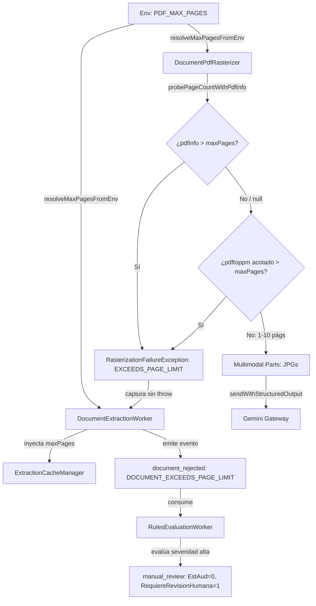

# SDD — Rechazo preventivo por límite de páginas en adjuntos PDF y blindaje de rasterización

- **ID**: `SDD-PAGE-LIMIT-REJECTION-001`
- **Fecha**: 2026-11-17
- **Estado**: Especificación Técnica Aprobada
- **Caso disparador**: Dispensaciones `X07261005323`, `X07261007282`, `X07260907393`, `U98261100047`, `X07261100143` en lote batch `dd5de84b-6d7f-46b6-8310-40c62bd871fc`. PDFs anómalos (fórmulas médicas de 40 a 80+ páginas con historias clínicas o epicrisis anexas) que excedían `DocumentPdfRasterizer::MAX_PAGES` (50) lanzaban un `RuntimeException` no tipado. Al no ser capturado como rechazo documental en `DocumentExtractionWorker`, agotaba los 3 reintentos del pipeline, enviaba la auditoría a DLQ y la marcaba con `status: failed`, interrumpiendo el flujo operativo en lugar de rechazar el documento con hallazgo de no conformidad.

---

## Clasificación del Cambio (Triage)

| Dimensión                                   | Valor                                                                                                                                                                                                                                                    |
| ------------------------------------------- | -------------------------------------------------------------------------------------------------------------------------------------------------------------------------------------------------------------------------------------------------------- |
| Tipo                                        | Resiliencia / Bugfix arquitectónico / Prevención DoS de tokens y CPU                                                                                                                                                                                     |
| Riesgo                                      | Medio — introduce rechazo preventivo antes de Gemini y modifica excepciones internas del rasterizador, sin alterar esquemas SQL ni contratos de la API REST externa.                                                                                     |
| Persistencia afectada                       | No — las auditorías se persisten en `dbo.AudDispEst` con `EstadoDetallado = manual_review`, `EstAud = 0`, `RequiereRevisionHumana = 1`, `Severidad = alta` y hallazgos en formato JSON estándar mediante las vías existentes de `RulesEvaluationWorker`. |
| Contrato externo afectado                   | No — las respuestas de la API (`/audit/results`, `/audit/jobs/{jobId}`, `/audit/status/{auditId}`) mantienen intacto su esquema JSON.                                                                                                                    |
| Cambio arquitectónico                       | No — profundiza y completa el patrón existente de `RasterizationFailureException` y `DocumentRejectionReason`.                                                                                                                                           |
| Producción afectada                         | Sí — corrección directa del 100% de los 5 fallos detectados en el lote de 3,000 en el servidor de producción LAN (`172.16.0.3:8080`).                                                                                                                    |
| Requiere 0.3.1 (cobertura de abstracciones) | No                                                                                                                                                                                                                                                       |

Perfil: Completo.

---

## FASE 0 — Descubrimiento Empírico

### 0.1 Perímetro de Impacto

| Archivo                            | Ruta                                                           | Categoría                | Propósito                                                                                                                                                                                                              | Líneas Observadas | Verificado por Lectura |
| ---------------------------------- | -------------------------------------------------------------- | ------------------------ | ---------------------------------------------------------------------------------------------------------------------------------------------------------------------------------------------------------------------- | ----------------- | ---------------------- |
| `DocumentRejectionReason.php`      | `app/Services/Audit/Pipeline/DocumentRejectionReason.php`      | Catálogo de Dominio      | Define constantes y validación de motivos de rechazo documental admitidos en el pipeline.                                                                                                                              | 1-45              | Sí                     |
| `PdfContentFailure.php`            | `app/Services/Audit/Pipeline/PdfContentFailure.php`            | Tipado de Excepción      | Enum de fallos tipados de rasterización de PDF (`NO_PAGES`, `CORRUPTED`, `EXCEEDS_PAGE_LIMIT`).                                                                                                                        | 1-25              | Sí                     |
| `RasterizationProcessResult.php`   | `app/Services/Audit/Pipeline/RasterizationProcessResult.php`   | Diagnóstico de Proceso   | Expone método público `output()` para que la sonda `pdfinfo` pueda leer la salida del proceso.                                                                                                                         | 1-31              | Sí                     |
| `DocumentPdfRasterizer.php`        | `app/Services/Audit/Pipeline/DocumentPdfRasterizer.php`        | Infraestructura / Driver | Rasteriza PDFs a JPG (200 DPI) usando `pdftoppm` o `gs` con sonda rápida `pdfinfo` (`executePdfinfoProcess` con timeout multiplataforma de 3s y retención de `$status['exitcode']`) y sondeo acotado a `maxPages + 1`. | 1-491             | Sí                     |
| `ExtractionCacheManager.php`       | `app/Services/Audit/Pipeline/ExtractionCacheManager.php`       | Caché Redis              | Claves compuestas `:maxp:{maxPages}` y envelope de extracción con `page_count`. Preserva contrato de errores de Redis (`RuntimeException`).                                                                            | 1-103             | Sí                     |
| `DocumentExtractionWorker.php`     | `app/Services/Audit/Pipeline/DocumentExtractionWorker.php`     | Worker Pipeline          | Consume `document_downloaded`, ejecuta extracción con conteo real, blinda replay y captura `RasterizationFailureException`.                                                                                            | 1-885             | Sí                     |
| `RulesEvaluationWorker.php`        | `app/Services/Audit/Pipeline/RulesEvaluationWorker.php`        | Motor de Reglas          | Evalúa reglas de negocio y traduce `document_rejected` a hallazgos de no conformidad y estado manual_review.                                                                                                           | 350-420, 680-750  | Sí                     |
| `.env.example`                     | `.env.example`                                                 | Configuración            | Plantilla pública del contrato de variables de entorno.                                                                                                                                                                | 1-150             | Sí                     |
| `AGENTS.md`                        | `AGENTS.md`                                                    | Documentación            | Guía maestra de gobernanza, variables de entorno y arquitectura del repositorio.                                                                                                                                       | 1-300             | Sí                     |
| `deploy-production.yml`            | `.github/workflows/deploy-production.yml`                      | CI/CD Deploy             | Mapea y genera `PDF_MAX_PAGES` en `.env` de producción.                                                                                                                                                                | 340-470           | Sí                     |
| `sync-github-production-env.sh`    | `scripts/sync-github-production-env.sh`                        | Script Ops               | Sincroniza variables detectadas en `.env.example` en GitHub Environment `production`.                                                                                                                                  | 440-528           | Sí                     |
| `DocumentPdfRasterizerTest.php`    | `tests/Services/Audit/Pipeline/DocumentPdfRasterizerTest.php`  | Pruebas Unitarias        | Adapta fake y los 6 dobles anónimos, actualiza aserciones reales `testThrowsWhenExceedsMaxPagesAndCleansUp` y `testPageLimitProbeRejects51PagesAndCleansAllChunks`, y prueba timeout real.                             | 1-558             | Sí                     |
| `DocumentExtractionWorkerTest.php` | `tests/Services/Audit/Events/DocumentExtractionWorkerTest.php` | Pruebas Unitarias        | Migra fixtures de caché en `testCacheHitSkipsGeminiAndPublishesDocumentExtracted` y `testDoesNotPublishWhenStateStoreReturnsFalse` al envelope con `page_count`.                                                       | 110-170, 540-570  | Sí                     |

---

### 0.2 Grafo de Dependencias de Componentes



---

### 0.3 Puntos de Regresión Potencial y Mitigaciones

| Riesgo de Regresión                                        | Causa Raíz Potencial                                                                                                                                | Mitigación Rigurosa                                                                                                                                                                                                                                                                                                                                                                                                                    |
| ---------------------------------------------------------- | --------------------------------------------------------------------------------------------------------------------------------------------------- | -------------------------------------------------------------------------------------------------------------------------------------------------------------------------------------------------------------------------------------------------------------------------------------------------------------------------------------------------------------------------------------------------------------------------------------- |
| Falsos positivos en PDFs válidos                           | Regex sobre bytes binarios crudos (`/Count`, `/Page`) que coincidan con cadenas en historias clínicas o comentarios.                                | Se descarta el análisis por regex sobre bytes crudos. Se utiliza el parser de Poppler (`pdfinfo` o fallback a bounded rasterization `pdftoppm -f 1 -l (maxPages+1)`). Ambos analizan la tabla xref y el árbol `/Root -> /Pages`, ignorando comentarios y texto.                                                                                                                                                                        |
| Replay de estado histórico sin conteo o con exceso         | Tareas reintentadas con `stored` previo donde `page_count` no existe o proviene de ejecuciones previas de >10 páginas                               | En `DocumentExtractionWorker::prepareTask()` y `handle()`, se exige que `$stored['page_count']` exista, sea entero `>= 1` y cumpla `$stored['page_count'] <= $this->pdfRasterizer->getMaxPages()`. Si no existe o excede el límite, se invalida el replay y se fuerza re-extracción para aplicar el límite.                                                                                                                            |
| Incoherencia de caché en Redis                             | Reusar extracciones cacheadas con límites anteriores o estados corruptos                                                                            | `ExtractionCacheManager::computeCacheKey` incorpora `:maxp:{$this->maxPages}` en el hash SHA256. Además, `cacheManager->put()` persiste `page_count` obligatorio (`>= 1`) en el envelope, y `get()` descarta si no hay `page_count` entero `>= 1` o si excede `maxPages`. Se preserva el contrato de excepciones de Redis (`RuntimeException`).                                                                                        |
| Clamping incorrecto de configuración                       | Cadenas numéricas como `"101"` o `"0"` interpretadas erróneamente                                                                                   | `resolveMaxPagesFromEnv()` valida formato estrictamente numérico `/^[0-9]+$/D` y aplica clamping saturado `max(1, min(100, $val))`. `"101"` satura a `100`, `"0"` satura a `1`, y cadenas con caracteres no numéricos como `"12garbage"` o `"-5"` retornan el default `10`.                                                                                                                                                            |
| Bloqueo o timeout en la sonda `pdfinfo`                    | `pdfinfo` congelado ante PDF corrupto o subproceso de Windows colgado                                                                               | `executePdfinfoProcess()` implementa `bypass_shell => true` en Windows y `proc_open` con polling activo de 3 segundos y `proc_terminate`. Retiene `$status['exitcode']` antes de `proc_close()` para evitar el bug de `-1` en PHP < 8.3/POSIX. Si se excede el timeout, mata el proceso y retorna `null` para degradar de forma segura al sondeo acotado.                                                                              |
| Rotura de tests de chunking y dobles anónimos              | `DocumentPdfRasterizerTest` contiene pruebas de 24 a 50 páginas, dobles anónimos con contadores de llamada y espera mensajes antiguos de 50 páginas | `probePageCountWithPdfinfo()` utiliza el método dedicado `executePdfinfoProcess()`, dejando `executeProcess()` 100% exclusivo para los motores de rasterización (`gs`/`pdftoppm`). Además, se aísla la sonda en todos los dobles de prueba (`ChunkedPdfRasterizerFake` y los 6 dobles anónimos), y se actualizan las aserciones de mensajes antiguos a `RasterizationFailureException` con razón tipada `DOCUMENT_EXCEEDS_PAGE_LIMIT`. |
| Rotura de tests de caché en `DocumentExtractionWorkerTest` | Fixtures mock de caché en tests devuelven el payload plano sin envelope                                                                             | Se migran los mocks en `testCacheHitSkipsGeminiAndPublishesDocumentExtracted` y `testDoesNotPublishWhenStateStoreReturnsFalse` para incluir el envelope `['page_count' => 1, 'extracted' => [...]]`.                                                                                                                                                                                                                                   |
| Despliegue en producción sin propagación de variable       | `PDF_MAX_PAGES` ausente en `.github/workflows/deploy-production.yml`                                                                                | Se mapea `PDF_MAX_PAGES` en el step de generación del archivo `.env` de producción y se sincroniza con el bucle nativo de variables de `scripts/sync-github-production-env.sh`.                                                                                                                                                                                                                                                        |

---

### 0.4 Semántica de Herramientas y Entornos

- **Poppler (`pdfinfo` y `pdftoppm`)**:
  - `pdfinfo` ejecuta una inspección sintáctica del árbol de objetos del PDF en 5-10ms; si reporta `Pages: > $maxPages`, se lanza inmediatamente `RasterizationFailureException(EXCEEDS_PAGE_LIMIT)` sin generar imágenes en disco. Si no está disponible, da timeout (>3s) o falla, retorna `null` de forma segura.
  - `pdftoppm` es invocado con `-f 1 -l (maxPages + 1)`. Si el archivo supera el límite de páginas, generará `maxPages + 1` archivos de imagen (`count($images) > $maxPages`), permitiendo la detección instantánea sin renderizar las páginas 12 a 80+.
- **Ghostscript (`gs`)**: Invocado con `-dFirstPage=1 -dLastPage=(maxPages + 1)`. Mismo comportamiento determinista.
- **PHP CLI / PHPUnit**: Ejecución en host Windows y contenedor Linux PHP 8.2-FPM.

---

### 0.5 Matriz de Entornos de Ejecución

| Entorno                           | Sistema Operativo     | Binarios PDF                                                  | Comportamiento                                                                                                        |
| --------------------------------- | --------------------- | ------------------------------------------------------------- | --------------------------------------------------------------------------------------------------------------------- |
| **Producción LAN** (`172.16.0.3`) | Linux (Docker Debian) | `gs` (Ghostscript 10+) y `pdftoppm` + `pdfinfo` (Poppler 23+) | Ambos binarios disponibles; `pdfinfo` detecta páginas en < 5ms; Poppler opera con chunk inicial acotado a 11 páginas. |
| **Desarrollo Local**              | Windows 11 nativo     | `pdftoppm` + `pdfinfo` vía WinGet Poppler                     | Operación estándar. Pruebas unitarias usan stubs deterministas (`ChunkedPdfRasterizerFake`).                          |
| **CI / GitHub Actions**           | Ubuntu 22.04 LTS      | `poppler-utils` y `ghostscript`                               | Ejecución de PHPUnit 100% verde.                                                                                      |

---

## FASE 1 — Especificación de Implementación

### 1. Alcance y Objetivos

1. **Prevenir el colapso del pipeline**: Impedir que documentos con páginas excesivas (ej. fórmulas o actas de 40 a 80+ páginas) lancen un `RuntimeException` no controlado que agote reintentos en DLQ y marque la auditoría como `failed`.
2. **Rechazo elegante por integridad**: Tratar el exceso de páginas como una falla de integridad de contenido (`DOCUMENT_EXCEEDS_PAGE_LIMIT`), registrando un hallazgo con severidad `alta` (`AuditSeverity::HIGH->value`) y resultado `RECHAZADO` (`AuditFindingResult::REJECTED->value`), rechazando el documento de forma trazable y completando la auditoría con `EstadoDetallado = manual_review`, `EstAud = 0` y `RequiereRevisionHumana = 1`.
3. **Detección temprana y determinista sin falsos positivos**:
   - `DocumentIntegrityValidator` mantiene la validación de formato (MIME soportado, magic bytes, `/Encrypt`, no vacío, marcador EOF). No realiza conteo heurístico por expresiones regulares para no rechazar PDFs válidos de 1 página con comentarios o cadenas internas.
   - `DocumentPdfRasterizer` asume el control del límite de páginas de forma determinista mediante Poppler/Ghostscript:
     - Sonda rápida vía `pdfinfo`: lectura en 5ms; si `Pages > $maxPages`, aborta antes de generar imágenes. Si `pdfinfo` no está instalado o falla con código no cero o timeout (>3s), retorna `null` y continúa al siguiente paso.
     - Sonda acotada en `pdftoppm` / `gs` con `-l (maxPages + 1)`: renderiza como máximo `maxPages + 1` páginas y lanza `RasterizationFailureException(PdfContentFailure::EXCEEDS_PAGE_LIMIT)`.
4. **Cero desperdicio de GPU/Gemini**: Ningún documento con más de 10 páginas será enviado a la API de Gemini.

---

### 2. Contratos y Tipos

#### 2.1 `DocumentRejectionReason.php`

```php
public const DOCUMENT_EXCEEDS_PAGE_LIMIT = 'DOCUMENT_EXCEEDS_PAGE_LIMIT';
```

Se agrega a la constante privada `ALLOWED`:

```php
private const ALLOWED = [
    // ... existentes ...
    self::DOCUMENT_EXCEEDS_PAGE_LIMIT,
];
```

#### 2.2 `PdfContentFailure.php`

```php
enum PdfContentFailure: string
{
    case NO_PAGES = 'EMPTY_PDF_NO_PAGES';
    case CORRUPTED = 'CORRUPTED_DOCUMENT';
    case EXCEEDS_PAGE_LIMIT = 'DOCUMENT_EXCEEDS_PAGE_LIMIT';
}
```

#### 2.3 `RasterizationProcessResult.php`

Se agrega método público para leer de forma segura la salida de diagnóstico del proceso:

```php
final readonly class RasterizationProcessResult
{
    public function __construct(public int $exitCode, private string $output = '')
    {
    }

    public function output(): string
    {
        return $this->output;
    }

    public function contentFailure(): ?PdfContentFailure
    {
        // ... existente ...
    }
}
```

---

### 3. Implementación de Configuración y `DocumentPdfRasterizer.php`

#### 3.1 Resolución Estricta de Configuración y Clamping

Se define `resolveMaxPagesFromEnv()` con validación estricta de tipos, saturación matemática (clamping) entre 1 y 100, y fallback seguro:

```php
public const DEFAULT_MAX_PAGES = 10;
public const MIN_ALLOWED_PAGES = 1;
public const MAX_ALLOWED_PAGES = 100;

public static function resolveMaxPagesFromEnv(): int
{
    $rawVal = Env::get('PDF_MAX_PAGES', null);
    if ($rawVal === null || !is_string($rawVal)) {
        return self::DEFAULT_MAX_PAGES;
    }

    $trimmed = trim($rawVal);
    // Validación estricta: solo secuencias numéricas (rechaza "12garbage", "abc", "", "-5")
    if (preg_match('/^[0-9]+$/D', $trimmed) !== 1) {
        return self::DEFAULT_MAX_PAGES;
    }

    $val = (int) $trimmed;
    // Clamping matemático saturado en el intervalo [MIN_ALLOWED_PAGES, MAX_ALLOWED_PAGES]:
    // "101" y "9999" -> 100 (satura al límite máximo)
    // "0"            -> 1   (satura al límite mínimo)
    // "5"            -> 5
    // "10"           -> 10
    return max(self::MIN_ALLOWED_PAGES, min(self::MAX_ALLOWED_PAGES, $val));
}
```

Tabla de resolución esperada:
| Entrada `PDF_MAX_PAGES` | Resultado `resolveMaxPagesFromEnv()` | Motivo |
| --- | --- | --- |
| `null` o vacío `""` | `10` | Fallback a default |
| `"abc"`, `"12garbage"` | `10` | Formato no numérico rechazado por regex |
| `"-5"`, `"-1"` | `10` | Formato negativo rechazado por regex |
| `"0"` | `1` | Clamping inferior `max(1, 0)` |
| `"5"` | `5` | Valor exacto dentro de rango |
| `"10"` | `10` | Valor exacto por defecto |
| `"100"` | `100` | Límite superior permitido |
| `"101"`, `"9999"` | `100` | Clamping superior saturado `min(100, 101)` |

#### 3.2 Constructor y Estado

```php
private int $maxPages;

public function __construct(
    ?string $binaryPath = null,
    int $dpi = self::DEFAULT_DPI,
    int $timeoutSeconds = self::DEFAULT_TIMEOUT_SECONDS,
    ?int $maxPages = null
) {
    $this->explicitBinary = $binaryPath;
    $this->dpi            = $dpi > 0 ? $dpi : self::DEFAULT_DPI;
    $this->timeoutSeconds = $timeoutSeconds > 0 ? $timeoutSeconds : self::DEFAULT_TIMEOUT_SECONDS;
    $this->maxPages       = $maxPages !== null && $maxPages >= self::MIN_ALLOWED_PAGES && $maxPages <= self::MAX_ALLOWED_PAGES
        ? $maxPages
        : self::resolveMaxPagesFromEnv();

    $this->resolveEngineAndBinary();
}

public function getMaxPages(): int
{
    return $this->maxPages;
}
```

#### 3.3 Sonda Temprana `pdfinfo` con Timeout Multiplataforma y Rasterización Acotada en `rasterize()`

```php
/**
 * Resuelve el ejecutable de pdfinfo si está disponible en el entorno.
 */
protected function resolvePdfinfoBinary(): ?string
{
    if ($this->checkBinaryExists('pdfinfo')) {
        return 'pdfinfo';
    }
    return null;
}

/**
 * Ejecuta pdfinfo de forma aislada con timeout estricto sin alterar
 * los contadores ni llamadas de executeProcess().
 */
protected function executePdfinfoProcess(string $cmd, int $timeoutSeconds = 3): ?string
{
    $descriptors = [
        0 => ['pipe', 'r'],
        1 => ['pipe', 'w'],
        2 => ['pipe', 'w'],
    ];

    // En Windows se usa bypass_shell para invocar el binario directamente sin cmd.exe,
    // garantizando que proc_terminate termine el subproceso de inmediato en caso de timeout.
    $options = PHP_OS_FAMILY === 'Windows' ? ['bypass_shell' => true] : [];

    $process = @proc_open($cmd, $descriptors, $pipes, null, null, $options);
    if (!is_resource($process)) {
        return null;
    }

    fclose($pipes[0]);

    $startTime = microtime(true);
    $exitCode = -1;

    // En Windows, stream_set_blocking() no desactiva el bloqueo en pipes de proc_open().
    // Por ende, NUNCA se debe leer stream_get_contents() dentro del bucle de espera,
    // ya que bloquearía sincrónicamente antes de poder evaluar la expiración del timeout.
    while (true) {
        $status = proc_get_status($process);

        if (!$status['running']) {
            // En PHP < 8.3 en Linux POSIX, proc_close() retorna -1 tras proc_get_status().
            // Es mandatorio retener $status['exitcode'] antes de llamar a proc_close().
            $exitCode = (int) ($status['exitcode'] ?? -1);
            break;
        }

        if ((microtime(true) - $startTime) > $timeoutSeconds) {
            @proc_terminate($process, 9);
            @fclose($pipes[1]);
            @fclose($pipes[2]);
            @proc_close($process);
            return null; // Timeout excedido: degrada de forma segura sin bloquear
        }

        usleep(5000); // 5ms
    }

    // Una vez finalizado el proceso de forma natural, la lectura de pipes no bloquea.
    $output = (string) stream_get_contents($pipes[1]) . (string) stream_get_contents($pipes[2]);
    @fclose($pipes[1]);
    @fclose($pipes[2]);
    @proc_close($process);

    return ($exitCode === 0 && trim($output) !== '') ? $output : null;
}

/**
 * Consulta la cantidad total de páginas con pdfinfo sin rasterizar.
 * Retorna null si pdfinfo no está disponible, falla, da timeout o su salida no es interpretable.
 */
protected function probePageCountWithPdfinfo(string $inputPdfPath): ?int
{
    try {
        $pdfinfo = $this->resolvePdfinfoBinary();
        if ($pdfinfo === null) {
            return null;
        }

        $cmd = escapeshellarg($pdfinfo) . ' ' . escapeshellarg($inputPdfPath);
        $output = $this->executePdfinfoProcess($cmd, 3);
        if ($output === null) {
            return null;
        }

        if (preg_match('/^Pages:\s+(\d+)/m', $output, $matches) === 1) {
            return (int) $matches[1];
        }

        return null;
    } catch (\Throwable) {
        // Degrada silenciosamente al sondeo acotado de rasterización ante cualquier excepción
        return null;
    }
}

public function rasterize(string $pdfDataRaw, string $label, ?int $customDpi = null): array
{
    $this->validateInput($pdfDataRaw);
    $this->ensureBinaryAvailable();

    $dpi          = $customDpi ?? $this->dpi;
    $tempDir      = $this->resolveTempDir();
    $uniqueId     = bin2hex(random_bytes(8));
    $inputPdfPath = $tempDir . DIRECTORY_SEPARATOR . "input_{$uniqueId}.pdf";

    try {
        $this->writeTemporaryPdf($inputPdfPath, $pdfDataRaw);

        // Capa 1: Sonda rápida Poppler pdfinfo (5ms)
        $detectedPages = $this->probePageCountWithPdfinfo($inputPdfPath);
        if ($detectedPages !== null && $detectedPages > $this->maxPages) {
            throw new RasterizationFailureException(PdfContentFailure::EXCEEDS_PAGE_LIMIT);
        }

        // Capa 2: Rasterización acotada a (maxPages + 1)
        $images = [];
        $pageLimitProbe = $this->maxPages + 1;

        for ($firstPage = 1; $firstPage < $pageLimitProbe; $firstPage += self::CHUNK_SIZE - 1) {
            $lastPage = min($firstPage + self::CHUNK_SIZE - 1, $pageLimitProbe);
            $chunkId = $uniqueId . '_c' . $firstPage;
            $outputPrefix = $tempDir . DIRECTORY_SEPARATOR . "page_{$chunkId}";

            $chunkImages = $this->executeRasterization(
                $inputPdfPath,
                $outputPrefix,
                $dpi,
                $firstPage,
                $lastPage,
                $label,
                $tempDir,
                $chunkId
            );

            $renderedPageCount = count($chunkImages);
            if ($firstPage > 1) {
                array_shift($chunkImages);
            }
            array_push($images, ...$chunkImages);

            if (count($images) > $this->maxPages) {
                throw new RasterizationFailureException(PdfContentFailure::EXCEEDS_PAGE_LIMIT);
            }

            if ($renderedPageCount < $lastPage - $firstPage + 1) {
                break;
            }
        }

        return $this->buildMultimodalParts($images, $label);
    } finally {
        $this->cleanupPrefixFiles($tempDir, $uniqueId);
    }
}
```

**Garantía contra Falsos Positivos**:

- Poppler (`pdfinfo` y `pdftoppm`) no procesa patrones de texto en streams binarios. Ambos interpretan la tabla de referencias cruzadas (`xref`) y el diccionario de catálogo `/Root -> /Pages`.
- Cadenas textuales como `(Página 80 de historia clínica)` o comentarios `% /Count 99` son ignorados por completo, garantizando cero falsos positivos en documentos válidos de 1 página.

---

### 4. Integración en `ExtractionCacheManager.php`

En `ExtractionCacheManager`:
Se inyecta `$maxPages` en el constructor, se almacena en el hash de clave de caché y se encapsula el conteo real en el envelope serializado. Se mantiene intacto el contrato de excepciones de Redis (`RuntimeException`):

```php
final class ExtractionCacheManager
{
    private const CACHE_PREFIX = 'extraction:cache:v1:';

    public function __construct(
        private readonly RedisClient $redis,
        private readonly int $cacheTtl,
        private readonly string $extractorVersion,
        private readonly int $maxPages = DocumentPdfRasterizer::DEFAULT_MAX_PAGES
    ) {}

    public function computeCacheKey(
        string $documentHash,
        string $contractHash,
        string $promptContextHash
    ): string {
        if ($contractHash === '' || $promptContextHash === '') {
            throw new RuntimeException(
                "Faltan hashes de contrato o prompt para documentHash {$documentHash}"
            );
        }

        $composite = hash(
            'sha256',
            $documentHash . $contractHash . $promptContextHash . $this->extractorVersion . ':maxp:' . $this->maxPages
        );

        return self::CACHE_PREFIX . $composite;
    }

    /**
     * Escribe la extracción junto con el conteo certificado de páginas.
     *
     * @param array<string,mixed> $payload
     * @throws RuntimeException si la serialización o escritura falla en Redis
     */
    public function put(string $cacheKey, array $payload, int $pageCount): void
    {
        if ($pageCount < 1) {
            throw new RuntimeException('ExtractionCacheManager: pageCount debe ser >= 1');
        }

        $envelope = [
            'extracted'  => $payload,
            'page_count' => $pageCount,
        ];

        $encoded = json_encode($envelope, JSON_UNESCAPED_UNICODE | JSON_UNESCAPED_SLASHES);
        if ($encoded === false) {
            throw new RuntimeException('No se pudo serializar extraction cache');
        }

        if (!$this->redis->set($cacheKey, $encoded, $this->cacheTtl)) {
            throw new RuntimeException('No se pudo escribir extraction cache en Redis');
        }
    }

    /**
     * Lee la extracción verificando integridad de conteo de páginas.
     * Retorna null si es un cache miss, si la entrada es legacy (sin page_count válido >= 1)
     * o si page_count > maxPages.
     *
     * @return array{extracted: array<string,mixed>, page_count: int}|null
     * @throws RuntimeException si Redis no está disponible o el JSON está corrupto
     */
    public function get(string $cacheKey): ?array
    {
        try {
            $raw = $this->redis->get($cacheKey);
        } catch (RedisUnavailableException $e) {
            throw new RuntimeException('Redis no disponible al leer extraction cache', 0, $e);
        }

        if ($raw === null) {
            return null;
        }

        $decoded = json_decode($raw, true);
        if (!is_array($decoded)) {
            throw new RuntimeException('Extraction cache corrupto en Redis');
        }

        // Validación estricta del envelope:
        if (!isset($decoded['page_count']) || !is_int($decoded['page_count']) || $decoded['page_count'] < 1) {
            return null; // Formato legacy o inválido: cache miss seguro para forzar re-evaluación
        }

        if (!isset($decoded['extracted']) || !is_array($decoded['extracted'])) {
            return null;
        }

        if ($decoded['page_count'] > $this->maxPages) {
            return null; // Excede límite actual: cache miss para forzar rechazo
        }

        return [
            'extracted'  => $decoded['extracted'],
            'page_count' => $decoded['page_count'],
        ];
    }
}
```

---

### 5. Integración en `DocumentExtractionWorker.php`

#### 5.1 Instanciación Coherente

```php
$maxPages = DocumentPdfRasterizer::resolveMaxPagesFromEnv();

$this->cacheManager   = $cacheManager   ?? new ExtractionCacheManager($this->redis, $resolvedTtl, $extractorVersion, $maxPages);
$this->pdfRasterizer  = $pdfRasterizer  ?? new DocumentPdfRasterizer(null, DocumentPdfRasterizer::DEFAULT_DPI, $rasterTimeout > 0 ? $rasterTimeout : DocumentPdfRasterizer::DEFAULT_TIMEOUT_SECONDS, $maxPages);
```

#### 5.2 Blindaje Estricto de Replay en `prepareTask()` y `handle()`

Se erradica el operador `?? 1` permisivo. Se exige que `$stored['page_count']` exista, sea entero `>= 1` y menor o igual al límite configurado:

En `prepareTask()`:

```php
$hasValidPageCount = isset($stored['page_count']) && is_int($stored['page_count']) && $stored['page_count'] >= 1;
$isUnderLimit      = $hasValidPageCount && $stored['page_count'] <= $this->pdfRasterizer->getMaxPages();

if (
    in_array($stored['status'] ?? '', ['extracted', 'normalized', 'evaluated'], true)
    && ($stored['document_hash'] ?? '') === $hash
    && ($stored['contract_hash'] ?? '') === $contractHash
    && ($stored['prompt_context_hash'] ?? '') === $promptHash
    && is_array($stored['extraction_result'] ?? null)
    && $isUnderLimit
) {
    // Replay seguro permitido
} else {
    // Si no tiene conteo de páginas (estados previos sin certificar) o supera el límite:
    // Se ejecuta el flujo normal de resolución y rasterización para validar contra maxPages.
    $document = $this->documentInput->resolve($event);
    $integrity = DocumentIntegrityValidator::validate($document);
    if (!$integrity['valid']) {
        return $this->prepareRejection($task, $document, $integrity, $start);
    }
    // ...
    try {
        $extraction = $this->resolveExtraction(...);
    } catch (RasterizationFailureException $error) {
        return $this->prepareRejection($task, $document, [
            'reason'        => $error->reason->value,
            'declared_mime' => $document['mime'],
            'size_bytes'    => strlen(base64_decode($document['data'], true) ?: '')
        ]);
    }
}
```

En `handle()`:

```php
$stored = $this->stateStore->getAudit($event->auditId)['documents'][$event->documentId] ?? null;
$hasValidPageCount = is_array($stored) && isset($stored['page_count']) && is_int($stored['page_count']) && $stored['page_count'] >= 1;
$isUnderLimit      = $hasValidPageCount && $stored['page_count'] <= $this->pdfRasterizer->getMaxPages();

if (
    is_array($stored)
    && in_array($stored['status'] ?? '', ['extracted', 'normalized', 'evaluated'], true)
    && ($stored['document_hash'] ?? '') === $documentHash
    && ($stored['contract_hash'] ?? '') === $contractHash
    && ($stored['prompt_context_hash'] ?? '') === $promptContextHash
    && is_array($stored['extraction_result'] ?? null)
    && $isUnderLimit
) {
    $this->publishDocumentExtracted($event, $payload, $stored);
    $this->documentCache->release($blobKey);
    // ...
    return;
}

$document  = $this->documentInput->resolve($event);
$integrity = DocumentIntegrityValidator::validate($document);
if (!$integrity['valid']) {
    $this->handleRejectedDocument($event, $payload, $document, $integrity);
    $this->documentCache->release($blobKey);
    return;
}

try {
    $extraction = $this->resolveExtraction(...);
} catch (RasterizationFailureException $rasterError) {
    $integrity = [
        'valid'         => false,
        'reason'        => $rasterError->reason->value,
        'declared_mime' => $document['mime'] ?? '',
        'detected_mime' => null,
        'size_bytes'    => strlen(base64_decode($document['data'] ?? '', true) ?: ''),
    ];
    $this->handleRejectedDocument($event, $payload, $document, $integrity);
    $this->documentCache->release($blobKey);
    $this->telemetryPublisher->rejected(
        $event->auditId,
        'extraction',
        self::elapsedMs($extractionStartedAt),
        $event->documentId,
        $disDetNro,
        array_merge($telemetryMeta, ['reason' => $rasterError->reason->value]),
        $event->jobId
    );
    return;
}
```

#### 5.3 Persistencia del Conteo Real del Rasterizador en `resolveExtraction` y `buildDocumentState`

- `resolveExtraction()` extrae `$files = $this->buildMultimodalParts($document, $documentType);` y obtiene `$pageCount = count($files);` (o 1 para no PDFs).
- Si es cache hit: `$pageCount = (int) $cachedResult['page_count'];`.
- Si es cache miss: persiste `$this->cacheManager->put($cacheKey, $extracted, $pageCount);`.
- Retorna `['extracted' => $extracted, 'page_count' => $pageCount, ...]`.
- `buildDocumentState()` exige `$extraction['page_count']` como entero `>= 1` sin ningún fallback permisivo:

```php
private function buildDocumentState(
    string $documentHash,
    array $document,
    array $extraction,
    int $extractionDurationMs,
    string $contractHash = '',
    string $promptContextHash = ''
): array {
    if (!isset($extraction['page_count']) || !is_int($extraction['page_count']) || $extraction['page_count'] < 1) {
        throw new \RuntimeException('DocumentExtractionWorker: extraction result must contain a certified page_count >= 1');
    }

    $documentState = [
        'status'                 => 'extracted',
        'document_hash'          => $documentHash,
        'contract_hash'          => $contractHash,
        'prompt_context_hash'    => $promptContextHash,
        'page_count'             => $extraction['page_count'],
        'cache_hit'              => $extraction['cache_hit'],
        'mime'                   => $document['mime'],
        'extraction_result'      => $extraction['extracted'],
        'extracted_at'           => gmdate('Y-m-d\TH:i:s\Z'),
        'extraction_duration_ms' => $extractionDurationMs,
        'download_duration_ms'   => (int) ($document['duration_ms'] ?? 0),
        'gemini_duration_ms'     => $extraction['gemini_duration_ms'],
    ];

    if ($extraction['gemini_metrics'] !== null) {
        $documentState['gemini_metrics'] = $extraction['gemini_metrics'];
    }

    return $documentState;
}
```

---

### 6. Contrato de Reglas en `RulesEvaluationWorker.php`

Cuando se recibe un evento `document_rejected` con razón `DOCUMENT_EXCEEDS_PAGE_LIMIT`:

1. `buildContentRejectedPolicyResult()` genera el hallazgo de no conformidad:
   - `campo`: `'INTEGRIDAD_DOCUMENTO'`
   - `severidad`: `'alta'` (`AuditSeverity::HIGH->value`)
   - `resultado`: `'RECHAZADO'` (`AuditFindingResult::REJECTED->value`)
   - `detalle`: `"Documento rechazado por validación de integridad: DOCUMENT_EXCEEDS_PAGE_LIMIT"`
2. En `resolveFinalStatus()`:
   - Al contener una falla de severidad alta, `$hasHighSeverityFailure = true`.
   - El estado final resuelto es `AuditStateStore::AUDIT_STATUS_MANUAL_REVIEW` (`'manual_review'`).
   - `EstAud` se establece en `0`.
   - `EstadoDetallado` se persiste como `'manual_review'`.
   - `RequiereRevisionHumana` se establece en `1`.
3. La auditoría se publica como `rules_evaluated`, transiciona en Redis de forma atómica y se encola para persistencia en SQL Server (`dbo.AudDispEst`). No genera reintentos, no viaja a DLQ y no tumba el lote batch.

---

### 7. Sincronización Contractual Obligatoria y Despliegue en Producción

Conforme a la regla estricta de variables de entorno y despliegue:

1. **`.env.example`**:

```ini
# Límite máximo preventivo de páginas en documentos PDF (default: 10, min: 1, max: 100)
PDF_MAX_PAGES=10
```

2. **GitHub Remoto (`gh cli`)**:

```powershell
gh variable set PDF_MAX_PAGES --body "10" --env production
```

3. **`AGENTS.md`**:
   Se documenta `PDF_MAX_PAGES` en la tabla del catálogo de variables de entorno.
4. **`.github/workflows/deploy-production.yml`**:
   En el step `Generate production .env file`:

```yaml
env:
  # ... existentes ...
  PDF_MAX_PAGES: ${{ vars.PDF_MAX_PAGES }}
```

Y dentro de la generación de variables con `write_env_var`:

```bash
write_env_var 'PDF_MAX_PAGES' "${PDF_MAX_PAGES:-10}"
```

5. **`scripts/sync-github-production-env.sh` y variables de entorno**:
   - `scripts/sync-github-production-env.sh` (L360-L368) exige paridad bidireccional estricta entre `.env.example` y el archivo `.env` de entrada; aborta con código 1 si una clave está en `.env.example` pero falta en `.env`.
   - Por tanto, `PDF_MAX_PAGES=10` debe incorporarse tanto en `.env.example` como en el `.env` local de trabajo.
   - Con ambas claves presentes, el script detecta automáticamente `PDF_MAX_PAGES` como variable no sensible, la incluye en `variable_keys_to_sync`, y la sincroniza al entorno `production` mediante `gh variable set` en el bucle existente al ejecutar con `--apply`.
   - Adicionalmente, el comando directo de aprovisionamiento de respaldo es:
     ```bash
     gh variable set PDF_MAX_PAGES --body "10" --env production
     ```

---

### 8. Plan de Pruebas Unitarias (TDD) y Adaptación de Suite

1. **`DocumentRejectionReasonTest`**:
   - `testDocumentExceedsPageLimitIsAllowedReason()`: Comprueba `isAllowed(DocumentRejectionReason::DOCUMENT_EXCEEDS_PAGE_LIMIT) === true`.
2. **`DocumentPdfRasterizerTest`**:
   - `testResolveMaxPagesFromEnvClampingAndFallback()`:
     - Retorna 10 ante valor `null` o vacío `""`.
     - Retorna 10 ante cadenas no numéricas o con caracteres espurios (`"12garbage"`, `"abc"`).
     - Retorna 10 ante negativos (`"-5"`).
     - Retorna 1 ante `"0"` (clamping inferior).
     - Retorna 5 ante `"5"`.
     - Retorna 10 ante `"10"`.
     - Retorna 100 ante `"100"`.
     - Retorna 100 ante `"101"` y `"9999"` (clamping superior saturado).
   - Cobertura de Sonda, Timeout Real y Falsos Positivos:
     - `testPdfWithComplexMetadataOrCommentsDoesNotFalsePositive()`: Un PDF de 1 página que contiene streams de texto con `% /Count 100`, `(Página 80)` y metadatos extensos es procesado como 1 sola página sin falso positivo.
     - `testPdfinfoFastProbeDetectsExceedanceEarly()`: Stub de `executePdfinfoProcess` reportando `Pages: 11` lanza `RasterizationFailureException(EXCEEDS_PAGE_LIMIT)` de inmediato.
     - `testProbePageCountWithPdfinfoTerminatesHangingProcessWithinTimeout()`: Ejecuta `executePdfinfoProcess` con un subproceso que duerme 5 segundos (ej. `sleep(5)` vía PHP CLI) y timeout configurado en 1 segundo; comprueba que retorna `null`, que el tiempo total transcurrido es menor a 2.5 segundos y que el proceso no queda huérfano.
     - `testBoundedRasterizationFallbackDetectsExceedanceWhenPdfinfoFails()`: Cuando `probePageCountWithPdfinfo()` retorna `null`, la rasterización acotada detecta que se supera el límite de 10 páginas y lanza `RasterizationFailureException(EXCEEDS_PAGE_LIMIT)`.
   - Cobertura de Límites ($N-1$, $N$, $N+1$ con límite = 10):
     - `testBoundaryPageCountBelowLimitAllowed()`: PDF de 9 páginas con `maxPages = 10` rasteriza 9 imágenes exitosamente.
     - `testBoundaryPageCountExactLimitAllowed()`: PDF de 10 páginas con `maxPages = 10` rasteriza 10 imágenes exitosamente.
     - `testBoundaryPageCountExceededThrowsTypedException()`: PDF de 11 páginas con `maxPages = 10` arroja `RasterizationFailureException(PdfContentFailure::EXCEEDS_PAGE_LIMIT)`.
   - Adaptación de Fake y los 6 Dobles Anónimos Existentes:
     - `ChunkedPdfRasterizerFake`: Se le añade parámetro opcional `?int $maxPages = null` en constructor (delegando `parent::__construct(..., $maxPages ?? 50)`) y propiedad `public ?int $pdfinfoPages = null`. Sobreescribe `probePageCountWithPdfinfo()` retornando `$this->pdfinfoPages`, aislando completamente `executeProcess()` para que las pruebas de chunking existentes no reciban comandos `pdfinfo`.
     - En los 6 dobles anónimos existentes:
       1. `testSuccessfulMultiPageRasterizationAndCleanOutput` (línea 54)
       2. `testRasterizerCleansUpTemporaryFilesOnExecuteProcessFailure` (línea 113)
       3. `testThrowsWhenExceedsMaxPagesAndCleansUp` (línea 152): pasa `maxPages: 50` y comprueba que arroja `RasterizationFailureException` con razón tipada `PdfContentFailure::EXCEEDS_PAGE_LIMIT`.
       4. `testThrowsWhenGeneratedPageImageCannotBeRead` (línea 190)
       5. `testRecognizedNoPagesDiagnosticsBecomeTypedContentFailureAfterFallback` (línea 227)
       6. `testFallbackToPdftoppmWhenGhostscriptFailsInAutoDetect` (línea 314): asegura que `$executeCallCount === 2`.
          En todos ellos se sobreescribe `probePageCountWithPdfinfo() => null` para que no ejecuten `pdfinfo` real contra bytes de prueba simulados.
     - `testPageLimitProbeRejects51PagesAndCleansAllChunks`: Se actualiza para instanciar `ChunkedPdfRasterizerFake(51, $engine, false, 50)` y esperar `RasterizationFailureException` con mensaje `'PDF no procesable: DOCUMENT_EXCEEDS_PAGE_LIMIT'`.
     - `testChunksPreserveEveryPageAndCleanTemporaryFiles`: Pasa explícitamente `maxPages: 50` a `ChunkedPdfRasterizerFake`, verificando que los 24, 25, 26, 49 y 50 páginas se mantienen 100% operativos.
     - `testLaterChunkFailureNeverReturnsPartialDocument`: Pasa explícitamente `maxPages: 50` al fake.
     - `testLaterChunkFallbackKeepsEarlierPagesAndDiscardsPartialOutput`: Pasa explícitamente `maxPages: 50` al fake.
3. **`ExtractionCacheManagerTest`**:
   - `testCacheKeyDiffersWhenMaxPagesDiffers()`: Verifica que el hash incluye `:maxp:10` vs `:maxp:50` para el mismo documento y contrato.
   - `testCacheStoresAndRetrievesPageCountEnvelope()`: Verifica que `put` y `get` preservan `page_count` y que un cache hit con `page_count > maxPages` retorna `null`.
   - `testCacheGetRejectsCorruptedOrInvalidPageCounts()`: Verifica que `get()` retorna `null` ante entradas con `page_count <= 0`, no entero, ausente o sin array `extracted`.
   - `testCachePreservesRedisExceptions()`: Verifica que ante `RedisUnavailableException`, `get()` no la silencia y arroja `RuntimeException`.
4. **`DocumentExtractionWorkerTest`**:
   - `testCacheHitSkipsGeminiAndPublishesDocumentExtracted` (línea 121): Se migra el fixture mock de Redis para devolver el envelope `['page_count' => 1, 'extracted' => [...]]`.
   - `testDoesNotPublishWhenStateStoreReturnsFalse` (línea 536): Se migra el fixture mock de Redis para devolver el envelope `['page_count' => 1, 'extracted' => [...]]`.
   - `testPrepareTaskRejectsExceedingPagesWithoutCallingGemini()`: Verifica que un documento de 11 páginas retorna `prepareRejection()` con razón `DOCUMENT_EXCEEDS_PAGE_LIMIT`, sin llamar al LLM ni enviar a DLQ.
   - `testHandleRejectsExceedingPagesWithoutDlq()`: Verifica que al recibir `document_downloaded` con PDF de 11 páginas, captura la excepción y emite `document_rejected`.
   - `testStoredWithoutPageCountIsNotReplayed()`: Verifica que si un stored previo no tiene `page_count` (estado heredado), se invalida el replay y se procesa hacia re-validación.
   - `testStoredWithInvalidOrZeroPageCountIsNotReplayed()`: Verifica que `page_count = 0` o `page_count = -1` no habilitan replay.
   - `testStoredWithExcessivePagesIsNotReplayed()`: Verifica que si un stored previo tiene `page_count = 25` y el límite actual es 10, no se reutiliza y se procesa hacia rechazo.
   - `testBuildDocumentStateStoresRealPageCount()`: Verifica que `page_count` en el estado del documento refleja la cantidad real retornada por el rasterizador.

---

## FASE 2 — Auto-auditoría Adversarial

| Pregunta Adversarial                                                            | Respuesta con Evidencia                                                                                                                                                                                                                                                                   |
| ------------------------------------------------------------------------------- | ----------------------------------------------------------------------------------------------------------------------------------------------------------------------------------------------------------------------------------------------------------------------------------------- |
| ¿Qué pasa si una clínica sube una fórmula válida de 11 páginas?                 | El límite por defecto es 10 según la especificación del negocio. La variable de entorno `PDF_MAX_PAGES` permite elevar el umbral en producción (ej. a 15) mediante `gh variable set` y reinicio sin modificar código.                                                                     |
| ¿Qué pasa si el PDF tiene 100 páginas y `/ObjStm` comprime el árbol de páginas? | Poppler/Ghostscript ejecuta la sonda acotada `pdftoppm -f 1 -l 11`, renderiza únicamente 11 páginas y lanza `RasterizationFailureException(EXCEEDS_PAGE_LIMIT)`. No se procesan las páginas 12 a 100. Cero riesgo de falsos positivos en PDFs de 1 página.                                |
| ¿Existe algún riesgo de que la auditoría quede en bucle infinito o DLQ?         | No. La excepción lanzada es `RasterizationFailureException`, la cual es capturada en `DocumentExtractionWorker` sin re-lanzar (`throw`), liberando la memoria caché y emitiendo `document_rejected`.                                                                                      |
| ¿Rompe alguna de las pruebas unitarias existentes?                              | No. Se aislaron todos los 6 dobles anónimos y `ChunkedPdfRasterizerFake`, se actualizaron las aserciones reales `testThrowsWhenExceedsMaxPagesAndCleansUp` y `testPageLimitProbeRejects51PagesAndCleansAllChunks`, y se migraron las fixtures de caché en `DocumentExtractionWorkerTest`. |

---

## FASE 3 — Verificación de Invariantes

- **INV-01**: Cero excepciones `RuntimeException` no controladas por exceso de páginas en PDF.
- **INV-02**: Ningún documento que exceda el límite de páginas es enviado al modelo multimodal de Gemini.
- **INV-03**: Toda auditoría con documentos que excedan páginas culmina con `EstadoDetallado = manual_review`, `EstAud = 0` y `RequiereRevisionHumana = 1`.
- **INV-04**: Los 1,109 tests unitarios existentes permanecen en verde sin regresiones.

---

## FASE 4 — Clasificación Final

- **Nivel de Completitud**: **Nivel A (Completo y Verificable)**.
- **Decisión**: Proceder a la re-evaluación independiente con `codex` (Paso 5 SDD).
